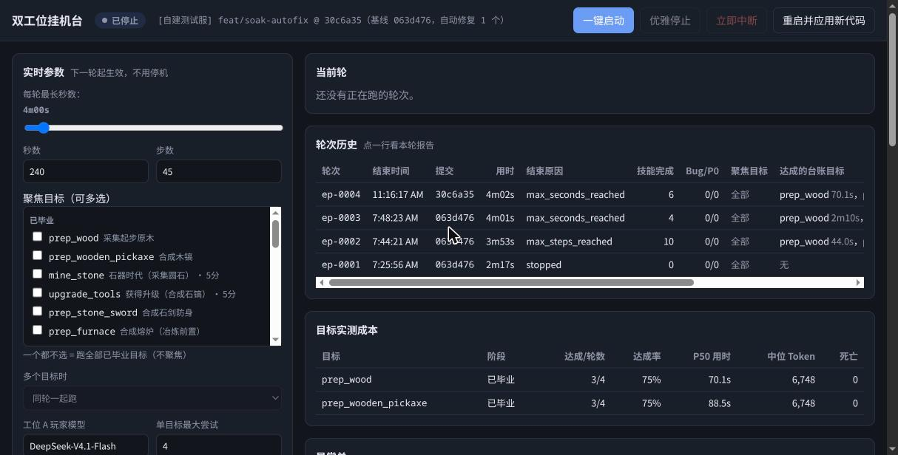
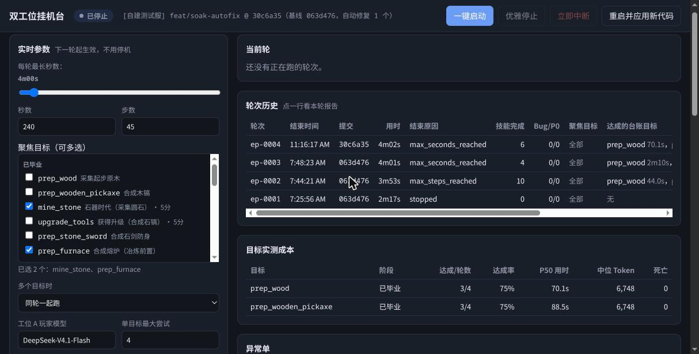
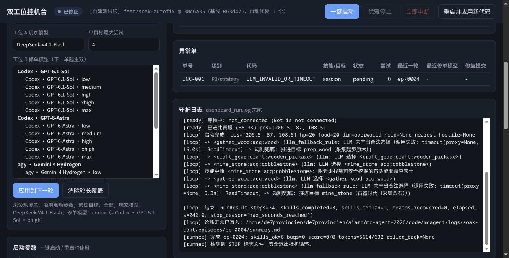
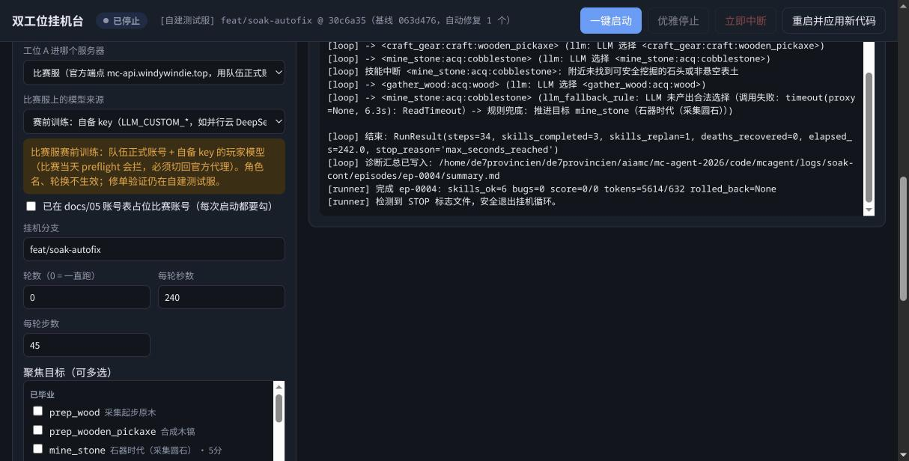
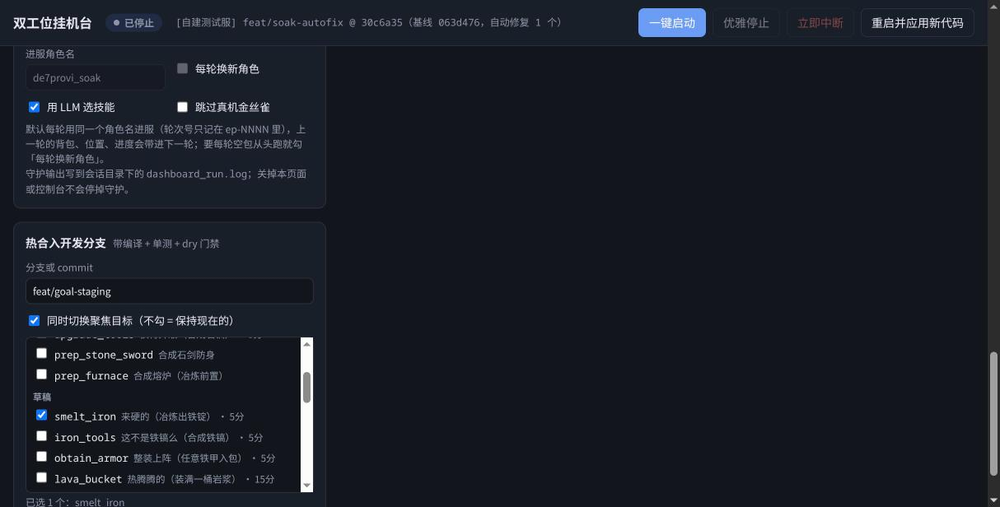
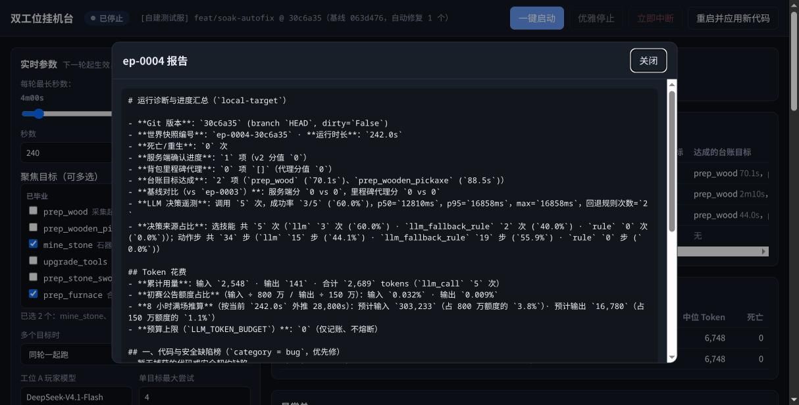

# 06 · 工作日志

> **每次改动都要在这里追加一条。** 最新的在最上面。
> 这是 `git log` 的补充，不是替代：`git log` 记"改了什么"，这里记"**为什么改、验证到哪一步、还剩什么**"。

## 这份日志有两个用途

1. **内部**：谁在改什么、为什么、验到哪一步。防止重复劳动，也防止下一个 agent 基于幻觉开工。
2. **评审**：工程评审 40 分里的「完善性 / 清晰度 / 可复现性 / 可维护性」，很大程度靠**过程记录**来证明。
   评委看不到我们 11 天的挣扎，只看到仓库；日志是他们唯一能看到的"决策过程"。

所以每条都要**能被外人读懂**：写"试了什么、为什么放弃、结论是什么"，而不是"又改了一版"。
凡是能证明工程能力的（发现问题 → 假设 → 验证 → 结论 → 回退），标 `评审价值：有`，
最后交材料时从这些条目里筛。

## 三条禁令

1. 不写账号、密码、token、任何密钥。
2. 不写对其他队伍的负面评价（这条会被外人看到）。
3. 不写没有依据的猜测——那种东西进 `docs/04-待确认.md`。

## 条目模板

```
### YYYY-MM-DD HH:MM · <agent id 或人名> · <一句话标题>

- **改**：文件或模块（列出来，别写"若干"）
- **为什么**：一句话动机
- **验证**：跑过什么、结果如何；没验证就写"未验证"
- **遗留**：新的待确认项（同时登记到 docs/04）
- **评审价值**：有 —— <证明了什么工程能力> / 无（纯内部协调）
```

---

### 2026-11-21 18:06 · antigravity · `soak8h_deep/seg-18` 残血近敌紧急抢占、低血禁下钻矿、滞空防跳水崖与受击短超时出水（`9264d1f`，`verified: offline`）

- **改**（`feat/arch-converge-v2-agy`，代码与单测独立提交 `9264d1f`，本日志单独提交）：
  - [runtime.py](../code/mcagent/runtime.py)：`Safety.hazards()` 在非脱险态且残血无甲（`hp <= hp_crit=6.0`）遇近身敌怪（`dist <= 4.5m`）或近距远程射手（`<= 8.0m`）时，将 `flee` 由 `soft` 升格为 **`urgent`**，立即 `/stop` 抢占正在进行的挖矿/移动，防止残血 1.5s 内无抢占被一击毙命；
  - [diamond.py](../code/mcagent/skills/diamond.py)：`MineDiamond.blocked()` 对齐 `SmeltIron` 守卫，无钻石且低血无甲无盾（`hp <= 8.0`）时禁止下探深层采钻；
  - [escape.py](../code/mcagent/skills/escape.py)：
    1. `_is_sprint_yaw_safe(..., avoid_water=False)` 脚下悬空/起跳滞空时将实心/水体探测扩深至 `dy = -1..-6` 及四向邻列，彻底修复 `Y=68.2` 滞空于 9 格深水峡谷边因 `dy=-1,-2` 全空气被误判为“空壳单测世界”从而放行冲崖入水的盲区；同时支持 `avoid_water=True` 拒绝干地疾跑跳入水体，并在 `_pick_cliff_safe_yaw()` 与 `_flee_hostile()` 干地分支启用；
    2. `escape_water_to_shore()` 新增敌怪感知：遇 `<=16m` 敌怪或 6s 内受击且已浮出水面时直接移交 `_flee_hostile()`，水下受击登岸改用 `_find_safe_dry_shore_away()` 并将 `move_to` 超时由 **`15.0s` 压紧至 `2.2s`**，根除在水中 7 秒长 `move_to` 站桩连吃两箭（`-7.0 HP`）的致命链路；
  - [test_soak_deep_seg01_deaths.py](../code/tests/test_soak_deep_seg01_deaths.py)：新增 4 条 `seg-18` 离线回归单测，覆盖残血近敌 `urgent` 抢占、`MineDiamond.blocked()` 低血守卫、滞空峡谷防冲崖避水与受击水下 `<=2.2s` 超时压紧。
- **为什么**：
  - `soak8h_deep/seg-18` 前 20 分钟零死亡完成铁器链（`smelt_iron ×2`、`craft_iron_gear ×1`、8h 外推 input token 仅 **`8.9%`**），随后发生 2 次高典型度架构盲区死亡：
    1. **Death #1（`t=1216.0s`, `[-40.5, 2, 77.4]`）**：`hp=2.7` 无甲无盾下探 `mine_diamond` 至 `Y=2`，`zombie` 出现在 `2.3m` 持续 1.5s，因 `Safety.hazards()` 对非苦力怕非受击仅发 `soft flee`，未被抢占直接走进僵尸一击毙命；
    2. **Death #2（`t=1311.4s`, `[-32.7, 60.4, -16.3]`）**：`_flee_hostile()` 第二段疾跑在 `Y=68.2` 滞空时 `_is_sprint_yaw_safe` 误判为空壳世界放行冲下 9 格深水峡谷；落水后 `escape_water_to_shore()` 发起 15s 慢速 `move_to` 耗时 7.0s 连吃 2 箭（`10.3→3.3`），上岸后干地疾跑又未避水跳回水中被射杀。
- **验证**：
  - `uv run python -m compileall -q mcagent tests` 通过；
  - 定向单测（`test_soak_deep_seg01_deaths` / `test_escape_water` / `test_hard_mode_combat_safety` / `test_diamond`）111/111 OK；
  - `uv run python -m unittest discover -s tests` 全量 **1,765 / 1,765 OK**（53.6s）；
  - `uv run python -m mcagent.smoke --dry` 返回码 0；
  - 随即优雅 `SIGINT` 热重启 `soak8h_deep` 进入 `seg-19` 在线验证。
- **遗留**：热重启 `seg-19` 持续 5 分钟巡检验证上述 4 项安全与脱险修复（目标截止本地时间 `22:02`）。
- **评审价值**：有 —— 通过两次真实深压测死亡的毫秒级 `http_tape` 复盘，定位并系统性修复“残血近敌未抢占”“低血深矿未拦截”“起跳滞空误判空壳世界冲崖入水”“水下受击 15s 长寻路吃箭”四条串联盲区，形成高价值防线演进闭环。

---

### 2026-11-21 17:35 · antigravity · `soak8h_deep/seg-17` 水坑/河岸壁水平停滞识别、开放水道换向与垫脚/破拆土岸脱困（`091d60c`，`verified: offline`）

- **改**（`feat/arch-converge-v2-agy`，代码与单测独立提交 `091d60c`，本日志单独提交）：
  - [escape.py](../code/mcagent/skills/escape.py)：
    1. `_flee_hostile()` 水中疾跑泳离循环由 3D `math.dist` 改为水平位移 `moved_sw_xz = math.hypot(...)`，杜绝在 2 格高河岸壁/水坑原地上下扑腾（`Δy=0.7m, Δxz=0.0m`）被误判为有效前进、未写入 `tried_yaws` 导致 17 轮死撞同一岸壁的 `SKILL_POSTCONDITION_FAIL` 循环；
    2. `_find_safe_dry_shore_away()` 对 `dy >= 2` 不可直跳高岸施加 `-6.0` 惩罚，且水中循环仅当 `shore[1] <= cur_fy + 1`（1 格内可直接登岸）时才触发 `<=2.5m` 登岸 `move_to` 或把 `swim_yaw` 指向 `shore`，避免反复撞向 2 格土岸；
    3. `_pick_alternate_escape_yaw(..., in_water=True)` 兼容扫描可通行的开放水道（`water/air` + 头部非实心墙），不再只认干地格；
    4. 退出水中分支新增 `on_ground is not False` 守卫，防止水中跳跃 1 tick 腾空（`in_water=False`）误退循环落入撞墙 `move_to`；
    5. 新增 `_find_soft_bank_dig_cell()`，并在水中连续 2 次水平停滞（`water_stalls >= 2`）时执行三段脱坑：**有方块先垫脚（`_find_step_cell`）→ 尝试可直接登岸干岸（`y <= cur_fy + 1`）→ 无方块时快挖 1 格紧邻松软泥土/草/沙岸壁开台阶 → 兜底高岸 `move_to`**。
  - [test_soak_deep_seg01_deaths.py](../code/tests/test_soak_deep_seg01_deaths.py)：新增 2 条 `seg-17` 离线回归单测（`test_seg17_in_water_bobbing_uses_horizontal_xz_displacement_and_rotates_to_open_water`、`test_seg17_water_pit_trap_digs_soft_bank_after_two_horizontal_stalls`）。
- **为什么**：
  - `soak8h_deep/seg-17` 前 5 分钟零死亡零异常且 `seg-16` 单候选节流把 8h 外推 input token 占比从 `98.2%` 压至 **`11.3%`**（降幅 >5×）；但在 `t=490.6s` 与 `t=600.9s` 发生 2 次死亡并在 `[-87.7, 62.4, 13.3]` 触发 17 次连续 `SKILL_POSTCONDITION_FAIL`，根因完全同源：角色在 2 格高河岸/水坑中竖直扑腾产生的 `Δy=0.7m` 骗过 3D 位移检查，使 `tried_yaws` 为空且永远不转向开放水道，陷坑无方块时又缺少破拆松软土岸脱困路径。
- **验证**：
  - `uv run python -m compileall -q mcagent tests` 通过；
  - `uv run python -m unittest tests/test_soak_deep_seg01_deaths.py tests/test_escape_water.py tests/test_hard_mode_combat_safety.py` 78/78 OK；
  - `uv run python -m unittest discover -s tests` 全量 **1,761 / 1,761 OK**（52.3s）；
  - `uv run python -m mcagent.smoke --dry` 返回码 0（直连 `127.0.0.1:8787` 4ms）；
  - 随即优雅 `SIGINT` 热重启 `soak8h_deep` 进入 `seg-18` 在线验证。
- **遗留**：热重启 `seg-18` 后持续 5 分钟巡检验证水坑/河岸逃敌脱困与主线推进（原定总时长至本地时间 `22:02`）。
- **评审价值**：有 —— 通过压测死亡与 17 次空转循环回溯，定位出水中逃敌 3D/水平位移判据混淆与 2 格岸壁物理不可直跳的系统性几何盲区，以水平位移停滞检测 + 开放水道寻向 + 垫脚/破拆松软土岸三级脱坑根治，并配齐物理几何离线回归。

---

### 2026-11-21 17:16 · antigravity · `soak8h_deep/seg-16` 残血无甲远程预警扩至 14m、暗洞粗铁不足守卫与单候选目标免 LLM 节流（`2fd94f5`，`verified: offline`）

- **改**（`feat/arch-converge-v2-agy`，代码与单测独立提交 `2fd94f5`，本日志单独提交）：
  - [runtime.py](../code/mcagent/runtime.py)：`effective_hostile_flee_dist()` 在残血（`hp <= hp_crit=6.0`）且无甲时将远程射手（`skeleton/stray/bogged/pillager/parched`）逃跑预警距由 `10.0m` 扩至 **`14.0m`**；同时修正 `Safety.hazards()` 当已存在 `soft flee` 时若 `recent_hurt` 满足残血抢占条件须将其升格为 `urgent` 而不再被 `emitted_flee` 遮蔽；
  - [iron.py](../code/mcagent/skills/iron.py)：`SmeltIron.blocked()` 新增残血无甲无盾身处暗洞且粗铁不足（`hp<=6.0, raw_iron<3, Y<58`）阻断；`_collect()` 在 `hp<=8.0` 无甲无盾时不再继续下洞追矿（已有少量粗铁直接返回熔炼，否则 `Replan`）；
  - [strategy_async.py](../code/mcagent/loop/strategy_async.py)：`dispatch_async_objective()` 在 `len(ctx.eligible_goals) <= 1` 时短路跳过异步 LLM 请求，杜绝搜图期唯一可选目标高频空烧 Token；
  - [test_soak_deep_seg01_deaths.py](../code/tests/test_soak_deep_seg01_deaths.py)（+1 项）：复现 `seg-16` `t=1409.9s` 暗洞残血 `hp=5.4` + 骷髅 `10.3m` 场景并同步对齐 `seg-01` 脱险后距离断言。
- **为什么**：`soak8h_deep/seg-16` 连续 **23.6 分钟 0 死亡、0 P0、0 `busy`、`emergency_escape 20/22` 零缺陷**，但在 `t=1409.9s` 吃肉回血至 `hp=5.4` 时，因背包已有 1~2 块粗铁绕过了旧 `not has_iron_input` 守卫，且 `10.3m` 骷髅略超旧 `10.0m` 阈值，导致 `smelt_iron` 在 `Y=51` 暗洞直撞骷髅阵亡；此外开局 5 分钟搜图期在仅剩 1 个可选目标时仍高频发 LLM 请求 28 次消耗 8.7 万 Token。
- **验证**：`compileall` 退 `0`；`mcagent.smoke --dry` 退 `0`；全量 `unittest discover -s tests` **`1,759 / 1,759 OK`**（`52.012s`，0 失败 0 跳过）。
- **遗留**：立即 `SIGINT` 优雅退出 `seg-16` 并热重启切入 `seg-17`（沿用同一账号与 `world_memo.json`，动态计算 `--max-seconds` 对齐至 **`22:02:00`** 满 8 小时截止）。
- **评审价值**：有 —— 同时修补残血暗洞部分持矿绕过守卫、残血远程预警与 `urgent hurt` 升格遮蔽及单候选 LLM Token 空烧三处系统性短板。

---

### 2026-11-21 16:44 · antigravity · `soak8h_deep/seg-15` 远距受箭识别与无盾二段疾跑一次性拉断骷髅 16m 射程（`bc7d957`，`verified: offline`）

- **改**（`feat/arch-converge-v2-agy`，代码与单测独立提交 `bc7d957`，本日志单独提交）：
  - [escape.py](../code/mcagent/skills/escape.py)：`_flee_hostile()` 将 6s 内 `recent_hurt` 的 `arrow`/`trident` 与远程敌怪受击纳入 `is_ranged`（即使更近处有僵尸也不漏判）；无盾遭远程追射时将 `flee_stride` 扩至 `18.0m`，并在 `move_to(2.2s)` 超时后的首段兜底疾跑位移通畅（`>=2.0m`）但仍处于 `18m` 射程且无掩体遮挡时顺势连补第二段 `800ms` 防跳崖疾跑跳；
  - [test_soak_deep_seg01_deaths.py](../code/tests/test_soak_deep_seg01_deaths.py)（+1 项）：精确复现 `seg-15` `t=45..78s` 夜间空手无盾被骷髅远射且近处另有僵尸的场景，验证 `flee_stride=18.0m` 与二段疾跑一次性拉出 `21.5m`。
- **为什么**：`soak8h_deep/seg-15` 运行期间 **0 缺陷、0 P0、0 `busy`、`emergency_escape 15/15`（`100%`）**，新版 `2.2s` 截断完全消除了卡滞；但在 `t=45..78s` 空手夜间山坡开局时，单次逃跑 `move_to(2.2s)+control(800ms)` 仅移 `11.5m` 停在 `14.8m`（仍落于骷髅 16m 仇恨/射程内），随后夜间守卫回 `idle` 站立 4~5s 连续挨 5 箭致死（且后半段因僵尸更近导致 `is_ranged` 为假）。
- **验证**：`compileall` 退 `0`；`mcagent.smoke --dry` 退 `0`；全量 `unittest discover -s tests` **`1,758 / 1,758 OK`**（`52.078s`，0 失败 0 跳过）。
- **遗留**：立即 `SIGINT` 优雅退出 `seg-15` 并热重启切入 `seg-16`（沿用同一账号与 `world_memo.json`，动态计算 `--max-seconds` 对齐至 **`22:02:00`** 满 8 小时截止）。
- **评审价值**：有 —— 将远程受击源与逃跑拉脱距离对齐 MC 骷髅 16m 仇恨机制，避免无盾空手在开阔地反复“跑 11m 停 5s 再挨箭”的慢性消耗死亡。

---

### 2026-11-21 16:33 · antigravity · `soak8h_deep/seg-14` 修复无敌怪 `void_risk` 踏回干地 `rng=1` 误报到达坠死与 `survey_island` 因残血 `heal` 意图误判振荡（`3903dce`，`verified: offline`）

- **改**（`feat/arch-converge-v2-agy`，代码与单测独立提交 `3903dce`，本日志单独提交）：
  - [escape.py](../code/mcagent/skills/escape.py)：`_flee_hostile()` 无敌怪 `void_risk` 踏回相邻实心安全格的 `_move_to_bounded()` 由 `rng=1` 改为 **`rng=0`**，并在返回后严格校验 `alive` 与 `on_ground` / 脚下实心支撑块，杜绝角色悬空于 4 格坑口距目标中心 `1.0m` 时 `30ms` 误报到达继续坠落；
  - [survey.py](../code/mcagent/skills/survey.py)：`_has_active_threat()` 收窄为仅响应活跃逃生类安全意图（`flee/douse/escape_lava/lava/surface/void_risk`）或近身敌怪/物理险情，不再因无怪残血挂 `soft heal` 意图反复中断 `survey_island` 造成 `REPLAN_OSCILLATION`；
  - [test_soak_deep_seg01_deaths.py](../code/tests/test_soak_deep_seg01_deaths.py)（+2 项）：精确复现 `seg-14` `INC-002`（`hp=0.7` 坑口 `void_risk`）与 `INC-001`（`heal` vs `flee` 意图判定）。
- **为什么**：`soak8h_deep/seg-14` 运行 11.5 分钟期间 **0 P0、0 `busy`、`emergency_escape` 战时脱险 `41/45` 零战斗死亡**（`t=691.2s` 实测夜间水中主动 `surface: in_water_night` 0.8s 脱险生效），但暴露两处精准边界问题：① `t=391.3s` 角色残血 `hp=0.7` 悬空 4 格坑口，`void_risk` 脱险用 `rng=1` 在 `30ms` 内误报到达未离坑口导致跌落 4 格扣 `1.0` 血阵亡；② 低血量无怪期间 `survey_island` 因 `safety_intent=heal` 连续 5 次中途让位触发 `REPLAN_OSCILLATION`。
- **验证**：`compileall` 退 `0`；`mcagent.smoke --dry` 退 `0`；全量 `unittest discover -s tests` **`1,757 / 1,757 OK`**（`52.343s`，0 失败 0 跳过）。
- **遗留**：立即 `SIGINT` 优雅退出 `seg-14` 并热重启切入 `seg-15`（沿用同一账号与 `world_memo.json`，动态计算 `--max-seconds` 对齐至 **`22:02:00`** 满 8 小时截止）。
- **评审价值**：有 —— 消除 `move_to(rng=1)` 与单格落脚安全判定间的几何语义偏差（1 格容差足以跨越坑缘），并厘清“被动回血意图”与“活跃威胁让位”的边界契约。

---

### 2026-11-21 16:17 · antigravity · `soak8h_deep/seg-13` 压紧逃跑 `move_to` 2.2s 超时防 5s 卡滞致死、扩宽连段疾跑并修复桥接层进食超时错报 P0（`1cc9e8c` + `06ef9e3`，`verified: offline`）

- **改**（`feat/arch-converge-v2-agy`，桥接层 `1cc9e8c`、主仓代码与单测 `06ef9e3`、本日志三笔独立提交）：
  - [bot_session.js](../tools/local-api-bridge/lib/bot_session.js) + [bot_session.test.js](../tools/local-api-bridge/test/bot_session.test.js)（`1cc9e8c`）：`useItem(food)` 捕获 Mineflayer `bot.consume()` 抛出的 `Promise timed out.` 并释放 `deactivateItem()`，映射为可重试业务码 `timeout`（不再默认透传 HTTP 400 `bad_args` 引发客户端误判 P0 `CONTRACT_OR_FATAL_ERROR`）。
  - [escape.py](../code/mcagent/skills/escape.py)（`06ef9e3`）：
    1. `_flee_hostile()` 兜底 `move_to` 超时上限由 `5.0s` 压紧至 **`2.2s`**，且失败兜底疾跑同步传入 `avoid_water` 与 `tried_yaws`，杜绝地形/矿洞墙体导致 pathfinder 卡滞 5 秒连吃 3~4 击致死；
    2. 首段 `<2.5m` 疾跑后的连段续跑阈值由 `<3.5m` 扩宽至 **`<=5.5m`（远程 `<=6.5m`）** 并允许最多连补 2 段，精准覆盖首段拉开后掠夺者恰处 `3.5m` 的漏判边界；
    3. `already_los_blocked` 掩体后撤阈值由 `>=3.0m` 提至 `>=4.5m` 并补加 `jump=True` 与 `tried_yaws` 记录；若掩体后撤撞墙受阻（`burst_blocked`）且敌怪 `<=5.0m`，先沿替代安全角带跳疾跑再考虑 `move_to`；
  - [test_soak_deep_seg01_deaths.py](../code/tests/test_soak_deep_seg01_deaths.py)（+3 项）与 [test_escape_water.py](../code/tests/test_escape_water.py)（对齐新 `timeout=2.2`）：精确复现 `seg-13` 两起死亡与 `2.2s` 超时契约。
- **为什么**：`soak8h_deep/seg-13` 创下 **53.8 分钟连续 0 死亡**、完成炼铁与铁装打造并实测验证 1.21.11 `bee_nest` 字符串 `honey_level:'5'`，但随后 96 秒内因同一根因连死两次（`INC-008`）：
  1. `t=3221..3226s` 矿洞掩体后撤撞墙 `0m` 后直接跌入 `move_to(..., timeout=5.0)` 撞向矿洞实心墙，原地停滞 `5008ms`（仅移 `0.9m`）连吃骷髅两箭（`10.3→6.3→1.3→0`）；
  2. `t=3318..3323s` 首段疾跑移出 `5.1m` 后掠夺者恰处 `3.5m` 漏过 `<3.5` 判断，跌入 `move_to(..., timeout=5.0)` 原地卡滞 `4691ms`（仅移 `1.1m`），连吃掠夺者 1 箭 + 僵尸 3 刀（`12.4→8.4→5.4→2.4→0`）；
  3. 同步顺手根治 `t=496.8s` 单发桥接层 P0（`INC-004` `bad_args (Promise timed out.)`）。
- **验证**：Node 桥接层 `npm test` **`16/16 PASS`**；Python `compileall` 退 `0`；`mcagent.smoke --dry` 退 `0`；全量 `unittest discover -s tests` **`1,755 / 1,755 OK`**（`52.383s`，0 失败 0 跳过）。
- **遗留**：立即 `SIGINT` 优雅退出 `seg-13`、热重启本地桥接网关并切入 `seg-14`（沿用同一账号与 `world_memo.json`，对齐至 **`22:02:00`** 满 8 小时截止）。
- **评审价值**：有 —— 通过两起不同地形（矿洞骷髅 vs 地表掠夺者+僵尸）死亡的毫秒级 HTTP 磁带交叉比对，锁定共同瓶颈 `move_to(timeout=5.0)` 站桩窗口与 `<3.5m` 边界盲区并架构级收敛，同时清零桥接层 P0 错误码映射缺陷。

---

### 2026-11-21 15:12 · antigravity · `soak8h_deep/seg-12` 根治河岸逃跑跳水、水中 5s `move_to` 卡滞吃三叉戟与夜间水中空闲下沉（`5784c50`，`verified: offline`）

- **改**（`feat/arch-converge-v2-agy`，代码与单测独立提交 `5784c50`，本日志单独提交）：
  - [escape.py](../code/mcagent/skills/escape.py)：
    1. 新增 `_path_enters_water()`，并在 `_resolve_flee_vector(avoid_water=not in_water)` 中对干地逃离方向引入河道入水重罚（`-22.0`），同时在干地 `flee_stride` 落点入水时自动收缩至安全干岸，避免河岸遇怪反跳进河道；
    2. 新增 `_find_safe_dry_shore_away()` 与 `_flee_hostile()` 专属**水中短步疾跑游泳分支**（最多 3 轮 `800ms` `control(forward=True, sprint=True, jump=True)`，仅在紧贴安全干岸 `<=2.5m` 时发 `2.5s` 短距 `move_to` 登岸），彻底禁止水中触发 5s 阻塞跨河 `move_to` 原地扑腾卡滞；
    3. `_score_escape_dir()` 将水中或刚偷袭的 `drowned` 纳入远程高危威胁权重（`1.8×` / 偷袭叠加 `1.6×`）；
  - [policy.py](../code/mcagent/loop/policy.py)：`_extract_escape_intent()` 在 `in_water` 且处于夜间（`is_daytime is False`）、`submerged`、18m 内有敌怪或刚受击（6s 内）时立即派发 `surface` 登岸，杜绝逃跑刚结束就进入 7~8s LLM 决策空闲导致垂直下沉至河底（`y=57.4, oxy=10`）；白天安全水域（`oxygen>10` 无怪）保持不误触发；
  - [runtime.py](../code/mcagent/runtime.py)：`Safety.hazards()` 将 `source="trident"` 与 `drowned` 补入远程受击应急逃跑判定（残血 `hp <= hp_crit` 升格 `urgent`）；
  - [test_soak_deep_seg01_deaths.py](../code/tests/test_soak_deep_seg01_deaths.py)（+4 项）：精确复现 `seg-12` 河岸逃离避水、水中遇苦力怕+溺尸使用疾跑游泳而非 5s `move_to`、夜间水中主动 `surface` 与三叉戟受击触发 `urgent flee`。
- **为什么**：`soak8h_deep/seg-12` 启动后 0 P0、0 `busy`，但 `t=103..182.7s` 夜间在河岸发生 1 次系统性四连链死亡（`INC-001`）：干地遇苦力怕时 `_flee_hostile` 两次把 16m 落点直接投向河道（`t=103s` 与 `t=147s`）导致跳水；脱险结束因 `oxy=20` 未登岸即进入 7~8s LLM 规划而两次沉到河底（`y=57.4, oxy=10`）；随后水中逃敌连续 5 次触发 5s 阻塞 `move_to` 全部超时，最后一次在 `[-9.5, 62.x, -82.5]` 原地扑腾 3.5s 被溺尸三叉戟连续 3 发（`8×3=24` 伤：`18.3→10.3→2.3→0`）击杀。
- **验证**：`compileall` 退 `0`；`mcagent.smoke --dry` 退 `0`；全量 `unittest discover -s tests` **`1,752 / 1,752 OK`**（`50.602s`，0 失败 0 跳过）。
- **遗留**：立即 `SIGINT` 优雅退出 `seg-12` 并热重启切入 `seg-13`（沿用同一账号与 `world_memo.json`，动态计算 `--max-seconds` 对齐至 **`22:02`** 满 8 小时截止）。
- **评审价值**：有 —— 完整还原“河岸跳水 → 空闲下沉 → 水中 A* 5s 卡死 → 溺尸三叉戟三连点杀”四层因果链并从向量避水、水中短步泳逃、夜间主动登岸与三叉戟威胁感知四处架构级闭环根治。

---

### 2026-11-21 14:53 · antigravity · `soak8h_deep/seg-11` 修复残血被追击时站桩进食抢占逃跑的优先级倒置（`385384d`，`verified: offline`）

- **改**（`feat/arch-converge-v2-agy`，代码与单测独立提交 `385384d`，本日志单独提交）：
  - [policy.py](../code/mcagent/loop/policy.py)：`_is_urgent_escape_hazard()` 将优先于 `eat_food` 的非苦力怕近怪半径由过窄的 `<= 2.5` 格提升至 `flee_dist`（`6.0m`），残血（`hp <= 8.0`）或无甲（`hp < 12.0`）时提升至 `effective_hostile_flee_dist`（`9~10m`），确保 1.6s 站桩进食只会在拉开安全距离后触发；
  - [test_soak_deep_seg01_deaths.py](../code/tests/test_soak_deep_seg01_deaths.py)（+1 项）：精确复现 `seg-11` `t=637s`（`hp=0.9` 无甲、僵尸距 `5.5m` 持羊肉）断言优先派发 `emergency_escape(flee)`，拉开至 `12m` 后再进食。
- **为什么**：`soak8h_deep/seg-11` 11 分钟推进 330 步、完成 `smelt_iron` 并新探明 `plains` 群系（`landmark_version=76`），但在 `t=637.3s` 发生 1 次死亡：首轮逃跑后残血 `hp=0.9`、僵尸仍在 `5.5m` 紧追，`eat_food` 抢先于 `emergency_escape` 令角色原地站桩 1.56s 啃生羊肉，被僵尸走近至 `2.0m` 一击秒杀。
- **验证**：`compileall` 退 `0`；`mcagent.smoke --dry` 退 `0`；全量 `unittest discover -s tests` **`1,748 / 1,748 OK`**（`50.375s`，0 失败 0 跳过）。
- **遗留**：立即 `SIGINT` 优雅退出 `seg-11` 并热重启切入 `seg-12`（沿用同一账号与 `world_memo.json`，`--max-seconds 25680` 对齐至 **`22:02`** 满 8 小时截止）。
- **评审价值**：有 —— 按 MC 进食 1.61s 静止物理时序对齐逃跑与进食优先级，根除残血原地啃肉被追杀的典型生存误判。

---

### 2026-11-21 14:38 · antigravity · `soak8h_deep/seg-10` 无甲深洞铁矿守卫收紧与近怪紧追二次疾跑刷新向量修复（`2aa105b`，`verified: offline`）

- **改**（`feat/arch-converge-v2-agy`，代码与单测独立提交 `2aa105b`，本日志单独提交）：
  - [iron.py](../code/mcagent/skills/iron.py)：`SmeltIron._ore_candidates()` 在无甲无盾时将深洞远矿过滤阈值由 `hp <= 10.0` 扩展为 `hp <= 12.0 or (hp < 16.0 and inventory_food_restore(state) < 4)`，阻止残血无粮裸装在暗洞反复追逐不可达暴露矿至入夜遭伏击；
  - [escape.py](../code/mcagent/skills/escape.py)：`_flee_hostile()` 在首段贴脸疾跑后一律以最新坐标与实时 `mid_hostile` 重算背敌向量 `(ux, uz)`；若近怪紧追仍处于 `< 3.5` 格（即使首段移动 `>= 1.5` 格未撞墙），立即补一次防跳崖原生疾跑跳拉开近战圈，严禁带着旧向量/贴脸怪回退慢速 A* `move_to` 绕回怪嘴边；
  - [test_soak_deep_seg01_deaths.py](../code/tests/test_soak_deep_seg01_deaths.py)（+2 项）：精确复现 `seg-10` `hp=10.3` 无粮深洞矿过滤与首段疾跑后僵尸紧追 `< 3.5m` 二次疾跑脱险。
- **为什么**：`soak8h_deep/seg-10` 实测前轮 `tried_yaws` 换向脱险生效（夜间遇蜘蛛保持连续位移零卡死），0 P0、0 `busy`，但 `t=62..152s` 发生 1 次死亡：`hp=10.3` 无甲无盾无粮时 `smelt_iron` 在 `Y=48` 暗洞连追 3 处不可达暴露矿 87s 至天黑遇僵尸，且首段疾跑移出 2.3m 后僵尸紧追至 `0.8m`，因未刷新向量且未补二次疾跑导致后续 `move_to` 绕回僵尸身旁阵亡。
- **验证**：`compileall` 退 `0`；`mcagent.smoke --dry` 退 `0`；全量 `unittest discover -s tests` **`1,747 / 1,747 OK`**（`49.589s`，0 失败 0 跳过）。
- **遗留**：立即 `SIGINT` 优雅退出 `seg-10` 并热重启切入 `seg-11`（沿用同一账号与 `world_memo.json`，`--max-seconds 26580` 对齐至 **`22:02`** 满 8 小时截止）。
- **评审价值**：有 —— 消除贴脸首段疾跑后因敌人紧追与过时逃跑向量叠加引发的 A* 回绕致死缺陷。

---

### 2026-11-21 14:28 · antigravity · `soak8h_deep/seg-09` 禁水中/外圈苦力怕恋战、疾跑脱险 `tried_yaws` 防重复撞墙与夜间空手重生守卫补齐（`731e11f`，`verified: offline`）

- **改**（`feat/arch-converge-v2-agy`，代码与单测独立提交 `731e11f`，本日志单独提交）：
  - [combat_eval.py](../code/mcagent/skills/combat_eval.py)：`decide_combat_or_flee()` 新增 `in_water`（此前仅判 `submerged`）与 16m 外圈苦力怕（无盾时）强制撤离，禁止在水中移速减半或有苦力怕逼近时与近身僵尸对砍；
  - [escape.py](../code/mcagent/skills/escape.py)：
    - `_pick_alternate_escape_yaw()` 支持传入 `tried_yaws`，跳过与此前受阻角度夹角 `< 0.65 rad` 的方向并在 8 个候选方向中强制旋转换向；
    - `_flee_hostile()` 在贴脸疾跑、撞墙二次疾跑与高速追击怪（蜘蛛等）三段连跑中全程累积 `tried_yaws`，并在连续 2 个不同角度均位移 `< 0.5` 格时退出连跑落入 A* `move_to` 绕障脱困；同时水中苦力怕 `<= 6.5m` 立即触发原生疾泳脱险；
  - [policy.py](../code/mcagent/loop/policy.py)：Step 8.5 夜间空手无甲重生驻留分支用 `not has_bed_ready` 替换 `safe_12`，防止无床空手重生因敌怪游荡至 `11m` 而被放行出门裸奔砍树；
  - [test_soak_deep_seg01_deaths.py](../code/tests/test_soak_deep_seg01_deaths.py)（+3 项）：精确复现 `seg-09` Death #1（水中+外圈苦力怕）、Death #2（蜘蛛连跑 `tried_yaws` 换向）与 `t=60.9s` 夜间空手重生驻留。
- **为什么**：`soak8h_deep/seg-09` 实测 `busy: dig` 死锁归零（0 `busy`），但暴露两次死亡：① Death #1（`t=30.2s`）：水中持石镐因 `can_evade=False` 强行反杀僵尸，4s 期间 13.1m 外苦力怕走近至 2.1m 引爆；② Death #2（`t=195.8s`）：夜间空手重生因 `safe_12=False` 出门砍树，随后遭蜘蛛贴脸时 `_pick_alternate_escape_yaw` 无状态连续 3 次返回同一受阻角度 `yaw=0.0` 挨咬掉 12 血。
- **验证**：`compileall` 退 `0`；`mcagent.smoke --dry` 退 `0`；全量 `unittest discover -s tests` **`1,745 / 1,745 OK`**（`50.984s`，0 失败 0 跳过）。
- **遗留**：立即 `SIGINT` 优雅退出 `seg-09` 并热重启切入 `seg-10`（沿用同一账号与 `world_memo.json`，`--max-seconds 27240` 对齐至 **`22:02`** 满 8 小时截止）。
- **评审价值**：有 —— 消除水中/外圈苦力怕反杀误判与高速怪脱险无状态重复撞墙两处核心战斗存活盲区。

---

### 2026-11-21 14:14 · antigravity · `soak8h_deep/seg-08` 双端根治 `busy: dig` 永久动作锁死锁（`504ac2e` + `f315c83`，`verified: offline`）

- **改**（`feat/arch-converge-v2-agy`，桥接与核心代码零耦合分别独立提交 `504ac2e` / `f315c83`，本日志单独提交）：
  1. **本地联调桥接层（`504ac2e`，[bot_session.js](../tools/local-api-bridge/lib/bot_session.js)、[bot_session.test.js](../tools/local-api-bridge/test/bot_session.test.js)）**：
     - `dig()` 新增 `digCancellable()` 监听 `signal` 并在 abort 时调 `bot.stopDigging()` 立即 reject，解决 Mineflayer `bot.dig(blk)` 在 `stopDigging()`/`quit()` 后永不 settle 导致 `_runAction` `finally` 不释放 `this.busy` 的死锁；
     - `disconnect()` 强制清空 `this.busy`/`_actionToken`/`_currentAbort`/`_actionDone`/`usingItemState`，`_runAction` `finally` 用 `actionToken` 防旧异步收尾误清后续会话锁；
     - 新增 Node 单测覆盖挂死 `dig()` 下 `stop()` 与 `disconnect()` 双路径释放 `session.busy === null`。
  2. **Agent 主循环客户端自愈（`f315c83`，[engine.py](../code/mcagent/loop/engine.py)、[test_soak_deep_seg01_deaths.py](../code/tests/test_soak_deep_seg01_deaths.py)）**：
     - `MainLoop` 新增 `_unreleased_busy_streak` 与 `_recover_stuck_busy_session()`：当技能因 `busy` 失败且 `/stop` 返回 `released=False`（`Executor.stop(raise_on_error=True)` 抛 `busy`）连续达 3 次时，自动执行 `/disconnect` + `/connect` + `wait_ready` 重建会话，确保即便正式比赛服出现未释放动作锁也能在 ~15s 内自愈而非整场僵死；
     - 新增离线回归单测 `test_main_loop_reconnects_after_3_unreleased_busy_stops`。
- **为什么**：`soak8h_deep/seg-07` `SIGINT` 退出时正处于 `dig` 阻塞动作，Mineflayer `bot.dig()` 挂死且旧桥接 `disconnect()` 未清 `this.busy`，导致 `seg-08` 复用同账号会话后连续 7 分钟 `76/76` 次 `move_to` 全部返回 `busy (Another action (dig) is currently executing)`，有效步数完全停滞。
- **验证**：`tools/local-api-bridge` `npm test` **15/15 PASS**；Python `compileall` 退 `0`；`mcagent.smoke --dry` 退 `0`；全量 `unittest discover -s tests` **`1,742 / 1,742 OK`**（`55.267s`，0 失败 0 跳过）。
- **遗留**：立即 `SIGINT` 停止 `seg-08`、重启本地联调网关加载 `504ac2e`，并按距 **`2026-11-21 22:02`**（自 14:02 起满 8 小时）的剩余秒数热重启切入 **`seg-09`**，持续每 5 分钟巡检。
- **评审价值**：有 —— 从真机热重启暴露出 Mineflayer `bot.dig` 断线挂死锁的跨端系统级死锁，在桥接侧与 Agent 主循环侧分别构建无耦合双保险自愈机制，消除 8 小时正式赛遭遇服务端锁死的风险。

---

### 2026-11-21 13:59 · antigravity · `soak8h_deep/seg-07` 夜间残血守卫去 `safe_12` 缺口、无盾苦力怕瞬时疾跑与扇区体检近怪让位修复（`54e8d2b`，`verified: offline`）

- **改**（`feat/arch-converge-v2-agy`，代码与单测独立提交 `54e8d2b`，本日志单独提交）：
  - [policy.py](../code/mcagent/loop/policy.py)：Step 8.5 夜间地表残血守卫移除 `safe_12` 与 `restore < 4` 限制（紧急敌怪与可食用食物已由上游 `choose_urgent_survival_or_safe_mode` 优先处置），防止夜间敌怪距 8~12 格导致 `safe_12=False` 时反而放行 1.1 血无甲角色外出执行 `survey_island`/`scout_island`/`breed_animal`；
  - [escape.py](../code/mcagent/skills/escape.py)：`_flee_hostile()` 在 `is_creeper and h_dist <= 3.5` 且无盾时新增即时防撞墙+防跳崖原生疾跑跳（`control(forward=True, sprint=True, jump=True, ms=900)`），避免跳过快速疾跑落入慢速 4.3m/s `move_to` 在 1.5s 引信内被炸死（持盾分支与 `>3.5m` 保持既有行为）；
  - [survey.py](../code/mcagent/skills/survey.py)：新增 `_has_active_threat(state, st)`，`survey_sector()` 在 `move_to` 抵达后、启动耗时 2~3s 的 `_sample_site()` 全量 `find_blocks` 之前若检测到待响应 `safety_intent` 或近身敌怪（苦力怕 `<7.0m` / 其他 `<5.5m`），立即返回 `aborted_threat=True` 由 `SurveyIsland.run()` 抛 `Replan` 毫秒级让位脱险；
  - [test_soak_deep_seg01_deaths.py](../code/tests/test_soak_deep_seg01_deaths.py)（+3 项）：精确复现 `seg-07` `t=318..337s` 三个环节。
- **为什么**：`soak8h_deep/seg-07` 实测前轮两项 P1 缺陷彻底归零（`eat_food` 3/3 全通、`emergency_escape` 由 442× 降至 17× 且 0 `STUCK_NO_PROGRESS`、0 `path_not_found`），但在 `t=337.6s` 午夜暴露 3 环苦力怕致死链：① 1.1 血无甲角色原本由 Step 8.5 稳定驻留 133s，因苦力怕走近至 ~10m 使 `safe_12=False` 反而被放行外出；② `survey_sector` 移动后未让位继续同步扫方块 2.4s 令苦力怕贴近至 2.8m 起爆；③ 无盾 `<=3.5m` 苦力怕跳过快速疾跑直接慢速 `move_to`，384ms 仅走 0.4 格即被炸死。
- **验证**：`compileall` 退 `0`；`mcagent.smoke --dry` 退 `0`；全量 `unittest discover -s tests` **`1,741 / 1,741 OK`**（`53.404s`，0 失败 0 跳过）。
- **遗留**：立即 `SIGINT` 优雅退出 `seg-07` 并热重启切入 `seg-08`（沿用同一账号与 `world_memo.json`），继续每 5 分钟巡检。
- **评审价值**：有 —— 补齐夜间残血避险守卫边界条件、无盾近身苦力怕物理时序（7.1m/s 疾跑 vs 1.5s 引信）与长扫描技能让位响应三处系统性盲区。

---

### 2026-11-21 13:48 · antigravity · `soak8h_deep/seg-06` 破除远程掩体 0 位移 442× 刷屏死循环与 `EatFood` 槽位延迟误报修复（`048a53e`，`verified: offline`）

- **改**（`feat/arch-converge-v2-agy`，代码与单测独立提交 `048a53e`，本日志单独提交）：
  - [escape.py](../code/mcagent/skills/escape.py)：
    - `_flee_hostile()` 先计算 `already_los_blocked = _is_ranged_los_blocked(...)`：
      - 当已在掩体后且 `h_dist >= 3.0` 时，短距疾跑前先检测正前墙体（`_is_yaw_wall_blocked` → `_pick_alternate_escape_yaw`）并在动作后校验真实水平位移 `>= 0.5` 格；若被地形角落卡住位移 `< 0.5` 格，不再原位返回 `True` 假完成，而是标记 `burst_blocked=True` 落入完整脱离流程（消除 102× 刷屏）；
      - 当 `already_los_blocked=True` 时不再反复进入 `_find_skeleton_cover_cell()` 或 `_try_place_ranged_barricade()`，且 `moved_cover` / `ok_strafe` 仅允许“位移 `>= 0.5` 格”或“从暴露态**新进入**射界阻断”时提前返回（消除 `h_dist=2.4m` 拐角处 18 秒 332× 刷屏）；
  - [starter_skills.py](../code/mcagent/loop/starter_skills.py)：`EatFood.run()` 记录 `food_before` 并读取 `use_item` 回执 `food > food_before` 作为已进食确认；若因 Mineflayer 槽位扣减包延迟 50–150ms 导致 `refresh_inventory` 仍见旧食物数量，主动 `state.invalidate_inventory()` 防下一拍重发撞上 `missing_item`；`EatFood.verify_done()` 同步接受饱食度上升确认，消除假阳性 `SKILL_POSTCONDITION_FAIL`；
  - [test_soak_deep_seg01_deaths.py](../code/tests/test_soak_deep_seg01_deaths.py)（+3 项）：精确复现 `seg-06` Cluster 1（掩体贴墙 0 位移落入真实远逃）、Cluster 2（拐角 2.4m 骷髅跳过 0 位移 cover 直接疾跑）与 `INC-002`（`use_item` 确认 `17->19` 且背包同步延迟 1 拍）。
- **为什么**：`soak8h_deep/seg-06` 实测前 343s 实现 **0 死亡**、进度 `8 -> 9`、`survey_island` 3/3 全通（新增 `river` 群系、`landmark_version=21`、`spiral_cursor=ring 1`）且 `smelt_iron` `void_risk` 震荡归零，但暴露两处 P1 缺陷：① `INC-001`（`STUCK_NO_PROGRESS` ×35）：两处 `skeleton_cover` 0 位移假完成分支合计刷屏 434 次；② `INC-002`（`SKILL_POSTCONDITION_FAIL: eat_food` ×2，亦曾见于历史 `run-16/23/24`）：进食后服务端槽位包滞后触发误报与紧随 `missing_item`。
- **验证**：`compileall` 退 `0`；`mcagent.smoke --dry` 退 `0`；全量 `unittest discover -s tests` **`1,738 / 1,738 OK`**（`54.528s`，0 失败 0 跳过）。
- **遗留**：立即 `SIGINT` 优雅停止 `seg-06` 并热重启切入 `seg-07`（沿用同一账号与 `world_memo.json`），持续每 5 分钟巡检核实 `STUCK_NO_PROGRESS` 与 `eat_food` 误报清零。
- **评审价值**：有 —— 根治两处高频真机假阳性/刷屏循环（434× 零位移掩体空转与跨多轮复现的 Mineflayer 进食槽位同步竞态），显著提升长跑有效推进占比。

---

### 2026-11-21 13:37 · antigravity · `soak8h_deep/seg-05` 悬崖矿全局 `void_risk` 拉黑、零敌怪防跳崖脱险、低血无甲深洞守卫与窄洞撞墙二次疾跑修复（`a054652`，`verified: offline`）

- **改**（`feat/arch-converge-v2-agy`，代码与单测独立提交 `a054652`，本日志单独提交）：
  - [iron.py](../code/mcagent/skills/iron.py)：
    - `SmeltIron._collect()` 遇 `void_risk` 抢占时改为非站位绑定全局拉黑（`voxel_cache.mark_unreachable(..., stance_cell=None, ttl_s=300.0)`）并同步写入落点区块的 `_session_excluded_for`，根治脱险位移跨区块或 `clear_stance_blacklist_if_moved()` 清空黑名单后连续 3 次重复走向同一悬崖矿的震荡（`INC-001`）；
    - `SmeltIron.blocked()` 新增低血无甲无盾下矿守卫（`overworld` 且无粗铁/无就绪铁租约、`hp <= 8.0`、无甲无盾时暂缓下矿，优先回地表补粮回血；有粗铁或就绪租约时仍允许熔炼补盾）；
    - `SmeltIron._ore_candidates()` 在 `hp <= 10.0` 无甲无盾时过滤 `Y < 58` 且距当前位置较远/下探的深洞暴露铁矿，防止残血裸装直冲 `Y=42` 怪洞；
  - [escape.py](../code/mcagent/skills/escape.py)：
    - `_flee_hostile()` 新增无敌对生物的 `void_risk` 安全落脚分支（若已在实心干地则立即返回 `True`，否则仅短距移至 `_find_dry_shore` 确认的邻近实心地面，严禁无怪时发盲目 12 格 `move_to` + 疾跑跳下峡谷）；
    - `_is_sprint_yaw_safe()` 修复滞空/滑出崖边时因脚下为空气而跳过悬崖/岩浆前瞻检查的盲区（周邻存在可观测实心地形时必须执行前瞻）；
    - `_flee_hostile()` 在贴脸近战（`h_dist < 2.5`）首段疾跑前先检测正前墙体避障，若首段疾跑仍撞墙受阻（`burst_blocked=True`）且近怪仍在 `< 4.5` 格，立即改沿 `_pick_alternate_escape_yaw` 畅通侧向通道执行二次快速疾跑脱险并检查 `alive is False`，不再先卡进慢速 `move_to` 挨打致死；
  - [test_soak_deep_seg01_deaths.py](../code/tests/test_soak_deep_seg01_deaths.py)（+4 项）与 [test_hard_mode_combat_safety.py](../code/tests/test_hard_mode_combat_safety.py)（同步移除已被即时正交疾跑绕过的旧 `move_to` 回执）。
- **为什么**：`soak8h_deep/seg-05` 实测 0 P0 缺陷、`dig` 24/24（100%）、0 `path_not_found`，但在 `t=184..266s` 暴露 4 环叠加致死链（`INC-001` + `INC-002`）：① `smelt_iron` 走向悬崖矿 `[-40, 60, 92]` 触发 `void_risk`，因原黑名单绑定 `stance_cell` 且分区块存储，脱险位移后即失效导致重复走回同一悬崖；② 无敌怪的 `void_risk` 触发 `emergency_escape(flee)`，且 `_is_sprint_yaw_safe` 在滞空边缘返回 `True`，连续两次把角色主动疾跑跳下 10 格峡谷（`hp=11 -> 8 -> 5`）；③ `hp=5.0` 无甲无盾无粮时 `smelt_iron` 仍选 `[-77, 43, 60]` 长途下潜 `Y=42` 遇 3 僵尸围攻；④ 贴脸僵尸首段疾跑撞墙 `burst_blocked=True` 后未即时转向，反而回退慢速 `move_to` 在 484ms 内死亡。
- **验证**：`compileall` 退 `0`；`mcagent.smoke --dry` 退 `0`；全量 `unittest discover -s tests` **`1,735 / 1,735 OK`**（`53.512s`，0 失败 0 跳过）。
- **遗留**：立即 `SIGINT` 优雅停止 `seg-05` 并热重启切入 `seg-06`（沿用同一账号与 `world_memo.json`），持续每 5 分钟巡检验证上述 4 环根因不再复现。
- **评审价值**：有 —— 从单一 80 秒死亡录像逐毫秒还原「站位黑名单跨区块失效 → 无怪 `void_risk` 滞空跳崖掉血 → 残血下洞 → 撞墙后回退慢速寻路」四级因果链，以架构级根治替代单点补丁，并以 4 项高保真离线回归测试闭环锁定。

---

### 2026-11-21 13:20 · antigravity · `soak8h_deep/seg-04` 阶梯出洞防挖破隐蔽岩浆池与岩浆跳脱早退修复（`ed9187a`，`verified: offline`）

- **改**（`feat/arch-converge-v2-agy`，代码与单测独立提交 `ed9187a`，本日志单独提交）：
  - [mine_return.py](../code/mcagent/skills/mine_return.py)：新增 `_step_touches_lava()`，`_climb_out_stairs()` 选向开阶前遍历全部 3 块待挖阶梯方块（`[ix, fy+2, iz]` / `[nx, fy+1, nz]` / `[nx, fy+2, nz]`）的六邻面，任一邻面为 `lava`/`flowing_lava` 即跳过该方向改选安全干石方向；
  - [escape.py](../code/mcagent/skills/escape.py)：`_douse_or_escape_lava()` 岩浆内疾跑跳脱循环增加 `st.get("alive") is False` 立即返回并在每轮刷新最新干岸朝向，避免死后多发 1 拍 `control` 与重复撞墙；
  - [test_soak_deep_seg01_deaths.py](../code/tests/test_soak_deep_seg01_deaths.py)（+1 项）：精确复现 `seg-04` `t=89s` 场景（`+X` 方向待挖阶梯紧邻隐蔽岩浆），断言 `_climb_out_stairs` 绕开 `+X` 改选安全 `-X`。
- **为什么**：`soak8h_deep/seg-04` 实测共享主矿井下探至 `Y=13` 并成功回收铁锭，0 P0 缺陷、0 震荡，但 `t=89s` 出洞开阶时因仅查 `fy+3` 顶板未查侧壁六邻面而挖破 `Y=59..60` 隐蔽岩浆池被灌顶致死。
- **验证**：`compileall` 退 `0`；`mcagent.smoke --dry` 退 `0`；全量 `unittest discover -s tests` **`1,731 / 1,731 OK`**（`53.421s`，0 失败 0 跳过）。
- **遗留**：立即 `SIGINT` 优雅退出 `seg-04` 并热重启切入 `seg-05`（复用同一账号与 `world_memo.json`）。
- **评审价值**：有 —— 补齐了出洞开阶最后一处岩浆侧壁感知盲区，使地下采矿、出洞爬升与地表采石全链路统一满足六邻面防岩浆不变量。

---

### 2026-11-21 13:09 · antigravity · `soak8h_deep/seg-03` 岩浆瞬时跳脱 + 防挖破岩浆守卫 + 低血造盾优先 + 网关 `Digging aborted` 分类修复（`b820cbb` + `9160e92`，`verified: offline`）

- **改**（`feat/arch-converge-v2-agy`，代码与桥接独立提交 `b820cbb` / `9160e92`，本日志单独提交）：
  1. **岩浆瞬时疾跑跳脱困与防挖破岩浆池（`b820cbb`，[escape.py](../code/mcagent/skills/escape.py)、[starter_skills.py](../code/mcagent/loop/starter_skills.py)、[runtime.py](../code/mcagent/runtime.py)、[landmark_nav.py](../code/mcagent/skills/landmark_nav.py)、[policy.py](../code/mcagent/loop/policy.py)）**：
     - [escape.py](../code/mcagent/skills/escape.py)：`_douse_or_escape_lava()` 在 `in_lava=True` 且无水桶灭火时跳过极易在岩浆内卡死 2.5s 的慢速 `move_to`，改用最多 3 轮沿干岸方向的原生 `control(forward=True, sprint=True, jump=True, ms=650)` 瞬时跳出岩浆；
     - [starter_skills.py](../code/mcagent/loop/starter_skills.py)：`MineStone` 新增 `_touches_lava()` 检查目标石块六邻面，紧邻 `lava`/`flowing_lava` 直接跳过拉黑，杜绝挖破岩浆池引火烧身；
     - [runtime.py](../code/mcagent/runtime.py)：`State._consume_events()` 在 `death`/`spawn` 事件到达时同步清空 `safety_intent`，消除重生后被过期 `escape_lava` 误派发 `scout_island`；
     - [landmark_nav.py](../code/mcagent/skills/landmark_nav.py)：`goto_known_landmark_or_biome` 补齐 `timeout=30.0, retries=0`，防止角色中途死亡后 `Executor` 重试寻路 17s 裸跑回洞；
     - [policy.py](../code/mcagent/loop/policy.py)：低血量（`hp<12`）持任意铁锭且无盾时优先触发造盾快路径，不再于 6.8 血先造水桶追美西螈；
     - 同步更新 [test_escape_water.py](../code/tests/test_escape_water.py) 并新增 2 项回归单测至 [test_soak_deep_seg01_deaths.py](../code/tests/test_soak_deep_seg01_deaths.py)。
  2. **本地联调网关 `Digging aborted` 归类修正（`9160e92`，[server.js](../tools/local-api-bridge/server.js)）**：将 Mineflayer `Digging aborted` 由兜底 `bad_args` 归类为 `interrupted`，消除 `INC-002` 误报 P0 `CONTRACT_OR_FATAL_ERROR`。
- **为什么**：`soak8h_deep/seg-03` 实测 `manage_camp_chest` 3/3 全通（存入并死后取回 4 铁锭）且得分翻倍至 30 分（8 项进度），但暴露 `MineStone` 挖破岩浆池后 `in_lava` 被 `move_to` 僵直 2.47s 烧死（Death #2）、`hp=6.8` 先造桶后残血钻洞死亡且 `landmark_nav` 死后重试 17s（Death #1），以及本地网关 `Digging aborted` 误报 `bad_args`（`INC-002`）。
- **验证**（全部 `verified: offline` DoD 门禁全绿）：
  - `cd code && uv run python -m compileall -q mcagent tests`：退出码 `0`；
  - `cd code && uv run python -m unittest discover -s tests`：**`1,730 / 1,730 OK`**（`52.139s`，新增 `2` 项，0 失败 0 跳过）；
  - `cd code && uv run python -m mcagent.smoke --dry`：退出码 `0`；
  - `cd tools/local-api-bridge && node --test test/*.test.js`：**`14 / 14 PASS`**（`756ms`）。
- **遗留**：即将 `SIGINT` 优雅退出 `seg-03`、重启本地联调网关加载 `server.js` 修正，并以同一账号与检查点热重启切入 `seg-04`。
- **评审价值**：有 —— 实机抓出岩浆内 A* 寻路 2.47s 僵直致命盲区（8 HP/s 下必死），并从挖矿前瞻（六邻面岩浆检测）+ 瞬时跳脱（原生 `control`）+ 重生清意图 + 残血优先造盾形成完整纵深防护。

---

### 2026-11-21 12:57 · antigravity · `soak8h_deep/seg-02` 营地箱窗口别名修复与高速蜘蛛追杀根治（`7a15baa` + `1401af4`，`verified: offline`）

- **改**（`feat/arch-converge-v2-agy`，代码与单测独立提交 `7a15baa` / `1401af4`，本日志单独提交）：
  1. **修复营地箱存取 100% 失败的协议窗口别名漏洞（`7a15baa`，[windows.py](../code/mcagent/skills/windows.py)、[test_t1_windows_mining.py](../code/tests/test_t1_windows_mining.py)）**：`is_storage_window()` 原仅接受 `generic_9x3` 等菜单 ID，拒收本地网关与方块名回执 `{"window": "chest", "target": "chest", "sections": {"container": []}}`，导致 `manage_camp_chest(deposit/withdraw)` 每次均报 `打开的窗口 'chest' 不是存储容器`。扩展 `_STORAGE_WINDOWS` 收纳 `chest`/`trapped_chest`/`barrel`/`ender_chest`/`dispenser`/`dropper`/`large_chest`/`double_chest` 及 `*_shulker_box`（仍严格校验 `sections.container` 为列表）。
  2. **根治高速蜘蛛追杀死亡（`1401af4`，[escape.py](../code/mcagent/skills/escape.py)、[combat_eval.py](../code/mcagent/skills/combat_eval.py)、[test_soak_deep_seg01_deaths.py](../code/tests/test_soak_deep_seg01_deaths.py) +2 项、[test_soak_5h_seg05_survival.py](../code/tests/test_soak_5h_seg05_survival.py)）**：
     - [escape.py](../code/mcagent/skills/escape.py)：新增 `_FAST_PURSUERS = {"spider", "cave_spider", "baby_zombie"}`；近距（`<8.5m`）逃离高速追击怪时跳过慢速非疾跑 `move_to`（4.3 m/s 慢于蜘蛛 6.0 m/s），改用最多 3 轮连续防跳崖疾跑跳 `control(sprint=True, jump=True, ms=900)`（~7.1 m/s）并每轮刷新实时敌群逃生向量；
     - [combat_eval.py](../code/mcagent/skills/combat_eval.py)：`counterattack_hostile()` 在次轮（`round_idx >= 1`）面对落单且已被打残的高速蜘蛛（无远程支援）时将撤退血线由 `10.0` 下调至 `6.0`，避免把蜘蛛砍剩 6 血后在 `hp=7.5` 转身慢跑被活咬致死。
- **为什么**：`soak8h_deep/seg-02` 成功验证了断镐爬出洞穴、建成 **Tier 1 5×5 圆石避难所** 与回收营地熔炉 **8 块铁锭**，但实跑暴露营地箱 `window='chest'` 被拒，以及 `t=817s` 石剑砍残蜘蛛后因 `hp=7.5<10.0` 弃战并用慢速 `move_to` 逃跑致死。
- **验证**（全部 `verified: offline` DoD 门禁全绿）：
  - `cd code && uv run python -m compileall -q mcagent tests`：退出码 `0`；
  - `cd code && uv run python -m unittest discover -s tests`：**`1,728 / 1,728 OK`**（`53.431s`，较基线 `1,726` 新增 `2` 项，0 失败 0 跳过）；
  - `cd code && uv run python -m mcagent.smoke --dry`：退出码 `0`。
- **遗留**：即将 `SIGINT` 优雅退出 `seg-02` 并无缝热重启切入 `seg-03`，实测营地热备箱存取闭环与铁器装备升级推进。
- **评审价值**：有 —— 实机抓出阻断 `keepInventory=false` 仓库闭环的 `window='chest'` 协议别名盲区，并从 Minecraft 移速物理（蜘蛛 6.0 m/s vs `move_to` 4.3 m/s vs 疾跑跳 7.1 m/s）根治蜘蛛追杀死亡。

---

### 2026-11-21 12:37 · antigravity · 根治地下断镐洞穴软锁（`INC-005`×33 / `INC-006`×32 / `INC-007`，`9759e63`，`verified: offline`）

- **改**（`feat/arch-converge-v2-agy`，代码与单测独立提交 `9759e63`，本日志单独提交）：
  - [mine_return.py](../code/mcagent/skills/mine_return.py)：重构 `_climb_out_stairs()` 支持三段式脱困——Pass 1 紧邻实心台阶常规开阶、Pass 2 洞穴空腔（四周齐脚为 `air`）自动用背包可放置方块（圆石/泥土）垫块造台阶、Pass 3 在 `return_to_surface_from_mine()` 检测到初始已断镐无镐（`best_pickaxe(state) is None`）且地表锚点全部 `path_not_found` 时启用 `allow_hand_rock=True` 允许徒手破岩开阶防永久软锁（保留单测直调 `_climb_out_stairs` 默认 `allow_hand_rock=False` 契约）；
  - [test_soak_deep_seg01_deaths.py](../code/tests/test_soak_deep_seg01_deaths.py)（+2 项）：覆盖无镐洞穴空腔垫圆石爬升与 `Y=44` 全石封堵断镐徒手破岩脱困。
- **为什么**：`soak8h_deep/seg-01` 优雅退出前暴露角色在 `[-29.6, 43..45, 70.5]` 挖满 8 粗铁 + 99 圆石后石镐耗尽断镐，`_climb_out_stairs` 既跳过洞穴空气侧壁又拒绝无镐破石，导致长达 10 分钟困死地下并刷出 `manage_camp_chest:path_not_found`×35、`gather_wood:replan`×34、`scout_island` 空转 124 次。
- **验证**：`compileall` 通过；`mcagent.smoke --dry` 返回码 `0`；全量 `unittest discover -s tests` **`1,726 / 1,726 OK`**（`51.811s`，0 失败 0 跳过）。
- **遗留**：立即启动 `soak8h_deep` `seg-02`（复用同一账号与 `world_memo.json`），在真实 `Y=44` 断镐困洞现场直接验收脱困与存仓闭环。
- **评审价值**：有 —— 捕获并根治了真实长跑中「地下断镐 + 无工作台 + 洞穴空腔」导致的永久软锁闭环，在保持既有断镐单测零回归的前提下消除三类高频震荡异常。

---

### 2026-11-21 12:31 · antigravity · `soak8h_deep/seg-01` 3 次夜间死亡根因深挖与 5 项架构级脱险/避险修复（`93bd9a6`，`verified: offline`）

- **改**（`feat/arch-converge-v2-agy`，代码与单测独立提交 `93bd9a6`，本日志单独提交）：
  1. **修复 `EmergencyEscape` 漏读 `safety_intent["kind"]` 盲区（[safety_escape.py](../code/mcagent/skills/safety_escape.py)）**：`EmergencyEscape._has_active_hazard()` 原仅检查 `intent_raw.get("intent")`，忽略了 `SafetyMonitor` 与 `engine._maybe_set_hurt_flee_intent` 实际写入的 `"kind"` 字段，导致远程敌怪（>12m）受击时 `EmergencyEscape.blocked()` 误报无险并降级成 `scout_island(radius=24)` 挨箭致死（Death #2）。改为同时识别 `kind`/`intent` 并校验 `expires_at` 有效期。
  2. **修复 50ms 意图擦除竞态并补齐远程箭矢受击逃逸（[runtime.py](../code/mcagent/runtime.py)、[engine.py](../code/mcagent/loop/engine.py)）**：
     - `State` 实时记录最近受击事件（`last_hurt_at`/`last_hurt_info`，`death`/`spawn` 与 `emergency_escape(flee)` 完成后清零）；`Safety.hazards()` 在无甲或 `hp<hp_risk` 遭远程箭矢/敌怪命中 4s 内自动发出 `flee`（`hp<=hp_crit` 时升格 `urgent` 抢占）；
     - `SafetyMonitor._dispatch()` 在 `hazards` 为空时保留未过期的 `source="hurt_interrupt"` 意图，杜绝 20 Hz 轮询 50ms 后把 `engine.py` 刚写入的逃生指令清零；`_maybe_set_hurt_flee_intent` 同步支持回退读取 `last_hurt_info`。
  3. **多怪 18m 扇区避障脱逃、超时重扫防苦力怕、挡箭墙射界保底（[escape.py](../code/mcagent/skills/escape.py)）**：
     - `_resolve_flee_vector()` 升级为固定收集 18m 内全部敌对生物（融合 `get_entities` 与 `nearest_hostile`），按苦力怕 2.5× / 远程 1.8× / 近期偷袭者 1.6× 加权并在 12 方向扇区打分，消除「避开 5.3m 蜘蛛却直冲 13.4m 骷髅」（Death #2）；
     - `move_to` 超时/失败后的兜底疾跑与追击疾跑前必须在新坐标重扫敌群刷新 `away_yaw`，消除 5s 寻路后盲冲前方苦力怕被瞬秒（Death #3）；
     - 新增 `_is_ranged_los_blocked()`：立起 2 格挡箭墙切断面敌射界后，下一拍不再因 `<0.5` 格位移校验踏出掩体送死（Death #1），改为沿背敌安全轴退离并保留 Sprint 4 零位移暴露回归契约。
  4. **夜间地表裸装/残血无甲无粮驻留避险守卫（[policy.py](../code/mcagent/loop/policy.py)）**：在 `choose_proactive_survival` 营地取箱与夜宿之后，若处于主世界地表黑夜（`is_day=False, y>=52`）且无近怪（`>=12m`），对残血无甲无粮（`hp<=8, restore<4`）或刚空手裸装重生无武器/石镐/盾且无法原地补造者驻留待天亮，根治 Death #1（5 血硬冲矿点）、Death #2/#3（夜林裸奔）及 `INC-002`（夜间砍树 7 次被打断震荡）。
  5. **新增 6 项离线回归单测（[test_soak_deep_seg01_deaths.py](../code/tests/test_soak_deep_seg01_deaths.py)）**：精确复现 Death #1/#2/#3 坐标与事件链、`kind` 键识别、50ms 意图保留、13.4m 箭矢逃逸、超时重扫避苦力怕与夜间裸装/残血守卫。
- **为什么**：`soak8h_deep` `seg-01` 第 2 次 5 分钟巡检（`674.5s`）捕获 3 次夜间死亡（`INC-001`）及 `gather_wood` 7 次受击打断震荡（`INC-002`）；回溯 `timeline.jsonl` + `http_tape.jsonl` 锁定上述 5 项系统性架构盲区并一次性根治。
- **验证**（全部 `verified: offline` DoD 门禁全绿）：
  - `cd code && uv run python -m compileall -q mcagent tests`：退出码 `0`；
  - `cd code && uv run python -m unittest tests/test_soak_deep_seg01_deaths.py`：`6 / 6 OK`（`0.012s`）；
  - `cd code && uv run python -m unittest discover -s tests`：**`1,724 / 1,724 OK`**（`52.898s`，较基线 `1,718` 新增 `6` 项，0 失败 0 跳过）；
  - `cd code && uv run python -m mcagent.smoke --dry`：退出码 `0`。
- **遗留**：即将向 `seg-01` 发送 `SIGINT` 优雅落盘并无缝热重启切入 `seg-02`（复用同一 `soak8h_deep` 账号与 `world_memo.json`），在真实困难服持续验证 5 项修复效果。
- **评审价值**：有 —— 通过 `timeline` + `http_tape` 毫秒级还原 3 次夜间死亡链，揪出 `safety_intent["kind"]` 键名错配、20 Hz 监控 50ms 擦除意图、12m 单怪逃生直扑 13.4m 骷髅、超时盲冲苦力怕与踏出挡箭墙 5 项真机盲区并全部 TDD 闭环。

---

### 2026-11-21 11:58 · antigravity · 核验并合入 5 路限定群系/结构闭环与新增 5 项生态目标（台账 109 项 / 94 计分 / 2,925 分，`verified: offline`）

- **改**（`feat/arch-converge-v2-agy`）：
  - 核验并合入 5 路并行改动：
    1. [t2_overworld.py](../code/mcagent/skills/t2_overworld.py)（9 项 T2 群系快速目标备料与下界干涸恶魂采集闭环）；
    2. [t3_biomes.py](../code/mcagent/skills/t3_biomes.py) & [t2_trials_oriented.py](../code/mcagent/skills/t2_trials_oriented.py)（13 项 T3/苍白之园/试炼密室备料与锚点导航闭环）；
    3. [t4_end_and_frogs.py](../code/mcagent/skills/t4_end_and_frogs.py) & [t4_quick_exploits.py](../code/mcagent/skills/t4_quick_exploits.py)（修复 `LeashFrogVariants` 全冷/温/暖群系锚点导航、`JukeboxMeadow` `@music_disc` 机会门控，新增 `collect_froglights` +60 分）；
    4. 新建 [archaeology_sniffer.py](../code/mcagent/skills/archaeology_sniffer.py)（新增 `brush_archaeology` / `hatch_and_raise_sniffer`，补齐 `salvage_sherd` +15 与嗅探兽三连 +120 分）；
    5. [survey.py](../code/mcagent/skills/survey.py) / [nether_core.py](../code/mcagent/skills/nether_core.py) / [t2_workstations.py](../code/mcagent/skills/t2_workstations.py) / [t4_ominous_combat.py](../code/mcagent/skills/t4_ominous_combat.py)（接入 `resolve_eye_bearings` 末影之眼三角定位、下界防熔岩/虚空安全路点、`brew_potion(weakness_splash)` + 治愈僵尸村民闭环与高风险低血撤退）；
    6. [goals.py](../code/mcagent/loop/goals.py)（台账由 104 项/89 计分/2,730 分扩充至 **109 项/94 计分/2,925 分（占 v2 总分 86.4%）**，新增 `@music_disc` 表达式与机会门控过滤，严守 `stage="draft"` 与单 candidate 纪律）；
  - 同步更新 3 份台账总量回归单测（[test_stage2_ledger_contract.py](../code/tests/test_stage2_ledger_contract.py)、[test_stage3_wave_d.py](../code/tests/test_stage3_wave_d.py)、[test_strategy_hub_recovery_and_draft_pool.py](../code/tests/test_strategy_hub_recovery_and_draft_pool.py)）匹配 109 项/94 计分/2,925 分基线，并合入全部配套技能单测（含 [test_archaeology_sniffer.py](../code/tests/test_archaeology_sniffer.py)）。
- **为什么**：集中核验 5 路并行改造的技能契约、台账合法性、无直调 `client.<action>` 违规及全量回归，将全部限定群系目标合入当前 `feat/arch-converge-v2-agy` 运行分支。
- **验证**：`skills.registry.load_all()` 62 模块 / 85 注册技能零契约错；`validate_ledger()` 与全阶段（含 `draft`）参数绑定零报错；`compileall` 通过；`mcagent.smoke --dry` 返回码 0；全量 `unittest discover -s tests` **1,718 项全绿**（53.83s）。
- **遗留**：1.21.11 含水放置 `dried_ghast`、`bee_nest` `honey_level`、`avoid_vibration` 8 格入圈、`ender_eye` 方位角实测、下界螺旋路点、长距 `goto_known_landmark_or_biome` 分段中继、`weakness_splash` 元数据、`creaking_heart` 轴向、`trial_spawner` 吐钥延迟、`wolf_armor` 实体字段、`WindChargeBounce` 采样均需上真机验收后方可晋级 `verified: live`。
- **评审价值**：有 —— 一次性核验并合入 5 路并行扩展，覆盖 94/99 项 v2 计分进度且 1,718 项离线单测全绿，无任何契约或红线回归。

### 2026-11-21 11:14 · antigravity · 群系与结构感知底座重构（零成本群系采样 + 锚点导航原语 + 周期勘探与虚空岛穷尽停探，`verified: offline`）

- **改**（`feat/arch-converge-v2-agy`）：
  - [world_memo.py](../code/mcagent/skills/world_memo.py)：扩展 `record_biome(biome, pos=..., dimension=...)` 支持记录群系代表锚点坐标并在首次发现新群系时递增 `landmark_version`；新增 `ENTITY_LANDMARK_TAGS` / `entity_landmark_tags()` 作为实体到规范地标/群系标签的单点真相源；新增 `BIOME_BLOCK_FINGERPRINTS`、`biome_or_landmark_positions()`（支持 `a|b` 与子变种前缀/后缀匹配）及 `is_island_survey_exhausted()`（螺旋环跑满或 `>=6` 方位触达虚空边判尽）；
  - [engine.py](../code/mcagent/loop/engine.py) & [survey.py](../code/mcagent/skills/survey.py)：`MainLoop` 接入零额外 HTTP 的 `_record_current_biome()`，`_maybe_roadside_scan()` 补全 `meadow`/`swamp`/`mangrove_swamp` 与机会实体（`frog`/`pillager`/`breeze`/`blaze`/`wither_skeleton`/`piglin_brute`）并通过 `entity_landmark_tags()` 同步写入规范地标（如 `armadillo->savanna`, `parrot->jungle`, `villager->village`, `tadpole->swamp`）；`SurveyIsland.can_start()` 在虚空岛探尽后自动停探；
  - [context.py](../code/mcagent/loop/context.py) & [goals.py](../code/mcagent/loop/goals.py)：`format_world_landmarks()` 渲染 `已探群系` 与 `全岛已探尽`（严守 J17 零坐标与 `<=200` 字符上限）；`rank_actionable_goals()` 为位于所需群系内或距锚点 `<=48` 格的目标增加 `1.35×` 顺路加权；
  - [policy.py](../code/mcagent/loop/policy.py)：在 `RulePlanner.choose_proactive_survival()` 底部新增周期性群系/结构外扩勘探（默认冷启延迟 300s、间隔 900s，仅当存在未探明地标目标、武装安全、白天且虚空岛未探尽时派发 2 扇区 `survey_island`）；
  - 新建 [landmark_nav.py](../code/mcagent/skills/landmark_nav.py)（L2 原语 `goto_known_landmark_or_biome`，复用 `sightline.eye_to_block_dist`、不触碰 `nav.py` 真机基线），并接入 [t2_overworld.py](../code/mcagent/skills/t2_overworld.py) 与 [t3_biomes.py](../code/mcagent/skills/t3_biomes.py) 全部群系/结构技能的扫空回退路径；
  - 新建离线回归单测 [test_biome_recon_infra.py](../code/tests/test_biome_recon_infra.py)（7 项全覆盖）。
- **为什么**：此前主循环未调用 `record_biome`、发现新群系不递增 `landmark_version` 且不存坐标、沿途扫描记录实体名与 `requires_landmarks` 群系/结构名错位、`t2_overworld`/`t3_biomes` 技能只在原地扫描且缺少周期性全岛勘探与虚空岛穷尽停探机制。
- **验证**：`compileall` 通过；`mcagent.smoke --dry` 返回码 0；全量 `unittest discover -s tests` 1,658 项全绿（52.58s）。
- **遗留**：各 T2/T3/T4 限定群系技能的备料闭环及缺失的 5 项特定群系计分目标（`salvage_sherd`、嗅探兽 3 连、`froglights`）已生成 5 路并行提示词待分派完善与真机验证。
- **评审价值**：有 —— 构建「零成本被动感知 → 事件解锁 → 顺路加权 → 虚空岛负证明停探 → 锚点导航回扫」完整闭环，避免虚空岛赛制下因缺失群系导致的无效搜索与止损空转。

### 2026-11-21 09:54 · antigravity · 定向举盾补强（多怪加权角平分线 + `hurt` 偷袭者优先锁向 + 锁面敌 yaw 横移进掩体，`verified: offline`）

- **改**（`feat/arch-converge-v2-agy`，代码与单测独立提交 `4193538`）：
  - [combat_eval.py](../code/mcagent/skills/combat_eval.py)：新增 `recent_hurt_attacker_id()`（解析最近 `hurt` 事件的 `source_entity`/`likely_attacker`）与 `shield_guard_yaw()`（按苦力怕 > 远程 > 近战及偷袭者 2.5× 权重计算正面 180° 盾牌最优覆盖角；前后 180° 夹击向量抵消时自动锁定最高危单目标避免指向空侧方）；`counterattack_hostile()` 举盾间隙接入 `_look_for_shield()`；
  - [escape.py](../code/mcagent/skills/escape.py)：新增按 `prismarine-physics` 实核基向量实现的 `_strafe_control_keys()`，持盾进入同高近处骷髅掩体时改用 `/control` 锁面敌 `yaw` 横移/倒退进掩体（不再用 `move_to` 转身把后背露给骷髅）；新增刚遭偷袭受伤且持盾时的面向攻击者举盾短后撤路径；
  - [test_combat_shield_and_cooldown.py](../code/tests/test_combat_shield_and_cooldown.py)（+2 项，覆盖多怪角平分线、180° 夹击锁主威胁、`hurt` 偷袭者锁向及横移进掩体全程举盾）。
- **为什么**：修补第一版举盾的两个方向死角——`move_to` 进掩体会转背挨箭，以及多怪/冷箭偷袭时只看单一最近怪容易破防。
- **验证**：`compileall` 通过；`unittest discover -s tests` 1,640 项全绿（46.8s）；`mcagent.smoke --dry` 退 0。
- **遗留**：真机格挡率随 `soak8h` 下一轮及后续官方端点实跑继续核验。
- **评审价值**：有 —— 严格依据 `prismarine-physics` 水平基向量推导相对横移键，避免寻路转身破坏盾牌 180° 格挡扇区。

### 2026-11-21 09:46 · antigravity · 战斗与盾牌防御闭环重构（修无敌帧空挥/缺失 health 选怪失效/主动举盾格挡/2 格挡箭墙/早期补盾，`verified: offline`）

- **改**（`feat/arch-converge-v2-agy`，代码与单测独立提交 `8473a90`）：
  1. **修复两项导致输出减半与无法选怪的根因 Bug**：
     - [combat_eval.py](../code/mcagent/skills/combat_eval.py) / [encounter.py](../code/mcagent/skills/encounter.py)：移除 `counterattack_hostile` 硬编码 `interval_ms=600`（改由服务端按 §4.6 原版武器满蓄冷却执行），并在 `counterattack_hostile` 与 `combat_melee`（`direct`/`kite`/`bunker_hit`）轮次间通过 `weapon_cooldown_s()` + `wait_attack_cooldown()` 补足冷却，消除本地/低 RTT 下 50% 挥砍撞入 500ms 无敌帧与重置 1.9+ 冷却条的问题（`soak8h-20261121/run-10` 实测 10 挥仅掉 5 点石剑耐久）；近战 `/attack` 改为 `stop_on=("death",)` 并放行 `HuntMob` 轻伤完成击杀校验；
     - [combat.py](../code/mcagent/skills/combat.py) / [combat_scene.py](../code/mcagent/skills/combat_scene.py)：兼容真实官方服与本地网关 `/get_entities` 省略 `health` 字段的响应，修复 `HuntMob` 100% `env_blocked` 与 `crowd_melee_hostiles` 群怪检测归零问题；加固 `pillar_up` 的逐拍重读坐标与单次 `blocked_by_self` 重试。
  2. **补齐盾牌主动格挡、16 格远程侦察、2 格挡箭墙与早期造盾**：
     - [combat_eval.py](../code/mcagent/skills/combat_eval.py)：反杀前自动将背包盾牌装入 `off-hand`，攻击间隙自动 `look` + `posture(shield=True)` 面向目标格挡并吃满冷却（收尾/异常必在 `finally` 收盾）；扩展外圈至 16 格排查无盾远程怪威胁，持盾允许近距（`<=6.5` 格）单挑骷髅；普通模式下调平无甲主攻门限至 `hp>=14`（持盾/穿甲 `>=12`）；
     - [escape.py](../code/mcagent/skills/escape.py)：逃离骷髅等远程怪时优先持盾移入掩体或举盾面敌后撤，无盾且无天然掩体时朝敌怪原地立 2 格高挡箭墙（`_try_place_ranged_barricade`）；将逃跑 `move_to` 超时由 `12.0s` 降至 `5.0s`、步幅 `18→12`，避免慢速寻路超时站桩挨打（`run-13` 死因）；
     - [policy.py](../code/mcagent/loop/policy.py)：在仅有 1–2 块铁锭（不足铁镐）且处于地下/夜间/非满血时提前走盾牌快路径；
     - [test_combat_shield_and_cooldown.py](../code/tests/test_combat_shield_and_cooldown.py)（+7 项）并同步更新 [test_combat.py](../code/tests/test_combat.py) / [test_escape_water.py](../code/tests/test_escape_water.py)。
- **为什么**：复盘 `soak8h-20261121/run-01..13` 真实日志发现，反杀 10 挥仅 5 次命中、持盾未举盾、`hunt_mob` 选不到怪、12 秒逃跑 `move_to` 超时与骷髅点射是打不过怪和暴毙的主因。
- **验证**：`compileall` 通过；`unittest discover -s tests` 1,638 项全绿（48.4s）；`mcagent.smoke --dry` 退 0；同时核验 `tools/local-api-bridge/lib/bot_session.js` 的 `posture(shield=True)` 确实执行副手装盾 + `bot.activateItem(true)` 并在动作间保持格挡姿态。
- **遗留**：当前改动为 `verified: offline`，已合入当前挂机分支 `feat/arch-converge-v2-agy`（供 `soak8h` 下一轮自动加载真机实测盾牌格挡率与击杀耗时）。
- **评审价值**：有 —— 通过 HTTP 录像对比石剑耐久差量精准定位 1.9+ 冷却与 500ms 无敌帧耦合 Bug，并完成端到端盾牌格挡与离线 TDD 闭环。

### 2026-11-21 06:33 · antigravity · 基于最新框架（`40c0689`）以自然日常表达重写 `report.md` 并重导 5 页矢量 `report.pdf`

- **改**（`feat/arch-converge-v2-agy`）：
  - [report.md](../report.md)（179 行）：通读 `code/mcagent` 最新架构与 `docs/00..15` 全套文档后重写，去掉套话与“AI 腔”，改用一线工程日常语言讲清楚核心设计（四层异步架构、三层行动体系、`keepInventory=false` 出生点避难所与三区箱、100k RPS 无频控高并发查块与 20 Hz 看护、共享深矿井与 32×32 螺旋探图、46 项地标先验静音、40 目标 `goal_cost_table.json` 闭环），并将口径同步至 `40c0689`（`82` 技能：`4 live + 78 offline`；`104` 目标台账 / `2,730` 分上限；`1,603` Python 单测 + `12` Node 契约单测全绿）；
  - [report.pdf](../report.pdf)（5 页 A4，Headless Chrome 矢量打印，含 3 张自绘矢量 SVG 图：四层异步与三层行动架构图、5×5 避难所与复活 3 步恢复状态机、困难服 30m 实跑收敛与 100k RPS 并发提速对比图）。
- **为什么**：旧版技术报告滞后于 11/20–11/21 连续完成的 Sprint 1–4、100k RPS 改造与 `keepInventory=false` 避难所方案，且书面腔偏重；重写后既同步最新真实代码与实测证据，又更贴近评委易读的自然工程叙述，同时继续严守 `official` / `local-target` / `offline` 三口径隔离。
- **验证**：
  - `pdfinfo report.pdf`：5 页 A4（`594.96 x 841.92 pts`），`pdftotext` 提取文本 `11,639` 字；
  - 逐页渲染 PNG（`pdftoppm -png -r 180`）人工目视检查全部 5 页：中文排版、3 张矢量 SVG 图表、徽章与分页均无溢出/重叠/断页异常；
  - 自动脚本扫描 `report.md` 与 `report.pdf`：隐私/密钥/内网 IP/本机绝对路径 **0 命中**、Mermaid 原始源码泄露 **0 命中**、常见 AI 腔套话 **0 命中**；全部关键数字与 `40c0689` 基线逐项核对一致。
- **遗留**：待后续在官方模拟服跑通并升格更多 `verified="live"` 技能、合入 `main` 后，再按官方新数据刷新一次正式版报告。
- **评审价值**：有 —— 将最新架构演进、真实踩坑闭环与严格三口径诚实边界浓缩为 5 页图文清晰、零虚报的可交付工程技术报告。

### 2026-11-21 06:06 · antigravity · Sprint 4 落地（`local-target` 联合实跑 4 项真机缺陷 TDD 闭环 + `goal_cost_table.json` 实测遥测聚合器，`verified: offline`）

- **改**（`feat/arch-converge-v2-agy`，代码、单测与遥测表独立提交 `7659156`，本日志单独提交）：
  1. **停跑取证 → 最小 TDD 闭环修复 4 项真机实跑缺陷（[runtime.py](../code/mcagent/runtime.py)、[survival_food.py](../code/mcagent/skills/survival_food.py) 398 行、[policy.py](../code/mcagent/loop/policy.py)、[iron.py](../code/mcagent/skills/iron.py)、[escape.py](../code/mcagent/skills/escape.py)、[test_sprint4_live_fixes.py](../code/tests/test_sprint4_live_fixes.py) +4 项、[test_sprint15_shelter_and_fixes.py](../code/tests/test_sprint15_shelter_and_fixes.py)）**：
     - **缺陷 1（`gather_food` 捕猎无害动物被 `heal` 误抢占 5 次）**：`State` 新增作用域标志 `foraging_passive`，仅在 `GatherFood` 捕杀无害动物的 `try..finally` 区间置 `True`；`SafetyMonitor._dispatch()` 在无食物且 `foraging_passive=True` 时保持 `heal` 为 `soft` 而不中断 `attack`，同时完整保留正常交战场景下的 `heal` 紧急抢占；
     - **缺陷 2（无工作台仅 2 原木时提前派发 `manage_camp_chest(setup)` 导致缺 12 木板连续 `replan` 3 次）**：`RulePlanner.choose_proactive_survival()` 在背包与 `WorldResourceMemo` 均无工作台时要求木板等价物 `>=12` 才主动触发 Tier 0 营地建箱（保持 `ManageCampChest.blocked()` 既有 8 木板契约不变）；
     - **缺陷 3（悬崖边缘裸露铁矿触发 `void_risk` 抢占后未拉黑导致反复跳崖）**：`SmeltIron._mine()` 捕获含 `"void_risk"` 的 `Replan` 后立即将该矿点写入本轮 `excluded` 与 `VoxelCache` 不可达缓存；
     - **缺陷 4（`INC-006`/`INC-008`：`_flee_hostile` 骷髅 1 格邻近掩体位用 `rng=1` 导致 0 位移 0.08s 秒返并空转 `emergency_escape(flee)` 1,520 次 / 164s）**：`escape.py` 将 `skeleton_cover` 移动收紧为 `rng=0`，并在返回前实测水平位移 `>=0.5` 格，若 0 位移则直接落入后续远距 `flee` 路径。
  2. **实测遥测聚合器与 `goal_cost_table.json`（新建 [telemetry_export.py](../code/mcagent/loop/telemetry_export.py) 207 行、[test_telemetry_export.py](../code/tests/test_telemetry_export.py) +1 项、生成 [goal_cost_table.json](../results/goal_cost_table.json)）**：
     - 支持从多段/多批次长跑目录的 `timeline.jsonl` + `progress_curve.jsonl` 聚合各目标 `episodes`/`hits`/`hit_rate`/`p50_elapsed_s` 与技能成败统计，严格零坐标输出且直接兼容 `goals.load_goal_telemetry()` / `effective_goal_cost()`；
     - 聚合 11 段自搭困难服历史与本轮实跑日志（`soak-5h-core-20261120-025031/seg-01..08`、`s15-soak-0228`、`s4-soak-0522`、`s4-soak-0522-seg02`）产出覆盖 **40** 个目标的实测成本表，显式标注 `"source": "local-target"`（严守 `AGENTS.md` §4，不作为官方校园网绝对时间预算）。
- **为什么**：在自搭困难服联合检验 Sprint 2（共享主矿井 + T1 解锁）与 Sprint 3（32×32 螺旋体检 + 地标静默门控 + 下界安全闭环）的真实协同表现，把长跑暴露的 4 类残余真机摩擦点逐一 TDD 封口，并补齐驱动调度器动态重排的实测 `goal_cost_table.json` 闭环。
- **验证**：
  - **自搭困难服联合实跑（`local-target`，2 段累计 30m，bot `s4_soak_0522` 已 `--disconnect-on-exit` 干净断连 `ready: false`）**：
    - `s4-soak-0522`（seg-01，~10m）：0 死亡、0 异常、10 分（`mine_stone` / `upgrade_tools`），营地 `kit_chest` + `crafting_table` 落地，0 次未探明地标（`trade`/`outpost`/`follow_ender_eye`）空唤醒，抓出缺陷 1–3 并停跑修复；
    - `s4-soak-0522-seg02`（seg-02，1,200.01s，接续 `memo_checkpoint.json`）：缺陷 1–3 实测清零；`smelt_iron` 于 `712.1s` 服务端达成（累计 6 项进度 / 15 分），`primary_mine_shaft` 持久化下探至 `Y=30`；`survey_island` **27 / 27** 推进至 Ring 4 Sector 4（访问 `7` 个 32×32 网格、登记 `4` 个虚空边缘）；`breed_animal`（0.3s）与 `gather_food`（0.4s）快速优雅退出；30m 累计仅 **1 次死亡**（较 Sprint 1.5 同等时长 9 死大幅收敛）；20m 消耗 `28,991` LLM token（8h 外推占输入额度 8.5% / 输出 1.2%）；抓出缺陷 4（`skeleton_cover` 空转）并已 TDD 封口。
  - **全部 `verified: offline` 交付门禁 100% 全绿**：
    - `cd code && uv run python -m compileall -q mcagent tests`：退出码 `0`；
    - `cd code && uv run python -m unittest discover -s tests`：**`1,603 / 1,603 OK`**（`46.614s`，较 Sprint 3 基线 `1,598` 新增 `5` 项，0 失败 0 跳过）；
    - `cd code && uv run python -m mcagent.smoke --dry` 与 `mcagent.loop --dry --strategy llm --min-verified offline --include-draft --goal-telemetry ../results/goal_cost_table.json`：退出码 `0`（已注册技能 `82` 个，104 项台账核验通过，空世界可选目标 `43` 项，上下文 `1,917 <= 2,000` 字）；
    - `cd tools/local-api-bridge && node --test test/*.test.js`：**`12 / 12 PASS`**（`651ms`）；
    - 单文件行数全部 `< 400` 行（`survival_food.py` 398、`telemetry_export.py` 207）；隐私/密钥/本机绝对路径扫描 **0 命中**。
- **遗留**：
  1. **官方模拟服最小复核清单待人类许可与占号**：按 `AGENTS.md` §2A.5 / §2A.6 / §3 未触碰官方端点；待获人类确认并占到官方模拟服账号后，再执行 `place_oriented`、B13 炽足兽加速、`T4-P1`/`T4-P3` 与 `c03c26e` 官方复验，仅对官方零缺陷跑通技能升格 `verified="live"`；
  2. 后续可在自搭困难服带着 `--goal-telemetry ../results/goal_cost_table.json` 与 `skeleton_cover` 修复继续跑 60–120m 联合长跑，进一步验证深层钻石与下界跨门碉堡闭环。
- **评审价值**：有 —— 展示了完整的「联合实跑取证 → 4 项真机缺陷最小 TDD 封口（含 1,520 次骷髅掩体空转根因定位）→ 11 段实测数据聚合为可喂给调度器的零坐标 `goal_cost_table.json`」工程闭环，30m 死亡率较前序下降 ~89% 且全量 1,603 项单测零回归。

---

### 2026-11-21 05:20 · antigravity · Sprint 3 落地（32×32 螺旋网格岛体检 + 地标先验静默门控 + 下界七项行前检查与落地 3×3 碉堡闭环，`verified: offline`）

- **改**（`feat/arch-converge-v2-agy`，代码与单测独立提交 `de2e0e8`，本日志单独提交）：
  1. **打破出生点 85 格引力井（[world_memo.py](../code/mcagent/skills/world_memo.py)、[survey.py](../code/mcagent/skills/survey.py) 380 行、[starter_skills.py](../code/mcagent/loop/starter_skills.py)）**：
     - `WorldResourceMemo` 新增 32×32 粗网格 `visited_grid`、渐进螺旋环带指针 `spiral_cursor`（`SPIRAL_RING_RADII = (48, 96, 160, 240, 320)`）及虚空边缘点 `void_edges`（12 格去重、上限 64 点/维），保持 `schema_version=1` 检查点向后兼容与 `summary_for_context()` 零坐标（仅输出计数与环号，遵守 J17）；
     - 修复 `SurveyIsland` 跑完 `sectors=2` 永久 `can_start=False` 与路点 16 格截断：新实例按环带指针持续推进至下一个未访环带扇区（单步 32–48 格，内置 `base_y-4..base_y+2` 全空虚空边缘检测与登记），沿途高频 `find_blocks(radius=64, limit=64)` + `get_entities(radius=48)` 同步登记全岛 21 类结构指纹与村民/掠夺者/悦灵/旋风人/烈焰人/猪灵蛮兵/羊群；
     - `ScoutIsland` 接入 `visited_grid`、螺旋外扩朝向与 `is_near_void_edge()` 绕避（对 `>=12` 格远距候选优先跨入未访 32×32 网格），根治原地布朗运动。
  2. **地标先验静默门控（[goals.py](../code/mcagent/loop/goals.py)、[objective.py](../code/mcagent/planner/objective.py)、[context.py](../code/mcagent/loop/context.py)）**：
     - `GoalSpec` 新增可选字段 `requires_landmarks: tuple[str, ...] = ()`，完成全表 46 项结构/群系依赖目标标注（村庄×8、前哨站×5、试炼密室×6、要塞 `follow_ender_eye`、下界要塞×4、堡垒遗迹×4、主世界/下界稀有结构与群系×18，保留 `find_fortress`/`find_bastion` 无前置门控、104 项台账与 WIP=1 不变）；
     - 新增 `goal_landmarks_satisfied()` / `chain_landmarks_satisfied()`（支持 `"a|b"` 或逻辑与群系变体匹配）；`rank_actionable_goals()`、`compute_goal_marginal_rois()` 与 `collect_objective_candidates()` 对未探明所需地标的目标**直接静默过滤**（既不进 LLM 可选菜单也不进挂起区、不触发 `chunk_moved` 空唤醒），`resolve_objective()` 拦截未探明地标直选；`context.py` 补全全部 21 类地标中文标签并展示零坐标 `待勘探目标=N项`（空世界可选目标从 85 项精简至 43 项，上下文 `1,917 <= 2,000` 字）；新地标入账递增 `landmark_version++` 后经既有 `landmark_opportunity` 瞬间激活整批高分目标。
  3. **下界远征七项行前检查与安全碉堡闭环（[nether_portal.py](../code/mcagent/skills/nether_portal.py) 385 行、[nether.py](../code/mcagent/skills/nether.py) 166 行、[spawn_shelter.py](../code/mcagent/skills/spawn_shelter.py) 389 行、[policy.py](../code/mcagent/loop/policy.py)）**：
     - `nether_portal.py` 新增只读检查 `nether_preflight_missing()` / `nether_preflight_ready()`（校验铁/钻/合金甲 + 金靴/金头 + 盾 + 熟食 `>=24` + 圆石/防爆块 `>=96` + 打火石 + 主世界 `kit_chest` 热备）；
     - `spawn_shelter.py` 抽离可复用 L2 原语 `build_nether_bunker_flow()`（跳过 `nether_portal`/`obsidian` 建 3×3 圆石防恶魂碉堡 + 放置/邻桌合成 `nether_portal_depot` 应急箱并升级 `the_nether` 营地 `shelter_tier=1`），同步补充 `tier1_shelter` 近地表 `y>=55` 触发守卫；
     - `nether.py` 为 `BuildAndEnterPortal` 增加可选 `strict_preflight` / `auto_bunker` 并在跨门落地自动登记下界活动门；`policy.py` 将下界未建碉堡提升至最高优先紧急生存钩子，并在主世界跨门前按七项清单先补齐缺项再以 `strict_preflight=True, auto_bunker=True` 放行。
  4. **新增与更新离线 TDD 单测（[test_sprint3_spiral_landmarks_and_nether.py](../code/tests/test_sprint3_spiral_landmarks_and_nether.py) +6 项；同步更新 4 处依赖未探明地标入池的既有单测夹具）**：覆盖 32×32 网格/螺旋环/虚空边缘检查点与零坐标、跨环续扫与 r=64/r=48 实体扫描、`ScoutIsland` 未访网格推进、地标静默过滤与 `landmark_version++` 唤醒、下界七项行前检查与落地 3×3 防恶魂碉堡 + 应急箱。
- **为什么**：根治 5h 长跑中 `ScoutIsland` 556 次未出 137×173 格、`SurveyIsland` 2 扇区后永久锁死、未探明村庄/前哨/要塞目标反复空唤醒（`trade_villager` 92 次、`sweep_outpost_captain` 44 次、`follow_ender_eye` 28 次）以及 `keepInventory=false` 下裸装进下界暴毙问题。
- **验证**（全部 `verified: offline` 交付门禁 100% 全绿）：
  - `cd code && uv run python -m compileall -q mcagent tests`：退出码 `0`；
  - `cd code && uv run python -m unittest discover -s tests`：**`1,598 / 1,598 OK`**（`46.893s`，较 Sprint 2 基线 `1,592` 新增 `6` 项，0 失败 0 跳过）；
  - `cd code && uv run python -m mcagent.smoke --dry` 与 `mcagent.loop --dry --strategy llm --min-verified offline --include-draft`：退出码 `0`（已注册技能 `82` 个；104 项台账核验通过；空世界可选目标精简至 `43` 项，上下文 `1,917 <= 2,000` 字）；
  - `cd tools/local-api-bridge && node --test test/*.test.js`：**`12 / 12 PASS`**（`661ms`）；
  - 单文件行数全部严格 `< 400` 行（`survey.py` 380、`nether_portal.py` 385、`nether.py` 166、`spawn_shelter.py` 389）；隐私/密钥/本机绝对路径扫描 **0 命中**。
- **遗留**：下一步进入 **Sprint 4**：在自搭困难服开展 Sprint 2 + Sprint 3 联合长跑实测，基于实测日志闭环修复残余真机瓶颈并生成实测 `goal_cost_table.json` 遥测文件喂给调度器动态重排。
- **评审价值**：有 —— 构建了跨环带虚空安全岛体检、46 项结构/群系目标地标先验静默门控（将空世界无效候选削减约一半且与 `landmark_opportunity` 瞬间唤醒联动）以及 `keepInventory=false` 下界七项行前检查与落地防恶魂碉堡闭环，1,598 项单测全绿。

---

### 2026-11-21 05:00 · antigravity · Sprint 2 落地（共享持久化主矿井/堵水绕水/分层鱼骨支巷 + 解锁 `HuntMob`/`BreedAnimal`/`SleepInBed`，`verified: offline`）

- **改**（`feat/arch-converge-v2-agy`，代码与单测独立提交 `5a95a3a`，本日志单独提交）：
  1. **共享持久化主矿井原语与铁/钻复用（[world_memo.py](../code/mcagent/skills/world_memo.py)、新建 L2 原语 [mine_shaft.py](../code/mcagent/skills/mine_shaft.py) 399 行、[iron.py](../code/mcagent/skills/iron.py)、[diamond.py](../code/mcagent/skills/diamond.py)）**：
     - `WorldResourceMemo` 持久化按维度隔离的 `primary_mine_shaft`（井口坐标 `entry` 优先复用 `camp.mine_entry`、历史最低点 `lowest_y`/`lowest_pos`、主朝向 `heading` 与各矿层分支索引 `branch_index`），保持 `schema_version=1` 检查点向后兼容与 `summary_for_context()` 零坐标（J17）；
     - 新建 L2 原语 `mine_shaft.py`（未注册 `@register`，单动作单 `yield`，全程复用 `skills.sightline`）：提供返井导航 `navigate_to_shaft`、遇水优先 1 格圆石封堵或 90° 横移 1–2 格绕开而非一刀切弃井的 `plug_or_detour_water`、以及在 `Y=16`（铁/煤层）与 `Y=-58`（钻石/红石/青金石层）切水平 1×2 鱼骨支巷并每 3 格高频 `find_blocks(radius=16..32)` 扫矿+顺路挖伴生矿的 `branch_mine_level`；
     - 重构 `iron.py` 与 `diamond.py` 共用同一条主矿井，扩大铁矿脉单次清扫至 12–16 粗铁，导出 `has_ready_iron_lease()` 并放行 `SmeltIron.blocked()` 在存在就绪铁锭租约时无镐亦可回炉取铁；`goals.py` 铁器基础冶炼升级为 `count=12, async_lease=True`，`policy.py` 新增就绪铁锭熔炉租约主动回收快路径。
  2. **解锁 5h 长跑中被过严阈值饿死的 3 项关键 T1 技能（[combat_scene.py](../code/mcagent/skills/combat_scene.py) 365 行、[combat.py](../code/mcagent/skills/combat.py) 398 行、[survival_farm.py](../code/mcagent/skills/survival_farm.py) 396 行、[survival_camp.py](../code/mcagent/skills/survival_camp.py) 393 行、[goals.py](../code/mcagent/loop/goals.py)、[policy.py](../code/mcagent/loop/policy.py)）**：
     - **`HuntMob`**：在 `combat_scene.py` 新增 `Encounter.open_field`、`has_open_field_kit()` 与 `_open_retreat()`；当持剑且（有盾或穿铁/钻/合金甲）且 `hp>=14` 且 `target_isolation_radius=6` 确认落单蜘蛛/僵尸时，允许无掩体开阔地交战——无盾有甲有方块对僵尸优先 `pillar_up(3)` + `bunker_hit` 无伤高柱击杀，对蜘蛛或持盾场景用 `kite`，打通蛛丝/箭矢整条线；
     - **`BreedAnimal`**：改为先用单次 `get_entities(radius=32)` 扫描鸡/牛/羊/猪成对成年动物，无成对动物立即 `EnvBlocked` 绝不盲挖草丛；发现鸡群缺种子时再按 `radius=32, limit=48` 扩围采草；
     - **`SleepInBed`**：在 `blocked()` 拦截既无床、又无 3 同色/可染羊毛、又无剪刀且记忆中无已知床/营地床的空跑；`run()` 联动营地室内床位、缺 3 木板时自动拆原木补板并将新放床位回写 `camp.bed`；`goals.py` 补充木料补料回退、`policy.py` 夜间快路径同步感知 `camp.bed`。
  3. **新增全链离线 TDD 单测（[test_sprint2_mine_shaft_and_unlocks.py](../code/tests/test_sprint2_mine_shaft_and_unlocks.py)，+15 项；同步更新 [test_survival.py](../code/tests/test_survival.py) 2 处 32 格扫描文案断言）**：覆盖主矿井检查点/零坐标/L2 契约、`camp.mine_entry` 复用、1 格堵水、90° 绕水、`Y=16`/`Y=-58` 鱼骨支巷、就绪铁锭租约回收、`HuntMob` 开阔地 `kite` 与 `pillar_up(3)` 及无甲/多怪防护、`BreedAnimal` 先扫动物后扩围采草、`SleepInBed.blocked()` 门控与拆原木/营地床联动。
- **为什么**：消除 5h 长跑中「每采 3 块铁新开一条地表斜井遇水即弃（耗时 35.7%）」以及 `HuntMob`（59 次 `env_blocked`）、`BreedAnimal`（48 次）、`SleepInBed`（23 次失败）被过严阈值饿死导致 T1 链断裂的核心瓶颈。
- **验证**（全部 `verified: offline` 交付门禁 100% 全绿）：
  - `cd code && uv run python -m compileall -q mcagent tests`：退出码 `0`；
  - `cd code && uv run python -m unittest discover -s tests`：**`1,592 / 1,592 OK`**（`49.780s`，较 Sprint 1.5 基线 `1,577` 新增 `15` 项，0 失败 0 跳过）；
  - `cd code && uv run python -m mcagent.smoke --dry` 与 `mcagent.loop --dry --strategy llm --min-verified offline --include-draft`：退出码 `0`（已注册技能仍 `82` 个，`mine_shaft.py` 未注册；104 项台账核验通过；上下文 `1,954 <= 2,000` 字）；
  - `cd tools/local-api-bridge && node --test test/*.test.js`：**`12 / 12 PASS`**（`813ms`）；
  - 单文件行数全部严格 `< 400` 行（`mine_shaft.py` 399、`combat_scene.py` 365、`combat.py` 398、`survival_farm.py` 396、`survival_camp.py` 393）；隐私/密钥/本机绝对路径扫描 **0 命中**。
- **遗留**：当前全部新技能与改造标 `verified: offline`，按规划先完成 Sprint 3（螺旋网格岛体检 + 地标先验静默门控 + 下界行前检查与碉堡闭环），随后在 Sprint 4 自搭困难服开展 Sprint 2 + Sprint 3 联合长跑实测与遥测校准。
- **评审价值**：有 —— 建立了铁/钻共享持久化主矿井与遇水主动封堵/绕行/鱼骨支巷 L2 原语，并针对长跑数据定量定位并解锁了 3 项被过严门控饿死的 T1 关键技能，全量 1,592 项单测零回归。

---

### 2026-11-21 03:00 · antigravity · Sprint 1.5 落地（4 项独立验收缺陷修复 + 出生点避难所与三区仓库 + 下界/末地止损收紧 + 30 分钟困难服实跑验收）

- **改**（`feat/arch-converge-v2-agy`，代码与单测独立提交 `3bde015`，本日志单独提交）：
  1. **修复 Sprint 1 独立验收揪出的 4 项真机缺口**：
     - **[P0] 冷启动自动建营（[policy.py](../code/mcagent/loop/policy.py)）**：在 `RulePlanner.choose_proactive_survival()` 增加 Tier 0 自动建营派发（持有石镐及以上 + 背包或附近已有熔炉 + 造箱木料且营地无箱时，主动派发 `manage_camp_chest(mode="setup")`），打通新局建箱死链路；
     - **[P0] 烤肉异步租约与有界等待防弃炉（[survival_food.py](../code/mcagent/skills/survival_food.py)，398 行）**：重构 `_cook_raw_meat()`，装炉后接入 `FurnaceLease`（`lease_book_for(state)`）登记熟食租约并按有界步长（`0.5s`）轮询等待，新增 `has_ready_food_lease()` / `_collect_food_leases()` 支持在 `raw_meat_count == 0` 甚至夜间也能回炉取回熟肉不遗弃；
     - **[P1] 预留保护、取箱自动穿甲举盾、无成品取料快造与防保护区（[camp_plan.py](../code/mcagent/skills/camp_plan.py) 298 行、[camp_base.py](../code/mcagent/skills/camp_base.py) 398 行、[reserve.py](../code/mcagent/loop/reserve.py)）**：`reserve.py` 新增弱引用绑定 `bind_reservation_book` / `reserved_item_counts`（由 `CampaignPlanner.select()` 同步绑定），`compute_deposit_plan` 严格扣减已预留黑曜石/钻石/铁锭等防误存；`withdraw` 在箱缺成品装备时支持取基础料（`iron_ingot`/`cobblestone`/`*_planks`/`coal`）供室内快造，取出护甲或盾牌后立刻调用 `ex.equip` 穿戴到位（`head`/`torso`/`legs`/`feet`/`off-hand`）；全量营地 `move_to` 统一带 `timeout=30.0, retries=0`；放置捕获 `protected_region` 自动调用 `_mark_protected` 记录 `PROTECTED_ZONES` 并按外缘环带位移重试；
     - **[P2] 策略快路径边界（[policy.py](../code/mcagent/loop/policy.py)、[iron_gear.py](../code/mcagent/skills/iron_gear.py)）**：盾牌快路径按 `total_planks + total_logs * 4 >= 6` 判定并在 `CraftIronGear` 内自动先拆原木合成木板再合盾；烤肉快路径校验持有燃料或存在待取熟食租约。
  2. **落地 [docs/15-出生点避难所与仓库架构方案.md](15-出生点避难所与仓库架构方案.md) 出生点避难所与三区仓库**：
     - **世界记忆扩展（[world_memo.py](../code/mcagent/skills/world_memo.py)、[engine.py](../code/mcagent/loop/engine.py)）**：保持 `schema_version=1` 检查点向后兼容与摘要零坐标（J17），新增 `spawn_pos`（`engine.py` 首次 `ready=True` 锚定）及 `camps[dim]` 的 `shelter_tier`（`0|1|2`）、`chests`（`kit`/`vault`/`bulk`，兼容旧单箱 `chest`）、`chest_items`、`mine_entry`、`kit_depleted` 字段；
     - **新建 L3 技能 `build_spawn_shelter`（[spawn_shelter.py](../code/mcagent/skills/spawn_shelter.py)，394 行，`verified="offline"`）**：支持 `mode="tier1_shelter"`（出生点保护区外缘 `r=10..32` 环带选址、5×5 圆石防爆墙与顶板、确保所有箱顶 `cy+1` 为 `AIR`、非相邻三区箱/工作台/熔炉/火把/床/门或 2 格圆石封口与 `mine_entry` 登记）及 `mode="nether_bunker"`（下界门 3×3 防恶魂圆石碉堡，跳过 `nether_portal`/`obsidian` 并于室内角放置 `nether_portal_depot` 应急箱）；
     - **三区分级仓库与严禁裸装捡尸三步状态机（[camp_plan.py](../code/mcagent/skills/camp_plan.py)、[camp_base.py](../code/mcagent/skills/camp_base.py)、[policy.py](../code/mcagent/loop/policy.py)）**：支持 `kit`/`vault`/`bulk` 非相邻单箱分拣、`empty_slots<=4` 自动卸大宗圆石与高价物强制回存（`diamond>=2`/`obsidian>=4`/`iron_ingot>=8`/`blaze_rod>=2`/`ender_pearl>=4`）；重生严格按「Step 1 先开箱重装穿甲举盾 → Step 2 仅武装+持食物且非 `safe_mode` 才派发受控捡尸 → Step 3 无热备则从金库取料重造」执行，严禁裸奔捡尸。
  3. **兑现 [docs/11-任务性价比分层.md](11-任务性价比分层.md) §八 止损收紧（[goals.py](../code/mcagent/loop/goals.py)）**：针对已确认 `keepInventory=false`，对 `NETHER_END_HIGH_RISK_GOALS` 统一收紧 `budget_s`（折半，保持 T2/T3 下限 `180s` 兼容台账契约）、强制 `stop_loss=True` 与 `max_fails_per_ep <= 2`；在 `survival_readiness_multiplier()` 新增跨维营地保护门控（铁器成型准备跨维但主世界尚无热备箱或避难所时折算 `0.35×`）。
  4. **新增全链离线 TDD 单测（[test_sprint15_shelter_and_fixes.py](../code/tests/test_sprint15_shelter_and_fixes.py)、同步更新 [test_strategy_hub_recovery_and_draft_pool.py](../code/tests/test_strategy_hub_recovery_and_draft_pool.py)）**：新增 8 项端到端 `drive()` 离线单测覆盖全部 4 项修复、Tier 1 避难所/箱顶留空/下界碉堡、三区分拣、严禁裸装捡尸状态机、`spawn_pos` 检查点兼容与下界止损收紧。
- **为什么**：针对正式赛确认 `keepInventory=false` 与 Sprint 1 独立验收暴露的 4 项真机致命缺口，先补齐防清零营地/避难所/三区仓库基础设施与止损收紧，并用真机困难服实跑检验端到端效果。
- **验证**：
  - **全量离线门禁（100% 全绿）**：
    - `cd code && uv run python -m compileall -q mcagent tests`：退出码 `0`；
    - `cd code && uv run python -m unittest discover -s tests`：**`1,577 / 1,577 OK`**（`42.043s`，较基线 `1,569` 新增 `8` 项，0 失败 0 跳过）；
    - `cd code && uv run python -m mcagent.smoke --dry`：退出码 `0`；
    - `cd code && uv run python -m mcagent.loop --dry --strategy llm --min-verified offline --include-draft`：退出码 `0`（已注册技能 **`82`** 个，含 `build_spawn_shelter`；104 项台账核验通过；上下文 `1,954 <= 2,000` 字）；
    - `cd tools/local-api-bridge && node --test test/*.test.js`：**`12 / 12 PASS`**（`801ms`）；
    - 隐私/密钥/本机路径静态扫描：**0 命中**；全部新建/受改技能单文件严格 `< 400` 行（`camp_plan.py` 298、`camp_base.py` 398、`spawn_shelter.py` 394、`survival_food.py` 398、`iron_gear.py` 82）。
  - **30 分钟自搭困难服实跑验收（`local-target`，`--mode campaign --strategy llm --min-verified offline --include-draft --no-stop-on-goal --soak --disconnect-on-exit`，`1,809.24s`，已干净下线 `ready=false`，不进入官方时间预算）**：
    - **运行稳定性**：累计 `670` 步、完成 `236` 次技能（`replan=28`），**`0` 异常包（`INC-* = 0`）、`0` 瞬态故障**；LLM 调用 `19` 次共 `52,140` tokens；`emergency_escape` 脱险成功率跃升至 **`191 / 198`（`96.5%`）**，重生轮询实测 **`3–108ms`**；台账达标 `7` 项（含实机反杀解锁 `kill_a_mob`，服务端 `5` 项 / `15` 分）。
    - **已真机验证通过项**：① 冷启动于 **`t=266.3s`（4.4 min，达成 5m 内建营目标）** 自动成功执行 `manage_camp_chest(mode="setup")` 并落盘 `spawn_pos` 与 `camps.overworld`（`chests.kit` + `furnace` + `crafting_table`）；② `gather_food`（8 次）与 `build_spawn_shelter`（2 次）自动触发链路均已打通并在不满足地形/生物条件时优雅 `EnvBlocked` 让路。
    - **实跑暴露、尚待 Sprint 1.5b 修复的 4 项真机短板（导致未达成 12m 成屋 / `<=2` 死 / 70–100+ 分验收线）**：
      1. `build_spawn_shelter` 在森林丘陵地形（±1–3 Y 起伏）要求固定 `y` 的 `25/25` 全平实心地基过严导致 2 次 `EnvBlocked`，且角色处于地下 `y=23..49` 时也会被策略层触发；
      2. `follow_ender_eye`（`discover_structure:stronghold`）在空包/重生后被反复选中 `28` 次（27 次 `EnvBlocked`），导致夜间裸装地表游荡大幅增加死亡（本轮共 `9` 死）；
      3. `safe_mode` 在逃跑刚脱离 6 格临界距时仍偶发 `/stop` 抢占正在执行的 `emergency_escape:flee`，导致在怪前刹停丧生；
      4. 当前出生森林区块半径 32 内缺乏被动动物（8 次 `gather_food` 全部 `EnvBlocked`），且 `smelt_iron` 6 次洞内遇怪打断尚未出铁存箱。
- **遗留**：基于上述 30 分钟实跑取证结果，下一轮优先执行 **Sprint 1.5b 小步快修**：① 为 `build_spawn_shelter` 增加地表 `cy-2..cy+2` 自适应找平/局部填垫并限制仅近地表触发；② 补齐 `follow_ender_eye` 的前置/装备门控，彻底消除空包夜跑要塞；③ 收紧 `safe_mode` 对 `flee` 的免抢占窗（放宽至 12 格或全程豁免活跃 `flee`）；④ 扩展沿途被动动物记忆与更大半径寻粮，随后复跑 30–60 分钟困难服验证达标后再晋升相关技能为 `verified="live"`。
- **评审价值**：有 —— 完整呈现了从独立验收缺陷清单 → 离线 TDD 全量修复与防爆避难所/三区仓库架构落地 → 1,577/1,577 全绿门禁 → 30 分钟困难服真机实跑验证（4.4m 冷启动自动建营实证 + 诚实定量暴露丘陵选址/空包选要塞/`safe_mode` 抢占 4 项真机瓶颈）的工程闭环。

---

### 2026-11-21 02:02 · antigravity · 确认 MC Agent API 无频限入档 + 100k RPS 零排队/连接池/并发批量查块/高频安全层与沿途扫描 + `window_timeout` 细分（`verified: offline`）

- **改**（`feat/arch-converge-v2-agy`，代码与单测提交 `fde44a5`，本文档单独提交）：
  1. **文档事实入档（[docs/00-赛事事实.md](00-赛事事实.md)）**：在「接口与端点」新增确认事实——赛事 MC Agent API **无请求频率限制** `[队内/人类确认 2026-11-21]`，`MC_MAX_RPS` 可配至 `100,000` 并保留 HTTP 429 兜底退避与防恶意压测约束。
  2. **客户端限速器、连接池与并发批量查块（[client.py](../code/mcagent/client.py)、[.env.example](../code/mcagent/.env.example)）**：
     - `MAX_RPS_CAP` 与默认 `MC_MAX_RPS` 由 `16.0` 提升至 `100_000.0`（允许环境变量下调）；`RequestLimiter` 在 `rate >= 10_000`（或 `spacing <= 0.0001`）走零睡眠快路径并保留 `/stop` 急停优先语义；HTTP 429 `rate_limited` + `retry_after_s` 退避与 `trust_env=False` 完整保留；
     - `Client.session` 挂载 `HTTPAdapter(pool_connections=32, pool_maxsize=32)` 复用 HTTP Keep-Alive 连接；
     - 默认 `MC_BLOCK_CACHE_TTL_S` 由 `1.5s` 收紧至 `0.3s`（写操作立即 `invalidate_block_cache` 不变）；
     - 新增只读并发辅助方法 `Client.get_blocks_batch(positions, *, max_workers=8, use_cache=True)`（有界线程池、先命中本地缓存、单格异常隔离返回 `{}`、严格不触碰 `Executor` 动作锁）；`CODE_CLASS` 新增 `"window_timeout": RETRY`（`bad_args` 保持 `REPLAN`）。
  3. **安全层与主循环高频化（[runtime.py](../code/mcagent/runtime.py)、[engine.py](../code/mcagent/loop/engine.py)）**：
     - `RuntimeConfig` 默认值升级：`observer_min_interval_s` `0.25 -> 0.05`（风险/离地/交战态逼近 MC 20 TPS，干燥安全态平滑退避至 `0.15s` 不空转）、`poll_risk_s` `1.0 -> 0.2`、`poll_safe_s` `4.0 -> 0.8`、`status_ttl_s` `1.0 -> 0.2`；`Executor._check_ambiguous_effect` 的 `busy_interval_s` `0.4 -> 0.1`；
     - `LoopConfig` 默认值升级：`idle_sleep_s` `1.0 -> 0.2`、`respawn_poll_s` `1.0 -> 0.1`；沿途增量扫描升级为 `roadside_scan_interval_s=5.0`（原 `30.0`）、`roadside_scan_radius=48`（原 `16`）、`roadside_scan_limit=64`（原 `16`）、新增 `roadside_scan_move_dist=8.0`（位移 `>= 8` 格或切维度立即触发扫描）。
  4. **全仓技能提速与 `local-api-bridge` 窗口超时细分（[voxel_cache.py](../code/mcagent/skills/voxel_cache.py)、[mining.py](../code/mcagent/skills/mining.py)、[iron.py](../code/mcagent/skills/iron.py)、[diamond.py](../code/mcagent/skills/diamond.py)、[diamond_site.py](../code/mcagent/skills/diamond_site.py)、[survey.py](../code/mcagent/skills/survey.py)、[starter_skills.py](../code/mcagent/loop/starter_skills.py)、[field.py](../code/mcagent/skills/field.py)、[combat_scene.py](../code/mcagent/skills/combat_scene.py)、[nether_portal.py](../code/mcagent/skills/nether_portal.py)、[recipes.py](../code/mcagent/skills/recipes.py)、[encounter.py](../code/mcagent/skills/encounter.py)、[t4_quick_exploits.py](../code/mcagent/skills/t4_quick_exploits.py)、[t2_workstations.py](../code/mcagent/skills/t2_workstations.py)、[bot_session.js](../tools/local-api-bridge/lib/bot_session.js)、[server.js](../tools/local-api-bridge/server.js)）**：
     - `VoxelCache` 新增 `get_blocks_batch` 与 `client_get_blocks_batch`（缺失 `get_blocks_batch` 或未配置 `Mock` 时自动优雅退化为循环 `get_block`），并在 `mining.safe_mine_column`、`iron._furnace` 候选放炉网格、`diamond_site._safe_excavation` / `diamond._safe_bonus_excavation`、`survey._pick_sector_waypoint` / `_pick_approach_dest`、`starter_skills` 阶梯脱困/开矿方向探测接入批量查块；扩大 `diamond`（`radius 16->32, max_ores 16->24`）、`MineStone`（`radius 16->24, limit 24->48`）、`ScoutIsland`（`limit 40->64`）与 `iron` 顺路采煤（`radius 8->16, limit 4->12`）只读探测范围；
     - 缩短无谓人工轮询间隔并保持合理总超时上限：`iron.POLL_SECONDS` `2.0->0.5`、`starter_skills._wait_craft_inventory_sync` `0.15->0.05`（`max_polls 3->6`）、`field.move_local` 落地复核 `0.15->0.05`（`3->6` 次）、`combat_scene.confirm_progress` `0.25->0.1`、`nether_portal` `0.5->0.15`、`recipes` `0.15->0.05`（`3->5` 次）、`encounter` `0.5->0.15`、`t4_quick_exploits` `0.35->0.15`、`t2_workstations.BrewPotion` `(_max_polls, _poll_sleep_s)` `(12, 2.0)->(48, 0.5)`；
     - 修复 `tools/local-api-bridge` 中 mineflayer `windowOpen` 20s 超时被兜底归为 `bad_args` 的缺陷（消除 `seg-08 INC-011`），新增 `_openWindow` 与 `server.js` 防御性识别统一抛出 `ApiBizError("window_timeout", ...)`。
  5. **单测更新与新增（[test_high_freq_api_speedup.py](../code/tests/test_high_freq_api_speedup.py) 等 6 个 Python 单测与 [bot_session.test.js](../tools/local-api-bridge/test/bot_session.test.js)）**：同步更新 5 处断言旧默认值的既有单测，新增 8 项 Python 单测与 1 项 JS 契约单测，覆盖 100k RPS 零排队、`/stop` 优先、连接池与 `trust_env=False`、429 退避、`get_blocks_batch` 并发与异常隔离/不碰动作锁/mock 降级、高频 `SafetyMonitor` 与位移触发沿途扫描、`window_timeout` 重试分类。
- **为什么**：已确认官方 MC Agent API 无请求频率限制，消除此前 `MC_MAX_RPS=16` 硬限速（62.5ms/次串行排队）与保守轮询/串行查块导致的安全层响应迟缓、高密度方块扫描耗时数秒与沿途地标漏检瓶颈，同时根治 `seg-08 INC-011` 窗口超时误判。
- **验证**（全量离线门禁 100% 全绿 + 5ms 模拟 RTT 前后对比实测）：
  - `cd code && uv run python -m compileall -q mcagent tests`：退出码 `0`；
  - `cd code && uv run python -m unittest discover -s tests`：**`1,569 / 1,569 OK`**（`47.763s`，较基线 `1,561` 新增 `8` 项，0 失败 0 跳过）；
  - `cd code && uv run python -m mcagent.smoke --dry`：退出码 `0`；
  - `cd code && uv run python -m mcagent.loop --dry --strategy llm --min-verified offline --include-draft`：退出码 `0`（81 技能 / 104 目标 / 上下文 `1,954 <= 2,000` 字）；
  - `cd tools/local-api-bridge && node --test test/*.test.js`：**`12 / 12 PASS`**（`791ms`）；
  - 静态隐私/密钥/本机绝对路径扫描：**0 命中**；全量受改单文件行数合规（`voxel_cache.py` 398、`survey.py` 377、`mining.py` 211、`diamond_site.py` 144、`field.py` 392、`test_high_freq_api_speedup.py` 384，全部 `< 400` 行）；
  - **5ms 模拟校园网 RTT 前后耗时对比（离线合成基准，不进入官方时间预算）**：
    - `RequestLimiter.acquire()` 排队开销：`62.5ms/次`（16 RPS）→ **`0.0002ms/次`**（100k RPS 快路径，1,000 次共 `0.20ms`）；
    - `5` 格矿道列探查（`safe_mine_column`）：`256.2ms` → `26.5ms`（100k 串行）→ **`10.1ms`**（8 线程并发，提速 **`25.4×`**）；
    - `24` 格选址/放炉网格：`1,447.7ms` → `129.6ms` → **`20.0ms`**（提速 **`72.5×`**）；
    - `60` 格扇区落点扫描（`survey._pick_sector_waypoint`）：`3,703.1ms` → `318.8ms` → **`45.7ms`**（提速 **`81.0×`**）。
- **遗留**：本次高频参数与批量查块改造已完成全量 `verified: offline` 门禁验收，后续在 `local-target` 或官方校园网真机实测时验证 20 Hz 异步监控与并发 `get_blocks_batch` 的实际 CPU/端到端表现。
- **评审价值**：有 —— 展示了在严格守住底层不变量（`trust_env=False`、429 兜底退避、动作互斥锁、`/stop` 优先与 Mock 优雅降级）前提下，通过「零排队快路径 + Keep-Alive 连接池 + 有界并发只读查块 + 20 Hz 自适应安全监控 + 位移触发沿途扫描」将典型网格感知延迟压低 25×–81× 的全链路性能优化闭环。

---

### 2026-11-21 01:25 · antigravity · 确认正式赛 `keepInventory=false` 入档 + 出生点避难所与分级仓库方案 + Sprint 1 独立验收

- **改**（纯文档提交，未改动生产代码）：
  1. [docs/00-赛事事实.md](00-赛事事实.md)：新增已确认事实——正式比赛服关闭死亡不掉落（`keepInventory = false`），死亡掉落全部随身与穿戴装备 `[队内/人类确认 2026-11-21]`，并更新主办方发布清单状态。
  2. [docs/04-待确认.md](04-待确认.md)：正式关闭 **`A13`**（`keepInventory=false`），同步更新 `A16` 状态并废除原“按不掉落排计划”临时假设。
  3. [docs/01-关键判断.md](01-关键判断.md) & [docs/11-任务性价比分层.md](11-任务性价比分层.md)：新增 **`J21`**（`keepInventory=false` 下出生点安全避难所与分级仓库是防清零一级基础设施，附推翻条件），并标注 `docs/11` §八「下界/末地止损收紧一半」条件已触发。
  4. 新建 [docs/15-出生点避难所与仓库架构方案.md](15-出生点避难所与仓库架构方案.md)：完整规划 `spawn_hub` 保护区外缘选址、Tier 0 急救营地 → Tier 1 5×5 圆石防爆避难所（含光照防怪、门/封口与室内直通主矿井）→ Tier 2 三区分级仓库（`kit_chest`/`vault_chest`/`bulk_chest` + 下界门碉堡箱）、随身配额/预留冲突保护与重生恢复三步状态机。
- **为什么**：正式赛已确认不开死亡不掉落（`keepInventory=false`），需立即固化赛事事实、更新风险模型、规划出生点防清零基础设施，并对已提交的 Sprint 1（`eb86a44..d47dc26`）执行独立验收。
- **验证**（Sprint 1 独立复验 + 源码逐行审查）：
  - **离线全量门禁复验（全部通过）**：`compileall -q mcagent tests` 退出码 `0`；`unittest discover -s tests` **`1,561 / 1,561 OK`**（`49.024s`，含 81 项新增 Sprint 1 单测）；`mcagent.smoke --dry` 与 `mcagent.loop --dry --strategy llm --min-verified offline --include-draft`（81 技能 / 104 目标 / 上下文 `1,954 <= 2,000` 字）退出码 `0`；`node --test tools/local-api-bridge/test/*.test.js` **`11 / 11 PASS`**；单文件行数（`survival_food.py` 346 行、`camp_base.py` 391 行）、零坐标参数与单步单 `yield` 合规。
  - **独立代码审查结论（有条件通过，揪出 4 项离线绿但真机会卡死的缺口，建议 Sprint 1.5 修复后再跑真机）**：
    1. **[P0] 建营死链路**：`policy.py` 与 `goals.py` 从未调用 `manage_camp_chest(mode="setup")`，而 `deposit` 强依赖 `is_near_camp()`（无营地恒返回 `False`），导致新局冷启动永远不会建箱或存/取箱；
    2. **[P0] 烤肉无等待遗弃炉内**：`survival_food.py:229-238` `_cook_raw_meat()` 连续 4 次无 `time.sleep` 空轮询 `window_view` 且未登记 `FurnaceLease`，真机 10s/块烤肉时 0.2s 即退出，下轮因 `raw_meat_count==0` 跳过不再取回，熟肉永久弃于炉内；
    3. **[P1] 取箱未自动穿甲且不取材料 + 未防保护区**：`camp_base.py` `withdraw` 取出护甲/盾后未 `equip` 穿戴、不取箱内铁锭/圆石/木板重造、`move_to` 缺 `timeout=30/retries=0`、放箱未捕获 `protected_region`；`deposit` 未排除 `ReservationBook` 预留物资；
    4. **[P2] 策略触发细节**：`policy.py:269` 盾牌快路径只看 `total_planks>=6` 未计入原木可拆木板；`policy.py:242` 烤肉快路径未检查燃料；且 Sprint 1 全部新能力尚未在 `local-target` 跑过 30–60 分钟真机验收。
- **遗留**：按 [docs/15-出生点避难所与仓库架构方案.md](15-出生点避难所与仓库架构方案.md) §五优先落地 **Sprint 1.5**（修复上述 4 项 Sprint 1 缺口 + 补齐出生点避难所与三区仓库），完成 30–60 分钟 `local-target` 真机验收后再推进 Sprint 2。
- **评审价值**：有 —— 展示了「规则变更即时落库闭环（A13→docs/00→J21→docs/11）+ 独立对抗式代码验收揪出 2 处离线全绿却会在真机致命失效的逻辑/物理时序缺陷」的工程严谨性。

---

### 2026-11-20 23:37 · antigravity · Sprint 1 止血与生存底座落地（安全防误抢占 / 食物闭环 / 营地存箱 / 昼夜双轨与 Readiness Gates，`verified: offline`）

- **改**（`feat/arch-converge-v2-agy`，基于 `918df9a`，共 4 笔独立代码+单测提交 + 本日志单独提交）：
  1. **`eb86a44`（Sprint 1.1 安全与脱险）**：[runtime.py](../code/mcagent/runtime.py)、[escape.py](../code/mcagent/skills/escape.py)、[safety_escape.py](../code/mcagent/skills/safety_escape.py)、[test_sprint1_safety_escape.py](../code/tests/test_sprint1_safety_escape.py)（+20 单测）—— 修复 `safe_mode` 抢占正在执行的 `emergency_escape` 或贴脸 `<6` 格敌怪（`_same_escape_kind` 豁免 `safe_mode`，且有逃生意图或贴脸敌怪时将 `flee` 置前、`safe_mode` 降为 `soft`）；细化非 `void_guard` 下的 `void_risk` 判定，区分 1–3 格受控下阶与真实深坑/虚空/岩浆（保留 J16/C16 防坠红线）；导出 `has_equipped_armor` 与 `effective_hostile_flee_dist`（无甲或 `hp < 14` 时警戒半径扩至 9 格、骷髅 10 格）；在 `escape.py` 新增地下 1×2 矿道封堵逃生（`_try_seal_underground_tunnel`）与骷髅断视线找掩体（`_find_skeleton_cover_cell`）。
  2. **`ad88a23`（Sprint 1.2 食物闭环）**：新建 [survival_food.py](../code/mcagent/skills/survival_food.py)（346 行，`@register gather_food`，`verified="offline"`）、[test_sprint1_survival_food.py](../code/tests/test_sprint1_survival_food.py)（+24 单测）—— 实现白天半径 32 格被动动物狩猎（缺 3 羊毛时优先杀羊并跳过敌怪 8 格内目标）、利用已有/随身熔炉与烟熏炉烤肉、干草块做面包/甜浆果丛交互兜底，并导出 `inventory_food_restore` / `cooked_food_count` / `raw_meat_count` 供策略层复用；空手满状态与夜间无生肉/燃料时 `blocked()` 正确拦截。
  3. **`0d8df3d`（Sprint 1.3 营地持久化与存箱）**：[world_memo.py](../code/mcagent/skills/world_memo.py)、新建 [camp_base.py](../code/mcagent/skills/camp_base.py)（391 行，`@register manage_camp_chest`，`verified="offline"`）、[test_sprint1_camp_base.py](../code/tests/test_sprint1_camp_base.py)（+16 单测）—— 在 `WorldResourceMemo` 增加按维度隔离的主营地档案（`set_camp` / `get_camp` / `update_camp_stored` / `camp_has_recovery_kit`）与死亡记录/受控捡尸判定（`record_death` / `should_attempt_corpse_recovery`：排除岩浆/虚空/火焰死、距 `<80` 格、4 分钟内、丢失铁器及以上装备），保持 `schema_version=1` 检查点向后兼容且 `summarize()`/`summary_for_context()` 严格零三维坐标（J17）；实现 `manage_camp_chest` 的 `setup`/`deposit`/`withdraw`/`recover_corpse` 四模式与随身配额计算。
  4. **`52608da`（Sprint 1.4 昼夜双轨与 Readiness Gates）**：[policy.py](../code/mcagent/loop/policy.py)、[goals.py](../code/mcagent/loop/goals.py)、[strategy.py](../code/mcagent/loop/strategy.py)、[context.py](../code/mcagent/loop/context.py)、[engine.py](../code/mcagent/loop/engine.py)、[test_sprint1_daynight_readiness.py](../code/tests/test_sprint1_daynight_readiness.py)（+21 单测）—— `engine.py` 重生恢复时自动将死亡位置/死因/掉落物资写入 `WorldResourceMemo`（最小化控制流改动并附回归单测）；`goals.py` 新增 `survival_readiness_multiplier` 接入 `rank_actionable_goals`（保持 104 项台账不变，未持剑+熟食前压低高风险战斗权重，出铁后优先铁镐/铁甲/盾牌并压低裸装冲钻/下界/岩浆桶权重，夜间优先睡床或地下矿业、压制无甲夜间地表砍树并仅在铁甲+盾+满血≥16 放开夜战）；`policy.py` 接入动态撤离半径、食物底仓门控（`<10` 白天补粮）、重生取箱/富余存箱/受控捡尸与出铁补盾快路径；`context.py` 新增脱敏护甲、食物回复量与营地存箱摘要（典型上下文 `1,299 / 2,000` 字）。
- **为什么**：针对 5 小时监督长跑复盘暴露的「零食物闭环 + 41 死回木器时代 + `safe_mode`/`void_risk` 误抢占 + 裸装冲钻石下界 + 夜晚地表裸砍」结构性短板，先落地 Sprint 1 生存底座与昼夜节奏，为后续困难服 30–60 分钟验证及 Sprint 2 持久化主矿井打底。
- **验证**（全部 `verified: offline` 门禁 100% 全绿）：
  - `cd code && uv run python -m compileall -q mcagent tests`：退出码 `0`；
  - `cd code && uv run python -m unittest discover -s tests`：**`1,561 / 1,561 OK`**（耗时 `54.419s`，较基线 `1,480` 新增 **`81`** 项 Sprint 1 离线 TDD 单测，含 `drive()` 契约与故障注入测试，0 失败 0 跳过）；
  - `cd code && uv run python -m mcagent.smoke --dry`：退出码 `0`；
  - `cd code && uv run python -m mcagent.loop --dry --strategy legacy|rule|llm`：3 种策略全部退出码 `0`（已注册技能 `81` 个，含 `gather_food` 与 `manage_camp_chest`，104 项台账核验通过，上下文 `1,100–1,148` 字）；
  - `cd tools/local-api-bridge && node --test test/*.test.js`：**`11 / 11 PASS`**；
  - 隐私/密钥/本机路径静态扫描：**0 命中**。
- **遗留**：① Sprint 1 新增技能（`gather_food`、`manage_camp_chest`）及矿道封堵/昼夜切换当前为 `verified: offline`，下一步需在自搭测试服完成 30–60 分钟真机验收（目标：死亡 `<= 2` 次、熟肉底仓 `>= 12`、睡床/盾/铁甲成型、死后可从营地箱重装）；② 待 Sprint 1 真机达标后按计划推进 Sprint 2（持久化主矿井 `mine_shaft.py`、解锁 `HuntMob`/`BreedAnimal`/`SleepInBed` 门槛与 `window_timeout` 细分）。
- **评审价值**：有 —— 针对 5 小时实跑根因系统性补齐了生存闭环（安全防误抢占、矿道封堵、狩猎烤肉、营地存箱防 `keepInventory=False`、Readiness Gates 与昼夜双轨），并保持三层架构解耦、单文件 <400 行、J17 零坐标摘要与 1,561 项全绿离线门禁。

---

### 2026-11-20 07:55 · antigravity（5 小时监督长跑会话）· 自搭困难服 5 小时带监督 LLM 深度长跑全维度复盘与 7 轮边跑边修闭环（`local-target`）

- **改**（`feat/arch-converge-v2-agy`，基于 `5d36e21`，共 7 笔独立代码+回归单测提交 + 本日志单独提交）：
  1. **`66e9c4d`（`seg-01` 后）**：[policy.py](../code/mcagent/loop/policy.py)、[iron.py](../code/mcagent/skills/iron.py)、[mining.py](../code/mcagent/skills/mining.py)、[test_soak_5h_seg01_fixes.py](../code/tests/test_soak_5h_seg01_fixes.py)（+5 单测）—— 修复石镐损坏后阻塞铁链死锁（`_recover_blocked_skill_prereq` / `_expand_unmet_prereq_chain`）、阶梯矿步悬空姿态漂移（`MineStepUnsafe("stance")` 落稳重试）与挖矿前未重装备镐（`INC-005` 木锄挖铁）。
  2. **`00f1219`（`seg-02` 后）**：[iron.py](../code/mcagent/skills/iron.py)、[test_soak_5h_seg02_mining.py](../code/tests/test_soak_5h_seg02_mining.py)（+4 单测）、[bot_session.js](../tools/local-api-bridge/lib/bot_session.js)、[bot_session.test.js](../tools/local-api-bridge/test/bot_session.test.js) —— 修复单块铁矿即退出、同矿脉中段掉落物漏检提前中止、水矿洞区块反复打转与 `noPath` 残余移动按键失控（新增 5 格邻近矿脉整片扫完 `_sweep_adjacent_vein`、`_FLOODED_CHUNKS` 绕行与 `_halt_residual_motion`）。
  3. **`297af96`（`seg-03` 后）**：[combat_eval.py](../code/mcagent/skills/combat_eval.py)（328 行）、[escape.py](../code/mcagent/skills/escape.py)、[test_combat_eval_tactics.py](../code/tests/test_combat_eval_tactics.py)（+5 单测）—— 新增敌我战力与脱逃可行性综合评估器，替代对僵尸无条件盲逃；可胜且有退路时执行有界反打与实时止损撤退（`seg-04` 实测于地下反杀僵尸并解锁 `kill_a_mob`）。
  4. **`f66d20a`（`seg-04` 后）**：[iron.py](../code/mcagent/skills/iron.py)、[escape.py](../code/mcagent/skills/escape.py)、[test_soak_5h_seg04_fixes.py](../code/tests/test_soak_5h_seg04_fixes.py)（+2 单测）—— 修复 `INC-006` 不可达深层矿点连续 30s `ReadTimeout` 死磕（将 `timeout`/超时 `network` 纳入会话级黑名单跳过）并扩展矿洞死角多方向逃逸扫描。
  5. **`935b2c9`（`seg-05` 后）**：[runtime.py](../code/mcagent/runtime.py)、[escape.py](../code/mcagent/skills/escape.py)、[test_soak_5h_seg05_survival.py](../code/tests/test_soak_5h_seg05_survival.py)（+3 单测）—— 修复 `void_risk` 在 `EmergencyEscape(flee)` 执行中自抢占导致在怪前僵死、3 格正常丘陵落差误报及非疾跑被蜘蛛追死（`flee`/`void_risk` 同组防自抢占、放宽 3 格落差、近身追击触发疾跑突围）。
  6. **`d75cf33`（`seg-06` 后）**：[mining.py](../code/mcagent/skills/mining.py)、[iron.py](../code/mcagent/skills/iron.py)、[test_soak_5h_seg06_mining.py](../code/tests/test_soak_5h_seg06_mining.py)（+2 单测）—— 将紫水晶晶洞岩层（`smooth_basalt`/`calcite` 等）与砂岩纳入 `SOLID_SUPPORT`，并增加 `_EXHAUSTED_SHAFTS` 干井耗尽区块记忆，避免爬回矿口触发 `chunk_moved` 后连续 5 次重复下走同一空矿井。
  7. **`9e0d635`（`seg-07` 后）**：[starter_skills.py](../code/mcagent/loop/starter_skills.py)、[engine.py](../code/mcagent/loop/engine.py)、[test_soak_5h_seg07_fixes.py](../code/tests/test_soak_5h_seg07_fixes.py)（+4 单测）—— 修复 `INC-009` 2 格宽凹坑内 0.1 格回弹误判脱困导致的 70 次 `scout_island` 死循环（强制要求实升超起点高度、隔空开凿 2 格外坑壁、忽略 `nothing_to_dig`、地表弹出不可达陈旧矿道）与 `INC-007` 异步监控在 `POST /place` 瞬时潜行窗口捕获旧快照造成的 `POSTURE_LEAK` 误报（审计前仅在疑似潜行/举盾时按需刷新一次 `/status`）。
- **为什么**：在自搭困难模式测试服（`local-target`，MC `1.21.11`）对 56 项核心通用计分目标池（自动展开 12 项前置准备，合计 68 项 / 1,605 分上限，排除末地及限定稀有群系/结构）开展 5 小时（`18,000s`）带监督长跑，按每 20 分钟巡检与「卡死 ≥10 分钟即停跑取证 → TDD 修复 → 全量门禁 → 同存档无缝续跑」闭环系统性暴露并消除真实长程物理、导航、战斗与审计瓶颈。
- **验证**：
  - **5 小时监督长跑量化汇总（`local-target`，`seg-01..seg-08` 共 8 段复用同一脱敏测试存档与 `WorldResourceMemo` 检查点，`--mode campaign --strategy llm --min-verified offline --include-draft --no-stop-on-goal --soak`，模型 `Qwen3.6-Flash`，预算护栏 `3,000,000` tokens / 并发 `2`，不消耗官方时间与配额）**：
    - **运行规模与稳定性**：总墙钟窗口 `18,000s`（有效在服运行 `14,751.4s ≈ 4.10h`），累计 **`5,675` 步**、完成 **`737` 次技能**（`replan=310`、`env_blocked=294`），`emergency_escape` 脱险成功 **`94/131`（71.8%）**，死亡自愈重生 **`41` 次**（困难服 `keepInventory=False`）；全程 104 份异常单中 `strategy=99`、`bug=5`（4 处已当场定位并 TDD 闭环，余 1 处 `seg-08 INC-011` 为偶发 `windowOpen 20s timeout` 被桥接层归类为 `bad_args`，未阻塞主线）。
    - **达成进度与阶段突破**：服务端确认 **`8` 项进度 / `ADVANCEMENT_SCORES_V2 = 30` 分**（`story/root` 0、`adventure/root` 0、`story/mine_stone` 5、`story/upgrade_tools` 5、`story/smelt_iron` 5、`story/iron_tools` 5、`husbandry/plant_seed` 5、`adventure/kill_a_mob` 5）；台账达成 **`10` 项**，累计运行突破节点：`prep_wood` (`0.5m`) → `prep_wooden_pickaxe` (`0.6m`) → `mine_stone` (`1.0m`) → `upgrade_tools` (`1.1m`) → `prep_stone_sword` (`1.3m`) → `prep_furnace` (`1.8m`) → `plant_seed` (`16.6m`) → `smelt_iron` (`23.8m`) → `iron_tools` (`78.5m`, `seg-03`) → `kill_a_mob` (`100.2m`, `seg-04`)。
    - **未完成目标归因**：
      - *地图结构缺失（正常 `EnvBlocked`）*：`WorldResourceMemo` 探明周边仅 `forest` 群系与 2 处 `amethyst_geode`，无村庄/掠夺者前哨站/海底神殿，导致 `trade`/`trade_at_world_height`/`cure_zombie_villager`（`trade_villager` 挂起 `92` 次）、`voluntary_exile`/`hero_of_the_village`/`totem_of_undying`（`sweep_outpost_captain` 挂起 `44` 次）、`throw_trident` 等结构支线正常挂起让路；
      - *真实物理与算法难点*：① 困难模式 `keepInventory=False` 下夜间/洞穴死亡导致刚累积的原铁与铁镐清零重来，阻滞了向 `obtain_armor`/`lava_bucket`/`mine_diamond`/下界链的跨阶段突破；② 出生点周边地下广布水矿洞（`smelt_iron` 因水洞/空井挂起 `32` 次），需要更大半径水平换区或自带简易避难所/箱子存铁；③ `breed_animal`（挂起 `48` 次）受限于可达草丛缺少 2 粒小麦种子；④ `hunt_mob`（挂起 `59` 次）对无掩体多怪场景采取保守跳过，推迟了蛛丝/箭矢补料（`ol_betsy`/`shoot_arrow`/`fishy_business`）。
    - **LLM 账单与延迟**：累计 LLM 调用 **`171` 次**（战略目标层 `158` 次 100% 合法，p50=`744ms` / p95=`1,095ms`；战术兜底层 `13` 次，12/13 成功，p50=`902ms` / p95=`1,853ms`；合计 **p50=`754ms` / p95=`1,253ms` / max=`1,853ms`**）；累计消耗 **`423,627` tokens**（prompt `413,808` / completion `9,819`，仅占 `3M` 预算 `14.1%`），外推 8 小时约 `677.8k ~ 827.1k` tokens（占 `3M` 预算 `22.6% ~ 27.6%`），长程预算充裕。
  - **收口全量回归门禁（`9e0d635`，100% 全绿）**：
    - `compileall -q mcagent tests`：退出码 `0`；
    - `unittest discover -s tests`：**`1,480 / 1,480 OK`**（较基线 `5d36e21` 新增 `25` 项离线回归单测，0 失败 0 跳过）；
    - `node --test tools/local-api-bridge/test/*.test.js`：**`11 / 11 PASS`**；
    - `mcagent.smoke --dry`、`mcagent.loop --dry` 与 `mcagent.loop --replay ../results/replay-sample/INC-005-P2-replan_oscillation-craft_gear.json`（`matched_original_outcome=true`）：全部退出码 `0`；
    - 全仓差异秘密/隐私/内网 IP/绝对路径扫描（`5d36e21..HEAD`）：**0 命中**，且长跑测试角色已干净 `/disconnect`（`ready=false`）。
- **遗留**：① 困难模式 `keepInventory=False` 下建议增加地表安全屋/储物箱（`chest`）暂存铁矿与工具或夜间优先 `sleep_in_bed`/封门避怪，减少重开成本；② `tools/local-api-bridge` 中 `windowOpen` 超时目前按 `bad_args` 抛出（`seg-08 INC-011`），后续可细分为可重试 `window_timeout` 错误码。
- **评审价值**：有 —— 完整呈现了 5 小时困难模式真实长跑中的「监控巡检 → 异常取证 → 最小化 TDD 修复 → 零回归全量门禁 → 无缝续跑」工程闭环，累计消除 7 类真机高频卡死/生存/导航缺陷并将全量离线测试基线推进至 1,480/1,480 PASS。

---

### 2026-11-20 01:28 · antigravity（策略升级会话）· 全台账目标池解锁（`--include-draft`）+ 枢纽目标可恢复挂起唤醒 + `survey_island` 兜底防空转与 15 分钟困难服实跑对比（`local-target`）

- **改**（`feat/arch-converge-v2-agy`，代码与单测提交 `6e54b15`，本日志单独提交）：
  1. **CLI 全目标池解锁与边际 ROI Top-K 上下文截断（[__main__.py](../code/mcagent/loop/__main__.py)、[goals.py](../code/mcagent/loop/goals.py)、[objective.py](../code/mcagent/planner/objective.py)、[context.py](../code/mcagent/loop/context.py)）**：
     - [__main__.py](../code/mcagent/loop/__main__.py) 新增 `--include-draft` 与 `--goal-stages`（逗号分隔并校验全部位于 `GOAL_STAGES` 内）；未传参时保持 `include_stages=None`（默认 7 项，完全向后兼容），传 `--include-draft` 时向 `_run_dry` 与 `CampaignPlanner` 透传全 4 阶段，解锁全部 **104 项台账（89 计分目标 / 2,730 分）** 而不改动 `goals.py` 中任何既有 `stage` 标记与 WIP=1 纪律；同时传 `--live` 与 `--include-draft` 时在 stderr 输出醒目风险提示且仍严格受 `--min-verified` 约束。
     - [goals.py](../code/mcagent/loop/goals.py) 新增 `compute_goal_marginal_rois()`；[context.py](../code/mcagent/loop/context.py) 在超长菜单渲染时按边际 ROI 截取 Top-K 可选目标并保留 `被挂起目标` 段落，严格保证战略上下文 `<= 2000` 字且零裸坐标泄漏。
  2. **核心枢纽目标可恢复挂起与双条件自动唤醒（[goals.py](../code/mcagent/loop/goals.py)、[policy.py](../code/mcagent/loop/policy.py)、[strategy.py](../code/mcagent/loop/strategy.py)、[strategy_async.py](../code/mcagent/loop/strategy_async.py)）**：
     - [goals.py](../code/mcagent/loop/goals.py) 新增 `compute_downstream_counts()` 与 `compute_hub_goal_ids()`，由台账 DAG 下游闭包自动识别下游 `>= 5` 的 19 个核心枢纽目标（覆盖 `smelt_iron`、`iron_tools`、`mine_diamond`、`prep_diamond_pickaxe`、`form_obsidian`、`enter_the_nether`、`find_fortress`、`enter_the_end` 等，零硬编码）。
     - [policy.py](../code/mcagent/loop/policy.py) 与 [strategy.py](../code/mcagent/loop/strategy.py) 将枢纽目标触及 `max_fails_per_ep` 或 `abandon_goal()` 改为可恢复临时挂起（`_HubSuspension`），挂起期间立即让出队列切去执行零铁平行目标并在战略菜单标注挂起唤醒条件；当角色位移 `>= 32` 格、切换维度或经过冷却（默认 `180s`，递增至 `300s/420s/540s` 且设重启上限 `8` 防单点死循环）时在 `refresh_environment_blocks()` / `select()` 自动解除挂起并清零 `ep_goal_fails` 与 `_abandoned_goals`；非枢纽叶目标保持原 `stop_loss` 止损纪律不变。
  3. **兜底防空转升级（[policy.py](../code/mcagent/loop/policy.py)）**：
     - 新增 `_choose_explore_fallback()`，在当前所有激活目标均被挂起/冷却/缺前置而落入兜底探索时，若 `survey_island` 已注册、满足 `min_verified`、未被 `blocked(state)` 且未冷却，优先在 `scout_island` 之前交替派发 `survey_island(sectors=2, radius=32)`（兼顾 `min_verified="live"`、空包与窄测试注册表平稳回退）。
  4. **新增 TDD 单测（[test_strategy_hub_recovery_and_draft_pool.py](../code/tests/test_strategy_hub_recovery_and_draft_pool.py)）**：新增 12 项离线单测，完整覆盖 `--include-draft`/`--goal-stages`/`--live` 风险提示、104 项上下文 `<= 2000` 字与脱敏、DAG 枢纽自动识别、挂起当拍切零铁平行目标、32 格位移与 `180s -> 300s` 冷却唤醒及重启上限、非枢纽叶目标止损不回归、`survey_island`/`scout_island` 交替兜底与兼容退化。
- **为什么**：此前 60 分钟自搭困难服 LLM 长跑暴露出两处策略层死锁：① CLI 未暴露 `include_stages` 开关导致默认仅加载 7 项（停在 `smelt_iron`），97 项 `draft` 平行与深链目标进不了规划器与 LLM 菜单；② `abandon_goal()` 与 `max_fails_per_ep` 将 `smelt_iron` 等带 50+ 下游的枢纽目标整局写死，一旦早期失败即在剩余时间里空转 `scout_island` 528 次。
- **验证**：
  - **全量离线验收（100% 全绿）**：
    - `compileall -q mcagent tests`：退出码 `0`；
    - `unittest discover -s tests`：**`1,455 / 1,455 OK`**（`49.7s`，较基线 `1,443` 新增 `12` 项，0 失败 0 跳过）；
    - `node --test tools/local-api-bridge/test/*.test.js`：**`11 / 11 PASS`**；
    - `mcagent.loop --dry --strategy llm --min-verified offline`（默认 7 项、上下文 `1,085` 字）与 `--include-draft`（全量 **104 项**、可选 85 项、上下文 **`1,939` 字 `<= 2000`**）：退出码 `0`；
    - `mcagent.loop --replay ../results/replay-sample/INC-005-P2-replan_oscillation-craft_gear.json`：`matched_original_outcome=true`；`mcagent.smoke --dry`：退出码 `0`。
  - **15 分钟自搭困难服实跑对比验证（`local-target`，日志目录 `soak-local-draft-llm-20261120-0112`，`--include-draft --strategy llm --min-verified offline --soak --max-seconds 900 --local-target --disconnect-on-exit`，模型 `Qwen3.6-Flash`，预算护栏 `500,000` tokens，不进入官方时间预算）**：
    - **对比基线（60 分钟 `b1d65fc`）→ 升级后（15 分钟 `6e54b15`）**：
      - 达成目标与分数：`6` 项 / 服务端 `2` 进度（`10` 分，卡死 `smelt_iron` 未达成）→ **`7` 项 / 服务端确认 `3` 进度（`15` 分：`story/mine_stone`、`story/upgrade_tools`、`story/smelt_iron`，`smelt_iron` 于 `474.8s` 达成并突破 7 项上限继续向 `iron_tools`/`lava_bucket`/`shiny_gear`/`ol_betsy`/`trade`/`plant_seed`/`sleep_in_bed`/`breed_an_animal`/`follow_ender_eye` 等 15 类技能推进）**；
      - 防 `scout_island` 空转：`528` 次 / 60min（`8.8` 次/分）→ **`9` 次 / 15min（`0.6` 次/分，降幅 `93%`）**；期间 `smelt_iron` / `iron_tools` 临时受阻或挂起后均立即切向零铁平行目标，外迁新区块后自动唤醒并成功冶炼出铁；
      - 存活与稳定度：`deaths_recovered=10` → **`deaths_recovered=0`**（全程 `0` 死亡、`450` 步、`19` 项技能完成、`transient_faults=0`、`category=bug: 0`；`emergency_escape` 触发 `2` 次：`flee` 成功脱离僵尸 + `surface` 上浮至 `900s` 到时正常收尾）；
      - LLM 战略层与 Token：`42` 次战略目标决策（`rule` `26` 次 + 异步 LLM `16` 次，采纳 `8` 次、`14` 次实际 HTTP 调用，延迟 p50=`820.5ms` / p95=`997.7ms` / max=`997.7ms`），总消耗 **`18,735` tokens**（输入 `18,226` / 输出 `509`，仅占 `500k` 预算 `3.7%`，8h 满场外推占官方输入额度 `7.2%` / 输出额度 `1.1%`）。
- **遗留**：15 分钟 `local-target` 实跑中部分 T2/T3 探索类目标（如 `follow_ender_eye`、`minecraft_trials_edition`）在周边未见指纹时返回 `env_blocked` 耗时 `133.3s`；后续可在 `discover_structure` / 候选菜单前置过滤里对缺少末影之眼或未探出结构地标的高阶目标进一步细化可启动条件。
- **评审价值**：有 —— 通过 DAG 下游闭包自动识别核心枢纽并实现位移/冷却双条件唤醒与全目标池 ROI Top-K 压缩，将困难服实跑的 `scout_island` 空转频率降低 93%，并在 15 分钟内实现 0 死亡炼铁与突破 7 项上限的多线并行推进。

---

### 2026-11-20 00:30 · antigravity（de7provincien 会话）· 自搭困难服 60 分钟 LLM 深度长跑取证、6 项真机根因闭环修复与 6 分钟定向复验（`local-target`）

- **改**（`feat/arch-converge-v2-agy`，按「代码与单测 / 本工作日志」严格分两笔提交）：
  1. **困难服出生守尸、`safe_mode` 防第 3 死与断线自愈修复（[policy.py](../code/mcagent/loop/policy.py)、[runtime.py](../code/mcagent/runtime.py)、[engine.py](../code/mcagent/loop/engine.py)）**：
     - [policy.py](../code/mcagent/loop/policy.py)：`_extract_escape_intent()` 补齐任意近身敌怪（`< hostile_flee_dist`）直读兜底，消除首拍未刷 `safety_intent` 时的出生守尸盲区；`_is_urgent_escape_hazard()` 在 `safe_mode` 期间存在实测 `<6` 格贴脸敌怪（或常态 `<=2.5` 格贴脸）时优先逃生，根治 `safe_mode` 原地 `idle` 3 秒吃第 3 死触发 5 分钟 `death_loop_cooldown` 的致命缺陷。
     - [runtime.py](../code/mcagent/runtime.py) 与 [engine.py](../code/mcagent/loop/engine.py)：`SafetyMonitor` 新增 `session_error` 状态位，遇 `not_connected` / `death_loop_cooldown` / `wrong_server` 时退避 `3s` 并按 10 倍频节流日志；`MainLoop._use_async_observation()` 检测到 `session_error` 立即退出异步缓存复用转入断线恢复；`State` 新增 `active_escape_intent` 状态位，`SafetyMonitor._dispatch()` 通过 `_same_escape_kind()` 抑制同类紧急脱险自抢占（如 `flee` 被 `flee` 打断），同时保留岩浆等跨类急停。
  2. **紧急脱险真机物理修复（[escape.py](../code/mcagent/skills/escape.py)、[safety_escape.py](../code/mcagent/skills/safety_escape.py)）**：
     - `_move_to_bounded()` 与 `_control_step()` 统一传 `stop_on=("death",)`（避免逃跑/脱岩浆时因 `hurt` 掉血中途停步），`EmergencyEscape.cooldown_s` 由 `5.0s` 下调为 `1.0s` 并在 `run()` 的 `try...finally` 中维护 `active_escape_intent`；
     - 新增 `_resolve_flee_vector()`（`/status.nearest_hostile` 缺 `pos` 时补一次 0–1ms `get_entities` 合成多怪反平方斥力向量）、`<2.5` 格贴脸优先原生疾跑跳脱离、`14/16` 格拉脱步距及 `_pick_alternate_escape_yaw()`（撞墙且 `path_not_found` 后改走 ±90° 正交干地方向，根治 `INC-009` 撞墙复现缺陷）。
  3. **探矿阶梯误报根治（[mining.py](../code/mcagent/skills/mining.py)）**：
     - 定位 `INC-003`（60 分钟长跑中 `smelt_iron` 3 连失败并导致后 55 分钟无激活目标可做）：`mine_step()` 原对石头传 `collect=True`，服务端寻路捡圆石把角色提前拉进刚挖好的目标台阶格，随后第 137 行误判“站位变化”抛 `Replan`；现改为仅矿石（`name.endswith("_ore")`）启用 `collect=True`，且挖完 `dy=0` 若角色已安全落入目标台阶格且 `on_ground=True` 则直接确认到达。
  4. **离线回归单测（[test_hard_mode_combat_safety.py](../code/tests/test_hard_mode_combat_safety.py)）**：新增 6 项 TDD 离线单测（总计 22 项），精确覆盖出生守尸、`safe_mode` 贴脸逃生、断线节流、`stop_on=("death",)` 斥力向量逃生、`mine_step` 自然落阶与矿石 `collect`、同类逃生防自抢占与撞墙正交转向。
- **为什么**：在队内自搭困难模式生存服（`local-target`，MC `1.21.11`，启用 `--strategy llm`，模型 `Qwen3.6-Flash`，预算护栏 `1,500,000` tokens / 并发 `2`）执行 60 分钟深度长跑，按真实真机日志暴露的卡点与 `INC-*.json` 异常包做逐项闭环修复。
- **验证**（全部 `local-target` 实跑数据与官方端点严格分列，均经 `--disconnect-on-exit` 干净下线，不进入官方时间预算）：
  - **60 分钟深度长跑（修复前基线，已归档本机日志目录 `soak-local-llm-20261119-231639`）**：
    - 完整跑满 `3,600.5s`、`1,362` 步、`606` 项技能完成、`54` 次 Replan、`transient_faults=0`、达成 6 项前序/基础台账目标（`prep_wood`→`prep_furnace`，`story/mine_stone` + `story/upgrade_tools` 代理 `10` 分），`deaths_recovered=10`（含 4 次 `emergency_escape(flee)` 自抢占与 1 次 `INC-009` 撞墙后置失败，`INC-009` 经 `--replay` `7/7` 精确复现）；
    - LLM 战略层：`9` 次实际模型调用（战略 `8` 次 + 技能兜底 `1` 次），延迟 p50=`704ms` / p95=`955ms` / max=`1,577ms`，总消耗 `25,753` tokens（输入 `25,041` / 输出 `712`，占 `1.5M` 预算 `1.7%`，按 8 小时满场外推仅占官方输入额度 `2.5%` / 输出额度 `0.4%`）；
    - 暴露 Top 3 根因：① `mine_step` `collect=True` 导致 `smelt_iron` 58s 内 3 连误报止损、后 55 分钟空转 `scout_island` 528 次；② `SafetyMonitor` 自抢占 `emergency_escape(flee)` + 撞墙重复同角（`INC-009`/`INC-010`）；③ 早期 2 轮启动阶段暴露并已当场修复的出生守尸/`safe_mode` 站桩/`escape` 缺 `stop_on=("death",)`。
  - **修复后全量离线回归**：
    - `compileall -q mcagent tests` 退出码 `0`；
    - `unittest discover -s tests`：**`1,443 / 1,443 OK`**（`47.0s`，含新增 6 项回归，0 失败 0 跳过）；
    - `node --test tools/local-api-bridge/test/*.test.js`：**`11 / 11 PASS`**；
    - `mcagent.smoke --dry`、`mcagent.loop --dry --strategy llm --min-verified offline`、`mcagent.loop --replay ../results/replay-sample/INC-005-P2-replan_oscillation-craft_gear.json`（`2/2` 匹配）：全部退出码 `0`。
  - **修复后 6 分钟自搭困难服定向复验（`local-target`，`verify-local-llm-20261120-002335`，`360.4s`）**：
    - **`deaths_recovered=0`**（全程 0 死亡）、`transient_faults=0`、`205` 步、`11` 项技能完成、`2` 次外部环境 Replan（均无代码缺陷 `category=bug: 0`、无震荡 `0`）；
    - 起步至 `prep_furnace` 提速近 2 倍（`197.5s -> 101.9s`），`smelt_iron` 连续稳定执行 **`159` 步直下至 `Y=47`** 并采集铜矿/煤矿，**`0` 次阶梯误报**；
    - `emergency_escape` **`2 / 2`（`100%`）成功**（含 `flee` 脱离僵尸 + `surface` 缺氧上浮后无缝续接 `smelt_iron`），**`0` 次自抢占**；LLM 战略调用消耗 `2,887` tokens（8h 外推输入 `2.8%` / 输出 `0.7%`）。
- **遗留**：当前激活台账仍遵循 WIP=1 铁律（仅激活 7 项直至 `smelt_iron`，其余 97 项为 `draft`）；`smelt_iron` 实跑至 `Y=47` 已打通下矿阶梯，后续可按需在 `local-target` 跑更长单目标专注验证至产出首块铁锭并晋级 `stage="graduated"`。
- **评审价值**：有 —— 完整展示「困难服 60 分钟 LLM 长跑 → 磁带级取证与 `--replay` 7/7 复现 → 根因 TDD 修复 → 6 分钟真机复验 0 死亡 + 阶梯下探 159 步零误报」的端到端工程闭环。

---

### 2026-11-19 23:02 · antigravity（de7provincien 会话）· 困难模式战斗增强（`combat_melee` 多战术 + `HuntMob` 落单挑怪/1vN 防围殴 + 近身苦力怕/低饱食抢占）

- **改**（`feat/arch-converge-v2-agy`，按代码与测试 / 文档与日志分笔提交）：
  1. **近战战术层升级（[encounter.py](../code/mcagent/skills/encounter.py)）**：
     - `combat_melee()` 新增 `tactic="auto" | "kite" | "bunker_hit" | "direct"` 与 `max_rounds=6`：
       - `auto` 遇 `creeper` 自动切换 `kite`（`ex.attack(max_hits=1)` 触发击退 → 立即 `ex.control(back=True, ms=450)` 拉开 3 格重置爆炸读条，`/control` 不可用时先 `yield` 错误再回退 `move_to`）；
       - 站立高柱（`dy >= 1.5`）或门框/1 格打脚缝掩体位时自动切换 `bunker_hit`（`/look` + `/control(hit=1)` 定点无伤挥砍，1 格打脚缝低瞄脚部防撞门梁，连续未命中 2 次及时 `Replan`，绝不调用 `/attack` 走出掩体）；
       - 副手持有 `shield` 时，在 `direct`（`max_hits=2` 连击）、`kite` 与 `bunker_hit` 间隙自动用不占锁 `/posture(shield=True)` 格挡并在 `finally` 中保证收盾；
     - 新增 L2 战术原语 `pillar_up(height=3)`（§4.11 `posture(jump=True)` 配合原地垫 3 格高柱，`finally` 必清 `jump=False`）与 `dump_water_crowd_control()`（§4.5 `/interact` 脚下倒水），`verify_shot_lane`/`shoot_projectile` 支持高柱位 `elevated_ok=True`。
  2. **`HuntMob` 挑怪与 1vN 防围殴（[combat_scene.py](../code/mcagent/skills/combat_scene.py)、[combat.py](../code/mcagent/skills/combat.py)）**：
     - `select_encounter()` 支持 `rank_key`、`target_isolation_radius=6.0` 与 `max_pack_size=3`，`HuntMob` 主动打怪优先挑落单且周围 6 格无第二只敌怪的蜘蛛/僵尸，默认跳过苦力怕与 3+ 怪堆，背包有盾自动副手装备；
     - `refresh_encounter()` 识别 2 只以上近战怪贴脸并抛 `CrowdAmbush`，`HuntMob` 自动优先垫 3 格高柱转 `bunker_hit`/远程 `/shoot`，无垫块或顶低时回退脚下倒水转 `/shoot` 或 `kite`。
  3. **困难模式近身苦力怕抢占与进食门禁（[runtime.py](../code/mcagent/runtime.py)、[escape.py](../code/mcagent/skills/escape.py)、[safety_escape.py](../code/mcagent/skills/safety_escape.py)、[policy.py](../code/mcagent/loop/policy.py)）**：
     - `RuntimeConfig` 新增 `creeper_urgent_dist=5.0`、`food_warn=6.0`、`food_crit=2.0`；`Safety.hazards()` 将 `<5` 格苦力怕升为 `urgent`（排在 `safe_mode` 之前防 60s 3 死保护触发），低饱食度进入风险轮询并在 `food<=2` 且有食物或交战中低饱食度时触发 `urgent` 抢占；
     - `escape.py` / `safety_escape.py` 对 `<=3.5` 格持盾苦力怕先举盾朝向后撤再收盾拉开 `>=7` 格；`policy.py` 确保岩浆/濒溺/近身苦力怕等 `urgent` 脱险优先于站桩进食，同时响应 `eat`/`heal` 意图与 `food<=14` 或 `hp<18 & food<20` 及时补食。
  4. **单测与文档**：新增 [test_hard_mode_combat_safety.py](../code/tests/test_hard_mode_combat_safety.py)（16 项 `drive()` 离线单测全覆盖上述战术、1vN 防围殴、近身苦力怕与进食门禁），同步 `WaveCWorld` 支持 `/look` + `/control(hit=1)` 门梁挥砍并更新 [skills/README.md](../code/mcagent/skills/README.md)。
- **为什么**：原 `combat_melee()` 无差别贴脸调用 `/attack(stop_on=("hurt", "death"))` 且安全层未对 `<5` 格苦力怕与困难模式饿死做 `urgent` 抢占，在困难服高伤环境下极易贴脸送死或受伤中断死循环；现基于 API v1.3.11 §4.5–4.7 / §4.11 / §4.16–4.17 原生能力补齐分层战术与生存门禁。
- **验证**（`verified: offline`，全离线无网验收）：
  - `cd code && uv run python -m compileall -q mcagent tests`：退出码 `0`；
  - `cd code && uv run python -m unittest discover -s tests`：**`1,437 / 1,437 OK`**（`47.856s`，含新增 `16` 项，0 失败 0 跳过）；
  - `node --test tools/local-api-bridge/test/*.test.js`：**`11 / 11 PASS`**；
  - `cd code && uv run python -m mcagent.smoke --dry` 与 `uv run python -m mcagent.loop --dry --strategy rule --min-verified offline`：全部退出码 `0`。
- **遗留**：新战斗战术与 `pillar_up`/倒水 1vN 防守当前为 `verified: offline`，待在自搭困难服实跑验收打怪与近身苦力怕脱险时序后再标定参数并决定是否晋级 `verified: live`。
- **评审价值**：有 —— 直接基于 API v1.3.11 底层原语（`max_hits`、`/look`+`/control(hit)`、`/posture` 举盾/跳跃）实现困难模式降维战斗与安全抢占，并通过 `drive()` 单步单动作契约单测与 `UnlockOminousVault` 门梁实战回归验证。

---

### 2026-11-19 15:53 · antigravity（de7provincien 会话）· Stage 3 独立审查 8 项 Blocker + 关键 Major 全量闭环修复、自搭困难服全链路实跑与重新冻结

- **改**（主仓库 `feat/arch-converge-v2-agy`，按「代码与契约回归单测 / 评审文档与 Stage 3 脱敏探针归档及矢量 PDF / 本工作日志」三笔严格分离提交）：
  1. **代码 5 项 Blocker + 10 项关键 Major 修复（`code/mcagent/` + `code/tests/`，6 个 `t4_*.py` 均严格 `<400` 行：`343–397` 行）**：
     - **台账死锁根治（Code-B1 + M9）**：[goals.py](../code/mcagent/loop/goals.py) 为 `GoalSpec` 新增向后兼容的 `done_predicates` 字段，挂接 `prep_high_altitude_portal`、`prep_piercing_iv_crossbow`、`prep_five_unique_mobs_pack`、`prep_looting_sword`、`prep_micro_village_bunker` 5 个原空判据前置节点解除下游 440 分永久死锁，并在 `validate_ledger()` 新增前置节点非空判据硬校验；[subgoals.py](../code/mcagent/loop/subgoals.py) 补入 `mace` 与子条件 `bare()` 归一化；[world_memo.py](../code/mcagent/skills/world_memo.py) 清理不存在方块 ID `ominous_trial_spawner`、`heavy_core`、`slime_block` 及平原易误报花；新增 [test_stage3_ledger_deadlock_fix.py](../code/tests/test_stage3_ledger_deadlock_fix.py)。
     - **图腾安全守卫与 Wave C 修复（Code-B2 + Code-B3 + M2/M3）**：[runtime.py](../code/mcagent/runtime.py) 与 [t4_ominous_combat.py](../code/mcagent/skills/t4_ominous_combat.py) 修复 `validate_controlled_totem_conditions()` 柱顶 `dy=1` 误放行漏洞（显式校验落点列 `landing_col` + 强制 `drop_blocks >= min_drop` + 拦截 `honey_block`/`*_bed`）、支持多拍坠落全程守卫并在 `with` 块内轮询至落地/图腾消耗；彻底移除违反 API v1.3.11 的虚构 `unequip`/`equip("")` 调用并改由 `assess_totem_armor()` 合法评估摔落保护与减伤；修复袭击第 1 波假胜利并记录 `micro_village_bunker` / `raid_no_evoker_easy` 地标。
     - **Wave A / B / D 真实 API 契约与物理安全修复（Code-B4 + Code-B5 + M1/M4–M8/M10）**：[t4_nether_endgame.py](../code/mcagent/skills/t4_nether_endgame.py) 铁砧改为单次原子 `left`/`right`/`output`、承接场上已有凋灵解除二次索头死锁、堡垒漏斗补 `"from": "container"` 与排空轮询、3×3 合成前置工作台；[t4_quick_exploits.py](../code/mcagent/skills/t4_quick_exploits.py) 移除虚构 `craft_grid` 改为标准工作台 `grid` 槽 `1/3/5/7` + `output`、修复 `SweepOutpostCaptain` 挥刀假完成与 `AllayCakeBirthday` 音符盒上方空气校验；[t4_arbalistic_and_height.py](../code/mcagent/skills/t4_arbalistic_and_height.py) 补高空脚下实心校验与平射坑位几何；[t4_end_and_frogs.py](../code/mcagent/skills/t4_end_and_frogs.py) 末地珍珠改瞄开放船面；[t4_strider_and_trident.py](../code/mcagent/skills/t4_strider_and_trident.py) 移除 `finally` 未 `yield` 的阻塞 `dismount()` 并强制靠岸陆地下坐骑、以单次 `find_blocks` 替代 3,500 次 `get_block` 风暴。
  2. **文档 3 项 Blocker + 5 项 Major 修复与证据归档**：
     - 将 5 份 Stage 3 本地靶场探针/冒烟 JSON 100% 脱敏归档至 [results/probe/](../results/probe/)（显式标 `"target": "local-target"` 与官方数据分列），同步 [results/README.md](../results/README.md)、[demo.md](../demo.md)、[README.md](../README.md)、[code/mcagent/README.md](../code/mcagent/README.md)、[docs/07-评审材料.md](07-评审材料.md)、[docs/14-T4精选扩展与子目标规划.md](14-T4精选扩展与子目标规划.md)、[plan/赛前切换清单.md](../plan/赛前切换清单.md) 与 [report.md](../report.md) 全口径为 **`1,421` 项 Python 单测**；
     - [docs/04-待确认.md](04-待确认.md) 消除 `C18` 重号（重编为 `C20`）与 `C1` 重号并指向已归档 `results/probe/` 路径；
     - 用结构化 HTML + 内联矢量 SVG 重导 [report.pdf](../report.pdf)（4 页 A4、`1.26 MB`），彻底消除旧版 Mermaid 源码裸出与有序列表编号错乱。
- **为什么**：对 `a7d43b1` 执行独立源码与评委视角复核时，定位出 5 项被同构 Mock 单测掩盖的代码 Blocker（台账 5 节点死锁、图腾柱顶安全漏洞、虚构脱甲/铁砧/陶罐接口）与 3 项现场展示 Blocker（`report.pdf` 裸出 Mermaid 源码、`demo.md` 停留在 Stage 2 旧数、Stage 3 探针未归档），需全部根治并在自搭困难服实跑验证后重新冻结。
- **验证**：
  - **全仓离线回归**：`compileall -q mcagent tests` 退出码 `0`；`unittest discover -s tests` **`1,421 / 1,421 OK`**（`52.108s`，0 失败 0 跳过）；`node --test tools/local-api-bridge/test/*.test.js` **`11 / 11 PASS`**；`mcagent.smoke --dry`、`mcagent.loop --dry --strategy llm --min-verified offline`（`79` 技能 / `104` 目标 / `1,085` 字上下文）、`mcagent.probe --api-capabilities --dry` 及 `INC-005` 离线 `--replay`（`2/2` 精确匹配）全部退出码 `0`；
  - **自搭困难服实跑复验（`local-target`，队内 `difficulty=hard` 生存服经本机 `127.0.0.1:8787` 网关，结束自动 `/disconnect`，不入官方预算）**：
    - 实连校验 10/10 活谓词、18/18 Stage 3 技能空包防误选拦截、`validate_controlled_totem_conditions` 地面拒放行、实时台账排序（`shared_dependents=72`, `marginal_roi=0.6655`）及 `GatherWood -> CraftGear(wood_pick) -> MineStone -> CraftGear(stone_pick) -> SurveyIsland(2 sectors)` 全通且血量保持 `20/20`；
    - 实跑 `mcagent.loop --mode campaign --strategy rule --min-verified offline --max-seconds 120 --max-steps 60 --local-target --disconnect-on-exit` 完整主循环战役（开局出生点 `dist=11.3` 存在真实困难僵尸）：**`103.35s` 完成 `60` 步、`6` 项技能全成（含 `emergency_escape` 真实僵尸近身 `dist=5.8` 抢占脱险后无缝续接 `mine_stone -> stone_pickaxe -> stone_sword -> prep_furnace` 补石）、`skills_replan=0`、`deaths_recovered=0`、`transient_faults=0`**，原子检查点成功落盘；
  - **`report.pdf` 与全仓隐私扫描**：`pdftotext` 确认 Mermaid 源码泄漏 **`0`**、隐私/密钥 **`0`**、§2.2/§4.2/§5 有序列表严格递增且内含最新 `1,421` 口径；全仓追踪文件秘密/官方账号/本机路径扫描 **`0`** 命中，公开文档内网地址/测试账号 **`0`** 命中。
- **遗留**：同前仅余人工/赛前外部动作（补填正式队名与 `docs/05` 4 位成员签认、评审后合入 `main`、可选官方模拟服复测 `c03c26e`、录制 11/22 兜底演示视频）。
- **评审价值**：有 —— 充分证明“独立对抗式代码审查 + 真实 API 契约测试 + 困难服真实主循环联动验证”远胜单纯追求 Mock 单测绿灯，真正拦截并根治了 8 项会在真机或评审现场致命暴露的缺陷。

---

### 2026-11-19 15:00 · antigravity（de7provincien 会话）· Stage 3（`feat/stage3-t4-agy`）无冲突 `--no-ff` 合入、本地 Vanilla `1.21.11` 真机冒烟修复与评审材料同步收口

- **改**（`feat/arch-converge-v2-agy`，按「合入 / 真机冒烟修复 / 文档同步 / 本工作日志」严格分离提交）：
  1. **合入提交（`61bc318`）**：将 `feat/stage3-t4-agy`（Stage 3 Base + Wave A–D，18 项 T4 精选技能 / `+1,005` 分 / 10 项 `T4_PREP` / 4 项新活谓词 / 21 类世界指纹 / `controlled_totem_trigger` 安全钩子 / 118 项离线单测）以 `--no-ff` 零冲突合入 `feat/arch-converge-v2-agy`。
  2. **本地靶场真实物理缺陷修复（`d746035`）**：在本地 Vanilla `1.21.11` 靶场实跑 `crafter_chain` 时发现向漏斗 `window_act(put)` 装料后立即挖漏斗会因原版漏斗 `8 tick/件` 传输时序导致同类原料首槽堆叠且余料未落槽；在 `code/mcagent/skills/t4_quick_exploits.py`（`396` 行 `<400`）补入每批次 `window_view` 排空循环，并在 `code/tests/test_stage3_base_and_wave_a.py` 新增 `test_waits_for_hopper_drain_between_batches` 回归单测。
  3. **文档与评审报告同步（`bb9ad07`）**：同步更新 `README.md`、`code/mcagent/README.md`、`docs/07-评审材料.md`、`report.md` 并重新导出 `report.pdf`（`1,330,386` 字节），统一对齐 **79 技能（4 `live` / 75 `offline`）、104 台账目标（89 计分 / 2,730 分上限 [80.6%]）、1,397 Python 单测 + 11 Node 单测** 最新口径与诚实边界声明。
- **为什么**：收口 Stage 3 全部代码、本地真机冒烟证据与评审五部分材料包，保持 `feat/arch-converge-v2-agy` 处于可随时复核与合入 `main` 的冻结就绪态。
- **验证**（主仓库 `feat/arch-converge-v2-agy` 全套离线 + `local-target` 验收，全程未连接官方服）：
  - `compileall -q mcagent tests`：退出码 `0`；
  - `unittest discover -s tests`：**`1,397 / 1,397 OK`**（`48.1s`，原 1,275 + Step 0 3 项 + Stage 3 119 项，0 失败 0 跳过）；
  - `node --test tools/local-api-bridge/test/*.test.js`：**`11 / 11 PASS`**；
  - `mcagent.smoke --dry`、`mcagent.loop --dry --strategy llm --min-verified offline`（**79 技能 / 104 目标 / 激活 7 项 / 上下文 1,085 字 `<= 2,000`**）、`mcagent.probe --api-capabilities --dry`：全部退出码 `0`；
  - `mcagent.loop --replay ../results/replay-sample/INC-005-P2-replan_oscillation-craft_gear.json`：**`matched_original_outcome=true`**（`2/2` 磁带命中）；
  - **本地靶场（`local-target`，结束均已 `/disconnect` 且无残留进程，证据 `code/mcagent/probe/stage3-local-smoke-20261119.json`，不进入官方时间预算）**：
    - 队内靶场 `127.0.0.1:8787` 与本地 Vanilla `1.21.11` 双环境验证全部 **18 / 18** Stage 3 新技能空包态 `blocked(state)` **100% 防误选**；
    - 本地 Vanilla `1.21.11` 真实执行 3 项低门槛新技能 **3 / 3 PASS**：`crafter_chain`（`26` 步、零 Crafter GUI 产出新合成器并解锁 `minecraft:adventure/crafters_crafting_crafters`）、`ride_strider_boost`（`5` 步、耐久 `[100,100]->[99,100]` 并解锁 `minecraft:nether/ride_strider`）、`jukebox_meadow`（`2` 步、`biome=meadow` 并解锁 `minecraft:adventure/play_jukebox_in_meadows`）；
  - 全仓隐私/密钥/本机绝对路径正则扫描：除 `test_soak_autofix.py:97` 合成扫描单测样例外 **0 命中**，`.env`/`.token.json` 未入库。
- **遗留**：75 项非毕业技能（含全部 18 项 Stage 3 技能）保持 `verified="offline"`、97 项台账目标保持 `stage="draft"`（维持 `smelt_iron` 唯一 `candidate` 的 WIP=1 铁律），`feat/arch-converge-v2-agy` 待人类评审后合入 `main` 并按需在官方端点执行逐项真机复核（含官方端点 B13 单步复核）。
- **评审价值**：有 —— 实测冒烟闭环再次证明“离线绿 ≠ 物理时序绿”（抓出并 TDD 锁死原版漏斗 `8 tick/件` 排空时序），同时将全仓交付收敛至 79 技能 / 104 目标 / 2,730 分上限（80.6%）/ 1,397+11 全绿可复现基线。

---

### 2026-11-19 14:40 · antigravity（de7provincien 会话）· Stage 3 Wave D（炽足兽双项 B13 双路径 + 被动机会三叉戟 / +150 分，全量达 89 项 / 2,730 分）离线闭环

- **改**（隔离工作树分支 `feat/stage3-t4-agy`，代码/单测提交 `5bc15cc` 与本日志提交严格分离）：
  1. **Wave D 技能模块（`code/mcagent/skills/t4_strider_and_trident.py`，`345` 行 `<350`，3 项新 L3 技能全标 `verified="offline"`，总技能 `76 -> 79`）**：
     - `ride_strider_boost`（`nether/ride_strider`, +30）：核对 Step 0 `T4-P4`（`docs/04` B13 本地 Vanilla 1.21.11 `/use_item("warped_fungus_on_a_stick")` 耐久 `100->99` 实测 PASS，官方 §4.5 待 1 步复核），实现条件解锁双路径：实心岸边引炽足兽 → 上鞍 → 骑乘 → 优先调 `/use_item` 核对耐久 `-1`，若返回 `cannot_use`/不支持则优雅回退 `/move_to` 载具掌舵复核耐久，若双路径均未触发耐久变化则诚实抛 `Replan("api_b13_unsupported: ...")` 并在 `try...finally` 安全下马，绝不造假。
     - `ride_strider_overworld`（`nether/ride_strider_in_overworld_lava`, +60）：支持下界拴绳/诡异菌牵炽足兽过下界门入主世界（Phase A）及主世界骑行（Phase B）；严格校验四轴向直线 `≥52` 格连续**全岩浆源**（显式拒绝 `flowing_lava` 与 `level>0` 流动岩浆）与**防雨顶棚**（覆盖 `Y=-54` 天然深层岩浆海与人工 `1×55` 沟槽，支持触手可及范围内补岩浆/补顶棚），严格沿单向直线推进并按水平欧氏净位移 `math.hypot(dx, dz) >= 50.0` 验收（折返/短距一律 `Replan` 并安全下马）。
     - `throw_opportunistic_trident`（`adventure/throw_trident`, +60）：**严格被动机会触发模式**——绝不主动刷溺尸；无 `trident` 或仅持 `riptide`（激流）附魔三叉戟时在 `blocked()` 硬拦截；仅当背包持非激流 `trident` 时放行，优先选 `armor_stand` 或半径 32 格安全被动生物（严格排除村民、铁傀儡、悦灵、驯服宠物、玩家与溺尸）调 `/shoot(weapon="trident")` 命中拿分并尝试回收无忠诚附魔三叉戟。
  2. **台账与被动机会根目标门控（`code/mcagent/loop/goals.py`）**：
     - 挂载 `ride_strider`（+30）、`ride_strider_in_overworld_lava`（+60）、`throw_trident`（+60，`prereq_goals=()` + `prereq_items=("trident>=1",)`），全标 `stage="draft"`、`stop_loss=True`，保持 `smelt_iron` 唯一 `candidate` 的 WIP=1 铁律；
     - 在 `rank_actionable_goals()` 补入被动机会根目标门控（无 `prereq_goals`、有 `prereq_items`、无 `gather_fallbacks` 且未显式指定 `target_goal` 时，仅在背包已满足 `prereq_items` 时入榜）：空包无戟时完全不干扰 `prep_wood -> shiny_gear` 排名第一，背包一旦偶得 `trident` 立即以 `roi=2.0` 置顶秒兑 +60 分；
     - **Stage 3 规划（Wave A–D）全部离线完工**：总台账达 **104 项 / 89 计分项（89 / 99）/ 2,730 / 3,385 分（80.6%）**。
  3. **单测**：新建 `code/tests/test_stage3_wave_d.py`（18 项离线单测全覆盖 B13 `/use_item` 正常路径、`cannot_use` 回退 `/move_to`、双路径均失败诚实报 `api_b13_unsupported`、水平 50 格欧氏净位移与折返拦截、流动岩浆/无防雨顶棚拒绝、下界跨门转运、无戟/激流戟严格 `blocked`、有戟置顶秒触发及台账契约），同步放宽 `test_stage3_wave_c.py` 基线总数断言。
- **为什么**：按 `docs/14` 路线图收官 Stage 3 Wave D（+150 分），把系统理论可调度得分上限推至 `2,730 / 3,385` 分（`80.6%`），同时对 B13 官方端点不确定性与三叉戟被动机会触发保持零造假、零偏航护栏。
- **验证**（独立 worktree `wt-stage3-t4/code` 全量离线验收）：
  - `compileall -q mcagent tests` 退出码 `0`；
  - `unittest discover -s tests` 全量 **`1,396 / 1,396 OK`**（`40.2s`，含 Wave D 新增 `18` 项，0 失败 0 跳过）；
  - `mcagent.smoke --dry`、`mcagent.loop --dry --strategy llm --min-verified offline` 退出码 `0`（79 技能 / 104 目标 / 激活 7 项 / 战略上下文 1,085 字）；
  - 行数核验：`t4_strider_and_trident.py` `345` 行（`<350` 行）；隐私/密钥扫描 `0` 命中。
- **遗留**：Stage 3 全部 18 项新计分技能（Wave A–D）均保持 `verified="offline"` / `stage="draft"`，待后续按单目标晋级纪律在测试服/官方端点逐项真机复核（含官方端点 B13 单步实测）。
- **评审价值**：有 —— 针对 B13 本地与官方规范潜在分歧实现双路径探活与诚实失败护栏，并在台账排序器中为「被动机会型目标（如三叉戟）」建立零偏航的 `prereq_items` 瞬时触发机制，完整兑现 Stage 3 的 89 项 / 2,730 分（80.6%）覆盖目标。

---

### 2026-11-19 14:15 · antigravity（de7provincien 会话）· Stage 3 Wave C（3 项不祥之瓶战斗目标 / +180 分 + 受控图腾安全守卫）离线闭环

- **改**（隔离工作树分支 `feat/stage3-t4-agy`，代码/单测提交 `5aeb23d` 与本日志提交严格分离）：
  1. **受控图腾一次性安全白名单钩子（`code/mcagent/runtime.py`）**：
     - 新增 `validate_controlled_totem_conditions()`、`State._totem_guard` / `is_totem_trigger_armed()` / `consume_totem_trigger_suppression()` 与上下文管理器 `controlled_totem_trigger(state, client, drop_height=25)`（严守 `AGENTS.md` §2A.3，零修改 `Executor` 单飞动作锁与抢占不变量）；
     - 仅当**同时满足**「存活就绪且无岩浆/水/着火/`safe_mode` + 背包新鲜且副手确认 `totem_of_undying` + 全身脱甲且 `armor_points == 0` + 正下方 25 格内为实心安全落点（显式拒绝虚空/岩浆/水/史莱姆块/干草块等危险或缓冲方块）」时才允许布防，在 `SafetyMonitor._dispatch()` 内仅单次暂缓 `void_risk`/`heal` 误抢占（绝不抑制 `escape_lava`/`surface`/`safe_mode` 与第 2 拍告警），并在 `try...finally` 内无条件清零标志恢复常规监控。
  2. **Wave C 技能模块（`code/mcagent/skills/t4_ominous_combat.py`，`363` 行 `<380`，3 个新 L3 技能全标 `verified="offline"`，总技能 `73 -> 76`）**：
     - `unlock_ominous_vault`（`adventure/revaulting`, +60）：先不带不祥之兆勘探密室标记 `ominous=true` 宝库（`world_memo` 落盘 `trial_vault_ominous`）与优先 3–5 个弱怪刷怪笼（避开 `breeze`）→ 搭 1 格宽打脚过梁掩体 → 饮 `ominous_bottle` → 复用 `clear_trial_wave` 清笼拿 `ominous_trial_key` → 复用 `use_item_on` 开不祥宝库；
     - `win_micro_village_raid`（`adventure/hero_of_the_village`, +60 / `prep_micro_village_bunker` via `prep_only=True`）：密封 1 村民 + 认领床 + 钟 + 4 格高射击塔 → 优先选最低等级（Lv.1 / `amplifier=0`）`ominous_bottle` 控波数 → 久寻不遇时敲钟定位 32 格袭击者 → 优先击杀 `evoker` 并追踪拾取 `totem_of_undying` → **硬校验 Bot 亲手补刀 `_bot_killed_raiders >= 1`**（0 亲手击杀则 `Replan` 防止环境杀不发进度）；
     - `trigger_totem_safely`（`adventure/totem_of_undying`, +60）：运行时难度守卫（若服务端为 `easy`/`peaceful` 且包内无图腾则直接抛 `EnvBlocked` 挂起，绝不盲找林地府邸）；持有图腾时脱甲（兼容 `window_act` 与 `equip` 退路）→ 图腾置 `off-hand` → 校验实心地面并搭 25 格高柱 → 刷新状态/背包后在 `with controlled_totem_trigger(...)` 保护下受控步出触发 `used_totem`。
  3. **台账与共享子图挂载（`code/mcagent/loop/goals.py`）**：挂入 `prep_micro_village_bunker`（`T4_PREP`, 0 分）与 `revaulting` / `hero_of_the_village` / `totem_of_undying`（`T4`, `+180` 分，全 `stage="draft"`、`stop_loss=True`，保持 `smelt_iron` 唯一 `candidate` 的 WIP=1 铁律）；台账扩至 **101 项 / 86 计分项 / 2,580 分**（`76.2%`），`prep_ominous_bottle` 形成 3 路依赖摊销。
  4. **单测与缺陷早筛**：新建 `code/tests/test_stage3_wave_c.py`（27 项离线单测全覆盖 4 条件安全钩子拒放/单次抑制/`finally` 复原、`Easy` 难度 `EnvBlocked`、Lv.1 瓶优选、敲钟定位、亲手补刀门禁、空包拦截与 3 路共享 ROI 摊销），同步放宽 `test_stage3_wave_b.py` 基线总数等式断言；单测期精准揪出并修复了两处隐蔽缺陷：① `TriggerTotemSafely` 已处高柱时仅检查 `py-1` 会误判空气为不安全落点；② 搭 25 格柱调用 `ex.place` 后留下 `inventory_dirty=True`，导致地面起步进入 `controlled_totem_trigger` 前被安全钩子拦截（已补 `refresh_inventory` + `refresh_status`）。
- **为什么**：按 `docs/14` 路线图交付 Stage 3 不祥战斗链 Wave C（3 项 / `+180` 分），将系统可调度覆盖上限由 `2,400` 分推进至 `2,580 / 3,385` 分（`76.2%`），同时为受控自伤触发图腾建立硬安全护栏。
- **验证**（独立 worktree `wt-stage3-t4/code` 全量离线验收）：
  - `compileall -q mcagent tests` 退出码 `0`；
  - `unittest discover -s tests` 全量 **`1,378 / 1,378 OK`**（`41.3s`，含 Wave C 新增 `27` 项，0 失败 0 跳过）；
  - `mcagent.smoke --dry`、`mcagent.loop --dry --strategy llm --min-verified offline` 退出码 `0`（76 技能 / 101 目标 / 激活 7 项 / 战略上下文 1,085 字）；
  - 行数核验：`t4_ominous_combat.py` `363` 行（`<380` 行）；隐私/密钥扫描 `0` 命中。
- **遗留**：Wave C 3 项技能均为 `verified="offline"` / `stage="draft"`，待进入 Wave D 与真机验证。
- **评审价值**：有 —— 为「受控触发不死图腾」设计 4 条件强校验 + 单拍抑制 + `finally` 强制复原的安全钩子，并通过离线全链路 `drive()` 单测提前拦截 `place -> inventory_dirty=True` 与高柱落点扫描两处真机高危缺陷。

---

### 2026-11-19 13:45 · antigravity（de7provincien 会话）· Stage 3 Wave B（5 项高分核心目标 / +420 分 + 7 项 `T4_PREP`）离线闭环

- **改**（隔离工作树分支 `feat/stage3-t4-agy`，代码/单测与日志严格分离提交）：
  1. **Wave B 技能模块（5 个新 L3 技能，全标 `verified="offline"`，总技能 `68 -> 73`，单文件均严格 `<380` 行）**：
     - `code/mcagent/skills/t4_arbalistic_and_height.py`（`373` 行）：
       - `trade_world_height`（`trade_at_world_height`, +60 / `prep_high_altitude_portal`）：支持高空 `Y>=314` 遇流浪商人/村民直交快路径，以及 3D 下界门锚定全链（村旁临时门送村民入下界 → 拆临时门 → `step_up_1x2` 连续交替搭柱至 `Y=314` 建高空门与 `Y=319` 平台 + `try...finally` 潜行复位 → 下界推回空降 `Y=315` → 推上 `Y=319` 调 `trade_once`）；
       - `arbalistic_trench_shot`（`arbalistic`, +100 / `prep_piercing_iv_crossbow` / `prep_five_unique_mobs_pack`）：严格校验穿透 IV 且显式禁用多重射击（`multishot`），挖 `+X` 轴向 `1×1×5` 浅槽放 4 种 3 HP 鱼桶 + 1 只 `tadpole`（卸武器空手 `max_hits=1` 拍至 5 HP）或 `chicken`，轴向 `/look` + `/shoot` 一箭穿五瞬杀。
     - `code/mcagent/skills/t4_nether_endgame.py`（`376` 行）：
       - `craft_netherite_armor_set`（`netherite_armor`, +100 / `prep_netherite_upgrade_set`）：通过 `material_plan` 接入 `ReservationBook` 预留最多 `21` 颗钻石用于模板复制；堡垒宝箱下方放 `hopper` 无仇恨抽模板（绝不直开宝箱）；盔甲匠买钻甲 + Y=15 残骸补锭 → `smith_once` 合齐 4 件下界合金甲在包（无需穿戴）；
       - `summon_and_trap_wither`（`summon_wither`, +100 / `prep_looting_sword` / `prep_wither_3_skulls` / `prep_nether_star`）：代码层在 `blocked()` 与 `run()` 双重硬禁止在共享 `the_end` 召唤凋灵；严格复用 Step 0 `T4-P3` 标定的本岛私域下界 `Y=127` 3×3 基岩顶单黑曜石水平 T 模板并兼容第 3 头同 tick 消耗方块的 `place_failed`/`protected_region` 后验确认；
       - `activate_beacon`（`create_beacon`, +60）：合信标 + 3×3 合法矿块金字塔（**显式排除全部铜块变体**）+ 露天校验 + 站 `≤10` 格零 GUI 激活。
  2. **台账与共享子图挂载**：`code/mcagent/loop/goals.py` 挂入 7 项 `T4_PREP`（`prep_high_altitude_portal`、`prep_piercing_iv_crossbow`、`prep_five_unique_mobs_pack`、`prep_looting_sword`、`prep_wither_3_skulls`、`prep_nether_star`、`prep_netherite_upgrade_set`）及 5 项 Wave B `T4` 计分目标（全标 `stage="draft"`、`stop_loss=True`，保持 `smelt_iron` 唯一 `candidate` 的 WIP=1 铁律；台账扩至 **97 项 / 83 计分项 / 2,400 分**）。
  3. **单测与缺陷早筛**：新建 `code/tests/test_stage3_wave_b.py`（23 项单测覆盖零 GUI 信标、铜块排除、私域下界维度锁、漏斗无仇恨抽模板、21 钻预留、轴向一箭穿五、3D 门锚定、空包拦截与 `prep_wither_3_skulls` 共享 ROI 摊销），同步按批次收敛 `test_stage3_base_and_wave_a.py` Wave A 计数断言；单测编写期同步揪出并修复了 `TradeWorldHeight` 分段 `step_up_1x2` 搭柱超 2 格 `blocked_by_self` 与要塞门框对角偏移两处几何细节。
- **为什么**：按 `docs/14` 路线图交付 Stage 3 高分中坚 Wave B（5 项 / `+420` 分），将系统可调度覆盖上限由 `1,980` 分推进至 `2,400 / 3,385` 分（`70.9%`）。
- **验证**（独立 worktree `wt-stage3-t4/code` 全量离线验收）：
  - `compileall -q mcagent tests` 退出码 `0`；
  - `unittest discover -s tests` 全量 **`1,351 / 1,351 OK`**（0 失败 0 跳过）；
  - `mcagent.smoke --dry`、`mcagent.loop --dry --strategy llm --min-verified offline` 退出码 `0`（73 技能 / 97 目标 / 激活 7 项 / 战略上下文 1,085 字）；
  - 行数核验：`t4_arbalistic_and_height.py` `373` 行、`t4_nether_endgame.py` `376` 行，均严格 `<380` 行；隐私/密钥扫描 `0` 命中。
- **遗留**：Wave B 5 项技能均为 `verified="offline"` / `stage="draft"`，待进入 Wave C（`revaulting` / `hero_of_the_village` / `totem_of_undying`）与 Wave D 编码及真机验证。
- **评审价值**：有 —— 将 Step 0 探针标定的私域下界 `Y=127` 单黑曜石凋灵模板与赛事红线（共享末地硬禁锁）固化进代码与回归测试，并用 `ReservationBook` 21 钻预留与共享子图成本摊销保障高分链路的资源与调度一致性。

---

### 2026-11-19 13:00 · antigravity（de7provincien 会话）· Stage 3 公共底座扩展与 Wave A（7 项 / +255 分）离线闭环

- **改**（隔离工作树分支 `feat/stage3-t4-agy`，基于 `feat/arch-converge-v2-agy` `e4f8d33`，代码/单测与日志严格分离提交）：
  1. **公共底座扩展**：
     - `code/mcagent/loop/goals.py`：扩展 `GOAL_TIERS = ("T0_PREP", "T1", "T2", "T3", "T4_PREP", "T4")`，挂入 `prep_ominous_bottle`、`prep_two_cakes` 2 项 `T4_PREP` 与 7 项 Wave A `T4` 目标（全标 `stage="draft"`、`stop_loss=True`，保持 `smelt_iron` 唯一 `candidate` 的 WIP=1 铁律；台账扩至 **85 项 / 78 计分项 / 1,980 分**）；
     - `code/mcagent/loop/subgoals.py`：新增并导出 4 项纯子目标谓词 `enchantment_ready`、`mob_collection_ready`、`ominous_ready`、`advancement_criteria_remaining`（接入 `evaluate_all_subgoals`），并将 `_KNOWN_STATIONS` 扩充 `anvil`（兼容 `chipped_anvil`/`damaged_anvil`）、`smithing_table`、`jukebox`、`note_block`、`crafter`、`beacon`（共 10 类工作站）；
     - `code/mcagent/skills/world_memo.py`：补充 5 项工作站方块与 5 项结构/群系指纹 `meadow`、`swamp`、`mangrove_swamp`、`cold_biome`、`trial_vault_ominous`（总计 21 项指纹）。
  2. **Wave A 技能实现（7 个新 L3 技能，全标 `verified="offline"`，总技能 61 -> 68）**：
     - `code/mcagent/skills/t4_quick_exploits.py`（`391` 行，`<400`）：`crafter_chain`（零 Crafter GUI 漏斗按槽 0→8 装料 + 拆漏斗 + `≤8.5` 格 `power_block_once` 破 B11）、`decorated_pot_sherds`（试炼密室敲饰纹罐取 4 陶片含重复 + 工作台 3×3 `craft_grid` 破 B12）、`jukebox_meadow`、`sweep_outpost_captain`（兼产 `prep_ominous_bottle`，`try...finally` 盾牌姿态收尾）、`allay_cake_birthday`（支持 `prep_only=True` 备料及原地放音符盒投递第 2 块蛋糕后退 `≥4` 格防自拾）；
     - `code/mcagent/skills/t4_end_and_frogs.py`（`361` 行，`<400`）：`loot_end_ship_elytra`（潜影贝举盾 + 珍珠/`sneak_bridge` 登船 + 复用 Step 0 `T4-P1` 实测 `attack(max_hits=1)` 与 `look + control(hit=True)` 双路径敲落画框拾取鞘翅）、`leash_frog_variants`（1.21.6+ 5 线合拴绳 + 顺序单拴 + 末地/深暗冷群系绿蛙 + `advancement_criteria_remaining` 追踪剩余温度变体）。
  3. **单测与契约适配**：新建 `code/tests/test_stage3_base_and_wave_a.py`（44 项单测覆盖 4 谓词、5 指纹、10 工作站、7 技能正常/空包/异常/回退/姿态清理与台账 ROI 共享摊销），同步更新 `test_world_memo.py`、`test_live_subgoals.py`、`test_stage2_ledger_contract.py`、`test_stage2_dag_and_roadside.py` 的基线计数/键集合断言。
- **为什么**：按 `docs/14` Stage 3 路线图，在完成 Step 0 靶场探针后先行打通公共底座与最高确定性、零新增高风险依赖的 Wave A（7 项 / `+255` 分），将系统可调度覆盖面由 `1,725` 分推进至 `1,980 / 3,385` 分（`58.5%`）。
- **验证**（均在独立 worktree `wt-stage3-t4/code` 离线执行）：
  - `compileall -q mcagent tests` 退出码 `0`；
  - `unittest discover -s tests` 全量 **`1,328 / 1,328 OK`**（含新增 44 项 Wave A 单测，0 失败 0 跳过）；
  - `mcagent.smoke --dry` 退出码 `0`；
  - `mcagent.loop --dry --strategy llm --min-verified offline` 退出码 `0`（68 技能 / 85 目标 / 激活 7 项 / 战略上下文 1,085 字）；
  - 行数核验：`t4_quick_exploits.py` `391` 行、`t4_end_and_frogs.py` `361` 行，均严格 `<400` 行；隐私/密钥扫描 `0` 命中。
- **遗留**：Wave A 7 项技能均为 `verified="offline"` / `stage="draft"`，待进入 Wave B / C / D 编码或靶场真机验证后逐项晋级。
- **评审价值**：有 —— 通过多子代理契约先锁再并行编码，零冲突交付公共谓词底座与 7 个破局机制技能（零 GUI 合成器、饰纹罐直取陶片、T4-P1 双路径画框、进度子条件追踪青蛙变体），并保持 1,328 项全仓离线测试 100% 全绿。

---

### 2026-11-19 12:35 · antigravity（de7provincien 会话）· Stage 3 前置检查（T4-P2 阻塞修复）与 4 项本地靶场机制探针（T4-P1..P4）闭环

- **改**（分支 `feat/arch-converge-v2-agy`，代码修复与文档分两笔提交，0 密钥/0 真实账号入库）：
  1. **代码修复与回归单测**（来自 `T4-P2` 自搭服实机复检捕获的两处真实阻塞缺陷）：
     - `code/mcagent/loop/starter_skills.py`：修复 `ScoutIsland.run()` 在高海拔凹坑（如 `Y=67`、周边地表 `Y=72..76`）受困时因 `cur[1] >= 62.0` 与 `attempts == 0` 门控永远不触发 1×2 阶梯向上脱困的问题；抽出 `_try_staircase_climb_out(allow_above_sea=...)`，支持步前刷新背包防碎镐 `missing_item`、2 格内贴壁开阶梯、无镐时徒手挖软壁阶梯及硬石壁 `nav.step_up_1x2` 垫块升层，升层后清空凹坑打转记录；
     - `code/mcagent/skills/survey.py`：修复 `SurveyIsland.can_start()` 未校验剩余未扫扇区，导致全扇区完成后在 `focus` / 循环调度下 60s 内空转 580 次（`INC-001 SKILL_SPAM_LOOP`）；
     - `code/tests/test_soak_scout_recovery.py`、`code/tests/test_stage2_survey.py`：补齐高海拔凹坑持镐阶梯脱困、无镐垫块脱困与 `survey_island` 完扫禁重入 3 项回归单测。
  2. **文档回填**：更新 [docs/04-待确认.md](04-待确认.md)（A16、B13、B19、C18 补充 `local-target` 实测结论与规范差异说明）与本日志；原始脱敏证据落盘至 `code/mcagent/probe/t4-p{1,2,3,4}-*-20261119.json`（均显式标 `local-target`，已 gitignore）。
- **为什么**：按 `docs/14` Stage 3 Step 0 铁律，先在队内自搭 MC `1.21.11` 测试服体检难度/刷怪并复检起步与阶段二关键链（遇真阻塞先修再测），再完成 `T4-P4 / T4-P1 / T4-P3` 三项核心机制探针，以决定 Wave A–D 编码解锁与精确坐标/接口容错参数。
- **探针与修复实测结论（`local-target`，MC Vanilla `1.21.11`，全部连接均已 `/disconnect`）**：
  - **`T4-P2`（PASS，修复 2 项真实缺陷后复跑通过）**：自搭服实测为 `Vanilla 1.21.11`、`gameMode=survival`、原始 `difficulty` 包 `"hard"`（Mineflayer 1.21.11 因字符串映射使 `bot.game.difficulty=undefined`）、刷怪开启（观测 50 实体含苦力怕/骷髅/僵尸/蜘蛛/末影人）、`keepInventory=false`；冒烟链 `gather_wood`、`mine_stone`、`craft_gear`、`smelt_iron`（端到端采矿+放炉+出 `2` 铁锭，0 报错）与修复后的 `scout_island`（`8/8` 完成、从 `Y=65` 爬升至 `Y=68`、0 缺陷）、`survey_island`（由 580 次空转收敛为 `steps=2, skills_completed=1, replan=0`）全链通过。
  - **`T4-P4`（B13 炽足兽加速，本地 PASS / 官方条件解锁）**：上鞍、骑乘均通；本地桥 `/move_to` 因未实装 §4.1 载具掌舵报 `stalled`（`durability_delta=0`）；`/use_item {item: "warped_fungus_on_a_stick"}` 在本地桥透传 `bot.activateItem()` 实测触发原版加速，耐久 `100 -> 99`（`-1`）并即时解锁 `minecraft:nether/ride_strider`。因官方 API v1.3.11 §4.5 注明未单列物品返 `cannot_use`，故 Step 4（90 分双项）按**条件解锁**在分支实现 `/use_item` 优先 + `cannot_use` 降级 `/move_to` 掌舵双路径，待官方端点 1 步复核最终定案。
  - **`T4-P1`（B19 画框掉鞘翅，PASS）**：`/attack {entity_id, max_hits: 1}`（`64.1 ms`）与 `/look + /control {hit: true}`（`61.6 + 56.1 ms`）均一次弹出 `elytra` 并拾取入包；空画框留在墙面，确认 `/attack` 必须传 `max_hits=1`。
  - **`T4-P3`（C18 私域下界 `Y=127` 基岩顶窒息凋灵，PASS）**：标定 `3×3` 基岩中心 `(cx, 127, cz)` 下方极简模板（仅 `1` 块黑曜石 `[0,-3,0]` + `Y=125` 水平 T 形灵魂沙/3 头），实测第 3 颗头同 tick 消耗方块使 `/place` 返 `place_failed`（须改用 `/get_entities` + `/advancements` 确认 `summon_wither`），凋灵锁定 `[cx+0.5, 125.0, cz+0.5]` 经历初爆后零漂移（`max_drift_xz=0.0`）且稳定净 `-1.0 HP/s` 窒息（`300 -> 286 HP`）。
- **验证**：
  - `compileall -q mcagent tests` 退出码 `0`；
  - `unittest discover -s tests` 全量 **`1,278 / 1,278 OK`**；
  - `node --test tools/local-api-bridge/test/*.test.js` **`11 / 11 OK`**；
  - `mcagent.smoke --dry`、`mcagent.loop --dry --min-verified offline` 退出码 `0`；
  - 临时本地 MC 测试服与 8788 桥均已关闭，8787 网关 `active_bots` 均已下线，全仓无密钥/真实账号泄漏。
- **遗留**：B13 / B19 / C18 均已在 `local-target` 完成机制验证，待赛前占官方号时做轻量级官方复核关闭；可立即按 `docs/14` 进入 Stage 3 Wave A 编码。
- **评审价值**：有 —— 在扩展新波次前严格执行“先探针、先清阻塞”纪律，真机前置冒烟抓出并根治了高海拔凹坑卡死与 `survey_island` 0 步刷屏两处隐蔽缺陷，同时用最小黑曜石模板与 3rd-skull API 边界实证为后续高分技能排雷。

---

### 2026-11-19 10:36 · antigravity（de7provincien 会话）· Stage 3 / T4 目标联网机制交叉审计、15+3 筛选方案与子目标架构规划落盘

- **改**：新建 [docs/14-T4精选扩展与子目标规划.md](14-T4精选扩展与子目标规划.md)，同步更新 [docs/04-待确认.md](04-待确认.md)（补充 A16 官方模拟服实测 `Normal` 难度旁证、B11 漏斗绕行方案、B12 饰纹罐拆分、新增 B19 / C18 探针项）与本日志。
- **为什么**：当前 T1–T3 代码与离线验收（71/99 计分项、1,725 分、1,275 单测）已冻结，需在 1.21.11 官方数据包判据 × API v1.3.11 能力矩阵 × AIAMC 虚空岛规则三方交叉约束下，重新评估余下 **28 项未实现目标（25 项原 T4 + 3 项原排除项，1,660 分）**，识别可通过游戏特性绕过原阻塞项的高性价比目标，形成可执行网状依赖图、共享中间子目标与分步执行路线。
- **核心结论与架构设计**：
  1. **服务端难度核查**：正式比赛服参数仍待赛前公布（A16）；官方模拟服 `survivaltest` 经 2026-11-19 实测僵尸伤害 `damage=3`（`20 -> 17`）证实为 **`Normal` 难度**（袭击第 5 波刷唤魔者，支持 `totem_of_undying`）；队内自搭靶场当前 TCP 返回 `ECONNRESET` 且历史长期 0 怪，须在 Step 0 首步登录读取 `bot.game.difficulty` 与 `doMobSpawning`。
  2. **六大破局机制**：① 上方漏斗按槽 `0 -> 8` 填满 9 格实现零 Crafter GUI 破 B11（`crafters_crafting_crafters`）；② 敲碎试炼密室饰纹罐取 4 陶片破 B12（`craft_decorated_pot_using_only_sherds`）；③ 4 种 3 HP 鱼桶 + 1 低血生物入 `1×1×5` 直线浅槽 + 穿透 IV 弩一箭穿 5 破 `arbalistic`（100 分）；④ 顺序单拴 + 1.21.6 无粘液球拴绳 + 末地/深暗冷群系 + `/advancements` 校验变体破 `leash_all_frog_variants`（60 分）；⑤ 漏斗无仇恨抽堡垒模板 + 盔甲匠买 4 钻甲破 `netherite_armor`（100 分）；⑥ 下界门 3D 锚定直传村民至 `Y=315 -> 319` 破 `trade_at_world_height`（60 分）。
  3. **筛选与上限**：入选 **Wave A–C 共 15 项核心目标（+855 分）**，叠加 **Wave D 3 项探针/机会项（+150 分，其中 B13 探针通过即可解锁炽足兽 90 分双项）**，系统覆盖上限可由 **1,725 分（51.0%）拉升至 2,580–2,730 / 3,385 分（76.2%–80.6%）**；明确放弃受 B12 刷子硬阻塞、1.21.11 34 效果鹦鹉螺（`all_effects`）、快乐恶魂不计入（`uneasy_alliance`）、60 分钟不睡锁（`two_birds_one_arrow`）与 164 矿块黑洞（`create_full_beacon`）影响的 **10 项（655 分）**。
  4. **子目标与谓词规划**：设计 **10 项 `T4_PREP` 共享中间子目标**（接入现有 `rank_actionable_goals()` 两遍共享子图边际 ROI 摊销与 `ReservationBook` 原子预留）、**4 个新子目标谓词**（`enchantment_ready`、`mob_collection_ready`、`ominous_ready`、`advancement_criteria_remaining`）、5 个 `<400` 行新技能模块与 **Step 0 四项前置靶场探针**（`T4-P1` 画框、`T4-P2` 自搭服难度/回归复检、`T4-P3` 私域下界 `Y=127` 基岩凋灵窒息模板、`T4-P4` B13 炽足兽加速）。
- **验证**：纯文档设计与规则/源码核对，零代码改动；全部 28 项分值加总校验（`15 项 855 分 + 3 项 150 分 + 10 项 655 分 = 1,660 分`，加现有 `71 项 1,725 分 = 99 项 3,385 分`）100% 精确闭合；零密钥、零真实账号名、零本机绝对路径。
- **遗留**：按 Step 0 优先恢复并体检自搭靶场，先确认既有 T1/T2 关键链过关（未过关先修）并跑通 `T4-P1..P4` 四项探针，再按 Wave A → B → C → D 隔离工作树逐波编码验收。
- **评审价值**：有 —— 展示基于最新 1.21.11 版本特性与接口边界的理性取舍、跨目标共享子图建模与“探针先行、再扩编码”的工程纪律。

---

### 2026-11-19 09:15 · antigravity（de7provincien 会话）· P3 独立验收整改闭环（B1–B3 全清 + 5 项细节对齐 + `report.pdf` 导出冻结）

- **改**（主仓库 `mc-agent-2026` 分支 `feat/arch-converge-v2-agy`，按“测试代码 / 评审材料与文档及 PDF / 工作日志”三笔严格分离提交）：
  1. **测试夹具密钥字面量脱敏（B3）**：将 [code/tests/test_preflight.py](../code/tests/test_preflight.py) 中的 51 字符历史公开压测密钥替换为合成占位前缀 `sk-mRbe_synthetic_blocked_public_test_key_0000`（仍触发 `preflight` 阻断门禁校验）。
  2. **跨文档口径统一与全仓脱敏（B1 / B2 / B3 / 5 项细节）**：
     - 统一 [README.md](../README.md)、[code/mcagent/README.md](../code/mcagent/README.md)、[docs/07-评审材料.md](07-评审材料.md) 与 [plan/赛前切换清单.md](../plan/赛前切换清单.md) 口径为冻结态真值（**61 技能 / 76 目标台账 / 1,725 分上限 / 1,275 Python 单测 + 11 Node 桥单测 / 12 项 `preflight` 门禁 / 2026-11-19 官方标定、三项故障演练与 2h 长跑已完成**）；
     - 导出脱敏 [results/probe/pathfinding-official-20261119.json](../results/probe/pathfinding-official-20261119.json)（承载稳态 `T_status = 7.34 ms` 原始实测证据），并在 [results/README.md](../results/README.md)、[report.md](../report.md)、[demo.md](../demo.md) 中精确区分稳态 `7.34 ms` 与冷启 `74.4 ms`；
     - 完成 [results/replay-sample/INC-005-P2-replan_oscillation-craft_gear.json](../results/replay-sample/INC-005-P2-replan_oscillation-craft_gear.json) 中邻近玩家名脱敏（`<redacted_player>`），清理 [docs/05-分工与契约.md](05-分工与契约.md) 与本日志中的官方测试账号名与本机绝对路径，以及 [results/README.md](../results/README.md) 与 [demo.md](../demo.md) 中的内网地址与本地测试账号名；
     - 校准 [report.md](../report.md) 阶段二文件行数区间（`293–393 行，均 <400 行`）、76 项台账阶段拆分（`6 graduated / 1 candidate（smelt_iron）/ 69 draft`）、长跑提交区间（`090a04a → c03c26e`）与 Mermaid 边标签引号，并补充 [demo.md](../demo.md) 中 2h 长跑 `44/873 = 5.04%` 报错拆解（`/move_to` 43 次 + `/dig` 1 次，全为 `path_not_found`）；
     - 使用无头 Chrome 从 [report.md](../report.md) 生成 A4 排版 [report.pdf](../report.pdf)（5 页、`1.5 MB`，内置向量四层架构图，无隐私泄漏）。
- **为什么**：针对冻结提交 `2a16fa8` 执行独立评委视角验收时定位出 B1（跨文档口径冲突）、B2（稳态 `7.34 ms` 缺追踪证据文件）、B3（测试夹具残留旧公开密钥 + 回放包他队玩家名 + 日志账号名与本机绝对路径）及 5 项表述细节，全部闭环修复并交付可直接提交的 `report.pdf`。
- **验证**：
  - `compileall -q mcagent tests` 退出码 `0`；`unittest discover -s tests` **`1,275 / 1,275 OK`**（`46.944s`，0 失败 0 跳过）；`node --test tools/local-api-bridge/test/*.test.js` **`11 / 11 OK`**；
  - `mcagent.smoke --dry`、`mcagent.loop --dry --strategy llm --min-verified offline`（61 技能 / 76 目标 / 943 字上下文）、`mcagent.probe --api-capabilities --dry` 全部退出码 `0`；
  - `mcagent.loop --replay ../results/replay-sample/INC-005-P2-replan_oscillation-craft_gear.json` 退出码 `0`（`tape_consumed=2/2`、`matched_original_outcome=true`）；
  - 全仓追踪与新增文件正则扫描真实账号名、玩家名、本机路径与历史密钥 **0 命中**（仅测试夹具保留合成占位字符串）；`pdfinfo` + `pdftotext` 确认 [report.pdf](../report.pdf) 为 5 页 A4、关键口径一致、隐私扫描 **0 命中**。
- **遗留**（仅余人工/赛前外部动作）：① 在 [docs/05-分工与契约.md](05-分工与契约.md) 与 [report.md](../report.md) 补填正式队名与 4 位成员签认；② 将 `feat/arch-converge-v2-agy` 评审后合入 `main`（并视需要复测 `c03c26e` 后短跑）；③ 录制 11/22 备用演示视频。
- **评审价值**：有 —— 体现面向外部评审标准的自我验收、证据链溯源（每个指标均可直达脱敏原始 JSON）、零密钥零隐私卫生与自动化 PDF 交付闭环。

---

### 2026-11-19 08:54 · antigravity（de7provincien 会话）· 阶段二全量合入 + 本地靶场冒烟 + 11/22 展示与 40 分工程评审五部分材料包（P3）冻结

- **改**（主仓库 `mc-agent-2026` 分支 `feat/arch-converge-v2-agy`，代码、材料与日志严格分离提交，0 密钥入库）：
  1. **本地桥寻路修复独立提交（`4aedb5d`）**：核查并跑通 `tools/local-api-bridge/test/*.test.js`（**11/11 PASS**）后独立提交 `tools/local-api-bridge/{lib/bot_session.js,test/bot_session.test.js}`（关闭本地 Mineflayer 桥疾跑与跑酷，规避 1.21.11 狭窄阶梯 `moved wrongly!` 与虚空边跳脱）。
  2. **阶段二三波无冲突合入（`3454a9f`）**：将隔离工作树 `feat/stage2-t2t3-agy`（`a770f8f`）以 `--no-ff` 无冲突合入 `feat/arch-converge-v2-agy`（累计 +37 个 L3 技能、+50 项 T2/T3 台账目标、共享子图 DAG 边际 ROI、30s 节流沿路增量扫描与 5 条高收益提速替代路线，总计 **61 技能 / 76 目标 / 1,725 分上限**）。
  3. **P3 五部分评审材料包汇编（`b6b2b43`）**：
     - 导出脱敏 `results/` 目录（[results/README.md](../results/README.md)）：汇总 6 份 2026-11-19 官方校园网标定与三项故障演练 `probe/*.json`、2h 官方长跑脱敏 `summary.md`/`progress_curve.jsonl`、以及 1 份可 **100% 离线 `--replay`** 的官方真实异常包 `results/replay-sample/INC-005-P2-replan_oscillation-craft_gear.json`（所有真实账号名替换为 `<redacted_bot>`，零密钥零 Token）；
     - 新建 `demo.md`：严格按教学包 §4 七步展示闭环与 `plan/赛前切换清单.md` §A 编写，含官方校园网/`local-target` 一键短任务命令与零网络兜底回放命令；
     - 新建 `report.md`（可直接导出 `report.pdf`）：整合 `docs/01`（J1–J20 闭环结论）、`docs/02` 架构图、`docs/03` 官方三端点基线表与 `docs/06` 6 个核心「评审价值：有」迭代案例（含 53 轮冷启动归因与官方 2h 长跑 Token 黑洞根治）；
     - 同步更新 `docs/07-评审材料.md` 现状与五部分材料映射表。
- **为什么**：在 11/22 线下交流日与 40 分工程评审前完成阶段二全部代码收口与可复现、可离线验证、严格脱敏的五部分评审材料包冻结。
- **验证**：
  - **主仓库离线全套（`verified: offline`）**：`compileall -q mcagent tests` 退出码 `0`；`unittest discover -s tests` **`1,275 / 1,275 OK`**（45.171s）；`node --test tools/local-api-bridge/test/*.test.js` **`11 / 11 OK`**；`mcagent.smoke --dry`、`mcagent.loop --dry --strategy llm --min-verified offline`（61 技能 / 76 目标 / 943 字上下文）、`mcagent.probe --api-capabilities --dry` 全部退出码 `0`；`mcagent.preflight` 12 项门禁准确识别开发态配置拦截项；
  - **离线异常包确定性回放**：`python -m mcagent.loop --replay ../results/replay-sample/INC-005-P2-replan_oscillation-craft_gear.json` 退出码 `0`（`tape_consumed=2/2`、`matched_original_outcome=true`）；
  - **阶段二技能本地靶场冒烟（显式标注 `local-target`，`de7_s2_check`，退出自动 `/disconnect`，不入官方预算）**：确认 `survey_island`/`trade_villager`/`smelt_iron(async_lease=true)` 空包防误选门禁 100% 生效；采木 2 原木后 `survey_island(sectors=2, radius=32)` 2 步 `18.9s` 完成并写入 `WorldResourceMemo` **44 条资源与 1 处地标**，`trade_villager` 门禁放行、`furnace_lease.best_fuel_for(1)` 返回 `('oak_log', 1)`，`discover_structure(stronghold)` 4 步 `34.8s` 有界推进正常无异常；
  - **全仓密钥与敏感路径扫描**：`git ls-files` 无 `.env`/`.token.json`/`.key`/`.pem`（仅保留 `.env*.example`），`results/`、`demo.md`、`report.md`、`docs/07` 及全仓追踪文件密钥与真实账号名正则扫描 **0 命中**。
- **遗留**：① 阶段二 50 项台账与 57 个非 `live` 技能保持 `stage="draft"` / `verified="offline"`，待 11/22 后在官方模拟服按 WIP=1 逐项真机晋级再合入 `main`；② 展示前需确认正式队名并在连官方服前停掉本机 `8787` 网关执行 `preflight --apply --live`。
- **评审价值**：有 —— 形成“代码合入（1,275+11 项单测全绿）→ 本地靶场真实联动冒烟 → 官方实测证据脱敏导出与离线 `--replay` 验证 → 11/22 七步演示脚本与工程技术报告成文 → 全仓 0 密钥扫描冻结”的完整 40 分评审交付闭环。

---

### 2026-11-19 08:43 · antigravity（de7provincien 会话）· 第二阶段第三波（群系 T3 10 项 / +270 分 + 共享子图 DAG ROI + 沿路增量扫描 + 五大提速替代路线）离线实现与全量验收

- **改**（隔离工作树 `wt-stage2-t2t3` / 分支 `feat/stage2-t2t3-agy`，基于 `887e80a`，按 3 个代码提交 + 1 个文档提交分离落盘，新增技能全标 `verified="offline"`、台账全标 `stage="draft"`）：
  1. **剩余 10 项群系 T3（`fb95d45`，+270 分）**：新建 `code/mcagent/skills/t3_biomes.py`（359 行，≤360）与 `code/tests/test_stage2_t3_biomes.py`（23 条单测）；新增 L2 辅助 `lure_entity` 与 8 个 L3 `@register` 技能（均含空包 `blocked()` 门禁、`verify_done()`、`skills.sightline` 复核与 `try...finally` 姿态清理）：`KillNearSculkCatalyst`（`kill_near_sculk_catalyst`，30 分）、`AssistAxolotlHunt`（`assist_axolotl_hunt`，30 分）、`ManageWolfArmor`（`manage_wolf_armor`，`mode=("remove","repair")` 覆盖卸甲 30 分 + 修甲 30 分）、`AllayDeliverItem`（`allay_deliver_item`，30 分）、`BoatWithGoat`（`boat_with_goat`，30 分，上船确认后自动 `dismount()` 收尾）、`SilkTouchBeeNest`（`silk_touch_bee_nest`，30 分，注明 `/get_block` 无巢内蜂数校验的夜间/雨天/近蜂保守策略）、`CatchTadpole`（`catch_tadpole`，30 分）、`SpyglassObserve`（`spyglass_observe`，`target=("ghast","parrot")` 复用 `ex.look` + `use_item("spyglass")` 各 15 分）。
  2. **多目标共享子图 DAG ROI + 沿路增量扫描 + 76 项台账封顶（`89b4f64`，66 → 76 项 / 1,725 分上限）**：
     - `code/mcagent/loop/goals.py`：补全 Batch 2F 10 项 T3 `GoalSpec`（总台账 **76 项** / 71 计分项 / **1,725 分上限**，仅排除 API 未证实 3 项与放弃的 25 项 T4）；升级 `rank_actionable_goals()` 为两遍扫描共享子图边际收益（对公共前置节点按活跃下游共享度摊销成本并新增 `GoalPlanStep.shared_dependents`/`marginal_roi`，独立路径保持原 ROI，`shiny_gear` 首选与 `test_goal_ledger`/`test_t1_ledger_contract` 全数不破）。
     - `code/mcagent/loop/engine.py` + `strategy.py`：在 `LoopConfig` 新增低频节流沿路观测参数（`enable_roadside_scan=True`、`roadside_scan_interval_s=30.0`、`roadside_scan_radius=16`），在 `MainLoop` 技能完成边界触发 `_maybe_roadside_scan()`（每 30s 最多 1 次短半径维度过滤 `find_blocks` + `get_entities`，发现新结构指纹或流浪商人/僵尸村民等机会实体时写入 `WorldResourceMemo`，递增 `landmark_version` 并由 `StrategyOrchestrator` 带 `15s` 冷却防抖触发 `landmark_opportunity`；初始化基线为启动时钟且容忍无观测方法的替身，不影响现有离线单测）。
     - 更新 `code/tests/test_stage2_ledger_contract.py` 并新建 `code/tests/test_stage2_dag_and_roadside.py`（6 条单测覆盖共享子图 ROI、节流边界、地标触发与容错）。
  3. **五大高价值提速替代路线（`91d85e2`）**：
     - `code/mcagent/skills/iron.py`：接入 `furnace_lease.py`，支持按物品复用附近 `blast_furnace`/`smoker`（2× 速率）、`lava_bucket`（自动取回空桶）与 `leaf_litter` 备选燃料，以及 `SmeltIron(async_lease=True)` 异步租约交还路径；
     - `code/mcagent/skills/diamond.py`：深潜 `Y<=0` 顺手识别并安全采掘暴露的 `lapis_ore`/`redstone_ore`（防岩浆/水），同步写入 `WorldResourceMemo`；
     - `code/mcagent/skills/enchant.py`：新增免甘蔗书源（优先以非精准采集工具挖现成 `bookshelf` 得 3 书，或用 `grindstone` 拆解闲置无诅咒附魔书，严拒绑定/消失诅咒）；
     - `code/mcagent/skills/survival_camp.py`：支持 3 块混色羊毛配背包染料（含骨粉/青金石/墨囊/可可豆/单花制染料）统一染色后合成同色床；
     - `code/mcagent/skills/lodestone.py`：支持发现或持有 `stonecutter` 时走省料切石机 1:1 切 8 块 `chiseled_stone_bricks`（含 `option_unavailable` 自适应重查）；
     - 新建 `code/tests/test_stage2_alt_routes.py`（13 条单测），原有 `test_iron`/`test_diamond`/`test_enchant`/`test_survival`/`test_lodestone` 175 条全绿无回归。
- **为什么**：收口第二阶段全部可离线验证的 50 项 T2/T3 目标（全表 76 项 / 1,725 分上限），并同步补强规划器对共享前置瓶颈的摊销排序、运行期低开销沿路机会发现以及 5 条关键提速替代路线，显著压缩正式赛 8 小时内的资源获取与冶炼/合成耗时。
- **验证**：`verified: offline`（在 `wt-stage2-t2t3/code` 下使用 `mc-agent-2026/.venv/bin/python` 运行）—
  - 行数核查：`t3_biomes.py` **359 行**（≤360 行）；
  - `compileall -q mcagent tests` 退出码 `0`；
  - `unittest discover -s tests` **`1,275 / 1,275 OK`**（38.664s，+42 条新单测，0 失败 0 跳过）；
  - `mcagent.smoke --dry` 退出码 `0`；
  - `mcagent.loop --dry --strategy llm --min-verified offline` 退出码 `0`（**61 个注册技能**、**76 项台账目标**、**943 字**脱敏战略上下文）。
- **遗留**：① 阶段二全部 50 项 T2/T3 台账目标与新增 37 个技能保持 `stage="draft"` / `verified="offline"`，待靶场与官方服真机验证后按 WIP=1 纪律逐项晋级；② 剩余 3 项 API 未证实目标（待接口探测核实）不提前入账。
- **评审价值**：有 —— 用 3 路互斥并行子代理（其中替代路线子代理进一步下拆 5 路原子 worker）零冲突完成阶段二全量 76 项台账（1,725 分上限）、多目标共享子图 DAG 摊销调度、低频节流沿路机会扫描与 5 条高收益提速替代路线，1,275 项全量单测一次性 100% 通过。

---

### 2026-11-19 08:23 · antigravity（de7provincien 会话）· 第二阶段第二波（末地冲刺 4 项 + 试炼密室 3 项 + 朝向放置 2 项 / +330 分）离线实现与全量验收

- **改**（隔离工作树 `wt-stage2-t2t3` / 分支 `feat/stage2-t2t3-agy`，基于 `bda0460`，按 3 个代码提交 + 1 个文档提交分离落盘，全部标 `verified="offline"`、`stage="draft"`）：
  1. **末地冲刺线（`c74fa5f`，4 项 / +210 分）**：新建 `code/mcagent/skills/end_rush.py`（346 行，≤360）与 `code/tests/test_stage2_end_rush.py`（22 条单测）；实现 L2 `bridge_segment`（基于 `nav.sneak_bridge` + 虚空承重保护、材料止损与 `abort()` 潜行清理）及 4 个 L3 技能：`EnterTheEnd`（`enter_the_end`，60 分，补齐要塞 `end_portal_frame` 并复用 `nether_portal.Entry`/`nether_site` 与 `world_memo` 穿越确认末地落点）、`EnterEndGateway`（`enter_end_gateway`，30 分，投掷 `ender_pearl` 穿越折跃门并核验外岛位移与实体支撑）、`FindEndCity`（`find_end_city`，60 分，按 `STRUCTURE_FINGERPRINTS["end_city"]` 跨岛搭桥探索并带血量/方块/步数止损）、`LevitateFifty`（`levitate_fifty`，60 分，借 `shulker` 记录 `start_y -> max_y >= 50` 并附带药水/紫颂果/珍珠/水桶/干草块/蜘蛛网分级摔落自救）。
  2. **试炼密室与朝向放置线（`94d7f0d`，5 项 / +120 分）**：新建 `code/mcagent/skills/t2_trials_oriented.py`（354 行，≤360）与 `code/tests/test_stage2_trials_oriented.py`（24 条单测）；实现 3 个 L2 原语：`place_oriented`（绕目标多侧站位 `/place` 并 `get_block` 复核 `facing`/`axis`，错向挖回换侧重试）、`power_block_once`（邻格放 `lever`/`*_button` 并 `/interact` 触发脉冲）、`clear_trial_wave`（带血量止损与击杀上限的试炼清波）及 5 个 L3 技能（全含空包防误选 `blocked()` 门禁与 `verify_done()`）：`UnlockTrialVault`（`unlock_trial_vault` → `under_lock_and_key`，30 分）、`WindChargeBounce`（`wind_charge_bounce` → `who_needs_rockets`，30 分）、`ScrapeLitCopperBulb`（`scrape_lit_copper_bulb` → `lighten_up`，15 分）、`ReadChiseledBookshelf`（`read_chiseled_bookshelf` → `read_power_of_chiseled_bookshelf`，15 分）、`TransplantCreakingHeart`（`transplant_creaking_heart` → `heart_transplanter`，30 分）。
  3. **台账与全量契约接入（`aed4860`，57 → 66 项 / 1,455 分上限）**：更新 `code/mcagent/loop/goals.py` 追加 Batch 2D（4 项 / 210 分）与 Batch 2E（5 项 / 120 分），核对 `draft_scores.ADVANCEMENT_SCORES_V2` 进度名与分值、保持全部 `stage="draft"` 与 `smelt_iron` 唯一 `candidate`（WIP=1）及 `shiny_gear` 最高 ROI 排序不变；更新 `code/tests/test_stage2_ledger_contract.py` 对全部 66 项验证 DAG 无环、传递前置闭包、`REGISTRY` + `bind_args` 与 `editable_files` 存在性。
- **为什么**：在阶段二第一波（31 项 / +835 分）底座之上，补齐高分值末地冲刺线（+210 分）以及无朝向参数 `/place` 约束下的试炼密室与朝向放置线（+120 分），将台账覆盖上限推至 66 项 / 1,455 分。
- **验证**：`verified: offline`（在 `wt-stage2-t2t3/code` 下使用 `mc-agent-2026/.venv/bin/python` 运行）—
  - 行数核查：`end_rush.py` **346 行**、`t2_trials_oriented.py` **354 行**（均 ≤360 行）；
  - `compileall -q mcagent tests` 退出码 `0`；
  - `unittest discover -s tests` **`1,233 / 1,233 OK`**（40.330s，+46 条新单测，0 失败 0 跳过，`test_t1_ledger_contract` 与 `test_goal_ledger` 全绿）；
  - `mcagent.smoke --dry` 退出码 `0`；
  - `mcagent.loop --dry --strategy llm --min-verified offline` 退出码 `0`（**53 个注册技能**、**66 项台账目标**、**943 字**脱敏战略上下文）。
- **遗留**：① 本波新增 9 个技能与 9 项台账均保持 `verified="offline"`、`stage="draft"`，待靶场与官方服真机验证 `place_oriented` 实测朝向规则、末地折跃门珍珠弹道与潜影贝漂浮落地后再逐项晋级；② 剩余阶段二群系 T3 项与 API 待证实项留待下一波。
- **评审价值**：有 —— 用 3 路严格文件互斥并行子代理一次性落地末地虚空安全搭桥/摔落救援与无朝向参数 `/place` 的多侧重试闭环（含 `sightline` 视线复核与单步单动作契约），全量 1,233 项离线单测 100% 通过。

---

### 2026-11-19 08:00 · antigravity（de7provincien 会话）· 第二阶段第一大波（T2/T3 核心 31 项 / +835 分 + 四大 L2 模块）离线实现与全量验收

- **改**（隔离工作树 `wt-stage2-t2t3` / 分支 `feat/stage2-t2t3-agy`，基于 `feat/arch-converge-v2-agy` `50de9fd`，按 4 个代码提交 + 1 个文档提交分离落盘，全部标 `verified="offline"`、`stage="draft"`）：
  1. **岛体检与结构发现（`6bf82e8`，+165 分）**：`skills/world_memo.py` 扩展至 16 类结构/群系指纹（补齐 `nether_fortress`/`bastion_remnant`/`end_city`/`lush_caves`/`amethyst_geode`/`pale_garden`/`pillager_outpost`/`dried_ghast`）并新增 `visited_biomes`/`survey_sectors_done` 检查点原子持久化；新建 `skills/survey.py`（`resolve_eye_bearings` 三角交会、`survey_sector`、`SurveyIsland`、`DiscoverStructure` 覆盖 `follow_ender_eye`/`find_fortress`/`find_bastion`/`minecraft_trials_edition`/`explore_nether`）。
  2. **工作站窗口三件套（`efbc415`，+180 分）**：新建 `skills/trade_smith_brew.py`（L2 `trade_once`/`smith_once`/`brew_batch`，严守单步单操作窗口契约）与 `skills/t2_workstations.py`（5 个 L3 技能：`TradeVillager`、`TrimArmor`、`SmithNetheriteHoe`、`BrewPotion` 含零地狱疣平凡药水捷径、`CureZombieVillager`）。
  3. **下界核心与异步熔炉租约（`c62fc1c`，+230 分）**：新建 `skills/nether_core.py`（L2 `drop_item`/`ensure_gold_armor`/`loot_container_items` + 6 个 L3 技能覆盖 7 项下界目标：`MineAncientDebris`/`HuntBlaze`/`LootBastion`/`ChargeRespawnAnchor`/`DistractPiglin` 含哭泣黑曜石交易模式/`HuntWitherSkull`）与 `skills/furnace_lease.py`（双炉异步租约 `FurnaceLeaseBook`、`blast_furnace`/`smoker` 2× 速率、`lava_bucket` 空桶回收与 `leaf_litter` 燃料）。
  4. **主世界 T2 快拿 14 项与 31 项台账接入（`9043967`，+260 分）**：新建 `skills/t2_overworld.py`（7 个 L3 技能覆盖 14 项 T2：铁傀儡、50 格狙击、荧光告示牌、捕鱼/美西螈、驯服、蜂巢烟熏采蜜/涂蜡/刮蜡、避幽匿潜行 `try...finally` 清理、刷犰狳、皮靴踩细雪、浸水恶魂、弩杀掠夺者）；更新 `loop/goals.py` 增补全部 31 项阶段二 `GoalSpec`（总台账 26 → **57 项 / 1,125 分上限**），并补齐空包防误选门禁。
  5. **测试**：新增 `test_stage2_{survey,workstations,nether_core,overworld,ledger_contract}.py`（共 +68 条离线 `GridWorld` + `drive()` 与全契约单测），同步更新 `test_world_memo.py` 与 `test_t1_ledger_contract.py`。
- **为什么**：在第一阶段 P0/P1/P2 与官方标定收口后，提前在隔离分支并行落地第二阶段性价比最高的 4 个 T2/T3 核心包（覆盖 31/53 项、835/1510 分上限），为 11/22 后的决赛冲刺与后续末地/试炼/多目标 DAG 批次建立干净的模块化底座。
- **验证**：`verified: offline`（全部在 `wt-stage2-t2t3/code` 下使用 `mc-agent-2026/.venv/bin/python` 运行）—
  - `compileall -q mcagent tests` 退出码 `0`；
  - `unittest discover -s tests` **`1,187 / 1,187 OK`**（41.378s，0 失败 0 跳过）；
  - `mcagent.smoke --dry` 退出码 `0`；
  - `mcagent.loop --dry --strategy llm --min-verified offline` 退出码 `0`（**44 个注册技能**、**57 项台账目标**、**943 字**脱敏战略上下文）。
- **遗留**：① 全部 20 个新增技能保持 `verified="offline"`、31 项台账保持 `stage="draft"`，待靶场与官方服逐项真机验收后再晋级并合入 `feat/arch-converge-v2-agy`/`main`；② 剩余第二阶段 22 项目标（末地冲刺 4 项、试炼密室 3 项、朝向放置 2 项、群系 T3 10 项、API 待证实 3 项）及多目标共享子图 DAG、沿路增量扫、替代路线待后续批次补齐。
- **评审价值**：有 —— 严格遵守 `AGENTS.md` §9 三层向下调用与一文件一职责，用 4 路并行子代理在隔离 worktree 内零冲突落地 20 个新技能与 31 项 T2/T3 台账（上限由 290 分扩至 1,125 分），并实现 1,187 项全量离线单测 100% 通过。

---

### 2026-11-19 07:27 · antigravity（de7provincien 会话）· 修复官方长跑暴露的 3 类卡死与 Token 烧爆根因并切回开发模式

- **改**（分支 `feat/arch-converge-v2-agy`，代码与日志分离提交，`verified: offline`）：
  1. **复用已知工作台 + 采石阶梯轨迹**（[starter_skills.py](../code/mcagent/loop/starter_skills.py)）：`CraftGear` 汇总 `find_blocks`、`memo.query("station")`、`memo.stations("crafting_table")` 与 `KNOWN_TABLES`（64 格内，严格遵守 `memo.is_blocked` TTL 防循环），身处地下矿井且有回地表轨迹时先沿 `MINE_TRAILS` 上浮再寻台；同步让 `MineStone` 下挖阶梯时把入口与落脚点写入 `MINE_TRAILS`。
  2. **地下矿坑脱困回地表**（[starter_skills.py](../code/mcagent/loop/starter_skills.py)）：`ScoutIsland` 放宽 `MINE_TRAILS` 触发半径至 16 格且仅在回到井口后 `pop`；当近场 `SAFE_GROUND` 全无两格净空（地下石壁）时，先尝试回到已知地表工作站/高处草地，若仍封死在 `y<62` 且背包有镐，则安全向上开 1–2 级 1×2 阶梯脱困（避开水/岩浆/落沙/砾石），根治 502 次原地 `Replan`。
  3. **封死旧战术 LLM 菜单 Token 黑洞与 `target=None` 忙等空转**（[strategy.py](../code/mcagent/loop/strategy.py)、[strategy_async.py](../code/mcagent/loop/strategy_async.py)、[engine.py](../code/mcagent/loop/engine.py)）：`strategy="llm"` 先跑确定性 `rules.choose(state)`，仅当规则层也无技能时才允许触发 `skill_fallback`，并对 `skill_fallback` 增加最小间隔与连续无效选择指数退避（`20s → 40s → 80s → 160s → 240s`）；`MainLoop` Tier 3 `goal_abandoned(target=None, abandoned=False)` 改为落入正常空闲退避睡眠，消除 0ms 紧循环空转；另在本地 `.env.match` 预设 `LLM_TOKEN_BUDGET=7500000` 软熔断护栏（不入库）。
  4. **新增回归单测**：[test_official_soak_fixes.py](../code/tests/test_official_soak_fixes.py)（8 条，覆盖上述全部 3 类官方长跑根因）。
- **为什么**：2026-11-19 官方长跑（`official-soak-20261119`）在前 `124.7s` 拿下 5 项起步目标后，因 `craft_gear(furnace)` 未复用 7 格外已知工作台 + `mine_stone` 下挖至 `y=52` 未记 `MINE_TRAILS` + `scout_island` 地下无净空 502 次 `Replan` + 战术无技能每 5s 回落旧 LLM 菜单，导致后 103 分钟空转并烧掉 291 万输入 Token（8h 外推 166%）；按取证结果一次性根治三环死锁并切回开发模式（恢复 `.env.dev` → `.env`、清理官方 `.token.json`、重启本地 `8787` 网关）。
- **验证**：`compileall` 退出码 `0`；`unittest discover -s tests` **`1,119 / 1,119 OK`**（含新增 8 条回归单测）；开发模式 `smoke --dry`、`loop --dry --strategy llm --min-verified offline` 全部退出码 `0`。
- **遗留**：本次修复为 `verified: offline`，待下一轮靶场/官方短跑复验熔炉与地下回地表链路；另 19 项 `stage="draft"` 目标需按 P1 靶场验收结果逐步晋级 `candidate`/`graduated`。
- **评审价值**：有 —— 展示了“官方 2 小时真机长跑取证 → 精确还原 4 环死锁与 166% Token 超额根因 → 先红后绿 TDD 锁死 3 类核心故障”的闭环迭代能力。

---

### 2026-11-19 07:07 · antigravity（de7provincien 会话）· 第一阶段 P2：官方赛服校园网标定、三项故障演练、长跑取证与 4 项技能升格 `verified="live"`

- **改**（分支 `feat/arch-converge-v2-agy`，代码与文档分离提交，绝不含任何 `.env`/`.env.match`/`.token.json`/密钥）：
  1. **代码（技能 `verified="live"` 升格与门禁单测适配）**：
     - [starter_skills.py](../code/mcagent/loop/starter_skills.py)：将官方真机完整跑通且 0 Bug 的 `GatherWood`（`gather_wood`）、`CraftGear`（`craft_gear`）、`MineStone`（`mine_stone`）从 `verified = "offline"` 升格为 `verified = "live"`（`ScoutIsland` 因长跑中出现 `MOVE_RANGE_SHORTFALL` / `STUCK_NO_PROGRESS` 保持 `"offline"`）；
     - [safety_escape.py](../code/mcagent/skills/safety_escape.py)：将官方真机 `6/6 (100%)` 跑通且保持 0 死亡的 `EmergencyEscape`（`emergency_escape`）升格为 `verified = "live"`；
     - [test_verification_gate.py](../code/tests/test_verification_gate.py)、[test_loop_soak.py](../code/tests/test_loop_soak.py)、[test_world_checkpoint.py](../code/tests/test_world_checkpoint.py)：同步更新 4 项官方真机升格技能的 `verified="live"` 断言，并为门禁单测引入显式 `OfflineGatherWood` 夹具。
  2. **文档回填**：
     - [03-策略推论.md](03-策略推论.md)：新增 §六 官方校园网基线对照表、长跑得分/小时与 Token 消耗曲线及瓶颈剖析；
     - [04-待确认.md](04-待确认.md)：实测关闭 **B4 / B5 / B7 / B18 / C1 / C4 / C5 / C8 / C10 / C16**，补充 **C3 / C9 / C12 / C13** 官方观察；
     - [05-分工与契约.md](05-分工与契约.md)：经人类确认登记官方演练账号 `<redacted_official_bot>`，实测全程占位并于完成后主动下线改回 `空闲`。
  3. **防泄密本地加固**：发现 `.gitignore` 仅忽略 `.env` 而未列 `.env.match`/`.env.dev`，已先写入本地 `.git/info/exclude` 防止误入库。
- **为什么**：在 11/22 前完成官方校园网端点 `https://apiin.nmo.net.cn/api/v1` 与官方 AIA 网关 `https://api.nju-aia.com/v1` 的全套真实标定与抗故障验收，消除基于 `local-target` 推测的协议/延迟/并发盲区。
- **验证**（全部在官方校园网入口与官方 AIA 端点实测完成，并附全量离线回归）：
  1. **门禁与冒烟**：停本地 `8787` 网关后 `preflight --apply --live` **15/15 全绿**（预热 RTT `5 ms`、HTTP `401`）；`mcagent.smoke` `0.5s` 登录（Token TTL **24h**）、进 `survivaltest` 就绪、出生点 `[13032.5, 65, -5895.5]`。
  2. **官方能力与基线（关闭 B18/C1/C10/C16/C8/C4）**：
     - B18：`/control`（`supported=True`）、`/look`（`supported=True`）、`/status` 含 `speed`/`velocity`/`jumping`/`held_controls`/`yaw`（不含 `pitch`），空闲 `/stop` 返 `{"stopped": true, "action": null}`；
     - C1：`T_status` 稳态 **`7.34 ms`**（进服首轮 `74.4 ms`）、`T_move20 = 3648 ms`（`5.5 格/秒`）、`T_dig1 = 2146 ms`、`status+act+status = 202.3 ms`；`MC_MAX_RPS` 4/8/12/16 全阶梯 **0 次限流**（推荐 `12–16`）；
     - C10：官方 `/advancements` 实测返回 `ready=True` 与真实完成进度（`4` 项完成、`server_score_v2=10`、`total=46`）；
     - C16：开启 `--void-guard` 走位+爬坡+跳跃实测误报率 **`0/12 (0.0%)`**（`SafetyMonitor.tick()` `p50=223.2 ms`），`probe --pathfinding --live --void-guard` 顺带证实 `climb_y` 可爬 1 格坡道、`pillar` 不自动搭柱；
     - C4/C8：官方 AIA `api.nju-aia.com`（后端 `qwen3.6-35b-a3b`）`LLMClient` 快路径 4/4 成功（`p50=1652.7 ms`），`chat_template_kwargs` 与 `thinking={"type":"disabled"}` 单独或同时传均返 HTTP `200`（零 400 降级）。
  3. **三项官方故障恢复演练**（`code/mcagent/probe/fault-drills-official-20261119.json`）：
     - ① 断线重连恢复：通过（`not_connected` → 守 ≥30s 间隔重连 → `ready=True` → `/look` 恢复；顺带证实 B4 `seq` 跨重连连续递增 `33→43→96`）；
     - ② `safe_mode` 冷却恢复：通过（双死触发 `safe_mode` → 真实墙钟守完 `65.2s` → 自动退出并恢复规划 `gather_wood` 与动作；同时实测抓到官方 `death_loop` 3 死 300s 冷却断连与 `49 ms` 自动重生）；
     - ③ Token 过期单飞刷新：通过（3 线程并发真实 401 `invalid_token` → 仅执行 **1 次** `_login_locked()` 重登 `428.7 ms`、原子更新 `.token.json`，随后 `wait_ready()` `31.98s` 自动重连回位）。
  4. **官方长跑取证**（`code/mcagent/logs/official-soak-20261119/summary.md`）：墙钟 `2h 15m`（`04:49:38–07:04:52`），`monotonic` 有效运行 **`6303.9 s`（`105.1 min`）**，**0 死亡、0 崩溃**，行动 `873` 步（失败 `44` 均 `path_not_found`，错误率 `5.04%`），`124.7s` 内完成 5 项起步目标、服务端确认 `4` 项进度 `10` 分；`checkpoint.json` 正常落盘。
  5. **离线回归门禁**：`compileall` + `unittest discover -s tests` + `mcagent.smoke --dry` 全部通过（见下）。
- **遗留（长跑提前抓出的 2 项冻结前必改根因）**：
  1. 战术层因平原缺木/全冷却返回空时，主循环每 ~5s 回落旧战术 LLM 菜单兜底，导致 `1,306` 次 LLM 调用消耗 `2.91M` 输入 Token（8h 外推 `166.2%` 超 800 万预算红线），须在冻结前限频/关闭旧兜底菜单并设 `LLM_TOKEN_BUDGET` 软熔断；
  2. 出生点平原缺木后 `scout_island` 与 `Tier 3 goal_abandoned(target=None)` 陷入原地震荡（`INC-001` / `INC-006`），故 `scout_island` 暂维持 `verified="offline"`，待修复跨区远距寻林后再升格。
- **评审价值**：有 —— 完整呈现“官方赛前门禁 → 校园网与 AIA 实测标定关闭 10 项待确认项 → 三类核心故障真机恢复演练 → 2 小时官方连跑提前暴露 Token 预算超限与缺木震荡根因 → 严守分级验证准入仅升格 4 项零缺陷技能”的硬核工程闭环。

---

### 2026-11-19 04:16 · antigravity（de7provincien 会话）· P8 靶场实机初测与基于已有日志的 6 项真实物理/同步根因修复

- **改**（提交 `20c91b5`，分支 `feat/arch-converge-v2-agy`，均标 `verified: offline`）：
  1. **原木直连造锄（`p8_s1_plant` `DISPATCH_STARVATION` 0/17 根因）**：[survival_farm.py](../code/mcagent/skills/survival_farm.py) `_has_farm_tools()` 纳入原木潜在木板产出，新增 `_craft_wooden_hoe()` 自动完成原木→木板→木棍→（按需合成放置工作台）→木锄；`_gather_wheat()` 单个草丛 `_approach` 失败跳过下一候选。
  2. **平原草丛可站立与视线穿透（`p8_plant2` `seq=247` 根因）**：[field.py](../code/mcagent/skills/field.py) `_standable_cell()` 与 [survival.py](../code/mcagent/skills/survival.py) `_standable()` / `can_see_block()` 将 `AIR` 放宽为 `AIR | PASSABLE_COVER`，不再误拒 `short_grass`/`tall_grass`/`leaf_litter` 站位。
  3. **`move_local()` 落地瞬态与 `GoalNear(rng=1)` 停步抖动（`p8_plant2` `seq=341/403` + `p8_plant3` `seq=545` 根因）**：[field.py](../code/mcagent/skills/field.py) `move_local()` 对 `move_to` 返回瞬间处于下坡滞空（`on_ground=False`）补最多 `3×0.15s` 重力落地复核，并将到达容差由 `rng+0.09` 放宽至 `rng+0.65`（匹配实机 `GoalNear(1)` 常见 `1.10–1.20` 格停步，上层 `_approach` 仍按眼距与视线精确复核）。
  4. **`/craft` 返回后 `set_slot` 延迟同步与 `updateSlot` 超时恢复（`p8_iron2` `seq=156->230`、`p8_s1_iron` `seq=543/1366` 根因）**：[starter_skills.py](../code/mcagent/loop/starter_skills.py) `_craft_with_space()` 与 [recipes.py](../code/mcagent/skills/recipes.py) `craft_recipe()` 在 `/craft ok=True` 但即刻库存未增时执行最多 `3×0.15s` 的强制 `invalidate_inventory + refresh_inventory` 沉降轮询；对 `bad_args` 包裹的 `updateSlot:0` 超时先复查是否实际产出，未产出再遗忘失效工作台并抛 `Replan`。
  5. **`MineStone` 阶梯挖掘滞空沉降与幽灵块单次补挖（`p8_iron2` `seq=331->347`、`seq=476->487` 根因）**：[starter_skills.py](../code/mcagent/loop/starter_skills.py) 阶梯挖掘前若 `on_ground=False` 先等最多 `2×0.15s` 落地（规避 5 倍滞空挖掘惩罚导致服务端回滚），净空复核仅对“刚刚挖过的同种非重力实心块”原位幽灵回滚补挖一次，完整保留坍塌沙/砾石拦截与表层剥离既有契约。
  6. **战略层 LLM 避免选已进行中前置（`mc_v2_live_run2` 根因）**：[objective.py](../code/mcagent/planner/objective.py) `OBJECTIVE_SYSTEM_PROMPT` 明确要求优先选高分主目标、不选 0 分或正在自动推进的中间前置，避免异步返回时因前置刚完成而作废。
  7. **回归单测**：[test_survival.py](../code/tests/test_survival.py)（+3）、[test_t1_field_encounter.py](../code/tests/test_t1_field_encounter.py)（+1）、新建 [test_p8_log_fixes.py](../code/tests/test_p8_log_fixes.py)（+4）。
- **为什么**：P8 靶场实测（`local-target`，无 RCON、0 敌对/0 陆生动物环境）在 `plant_seed` 与铁器线前几轮即暴露出上述 6 类真实 Minecraft 物理与 `mineflayer` 同步边界；先停机基于已采 HTTP 磁带逐项根因修复并补齐离线回归单测，再继续后续长跑压测。
- **验证**（全部使用 `mc-agent-2026/.venv/bin/python`）：
  - **`plant_seed` `local-target` 实机复测**（`de7_p8_plant4`，修复前 3 项后）：空包冷启动 `128.46s` **`goal_reached`**（`prep_wood` `51.9s` → `plant_seed` `128.3s`，服务端确认 `minecraft:husbandry/plant_seed` `+5` 分），**0 死亡、0 Bug、0 Replan**，`/dig` 23/23、`/move_to` 10/10、`/craft` 4/4；
  - **离线全量验收**：`compileall` 退出码 `0`；`unittest discover -s tests` **`1,111 / 1,111 OK`**（48.326s）；`smoke --dry`、`loop --dry --strategy llm --min-verified offline`、`probe --api-capabilities --dry` 全部退出码 `0`。
- **遗留**：① 靶场 RCON（`10.6.17.10:25575` / `frp-net.com:25575`）当前不可用且测试服 `r=96` 内为 0 敌对生物 + 0 陆生动物；② 待恢复靶场实跑后复验铁器/岩浆链及 `rule` vs `llm` 冷启动对照，确认无阻断后再晋级 `goals.py` `stage` 并合入 `main`。
- **评审价值**：有 —— 展示了“靶场 HTTP 磁带精确取证 → 定位真实 MC 物理/协议同步缺陷（`GoalNear` 抖动、`set_slot` 1-tick 延迟、滞空幽灵块回滚）→ 先红后绿 TDD 回归锁死”的完整工程闭环。

---

### 2026-11-19 03:35 · antigravity（de7provincien 会话）· 第一阶段 P0：移植 `fix/api-v1311-codex` 精选恢复 4 项、补齐 `preflight` 进程/代理门禁与滞后文档同步

- **改**（落盘在 `feat/arch-converge-v2-agy`，按代码 / 文档 / 日志分离提交）：
  1. **代码提交 `5eb7153`**：
     - `code/mcagent/runtime.py`：① `SafetyMonitor._check_support()` 增加基于有限非布尔 `/status.velocity[1]` 的跌落/上升判断（缺失或畸形时回退 `prev_y - y`），并在 `State.patch_action()` 更新 `pos`（非 `place`）后清除陈旧 `speed`/`velocity`；② `Executor.stop()` 在服务端返回 `released is False` 时抛 `ApiError("busy", ...)`；③ 补 `State.last_hurt_source()`（遇 `spawn`/`death` 截断）。
     - `code/mcagent/skills/nav.py` + `code/mcagent/loop/starter_skills.py`：新增 L2 限次重挖封装 `dig_with_recovery()`（不触动 `nav.py` 既有三原语 `breach_1x2`/`sneak_bridge`/`step_up_1x2` 的常量与动作顺序，复用了 `sightline.eye_to_block_dist`）并接入 `GatherWood`/`MineStone`；新增 `_craft_with_space()`（`no_window` 同步遗忘 `KNOWN_TABLES`/`WorldResourceMemo`/`voxel_cache` 失效工作台；`inventory_full` 且饥饿时仅吃 1 格单堆叠无附魔无自定义名食物腾位并最多重试合成一次）。
     - `code/mcagent/preflight.py`：补齐 `plan/赛前切换清单.md` §4 尚缺的 2 项静态门禁——① 检出残留后台 `soak_ctl` / `mcagent` 进程（Linux `/proc` + `ps` 兜底，自动排除自身 `preflight`/测试进程，发现即 `BLOCK`）；② 连接校园网直连端点 `apiin.nmo.net.cn` 时若 `MC_PROXY` 指向 `7897` 端口则明确 `BLOCK` 拦截。
     - `code/tests/test_runtime_v1311_recovery.py`（新建 22 条离线故障注入单测）+ `code/tests/test_preflight.py`（新增 9 条残留进程与校园网代理门禁单测）。
  2. **文档提交 `70a49e5`**：
     - `docs/13-得分目标脚本与子目标规划.md`：将工作区根 `../得分目标脚本与子目标规划.md` 多出的 4 节（`调度与故障归因`、`材料与工具兼容`、`有预算的找矿与单次深潜`、`低成本替代路线`）回写并保留既有入库内容，标注来源与“设计规划 vs 已落地”边界。
     - `README.md`、`code/mcagent/README.md`、`docs/07-评审材料.md`：刷新至 `feat/arch-converge-v2-agy` 现状（24 注册技能 / 26 台账项 / 1,103 项离线单测，如实标 `verified: offline` 与 `local-target` 边界，不混入 `main`）。
- **为什么**：收敛 `fix/api-v1311-codex` 中高价值且可离线验证的 4 项运行时/恢复机制，封闭赛前残留进程互踢与校园网直连误挂 7897 代理两类高危运维事故，并消除仓库文档与代码现状的漂移，为下一阶段 P1 靶场验收与官方服标定扫清障碍。
- **验证**（全部使用 `mc-agent-2026/.venv/bin/python`，无网/不占号）：
  - `cd code && ../.venv/bin/python -m compileall -q mcagent tests` → 退出码 `0`；
  - `cd code && ../.venv/bin/python -m unittest discover -s tests` → **`1,103 / 1,103 OK`**（55.875s，较基线 1,072 净增 31 条）；
  - `mcagent.smoke --dry`、`mcagent.loop --dry --strategy llm --min-verified offline`（24 技能 / 26 台账项 / 943 字脱敏上下文）、`mcagent.probe --api-capabilities --dry` → 全部退出码 `0`；
  - `preflight` 离线试跑临时 `.env`（`apiin.nmo.net.cn` + `MC_PROXY=http://127.0.0.1:7897`）→ 正确返回退出码 `1` 并拦截代理误配，同时检出宿主环境当前残留的 5 个 `soak_ctl.py` 后台进程（未误报自身）。
- **遗留**：本次改动验证等级为 `verified: offline`（其中 `dig_with_recovery` 与 `_craft_with_space` 涉及服务端真实物理与库存响应，合入 `main` 前须经 P1 靶场与 P2 官方服真机复核，遵循 `AGENTS.md` §2A.6）；另本机当前仍有历史 `127.0.0.1:8787` 网关与 `soak_ctl.py` 后台进程运行，开赛或官方实测前须停掉。
- **评审价值**：有 —— 补齐了动作中断锁保护（`/stop released=False`）、速度场跌落检测与限次挖掘/腾位合成恢复的离线故障注入验证闭环，并以确定性静态门禁拦截两类典型赛场运维事故，同时保持代码、文档与工作日志严格解耦提交。

---

### 2026-11-19 02:18 · antigravity（de7provincien 会话）· 官方端点连通性复测与新架构 `local-target` 两轮冷启动真机实测（定位并根治悬空树冠 `stalled`）

- **改**：`code/mcagent/loop/starter_skills.py`（`_is_floating_canopy_log` + `_resolve_log_base`）、`code/tests/test_starter_reach_integration.py`（新增悬空树冠回归单测）。
- **为什么**：在队内测试服 `10.6.17.10:25565`（经本机 `127.0.0.1:8787` 网关，`local-target`）实跑新架构 `feat/arch-converge-v2-agy` 首轮 240s 冷启动（`de7_v2_test01`）发现：目标级 `--strategy llm`（`Qwen3.6-Flash`，881ms / 884 tokens）、原子检查点落盘与 `clear_line_of_sight` 自动清树叶砍树均首轮即通，但出生点周边被历史 bot 砍空树干后留下的 8 处悬空树冠（离草地 5–7 格）导致开局连续 8 次 `move_to` `stalled` 白耗 146s。在 `GatherWood` 发 `move_to` 前增加真实地形悬空树冠前检（下方 4 格连续空气/树叶且 5–10 格下存在真实地表即提前跳过，不误伤稀疏 `GridWorld` 单测）。
- **验证**：
  - **官方端点无鉴权复测**（不占号）：`https://apiin.nmo.net.cn/api/v1`（校园网入口）长连接 RTT `4.0–4.3 ms`（首包 TLS 78 ms），`https://mc-api.windywindie.top/api/v1`（公网入口）`816–973 ms`（首包 2973 ms），均返标准 `401 unauthorized`。
  - **离线单测**：`compileall` 退出 `0`，`test_starter_reach_integration` 等 5 个套件 `45/45` 全绿（全仓总计 `1072` 项）。
  - **第二轮 `local-target` 冷启动真机实测**（`de7_v2_test02`，240.4s，退出自动下线）：**0 死亡、0 Bug、`/dig` 33/33（100%）、`/craft` 7/7（100%）**；冷启动达成 5 项台账目标——`prep_wood` **93.4s**（旧版 `ep-2146..2159` 需 173–290s）、`prep_wooden_pickaxe` **99.8s**、`mine_stone` **172.9s**、`upgrade_tools` **185.9s**、`prep_stone_sword` **186.9s**（已拿到 10 分并进入熔炉圆石采挖）；累计仅花 `1,746` tokens（8h 外推占输入额度 `2.5%` / 输出 `0.5%`），`/get_block` 仅 `551` 次（对比旧版 1800–2883 次），且 `SafetyMonitor` 实机触发 `void_risk` 紧急抢占成功保命。
- **遗留**：本机 `.env` 尚无官方皮肤站账号凭据，待人类确认账号占位与凭据后再对校园网官方端点 `apiin.nmo.net.cn` 执行正式 `smoke` + `probe --api-capabilities`（关闭 B18/C1/C10/C16）；另 `local-target` 实测数据仅作动作闭环验证，不进入正式比赛预算表（`AGENTS.md` §4）。
- **评审价值**：有 —— 通过两轮 240s 真机对照实验量化验证架构重构成效（砍树提速 ~2–3 倍、Token 外推从 313% 压至 2.5%、体素查询压降 70%+），并用真实地形判据根治共享测试世界残留悬空树冠问题。

---

### 2026-11-19 01:55 · antigravity（de7provincien 会话）· 三线分支收拢与四大架构根因改造（L2 体素/清障/脱困、记忆落盘与活谓词、冷却状态机、目标级战略收敛）

- **改**（全部落盘在干净新分支 `feat/arch-converge-v2-agy`，未直接提交 `main`）：
  1. **收拢 `main` + `feat/t1-batch` 唯一主干基线**（`9ac3e05`）：以 `main` 最新运行时底座（16 RPS + 三级优先级限速 + `get_block` 缓存、连续异步 `SafetyMonitor`、有界 `Executor.move_to` 超时与 `>=20s` 禁重试、审计加固）为基座，干净合入 `feat/t1-batch`（P0 公共脚本、23 个模块化 T1 技能、P9 目标级战略层、物资预留账本），放弃 `feat/soak-autofix` 上 230+ 个叠加补丁与 150+ 个一次性 `ep-21xx` 锁死测试；融合基线 958/958 单测全绿。
  2. **L2 本地体素缓存、`reach_and_act` 清障与水/险脱困原语**（`9be18fd`：`skills/{voxel_cache,reach,escape,field,mining,nav}.py` + 41 条离线单测）：
     - `VoxelCache` 按 `State` 缓存 `find_blocks`/`get_block` 结果、监听 `client._block_cache_gen` 自动失效，并提供带 TTL 与站位刷新的目标级黑名单（`mark_unreachable`/`is_unreachable`），压低单轮 1800–2800 次重复 `get_block`。
     - `reach.py` 实现 `select_column_base`（修 `ep-2157/2159` 砍树走树冠 y+5）、`clear_line_of_sight`（修 `ep-2159` 矿旁 2 格遇 1 块遮挡即逃跑）、`settle_dry_landing` 与统一 `reach_and_act`。
     - `escape.py` 实现 `escape_water_to_shore`（支持 3 层软顶棚破拆 + 岸边寻路 + 垫块 + `control(forward+jump)` 主动游动，仅真正 `in_water=False` 才判脱困）与 `escape_hazard_step(surface/douse/flee)`。
  3. **原子 JSON 检查点、6 项活子目标谓词与 L3 `EmergencyEscape` 技能**（`08b990e`：`skills/{world_memo,safety_escape}.py`、`loop/{subgoals,context}.py` + 26 条离线单测）：
     - `WorldResourceMemo` 增加工作台/熔炉/床/附魔台/下界门站点记忆、地标发现计数 `landmark_version`、区块黑名单、脱敏 `summary_for_context()` 以及原子临时文件+`os.replace` 的 `save_checkpoint`/`load_checkpoint`。
     - `subgoals.py` 全部 6 个谓词改为基于 `state` + `WorldResourceMemo` 实时求值并导出 `evaluate_all_subgoals()`，`context.py` 彻底清除 4 处 `"待现场观察"` 占位且保持脱敏 `<= 2000` 字（典型 943–1141 字，零裸坐标/实体 ID）。
     - 注册 L3 `EmergencyEscape`（`emergency_escape`，仅在存在安全意图或物理风险时可启动，避免污染正常技能菜单）。
  4. **冷却死锁状态机、安全意图消费与目标级战略收敛**（`1444d54`：`loop/{engine,policy,strategy,strategy_async,__main__}.py`、`planner/objective.py` + 33 条离线单测）：
     - 新增 `LoopConfig.failure_cooldown_cap_s`（CLI `--failure-cooldown-cap` 默认 `8.0s`）及 `MainLoop` 同位空闲自旋检测（连续 2 次同格冷却空转立刻按 `local_retry → relocate → goal_abandoned` 三级升级，根治 `ep-2157` 15 次 × 76.5s 干睡 59% 时长）。
     - `RulePlanner` / `CampaignPlanner` 在 `safe_mode` 之后最高优先级消费 `state.safety_intent`（`flee`/`douse`/`surface`）与水/火/熔岩物理险情，完成后自动确认清除防循环。
     - CLI `--llm`（未显式传 `--strategy`）默认收敛到目标级异步 `--strategy llm`（保留显式 `--strategy rule/legacy` 兼容）；新增 `landmark_opportunity` 触发器、`LoopConfig.checkpoint_path`（`--checkpoint`）起停落盘与 `Objective.route_branch`。
  5. **核心 T1 技能精简加固与 `soak_ctl` 护栏**（`697d88e`：`loop/starter_skills.py`、`skills/{iron,diamond}.py`、`tools/soak-autofix/soak_ctl.py` + 13 条集成单测）：
     - `GatherWood`/`MineStone`/`ScoutIsland`/`CraftGear`/`SmeltIron`/`MineDiamond` 接入 `voxel_cache`、`select_column_base`、`clear_line_of_sight`、`escape_water_to_shore`、有界 30s `move_to`、矿点高差优先排序与站点/地标记忆，同时保持代码精简（`starter_skills.py` 1135 行、`iron.py` 656 行、`diamond.py` 420 行）。
     - `soak_ctl.py` 新增 `--observe-only`（只跑只测不自动提交）与 `--max-auto-commits` 护栏，防止无约束自动修单再次造成代码与测试膨胀。
- **为什么**：复盘 `soak-cont` `ep-2108..2160` 53 轮全新冷启动日志发现：前 2106 轮复用旧角色掩盖了真实达成率，冷启动 `smelt_iron` 仅 11.3%（6/53）、后 13 项 T1 几乎全 0%；根因在于 L2 缺少柱底选点/近距清障/体素缓存与真脱困原语、`engine.py` 冷却退避造成 59% 时间空睡、自动 Fixer 在 `feat/soak-autofix` 叠加 230+ 补丁导致 `starter_skills.py` 膨胀至 3014 行且短路架空了 `--llm`（`ep-2149..2160` 全程 `llm=0`）。故以多代理并行方式完成架构级收拢与根治。
- **验证**：`verified: offline` —
  - `cd code && ../.venv/bin/python -m compileall -q mcagent tests && ../.venv/bin/python -m py_compile ../tools/soak-autofix/soak_ctl.py` 退出码 `0`；
  - `cd code && ../.venv/bin/python -m unittest discover -s tests` **1071/1071 全绿**（44.143s，含新增 113 条回归与跨模块集成测试）；
  - `mcagent.smoke --dry`、`mcagent.loop --dry --strategy llm --min-verified offline`（24 技能、26 台账项、943 字脱敏上下文）、`mcagent.probe --api-capabilities --dry` 及 `soak_ctl.py run --help` 全部通过。
- **遗留**：① 所有新增/改造技能仍标 `verified="offline"`，需先用 RCON/预设背包做单技能真机验收，再跑冷启动端到端压测与官方服标定（C1/B18/C10/C16）；② 若后续需合并进 `main`，建议先完成本地靶场（`--observe-only`）与官方服真机抽验。
- **评审价值**：有 —— 基于 53 轮冷启动轨迹的量化归因，果断止损无约束自动修单膨胀，以四路并行模块契约收拢三线分支并系统性补齐 L2 空间原语、持久化世界记忆、无死锁冷却状态机与目标级异步战略闭环，同时保持全仓 1071 项离线测试 100% 通过与清晰模块边界。

---

### 2026-11-18 16:24 · antigravity（de7provincien 会话）· Fixer 并发策略放宽（`relaxed` 渐进隔离）与 `ep-2151` 四格地形兜修复

- **改**：
  1. **放宽工位 B 并行认领调度策略**（分支 `feat/relaxed-fixer-parallel` 提交 `1a98391`，合入 `main`：`tools/soak-autofix/soak_ctl.py`、`code/tests/test_soak_parallel_fixer.py`、`code/tests/test_soak_autofix.py`）：
     - 新增 `PARALLEL_POLICIES = ("relaxed", "strict")` 及 `--fixer-parallel-policy {relaxed,strict}`（`run` 默认 `"relaxed"`、`fixer-loop` 回落读取会话配置或 `"relaxed"`、`set-goal` 支持热切换，同时保留无标记单测调用默认 `"strict"` 的全量兼容）。
     - 在 `"relaxed"` 模式下：`LLM_INVALID_OR_TIMEOUT` 与 `COMBAT_OR_MOB_DEATH` 等可归类 session 单拆至独立逻辑域 `domain:llm_session` / `domain:combat_session`（仅真正未知/FATAL 崩溃保持 `"*"`）；`GOAL_MISS` 与 `_DOMAIN_SCOPED_INCIDENT_CODES` 改用细粒度 `skill:<skill>` / `goal:<goal_id>` 标签（`DISPATCH_STARVATION` 附 `domain:dispatch`），认领阶段不再预先用 `starter_skills.py` 单桶或 `GOAL_RECURRENCE_EXTRA_FILES` 将互不相关的技能锁死成 1 路（Gate 1 复发扩权与 Gate 4 `git cherry-pick` 冲突自动无损重排均保持完整）；同一异常仅在累计 `1` 次 `merge_conflict_requeue` 时收紧至严格文件集，累计 `>=2` 次才升为 `"*"`。
     - 在 `test_soak_parallel_fixer.py` 与 `test_soak_autofix.py` 新增 `13` 条单元测试，全面验证 3 路满并发调度、跨代 `cherry-pick` 真实冲突重排、`0/1/2` 次冲突渐进收紧及热切换边界。
  2. **修复 `ep-2151` `ScoutIsland._recover` 四格地形兜往返绕过滞留**（分支 `feat/agy-pocket-ep2151-fix` 提交 `2a5c241`，基于 `feat/soak-autofix` `3621bed`）：
     - `code/mcagent/loop/starter_skills.py`：将 `_SCOUT_RECOVERY_MOVES` 历史保留增至 `maxlen=12`，将原地/窄兜检测从 `arrival[1] <= origin[1]` 与 `< 3.0` 格扩为 `abs(arrival[1] - origin[1]) <= 2` 且在 `abs(arrival[1] - entry.arrival[1]) <= 2` 与水平 `< 5.0` 格内累计滞留 `>= 2` 次即 `Replan("探索脱困在狭窄地形兜内往返滞留")`，彻底拦住 `ep-2151` 中 `[28.5, 65, -45.5] <-> [30.5, 64, -47.5]` 仅靠升降 1 格和 `3.6` 格对角跨度绕过滞留检测的死循环；保持真向上攀升（`dy >= 3`）及 `>= 5.0` 格横向脱困不受影响。
     - `code/tests/test_soak_water_basin_ep2142_ep2145.py`：新增 4 条 `ep-2151` 正反回归单测。
- **为什么**：复盘 `15:17` 之后的 `attempt-0222..0229` 与 `ep-2147..2151`：`attempt-0222..0229` 8 批中 7 批仅以 1 并发串行（大量 `starter_skills.py` 与带复发提交的 `GOAL_MISS` 被 `_STARTER_DOMAIN` 与 `GOAL_RECURRENCE_EXTRA_FILES` 提前互斥锁死）；实机侧 `ep-2151` 在 `[27..31, 64..65, -45..-47]` 4 格地形兜反复跳步 `13+` 分钟至 `1950.7s` 耗尽预算。另排查 `ep-2147..2151` 全程测试服 `POST /get_entities` 与 `/status` `nearest_hostile` 返回均为 `0` 敌对生物（`ep-2150` `413/413` 次为空）。
- **验证**：`verified: offline` —
  - `main` 分支（合入 `1a98391` 与工作日志后）：`compileall` 退出 `0`、`unittest` 全量 `648` 项通过、三大 `--dry` 与 CLI `--help` 通过。
  - `feat/agy-pocket-ep2151-fix`（合入 `main` 与 `feat/soak-autofix` 最新提交后复验）：`compileall` 退出 `0`、全量 `unittest` 与三大 `--dry` 全部通过，并通过 `set-goal --merge-ref` 门禁合入 `feat/soak-autofix`、启用 `--fixer-parallel-policy relaxed` 并重置 2 个 `scout_island` 升级单。
- **遗留**：测试服 `10.6.17.10:25565` 当前周围实测 `0` 敌对生物（导致 `kill_a_mob` / `deflect_arrow` / `shoot_arrow` 缺少真怪靶标），需确认测试服刷怪/难度规则。
- **评审价值**：有 —— 用细粒度逻辑域与 `git cherry-pick` 渐进退避替代一刀切悲观文件锁解锁 3 路满并发，同时定位并修复实机多格小高差地形兜滞留逃逸缺陷，区分代码问题与靶场环境 0 刷怪边界。

### 2026-11-18 15:05 · antigravity（de7provincien 会话）· `EnvBlocked` 审计防屏蔽、`reset-goals` 增强与水下/洼地死循环根治

- **改**：
  1. **审计纯站位屏蔽过滤、`reset-goals` 增强、并发范围对齐与 `nav.py` 有界超时**（分支 `fix/audit-reset-and-nav-bounds` 提交 `92210ce`，合入 `main`）：
     - `code/mcagent/loop/auditor.py`：引入 `_STANCE_ONLY_ENV_PREDICATES = {"dry_work_stand", "unconfirmed_work_stand"}` 与 `_real_env_blocked_goals()`；保留 `timeline.jsonl` 中的 `environment_blocked_goals` 原始记录的同时，避免局部站位问题清除 `_goal_failures` 或屏蔽 `GOAL_MISS`/`DISPATCH_STARVATION`；补充极端空转硬底线（`scout_island >= 60` 无视阻塞强制开单，`scout_island >= 60` 与 `surface_for_air >= 30` 存在未达目标时直接升为 `P1`）。
     - `tools/soak-autofix/soak_ctl.py`：在 `_claim_parallel_scope()` 为 `DISPATCH_STARVATION` 补充 `loop/policy.py` 与 `loop/goals.py` 并发冲突声明（`merge_conflict_requeue` 时回落 `"*"`），保留单技能策略与 `API_BOTTLENECK_SLOW` 3 路并发；增强 `reset_escalated_goals()` 与 `reset-goals` CLI，新增 `--include-non-goal`（同 `--all`）与 `--fingerprints` 参数并在重置时清理残留 `last_failed_fix_commit`。
     - `code/mcagent/skills/nav.py`：为 `_step_recover`、`sneak_bridge`、`step_up_1x2` 的 `ex.move_to` 统一增加 `timeout=20.0, retries=0` 并在 `_step_recover` 接纳 `"timeout"`（保持 `NAV_FAIL_CODES` 原元组契约与安全抢占重抛）。
     - 测试（`code/tests/test_proactive_observer.py`、`test_soak_parallel_fixer.py`、`test_soak_autofix.py`、`test_nav_recovery.py`、`test_safety_layers.py`）：补充 14 条回归与边界断言，并修正 `test_safety_layers.py` 两处 `client.move_to` mock 签名的 `timeout=None` 兼容。
  2. **水下换气死循环与窄洼地原地滞留根治**（分支 `feat/agy-water-and-audit-fix` 提交 `c9e4929`，基于 `feat/soak-autofix` `af8109b`）：
     - `code/mcagent/loop/starter_skills.py`：
       - 修复 `ep-2145`（`scout_island` ×317）：新增 `_surface_check_dry()`，当 `ScoutIsland`（不含 `SurfaceForAir` 子类）执行 `_surface` 头部离水但 `in_water` 仍为 `True` 时，不再误返 `"completed"`，而是继续寻岸或耗尽时抛出 `Replan`；仅当真正出水（`in_water=False`）时保留既有提前完成契约。
       - 修复 `ep-2142`（`surface_for_air` ×296）：`shore_search_recently_failed()` 增加 `_SHORE_FAILURE_TTL_S = 45.0` 过期淘汰；`_seek_shore()` 优先排序水上可达高度再考虑水底洞石；新增 `_SURFACE_COLUMN_LOOPS` 追踪同格连续原地紧急换气，保留前 2 次应急（兼容 `inc_003`），第 3 次起失效 `_SHORE_SEARCH_FAILURES` 并抛出 `Replan` 打破零位循环。
       - 修复 `ep-2143`（`scout_island._recover` 窄坑折返）：扩展 `_SCOUT_RECOVERY_MOVES` 为 `deque(maxlen=8)`，对无垂直抬升且连续落点集中在 3 格内滞留超过 2 次的脱困主动 `Replan`。
     - `code/tests/test_soak_water_basin_ep2142_ep2145.py`：新增 15 条回归测试覆盖上述 `ep-2142`、`ep-2143`、`ep-2145` 场景与原有兼容性。
- **为什么**：复盘 `0b9e085` 合入后跑出的 `ep-2141..2146`，虽然 `150s/450s` `move_to` 死锁清零且 `ep-2146` 拿通首个 `plant_seed`（`1/30`），但同时暴露出 4 类阻断：1）部分 Codex 修复将站位 `Replan` 改抛 `EnvBlocked`，屏蔽了 `GOAL_MISS`/`DISPATCH_STARVATION` 与 Gate 3 验收并放走刷屏循环；2）`state.json` 中 8 个非 `GOAL_MISS` 高频单（含水下/探岛/移动慢/`mine_stone`/`craft_gear`）停留在 `escalated_human` 彻底停修；3）水下换气“水下未上岸即 completed”导致 `surface_for_air` ×296 / `scout_island` ×317，以及窄洼地 1 格横跳空等；4）`DISPATCH_STARVATION` 并发域漏含 `goals.py`/`policy.py` 引发冲突退回、`nav.py` 尚余 3 处无 `timeout` 的 `move_to`。
- **验证**：`verified: offline` —
  - `main` 分支合入 `92210ce` 与本日志后：`compileall` 退出 `0`、`unittest` 全量 `635` 项通过（无失败/跳过）、`mcagent.smoke --dry` / `mcagent.loop --goal prep_wood --dry` / `mcagent.probe --api-capabilities --dry` / `soak_ctl.py reset-goals --help` 全过。
  - `feat/agy-water-and-audit-fix`（合入 `main` 与最新 `feat/soak-autofix` 后复验）：`compileall` 退出 `0`、全量 `unittest` 与三大 `--dry` 全部通过；合入 `soak-cont` 并执行 `reset-goals --include-non-goal` 清零 8 个 `escalated_human` 停修单。
- **遗留**：新合入的水下脱困、审计屏蔽修复与重启的 8 类停修单修复效果需在后续实机挂机轮次（`ep-2149+`）持续观测。
- **评审价值**：有 —— 从实机日志反推出“异常降级变相屏蔽观测器与门禁”的闭环漏洞并加以堵住，同时一并清除水下假成功循环、并发冲突域盲区及伪升级停修队列。

### 2026-11-18 11:55 · antigravity（de7provincien 会话）· `Executor.move_to` 长超时防复试与 `ep-2138` 全技能有界寻路收敛

- **改**：
  1. **运行时 `Executor` 有界超时与长超时禁重发**（合入 `main` 提交 `9b4b2a1` / 分支 `fix/executor-move-timeout-guard`：`code/mcagent/runtime.py`、`code/tests/test_d0_recovery_and_preempt.py`、`docs/02-接口与架构.md`）：
     - `Executor.move_to` 新增可选 `timeout=None, *, retries=2, stop_on=None`：当 `timeout=None` 时不透传 `timeout` 关键字以兼容既有精简 mock；当显式传入有界 `timeout` 时透传给 `Client.move_to`，并将 `requests.ReadTimeout` 导致的 `ApiError("network")` 归一为 `timeout`（触发 `STOP_ON_TIMEOUT_ACTIONS` 补发 `/stop`）。
     - `Executor.act` 统计单次尝试耗时 `attempt_elapsed`；若 `e.code == "timeout"` 且实际耗时 `>= 20.0s`（`_NO_RETRY_TIMEOUT_ELAPSED_S = 20.0`），直接清理后向上抛出 `Replan`，不再重复原样重发长耗时失败寻路，同时保留 `<20s` 瞬时/测试 mock 的 `retries=2` 既有契约。
  2. **冶铁与跨技能有界寻路及站位判定收敛**（分支 `feat/agy-skills-path-fix` 提交 `7b90158`、`bfe8fa1`，基于 `feat/soak-autofix` 并合入 `main` 与 `858d231`）：
     - `code/mcagent/skills/iron.py`：7 处 `ex.move_to` 统一收敛为 `timeout=30.0, retries=0` 与移动中断检查；新增 `_is_preempted` / `_recoverable_nav_code` 将 `"timeout"` 纳入 `SmeltIron._collect`、备料、找炉、顺路采煤、工作台与取岩浆的可恢复导航失败码（严格保留安全抢占/`interrupted_by`/`cause`/`dimension_changed`/`in_reach_only` 即时重抛，不影响熔炉窗口读取超时路径）；`_scan_ore_candidates` / `_memo_ore_candidates` 改为 `_ore_sort_key`（优先高差 `<=8` 格，其次 `<=12` 格，同档按 3D 距离近者优先）；将 `_DRY_LANDING_SETTLE_DELAYS` 与 `observe_stair_arrival` 扩展为 `(0.15, 0.25, 0.35, 0.45)`（`1.2s` 预算）以覆盖实测 `~0.75s` 桥面落地同步延迟。
     - 跨技能与测试兼容（`code/mcagent/skills/{diamond,nether,survival,combat}.py`、`code/mcagent/loop/starter_skills.py`、`code/tests/`）：全系远程/追击/搜索 `ex.move_to` 统一加固 `timeout=30.0, retries=0` 与中断重抛保护；`combat.py` 在合入 `858d231` `_footprint_cells` 基础上扩充 `_DRY_TERRAIN_SUPPORT`（含 `sand`/`red_sand`/`gravel`/`podzol`/`snow_block` 等）；补齐 7 个测试文件共 9 处严格签名的 `move_to` 测试替身并新增 `code/tests/test_soak_smelt_iron_ep2138.py`。
- **为什么**：复盘 `ep-2138`（`smelt_iron` 首轮对 `[72, 56, 59]` 深洞远矿触发 `150s × 3 = 450.9s` 连续寻路超时且 `"timeout"` 未入 `NAV_FAIL_CODES`，加上 `0.75s` 桥面着陆未等到位与后续 `combat._dry_stand` 在沙地/浮点边界 `<0.3s` 连败触发 `stop_loss`）及 `ep-2108..2138` 轮换挂机 `0/26`（`2108..2132` `0/25`）根因——自治 Fixer 受限于 `FORBIDDEN_EDIT_PATHS` 无法修改 `runtime.py`，`9a5cb5c` 又仅在 `starter_skills.py` 限制了 `30s` `move_to`，且 13 目标每轮从零轮换导致高阶目标缺乏实机失败采样、早期采集/策略震荡与晨间停服持续消耗预算。
- **验证**：`verified: offline` —
  - `main` 分支合入前（`0b8b208` / `87e27d5`）：`compileall` 退出 `0`、`unittest` 全量 `621` 项通过（`29.659s`）、`mcagent.smoke --dry` / `mcagent.loop --goal prep_wood --dry` / `mcagent.probe --api-capabilities --dry` 通过。
  - `feat/agy-skills-path-fix` 分支合入 `main`（`9b4b2a1`）与 `feat/soak-autofix`（`858d231`）后（`bfe8fa1`）：`compileall` 退出 `0`、`unittest` 全量 **`1581` 项通过（`44.307s`）**、`mcagent.smoke --dry` / `mcagent.loop --dry` / `mcagent.probe --api-capabilities --dry` 全部通过。
- **遗留**：需观察合并至 `feat/soak-autofix` 后的下一轮实机 episode（如 `smelt_iron` 远矿超时跳过效率与 `deflect_arrow` 站位稳定性）；另 `docs/04` 登记的真机延迟上限待长跑继续验证。
- **评审价值**：有 —— 针对 `ep-2138` 暴露的「跨模块职责错位（`runtime.py` 重试契约 vs 上层无界 `move_to`）」与 `FORBIDDEN_EDIT_PATHS` 盲区实施框架级根治，并通过隔离双分支全量回归与跨技能签名统一消除同类 `450s` 卡死风险。

### 2026-11-18 04:21 · antigravity（de7provincien 会话）· Fixer 领域并发调度解锁与 `SKILL_SPAM_LOOP` 指纹收拢

- **改**：
  1. **按技能/目标域隔离 Fixer 并发调度**（`tools/soak-autofix/soak_ctl.py`、`code/tests/test_soak_parallel_fixer.py`）：新增 `SKILL_CONFLICT_DOMAIN`、`GOAL_CONFLICT_DOMAIN` 与 `_claim_parallel_scope()`，并在 `claim_parallel_incidents()` 中替换原一刀切的 `_incident_edit_scope()`；使 `DISPATCH_STARVATION`、`SKILL_SPAM_LOOP`、`REPLAN_OSCILLATION` 等归属不同域文件（`starter_skills.py` / `iron.py` / `diamond.py` / `nether.py` / `survival.py` / `combat.py`）且非未知野生类的异常单与 `API_BOTTLENECK_SLOW`（`domain:api_bottleneck_slow`）可满 3 路并发执行（若曾触发 `merge_conflict_requeue` 或复发则自动追加 `GOAL_RECURRENCE_EXTRA_FILES` 序列化避碰），同时保持 `_incident_edit_scope()`、`_scopes_conflict()`、未知异常排他与 `GOAL_MISS` 复发互斥既有契约不变。
  2. **非物品参数型 `SKILL_SPAM_LOOP` 按技能名聚合指纹**（`code/mcagent/loop/auditor.py`、`code/tests/test_proactive_observer.py`）：在 `SoakObserver.on_run_end` 对 `gather_wood`、`mine_stone`、`scout_island` 等按数量/半径变参调用的非 `item` 类技能合并计数并生成统一的 `SKILL_SPAM_LOOP:<skill>:<6hex>` 指纹（同时保留 `detail.args_variants` 供 Fixer 回溯），而 `craft_gear` / `craft_iron_gear` / `craft_diamond_gear` 仍按 `item` 保持配方独立防误报。
- **为什么**：复盘 `soak-cont` 在 3 并发配额下仍有 10 单积压且实际仅运行 1 个 Fixer 工位（`worker-0166`/`worker-0167` 均单开）：此前凡 `editable_files=[]` 的主动策略/性能/震荡单在 `_incident_edit_scope` 均落入 `{"*"}`，触发 `_scopes_conflict` 与全队列互斥导致 `fixer_workers=3` 退化成 ~12–15 分钟/单的串行队列；同时同技能不同 `count`/`radius` 变体拆分了多张刷频单。
- **验证**：`verified: offline` — 本分支 `fix/parallel-scope-and-spam-dedup`（合入 `main` 后再复验）通过 `py_compile`、`compileall`、`mcagent.smoke --dry` / `mcagent.loop --dry` / `mcagent.probe --api-capabilities --dry` 及全量单测。
- **遗留**：需将本轮 `main` 提交合入 `feat/soak-autofix` 并重启加载新 `soak_ctl.py`，实测验证 3 路并发与积压下降速度。
- **评审价值**：有 —— 针对自治修单并发调度中的通配符假冲突阻塞与参数哈希碎片化开单问题，在不破坏 Gate 1–4 与既有契约的前提下将并发利用率从 1 路恢复至满 3 路。

### 2026-11-18 03:58 · antigravity（de7provincien 会话）· 连续异步 `/status` 风险自适应降频与 `SurfaceForAir`/`SmeltIron` 根因修复

- **改**：
  1. **连续异步 `/status` 风险自适应降频**（`main`：`code/mcagent/runtime.py`、`code/mcagent/.env.example`、`code/tests/test_safety_layers.py`、`code/tests/test_client_cache_and_rps.py`、`docs/02-接口与架构.md`）：将 `RuntimeConfig.observer_min_interval_s` 默认从 `0.05` 调整至 `0.25`，并在 `SafetyMonitor` 新增 `_is_risk_state()` 与 `_continuous_wait_s()`，使 `continuous=True` 仅在风险/水中/着火/低血/近敌/离地或 `risk_context` 时维持 `observer_min_interval_s`（默认 `0.25s`），干燥接地安全态自动退避至 `min(poll_risk_s, 3 * observer_min_interval_s)`（默认 `0.75s < status_ttl_s=1.0s`），保留连续后台观察与 LLM 快照复用同时根治干燥态每轮 `1.5w~2.0w` 次 `/status` 刷屏（`API_BOTTLENECK_SLOW:status`）。
  2. **`SurfaceForAir` 多层软顶棚破拆与 `SmeltIron` 干燥瞬时未落地稳态等待**（`feat/soak-autofix` 分支树 `fix/surface-and-smelt-stance` 提交 `3fac0de`：`code/mcagent/loop/starter_skills.py`、`code/mcagent/skills/iron.py`、`code/tests/test_soak_surface_for_air_inc_004.py`、`code/tests/test_soak_smelt_iron_ep2124_inc_002.py`）：
     - `_surface_opening` / `_surface_roof` / `_swim_to_air`：扩展识别 `grass_block`、`sand`、`clay`、`mud`、`gravel`、`*_leaves` 等可手挖软覆层（`diggable=True`），新增 `_soft_roof_air_depth()` 在保持单层 `dirt+air` 优先与 `stone`/`lava`/`not_loaded` 拒绝契约的同时，向上探测最多 `3` 层软覆层/浅水直达已确认 `AIR` 并放宽每次上浮挖顶预算至 `4` 次，且破顶 `dig` 不再挤占 `12` 次游动控制脉冲配额；
     - `SmeltIron._refresh_work_stance`：区分真实液体/火焰危险（`_hazard_stance`，立即拒绝）与干燥移动/步骤末瞬时悬空（`on_ground=False` 且无水火，`y=*.9/*.8`），通过 `(0.12, 0.16, 0.22)` 秒有界短等落地确认后再决定是否抛出 `dry_iron_work_site`，解决 `ep-2132` 连续 `18` 次误阻循环。
- **为什么**：复盘 `soak-cont` `ep-2130`–`ep-2132` 实况日志：① `ep-2130`/`ep-2131` 分别触发 `15,110`/`20,080` 次 `/status`（占本轮 `32.2%`/`29.0%` 耗时）并开出 `API_BOTTLENECK_SLOW:status`，而 `runtime.py` 在 Fixer 禁改名单中；② `ep-2131` 角色被水下 `(23,62,-10)`/`(23,63,-10)` 双层泥土岸沿困住时，`surface_for_air` 因仅认单层 `dirt+air` 连败 `22/22` 次溺亡并升级人工；③ `ep-2132` 多次在 `move_to` 刚结束仍差 `0.1` 格落地瞬间被 `_refresh_work_stance` 误判水阻 `env_blocked`。
- **验证**：`verified: offline` — ① `main` 分支（合入 `d019aa1` / `c9fc45c` -> `e12aeb7`）：`compileall`、`unittest discover -s tests` 全部 `616` 项、以及 `mcagent.smoke --dry` / `mcagent.loop --dry` / `mcagent.probe --api-capabilities --dry` 均通过；② `fix/surface-and-smelt-stance`（含 `main` 与 `3fac0de`）：`compileall`、`unittest discover -s tests` 全部 `1498` 项与三项 `--dry` 检查均通过（`test_soak_surface_for_air_*.py` 21 项 + `test_*iron*.py` 100 项全绿）。
- **遗留**：待合入 `feat/soak-autofix` 并重置已升级的 `surface_for_air` 异常单后，需在 `local-target` 挂机观察 `/status` 占比、`surface_for_air` 脱困率及 `smelt_iron` 误阻次数变化。
- **评审价值**：有 —— 结合实况 HTTP/Timeline 轨迹逐帧定位运行时高频轮询瓶颈与水下双层悬崖/移动末帧离地边界条件，在保留全部既有安全门禁与回归契约前提下跨分支完成根治验证。

### 2026-11-18 00:48 · antigravity（de7provincien 会话）· Fixer 主动异常发现、全局剖面供料、防空转门禁与复发扩权改造

- **改**：
  1. **Observer 主动检测与全局运行剖面**（`code/mcagent/loop/tape.py`、`code/mcagent/loop/auditor.py`、`code/tests/test_proactive_observer.py`）：`TapeRecorder` 新增线程安全 `_path_stats` 与 `path_stats()` 只读快照；`SoakObserver` 累计 `skill_elapsed_s`、`skill_arg_stats` 与 `_decision_history` 并在每份异常包附加 `run_dir` 与 `episode_profile`、在 `summary.md` 新增「五、接口耗时与高频行为剖析」，且在 `on_run_end`（晚于 `_report_goal_miss` 保留 `INC-001` 顺序）主动识别并派发广域策略单 `DISPATCH_STARVATION`、`SKILL_SPAM_LOOP`（要求 `ok_count >= 2` 防误伤正常重试恢复）、`API_BOTTLENECK_SLOW`（`editable_files=[]` 放行跨模块修改）。
  2. **Fixer 提示词、防空转 Gate 1、复发扩权与 Gate 3 路由**（`tools/soak-autofix/soak_ctl.py`、`code/tests/test_soak_proactive_fixer.py`）：`_render_fixer_prompt` 新增 `1C` 全局剖面（优先读 `episode_profile`，缺省时自动从同局 `summary.md`/`timeline.jsonl`/`http_tape.jsonl` 回填）与 `3B` 主动排雷/举一反三硬要求；`_check_gate1_in_worktree` 强制要求改动至少包含 1 个 `code/mcagent/**/*.py` 生产文件，直接拦截“只写测试打卡”的空转提交；新增 `_effective_goal_narrow_files` 对含 `last_failed_fix_commit` 的复发 `GOAL_MISS` 自动解锁 `policy.py`/`starter_skills.py`/`goals.py`；`Gate 3` 支持 `DISPATCH_STARVATION` 等带 `goal_id` 策略单走 `--mode campaign --goal`、`skill="session"` 走 `--mode campaign --llm` 而不崩溃，并将 `canary_summary` 写入 `gate_history`、拦截 `goal_stopped_out`。
- **为什么**：复盘 `soak-cont` 昨晚 153 次修单，发现此前未能修掉 4 RPS 队列、停滞空转与重复合成/采集的 4 项制度瓶颈：① `GOAL_MISS` 仅看末尾 10 条局部 `http_tape` 且缺全轮耗时与决策流水；② 刷木石/刷石剑因 `ok=True` 不产生任何异常单；③ 仅改单域技能无法触达 `policy.py`/`goals.py`（复发依然被白名单锁死）；④ 多次提交仅新增一条表征单测而零生产代码修改却过了 Gate 1–3，且 `skill="session"` 在 Gate 3 `--mode focus` 下必然报错。
- **验证**：`verified: offline`（分支 `feat/proactive-fixer-agy` 代码提交 `ef0129a` + `f0db212`）。`py_compile`（含 `soak_ctl.py`）与 `compileall` 退出码 `0`、`mcagent.smoke --dry` / `mcagent.loop --dry` / `mcagent.probe --api-capabilities --dry` 退出码均为 `0`（全量测试随本轮双分支合入一并执行验证）。
- **遗留**：需在 `local-target` 重启双工位压测观察新增主动策略单与 Gate 1 防空转拦截的实际闭环收敛速度。
- **评审价值**：有 —— 针对自治修单闭环中的“局部盲区、只测不修空转与单域死锁”，建立端到端全局剖面采集、零成本 `ok=True` 刷频检测与分级跨模块解锁护栏。

---

### 2026-11-18 00:10 · antigravity（de7provincien 会话）· 16 RPS 限速上限、连续异步观察、体素缓存与单目标止损退轮优化

- **改**：
  1. **客户端限速与体素缓存**（`code/mcagent/client.py`、`code/mcagent/.env.example`、`code/tests/test_client_cache_and_rps.py`）：`MC_MAX_RPS` 硬上限及默认值从 `4` 放宽至 `16`（`MAX_RPS_CAP=16.0`）；`RequestLimiter` 增加 `urgent > normal > background` 三级调度与 `Client.background_observation()` 线程本地上下文；`Client.get_block(pos, use_cache=True)` 增加 `MC_BLOCK_CACHE_TTL_S=1.5` 秒防并发脏写缓存（带代际号 `_block_cache_gen`，并在 `dig`/`place`/`interact`/`use_item`/`connect`/`disconnect` 自动失效）。
  2. **连续异步观察与模型零阻塞复用**（`code/mcagent/runtime.py`、`code/mcagent/loop/engine.py`、`code/tests/test_safety_layers.py`、`code/tests/test_async_observe_loop.py`）：`RuntimeConfig` 新增 `observer_min_interval_s=0.05`；`SafetyMonitor` 新增 `continuous`/`refresh_inventory` 模式，每次 `tick()` 返回后立即按 `observer_min_interval_s` 续刷 `status(max_age_s=0)`、`events` 与脏 `inventory`（同时保持 `tick()` 无参兼容 `probe_path.py` 子类且 `_check_support` 强制 `use_cache=False`）；`MainLoop` 在 `enable_monitor=True` 时默认开启 `continuous_observe=True` 与 `async_observe_for_llm=True`，规划前跳过同步 `status`/`events` 阻塞直接喂最新后台快照给模型，并支持 `decision.stop_episode` 立即结束轮次（`stop_reason="goal_stopped_out"`）。
  3. **止损退轮与防刷门控**（`code/mcagent/loop/policy.py`、`code/mcagent/loop/starter_skills.py`、`code/tests/test_loop_stop_loss_and_caps.py`）：`RulePlanner.targets_exhausted` 与 `CampaignPlanner.select` 在聚焦目标触发 `max_fails_per_ep`/`budget_s` 止损后直接终止本轮不再空转；目标不需木/石且库存已饱和时从 LLM 菜单过滤 `gather_wood`/`mine_stone`（若 `target_goal` 显式点名了含 `gather_wood`/`mine_stone` 的目标则予以豁免，兼容双工位 `test_valid_llm_choices_can_bypass_ready_breeding_repeatedly`）；`CraftGear.can_start` 禁止重复合成背包已有成品及已有更优镐时的 `wooden_pickaxe`。
  4. **文档与计划**（`docs/02-接口与架构.md`、`plan/2026-11-17-连续异步观察与循环优化.md`）。
- **为什么**：复盘 `soak-cont` `ep-2108`~`ep-2125`（全部 `18/18` 在 `1500s`/`1950s` 触发 `max_seconds_reached` 且聚焦目标 `0/18` 达成）发现并非轮长预算过短，而是：① 客户端 `4 RPS` 限速把主线程 `get_block`（如 `ep-2125` 1948 次耗 `602.5s`）与同步 `status`/`events`/`inventory`（`283.2s`）拖成近一半固定等待开销；② 目标触及 `max_fails_per_ep=3` 后 LLM 失焦继续刷工具和木石（`ep-2122` 砍 `129 oak_log`、`ep-2124` 造 `13 stone_sword`、`ep-2125` 挖 `160 cobblestone`）。经人类确认将限速上限调至 `16`、改为后台连续异步观察并让模型直接复用上次观察状态，同时堵住重复合成与止损后空转。
- **验证**：`verified: offline`。`main` 分支（含 `policy.py` 豁免微调）`compileall` 退出码 0、全量 `unittest discover -s tests` **579/579** 通过、`mcagent.smoke --dry` / `mcagent.loop --dry` / `mcagent.probe --api-capabilities --dry` 退出码均为 0；双工位 `feat/soak-autofix` 合入 `main` 后全量 `unittest discover -s tests` **1407/1407** 通过，干跑检查全部通过。
- **遗留**：需在 `local-target`（双工位 `feat/soak-autofix`）跑新一轮挂机实测观察 `get_block` 降耗与目标达成率变化；比赛服（公网/校内）使用 `MC_MAX_RPS=16` 前仍需关注防洪边界。
- **评审价值**：有 —— 基于 `http_tape.jsonl`/`timeline.jsonl` 量化归因定位“客户端限速排队 + 重复体素查询 + 止损失焦空转”复合损耗，以三级优先限速器、代际防污只读缓存与前后台观测解耦重构主循环并配套离线并发回归测试。

---

### 2026-11-17 13:48 · antigravity（de7provincien 会话）· `8790` 控制台补充工位 B 并发数 `fixer_workers` 控制并收窄聚焦目标

- **改**：更新 `tools/soak-autofix/dashboard.py`（`last_start_params` 默认 `fixer_workers=3`、`snapshot()` 与 `apply_settings()`/`_validate_start()`/`build_run_cmd()` 读写并校验 `fixer_workers` 并透传 `--fixer-workers`）、`tools/soak-autofix/dashboard.html`（实时参数 `#workersIn` 与启动参数 `#sWorkers`、状态栏并发展示）及 `code/tests/test_soak_dashboard.py`（补 `test_fixer_workers_settings_validation_and_run_cmd`）。
- **为什么**：此前从 `8790` 网页点「一键启动」未传 `--fixer-workers`，导致工位 B 启动后被 `soak_ctl.py run` 默认值 `1` 覆盖掉原本配置的 `3` 路并发；同时按策略将 `soak-cont` 聚焦目标收窄为剩余 `13` 项未打通目标、`focus_mode=rotate`、`bot_user=de7_soak`（防 16 字符截断撞名）。
- **验证**：`verified: offline`。`node --check` 退出码 0、`compileall` 退出码 0、全量 `unittest discover -s tests` **536/536** 通过（40.272s）、`mcagent.smoke --dry` 与 `mcagent.loop --dry` 退出码均为 0。
- **遗留**：合并 `main`、同步 `feat/soak-autofix`、重启 `8790` 并刷新 `soak-cont` 配置后即可重新起跑。
- **评审价值**：无（控制台启动参数一致性补全）。

---

### 2026-11-17 13:39 · antigravity（de7provincien 会话）· 工位 B Codex 主会话默认模型切换为 `gpt-6.2-sol xhigh`

- **改**：更新 `tools/soak-autofix/soak_ctl.py`（在 `CODEX_FIXER_MODELS` 新增 `gpt-6.2-sol` 并保留 `gpt-6.1-sol` 向后兼容，将默认简写 `codex` 指向 `codex:gpt-6.2-sol:xhigh`；子代理模型 `DEFAULT_FIXER_SUBAGENT_MODEL` 保持 `gpt-6.1-terra` xhigh）、`tools/soak-autofix/README.md`、`code/tests/test_soak_autofix.py` 与 `code/tests/test_soak_dashboard.py`。
- **为什么**：根据本机 `~/.codex/models_cache.json` 已开放 `gpt-6.2-sol`（支持 `xhigh` 档位）与协作指令要求，将 Fixer 主会话默认模型由 `gpt-6.1-sol xhigh` 升级为 `gpt-6.2-sol xhigh`。
- **验证**：`verified: offline`。`compileall` 退出码 0、全量 `unittest discover -s tests` **535/535** 通过（40.152s）、`mcagent.smoke --dry` 与 `mcagent.loop --dry` 退出码均为 0。
- **遗留**：合并 `main`、同步 `feat/soak-autofix` 并重启 `8790` 控制台加载新模型目录。
- **评审价值**：无（工位 B 模型预设版本升级）。

---

### 2026-11-16 21:27 · antigravity（de7provincien 会话）· 修复聚焦目标前端透出不一致、0 步空转保护与升级人工状态重置

- **改**：更新 `tools/soak-autofix/soak_ctl.py`（`_summarize_episode_dir` 计入 `steps`、`ingest_episode_and_check_rollback` 与 `run_runner_loop` 记录 `configured_target_goal` 与 `skipped_goals`；新增连续 2 轮持久角色 0 步 `goal_reached` 自动写 `STOP` 防空转保护；新增 `reset_escalated_goals()` 与 `reset-goals` 子命令重置 `escalated_human` 阻塞）、`tools/soak-autofix/dashboard.py`（`snapshot()` 新增 `focus_summary` / `goal_statuses` 并透出 `skipped_goals` / `steps`，新增 `POST /api/reset_goals`）、`tools/soak-autofix/dashboard.html`（左侧勾选列表标注 `已升级跳过/待修/在修` 徽标与 `已选 vs 实跑 vs 跳过` 计数、加「展开全部/收起列表」与「重置升级人工目标」按钮；右侧当前轮与轮次历史明确标注实跑数及跳过目标）、`code/tests/test_soak_autofix.py` 与 `code/tests/test_soak_dashboard.py`。
- **为什么**：排查 `soak-cont` 发现左侧已选 `23` 项聚焦目标而右侧仅显示 `10` 项，且 `ep-0028`~`ep-2106` 共 `2,079` 轮全部在 `5s/0 步` 结束：`13` 个未达成目标的 `GOAL_MISS` 满 `max_goal_attempts=5` 转入 `escalated_human` 被 `pick_round_goals` 静默跳过，页面未显示跳过原因；同时未开 `--rotate-user` 时持久角色已完成剩余 `10` 项，每轮开局秒达 `goal_reached` 引发连续 0 步空转。
- **验证**：`verified: offline`。`compileall` 退出码 0、全量 `unittest discover -s tests` **535/535** 通过（41.989s，含 `test_zero_step_spin_guard_records_skipped_goals_and_reset_escalated_goals` 与 `test_snapshot_exposes_focus_summary_goal_statuses_and_reset_goals_endpoint`）、`dashboard.html` 脚本 `node --check` 退出码 0、`mcagent.smoke --dry` 与 `mcagent.loop --dry` 退出码均为 0。
- **遗留**：合并 `main` 并同步 `feat/soak-autofix` 后，重置 `soak-cont` 的 `13` 个 `escalated_human` 目标单并重启 `8790` 控制台；后续如需从零复跑全部目标，启动时建议勾选「每轮换新角色」或分组聚焦未通目标。
- **评审价值**：有 —— 通过交叉核对前端 DOM、后台 `state.json`、`timeline.jsonl` 与 `soak_ctl.py` 调度链路定位出“静默跳过 + UI 盲区 + 持久角色 0 步空转”复合故障，并以 TDD 补齐可观测性与防空转护栏。

---

### 2026-11-16 10:02 · antigravity（de7provincien 会话）· 修复 Gate 2/3 超时未捕获导致并行批与 `fixer-loop` 崩溃退出

- **改**：更新 `tools/soak-autofix/soak_ctl.py`（统一抽出 `_run_command_with_tree_kill` / `_run_gate_subprocess`，Gate 2/3 及 `inject_and_set_goal` Gate 2 全面捕获 `subprocess.TimeoutExpired` 并清理 `uv`→`mcagent.loop` 整棵子进程树；Gate 3 金丝雀超时由 `canary_max_seconds + 45` 放宽至 `+ 75`=`120s`；`run_fixer_batch` 对每个已完工 worker 的合入/验收独立 `try/except` 隔离；`fixer-loop` 主循环异常记录日志继续运行不崩溃）与 `code/tests/test_soak_parallel_fixer.py`（补 4 项回归测试）。
- **为什么**：`attempt-0031` (`INC-012 lava_bucket`) 完成 Gate 1/2 后在 Gate 3 `--live` 连 `10.6.17.10` 时连续遇到 `socketClosed` 重连限流，突破 `90s` 触发 `subprocess.TimeoutExpired`；因 Gate 3 未捕获该异常且未回收子进程，导致 ① 整条 `fixer-loop`（`PID 1074240`）直接崩溃停止，不进入下一批；② 同批已完成的 `worker-0032`（`kill_a_mob`）与 `worker-0033`（`fishy_business`）未及合入即被清理回退；③ 孤儿子进程 `mcagent.loop` 继续空转至 `715.3s`。
- **验证**：`verified: offline`。`compileall` 退出码 0、全量 `unittest discover -s tests` **533/533** 通过（36.951s，含 Gate 2/3 超时、批内异常隔离、守护循环不崩及 Gate 子进程跨 PGID 清理测试）、`mcagent.smoke --dry` 与 `mcagent.loop --dry` 退出码均为 0。
- **遗留**：合并 `main` 并热合入 `feat/soak-autofix` 后重启 `fixer-loop` 自动续跑剩余 13 个待修单。
- **评审价值**：有 —— 从 `fixer_loop.log` traceback 与 `attempt-0031/live_canary/http_tape.jsonl` 精确还原“单次重连耗时 -> Gate 3 未捕获超时 -> 批内同享 `ThreadPoolExecutor` 阻塞丢单并拖垮守护进程 + 孤儿进程泄漏”链路并系统加固。

---

### 2026-11-16 09:28 · antigravity（de7provincien 会话）· 默认修单超时改为 `1000s` 并为 `fixer-loop`/`runner-loop` 强制行缓冲输出

- **改**：更新 `tools/soak-autofix/soak_ctl.py`（`DEFAULT_FIXER_TIMEOUT_S = 1000`、新增 `_enable_line_buffering()` 并在 `fixer-loop` 启动时立即刷新配置日志）与 `code/tests/test_soak_parallel_fixer.py`。
- **为什么**：按团队要求将单次 AI 修单默认超时上限调为 `1000s`；并排查到 `1043004` 启动时重定向到 `fixer_loop.log` 因 Python stdout 块缓冲导致前一批（Batch 3，含 `worker-0028` 用时 `616.1s` 成功合入 `becdb75`）未即时落盘、监控页日志区仍停留旧的 `600s` 超时行。开启行缓冲后每条进展即时可见。
- **验证**：`verified: offline`。`compileall` 退出码 0、`unittest discover -s tests` **529/529** 通过（38.592s）、`mcagent.smoke --dry` 与 `mcagent.loop --dry` 退出码均为 0。
- **遗留**：等当前在修单 `worker-0030` 自然收尾后热合入 `feat/soak-autofix` 并按 `1000s` 重启 `fixer-loop`。
- **评审价值**：无（参数调整与日志刷盘细节）。

---

### 2026-11-16 09:09 · antigravity（de7provincien 会话）· Fixer 超时进程树回收、开启 `workspace-write` 本地 socket/网络与 1200s 默认超时上限

- **改**：更新 `tools/soak-autofix/soak_ctl.py`（新增 `_read_proc_stat_info`/`_snapshot_descendants`/`_signal_process_tree`/`_run_fixer_command`，`_CODEX_FIXER_TMPL` 新增 `-c 'sandbox_workspace_write.network_access=true'`，新增 `DEFAULT_FIXER_TIMEOUT_S = 1200` 替换默认 `600s`）及 `code/tests/test_soak_autofix.py`、`code/tests/test_soak_parallel_fixer.py`。
- **为什么**：① 实测 `soak-cont` 首批并行修单在 600s 超时后，`subprocess.run` 仅杀掉外壳 `bash` 并残留孤儿 `codex exec` 与独立 PGID MCP 子进程；改为 `start_new_session=True` + `/proc/<pid>/stat` 子孙进程树快照（含 `starttime` 校验），超时先 `SIGTERM` 宽限再 `SIGKILL` 清场。② 实测 `attempt-0026` 在默认 `workspace-write` 沙盒跑全量单测时被 3 项本地 `socket.socket()` 测试 `PermissionError: [Errno 1] Operation not permitted` 拖累重试超时；保留 `-s workspace-write` 文件隔离的同时追加 `sandbox_workspace_write.network_access=true`。③ 单次修单默认超时上限由 `600s` 提升至 `1200s`。
- **验证**：`verified: offline`。① 宿主机执行 `compileall` 退出码 0、全量 `unittest discover -s tests` **529/529** 通过（36.448s）、`mcagent.smoke --dry` 与 `mcagent.loop --dry` 退出码均 0；② 在 `codex sandbox -c 'sandbox_mode="workspace-write"' -c 'sandbox_workspace_write.network_access=true'` 实测写沙盒外路径仍触发 `OSError: [Errno 30] Read-only file system`，全量 `unittest discover -s tests` **529/529** 通过（36.058s）。
- **遗留**：合并 `main` 并热合入 `feat/soak-autofix` 后恢复 `soak-cont` 挂机修单队列。
- **评审价值**：有 —— 通过线上进程/日志定位 `TimeoutExpired` 孤儿进程泄漏与沙盒 `socket()` 权限瓶颈，实现零外依赖 `/proc` + 会话组清理与最小权限沙盒网络放开并补齐跨 PGID 回归单测。

---

### 2026-11-16 08:56 · antigravity（de7provincien 会话）· 工单内子代理统一使用 `gpt-6.1-terra` (`xhigh`) 并显式写明 `fork_turns="none"` 与 4 并发槽位约束

- **改**：更新 `tools/soak-autofix/soak_ctl.py`（`CODEX_FIXER_MODELS` 新增 `gpt-6.1-terra`、`DEFAULT_FIXER_SUBAGENT_MODEL = "gpt-6.1-terra"`、`DEFAULT_FIXER_SUBAGENT_EFFORT = "xhigh"`、`_render_fixer_prompt` 步骤 `2B`）与 `code/tests/test_soak_parallel_fixer.py`。
- **为什么**：核对 `attempt-0021` 实跑 `spawn_agent` schema 与 `<multi_agent_role>` 发现：① Codex 单会话实际总并发上限为 `4` 个槽位（含 `/root` 自身 `1` 槽、同时在线子代理最多 `3` 个，并非 `5` 个）；② 不传或使用 `fork_turns="all"` 时禁止覆盖子代理模型/推理档位，唯有显式传 `fork_turns="none"` 时 `model="gpt-6.1-terra"` 与 `reasoning_effort="xhigh"` 才能生效。
- **验证**：`verified: offline`。CachyOS Linux / Python `3.14.9`：`compileall` 退出码 0、`tests.{test_soak_parallel_fixer,test_soak_autofix,test_soak_dashboard,test_loop_resilience}` **64/64** 通过、`mcagent.smoke --dry` 与 `mcagent.loop --dry` 退出码均为 0。
- **遗留**：待合入 `main` 并热合入 `feat/soak-autofix`，下一批认领工单起自动按 `gpt-6.1-terra` (`xhigh`) 派发子代理。
- **评审价值**：无（纯参数目录与子代理提示词完善）。

---

### 2026-11-16 08:40 · antigravity（de7provincien 会话）· `soak_ctl` 显式开放白名单新建技能权限、子代理协作与按文件域多工位并行修单

- **改**：更新 `tools/soak-autofix/soak_ctl.py`，新增 `code/tests/test_soak_parallel_fixer.py`（19 项单测）。
- **为什么**：① 原 `_render_fixer_prompt()` 未明确说明当 `target_skill_started=False` 且 `REGISTRY` 尚无目标技能时，允许在收窄白名单的 `code/mcagent/skills/<域>.py` 内直接修改或新建并 `@register` 缺失技能，也未提示可用 `spawn_agent` 开辅助子代理，导致 Codex 在缺失技能 `GOAL_MISS` 单上频繁超时；② 原 `fixer-loop` 与 `run_fixer_once()` 仅单锁单工位 `worktrees/fixer` 串行修单，15+ 张积压单耗时长。
- **怎么改**：
  - 提示词升级（`_render_fixer_prompt`）：收窄 `GOAL_MISS` 单明确允许创建/更新精确命中的白名单 `skills/<域>.py` 并按 `skills/__init__.py` `load_all()` / `REGISTRY` 规范定义 `@register` 新技能，给出 `code/tests/test_soak_<goal_id>_<inc_id>.py` 防碰撞测试命名建议；非收窄单明确允许在 `skills/*.py` 新建领域文件；新增 `2B. 子代理协作权限` 指引（`<= 2` 层深度、同工作树内严格分文件并汇总前亲自跑通全量 `unittest`）。
  - 并行多工位调度（`--fixer-workers` / `FIXER_WORKERS_BOUNDS = (1, 6)` / `set-goal --fixer-workers`）：新增 `_incident_edit_scope()`、`claim_parallel_incidents()`（按 `editable_files` 互斥贪心挑单，非 `GOAL_MISS`/无白名单通配符 `*` 保持独占）、隔离工位 `worktrees/worker-XXXX` + `ThreadPoolExecutor` 并发执行 `run_fixer_batch()`，主协调器在 `.fixer_wt.lock` 下通过 `_apply_worker_patch_to_fixer_wt()`（`git cherry-pick --no-commit` + 冲突重排队不耗次数）串行合入统一 `worktrees/fixer` 并复用四道机器闸门 `verify_and_promote()` 提交及清理临时 worktree；默认 `workers=1` 完全兼容既有单工位调用。
- **验证**：`verified: offline`。CachyOS Linux / Python `3.14.9`：`compileall` 退出码 0；`tests.{test_soak_parallel_fixer,test_soak_autofix,test_soak_dashboard,test_loop_resilience}` **64/64** 通过；全量 `unittest discover -s tests` **527/527** 通过；`mcagent.smoke --dry` 与 `mcagent.loop --dry` 退出码均为 0。
- **遗留**：待合入 `main` 并同步推至 `feat/soak-autofix`；后续重启挂机时配合升级后的 Konsole 多路监控脚本 `watch_codex_fixer.py` 可并行观察各 `worker-*` 修单对话。
- **评审价值**：有 —— 补齐自动修单缺失技能指引与按文件域互斥的多 worktree 并行修单 + 统一四道门禁串行合入机制。

---

### 2026-11-16 07:53 · antigravity（de7provincien 会话）· 修复 `ScoutIsland` 雪原薄雪误杀并接入 `skills.nav`（`breach_1x2` / `step_up_1x2` / `sneak_bridge`）与 `stalled` 脱困兜底

- **改**：更新 `code/mcagent/skills/{items,nav}.py`、`code/mcagent/loop/{starter_skills,engine,auditor}.py`，新增离线回归单测 `code/tests/{test_nav_recovery,test_nav_loop_auditor,test_starter_nav_recovery}.py`。
- **为什么**：分析挂机日志 `ep-0009`（25 分钟全停于 `[-36.3, 71, 2.3]`）与 `ep-0010/http_tape.jsonl` 发现两重阻断根因：① 雪原（`snowy_plains`）候选地面上方的 `y+1` 为 1 层薄雪 `{"name": "snow", "properties": {"layers": "1"}}`，`ScoutIsland` 原 `not in AIR` 净空判定把抽查的 13/16 个覆雪地面全部误判为实体阻挡，导致一次 `move_to` 都未发出即抛 `Replan`；② `GatherWood` 在脚底覆雪格连遇 8 次 `stalled` 原地卡死，而全仓仅 `probe_path.py` 与测试导入了 L2 脱困原语 `skills.nav`，`ScoutIsland` / `GatherWood` / `CraftGear` / `MineStone` 及 `engine` / `auditor` 均未将 `"stalled"` 纳入导航失败处理，也未接入实况清障/垫块/搭桥脱困。
- **怎么改**：
  - `skills.items`：新增可穿行矮地被集合 `PASSABLE_COVER`、`NAV_FAIL_CODES = ("path_not_found", "unreachable", "move_timeout", "stalled")`，以及解析字符/整数雪层数（`layers <= 2` 视为可站立净空，排除 `water`/`lava`/`powder_snow`/厚雪）的 `is_clear_space()` 与 `is_safe_solid_floor()`。
  - `skills.nav`：保留既有 `breach_1x2` / `sneak_bridge` / `step_up_1x2`，新增基于当场 `get_block` 核验的 L2 脱困生成器 `recover_move()`（先清脚底/头顶软覆盖如薄雪与树叶，再按目标方向择一执行邻格脱困移动、`breach_1x2` 开 1×2 障碍、`step_up_1x2` 翻越两格高台或 `sneak_bridge` 跨 1~3 格空隙/水沟，严格避开保护区、矿脉、工作站及危险方块，每次阻塞动作单步 `yield rec(...)`）。
  - `starter_skills` & `loop`：`ScoutIsland` 头顶改用 `is_clear_space()` 并与 `GatherWood` / `CraftGear` / `MineStone` 统一捕获 `NAV_FAIL_CODES`；`ScoutIsland` 遇 `stalled` 或候选耗尽、`GatherWood` 首次遇 `stalled` 时通过 `_run_nav_recovery()` 有界调用一次 `nav.recover_move()`；`engine.py` 与 `auditor.py` 同步将 `"stalled"` 纳入连续寻路失败冷却升级与 `environment_recovery` 探索方差抑制。
- **验证**：`verified: offline`。CachyOS Linux / Python `3.14.9`：`compileall -q mcagent tests` 退出码 0；新增 `test_nav_recovery.py`（45 项）、`test_nav_loop_auditor.py`（6 项）、`test_starter_nav_recovery.py`（19 项，含还原 `ep-0010` 覆雪坐标与网关 `"layers": "1"` 字符串格式校验），全量 `unittest discover -s tests` **508/508** 通过，`mcagent.smoke --dry` 与 `mcagent.loop --dry` 退出码均为 0。
- **遗留**：待同步推送至运行中的 `feat/soak-autofix` 挂机分支（含 `iron.py` 的 `"stalled"` 对齐），并在本地测试服下一轮挂机中实测验证。
- **评审价值**：有 —— 从挂机抓包精确归因 `snow (layers="1")` 误杀与 L2 脱困原语断档问题，并完成 L2/L3 统一兜底与回归测试闭环。

---

### 2026-11-16 06:33 · antigravity（de7provincien 会话）· 新增共享世界资源台账 `skills.world_memo`，打通 `GatherWood` 扩圈、`ScoutIsland` 去重与核心资源共享

- **改**：新增 `code/mcagent/skills/world_memo.py`（332 行）、导出更新 `code/mcagent/skills/__init__.py`、改造 `code/mcagent/loop/starter_skills.py`（`ScoutIsland`、`GatherWood`、`CraftGear`、`MineStone`）与 `code/mcagent/loop/policy.py`（`build_state_summary`），同步更新 `code/tests/test_goal_ledger.py` 并新增离线单测 `code/tests/{test_world_memo,test_world_memo_skills,test_world_memo_policy}.py`。
- **为什么**：在 `10.6.17.10:25565`（`snowy_plains`）挂机 `ep-0007` 实测中暴露出三处叠加问题：① `GatherWood` 仅扫描 `radius=32` 并在未命中时立刻放弃，而 `2.3s` 后 `ScoutIsland` 调 `find_blocks(radius=48)` 摘要模式其实已看到 `dist=34.9` 的 `spruce_log`（`[-46, 67, -24]`）；② `ScoutIsland` 拿到摘要后只筛 `STRUCTURE_FINGERPRINTS` 并丢弃原木/流体/矿脉等位置，`SAFE_GROUND` 在丘陵地形下于 ~17 格内占满配额且 `VISITED_ANCHORS[-6:]` 仅惩罚 `<8.0` 格，导致在 9–13 格三角区反复乒乓 21 次；③ `GatherWood` 失败仅抛普通 `Replan` 且 `bad_positions` 不跨次保留，反复重入触发 `INC-002 REPLAN_OSCILLATION`。
- **怎么改**：
  - `skills.world_memo`：按 `(dimension, category, pos)` 维护 `wood`/`water`/`lava`/`iron_ore`/`coal_ore`/`diamond_ore`/`obsidian`/`station`/`structure` 台账（`untested`/`reachable`/`unreachable`/`protected`/`depleted` 状态与 `120s` 冷却粘性），兼容 `find_blocks` 明细与摘要响应，按 `State` 弱引用隔离并由 `reset_world_memo()` 统一清空；`format_memo_summary(state)` 只输出脱敏类别/约略格距/状态，严守 J17 不暴露三维坐标。
  - `starter_skills.py`：`GatherWood` 采用 `radius=32 -> 64` 分级扫描并合并同维度台账木源，远端木源先走过去并用 `get_block` 核验清理已消失残影，寻路失败回写 `unreachable`、保护区同步 `protected`，全无可用树时抛出 `EnvBlocked(wake_on="chunk_moved")`；`ScoutIsland` 摘要全量入账 A/B 类关键资源，拓展近 `24` 个锚点 `<8/<14` 格双级惩罚，且在缺木且已知远端（`>28` 格）存在可用原木时优先朝远木方向安全落地；`CraftGear`/`MineStone` 同步对接工作站台账与保护区记忆。
  - `policy.py`：`build_state_summary()` 注入脱敏 `已知环境资源：...` 行供规划决策参考。
- **验证**：`verified: offline`。CachyOS Linux / Python `3.14.9`：`compileall` 通过，`uv run --offline python -m unittest discover -s tests` 全量 **438/438** 通过（新增 `test_world_memo` 10 项 + `test_world_memo_skills` 11 项 + `test_world_memo_policy` 4 项；同步将 `test_goal_ledger.py::test_goal_miss_when_blocked_at_prereq_reports_bottleneck_and_last_replan` 的前置阻塞夹具从空岛 `blocks={}` 改为保护区原木以符合 `EnvBlocked` 语义），`mcagent.smoke --dry` 与 `mcagent.loop --dry` 退出码均为 0。
- **遗留**：尚需同步适配至运行中的 `feat/soak-autofix` 挂机分支（含 `iron.py` 接入 `world_memo`），并在本地测试服真机挂机验证后按 `AGENTS.md` §2A.6 留档更新 `verified`。
- **评审价值**：有 —— 从 `ep-0007` 真实遥测录像定位出“短半径放弃 + 摘要丢弃 + 局部乒乓”三层耦合缺陷，将其抽象为跨维度、有状态粘性、严守 J17 坐标脱敏的共享资源台账，并用 25 项新增离线回归单测锁定行为边界。

### 2026-11-16 05:48 · antigravity（de7provincien 会话）· 接入自建测试服 `10.6.17.10:25565` 并在控制台实时展示本地网关状态

- **改**：本地未跟踪配置 `tools/local-api-bridge/.env`（设为 `MC_HOST=10.6.17.10`、`MC_PORT=25565`）、`tools/soak-autofix/{dashboard.py,dashboard.html}`、`code/tests/test_soak_dashboard.py`、`docs/06-工作日志.md`（保留 `tools/local-api-bridge/.env.example` 与 `server.js` 默认 `frp-net.com:64463`，以免影响非校内队友）。
- **为什么**：新启用的自建 Minecraft `1.21.11` 测试服位于 `10.6.17.10:25565`；控制台原需手动点击「探测本地网关 & preflight」才能确认 `127.0.0.1:8787` 是否在线及其底层指向的 MC 地址，改在 `Console.snapshot()` 中非阻塞附带 `bridge`（回环地址快速 `/healthz`）与 `bridge_env`（解析 `tools/local-api-bridge/.env`），并在顶栏、「启动参数 -> 自建测试服」及「仓库与环境自检」自动实时展示。
- **验证**：`tools/local-api-bridge` `npm test` **10/10** 通过；启动本机 `127.0.0.1:8787` 网关并确认 `/healthz` 返回 `mc_target=10.6.17.10:25565`（MC `1.21.11`）；`mcagent.smoke --dry`（5ms `unauthorized`）与 `mcagent.loop --dry` 退出码 0；使用内存 Token（`MC_TOKEN_FILE=""`）与独立角色 `soak_probe` 实连 `10.6.17.10:25565` 2.1s 达 `ready=True`（`[-38.5, 70, 7.5]`、`snowy_plains`）并已干净下线；`compileall` 与 `uv run python -m unittest discover -s tests` 全量 **413/413** 通过；Playwright 打开 `http://127.0.0.1:8790/` 验证渲染与交互 0 报错/0 警告。
- **遗留**：正式开赛前仍须按 `plan/赛前切换清单.md` 停掉本机 `127.0.0.1:8787` 网关并切回官方端点。
- **评审价值**：有 —— 测试服切换仅变更本地 `.gitignore` `.env`，控制台零密钥只读展示网关目标与在线态，不污染仓库跨环境默认配置。

### 2026-11-16 05:30 · antigravity（de7provincien 会话）· 对照当前仓库更新双工位挂机台前端与控制台后端（`tools/soak-autofix`）

- **改**：`tools/soak-autofix/{dashboard.html,dashboard.py,soak_ctl.py,README.md}`、`code/tests/{test_soak_dashboard,test_soak_autofix}.py`、`docs/06-工作日志.md`（未改动 `code/mcagent/` 核心业务代码与冻结面）。
- **为什么**：对照 `feat/soak-dashboard` / `feat/soak-multi-goal` 之后合入 `main` 与挂机分支的仓库演进（`EnvBlocked` 环境挂起、`fix/loop-resilience-campus` 双官方入口、`test_verification_gate` 的 `verified="live"`/`"offline"` 门槛、多源 `goal_telemetry.<source>.json` 隔离、`death_recovered` 与 `feat/t1-batch` 战略层 `objective_decision` 事件），控制台存在 6 处滞后：① `dashboard.py` 仅硬编码读取 `goal_telemetry.local-target.json`，`official` 遥测不显示且缺数据来源列；② `summarize_live_episode` 把 `env_blocked` 与 `budget_stopped` 误计为 `skills_failed`、未格式化 `death_recovered`/`objective_decision`，轮次历史也不显示环境挂起状态；③ 启动比赛服时无法预览/选择校园网（`apiin.nmo.net.cn`）vs 公网（`mc-api.windywindie.top`）入口，且缺少当前分支 `verified="live"` 技能数告警与可选 `--min-verified` 透传（当前 `main` 全为 `offline` 技能，直连比赛服默认会因仅收 `live` 而立即 `idle`）；④ 异常单行不可点击查看 `gate_history` / `INC-*.json` / `prompt.md`；⑤ 多会话目录（`soak-cont` / `soak-iron-cold-codex`）无法切换，也看不到 `main` 领先挂机分支的待合入提交数；⑥ 缺少 `.env` 非密钥摘要与本地联调网关 `/healthz` 按需自检。
- **验证**：`verified: offline`。CachyOS Linux / Python `3.14.9`：`compileall` 零报错、`uv run python -m unittest discover -s tests` 全量 **412/412** 通过（`test_soak_dashboard` +4、`test_soak_autofix` +1，含 DOM `id` 与 JS 语法 `node --check` 校验）、`mcagent.loop --dry` 退出码 0；已在真实会话 `soak-cont` 上启动本地控制台并用 Chrome 实机打开验证渲染与交互无控制台报错。
- **遗留**：若需在控制台页面切换后于本地靶场起跑轮次，仍需先在另一终端按 `tools/local-api-bridge/README.md` 启动 `127.0.0.1:8787` 联调网关。
- **评审价值**：有 —— 使持续挂机控制台严格对齐最新 `AGENTS.md §4` 多源遥测隔离、`EnvBlocked` 归因与 `verified` 准入闸门，补全故障与门禁历史的可观测性。

### 2026-11-16 01:12 · antigravity（de7provincien 会话）· 新增固定共享模块 `skills.sightline`，双线收口眼高、方块中心眼距与 3D 视线遮挡判定

- **改**：新增固定只读模块 `code/mcagent/skills/sightline.py` 与离线单测 `code/tests/{test_sightline,test_starter_sightline}.py`；重构 `code/mcagent/loop/starter_skills.py`（`GatherWood`、`CraftGear`、`MineStone`）并导出 `code/mcagent/skills/__init__.py`；同步在 T1 离线技能分支收口 `code/mcagent/skills/{iron,recipes,field,diamond,diamond_site,enchant,nether_site,nether_mining,nether_portal,survival,survival_camp,survival_farm,survival_fish,encounter,combat_scene,target}.py` 及 `code/tests/{test_t1_sightline_mining,test_t1_sightline_stations}.py`；更新 `AGENTS.md`（§9.2 第 8 条、§9.3、§9.4）与 `code/mcagent/skills/README.md`。未改动 `nav.py` 已真机标定原语、未改动冻结底座 `client.py` / `runtime.py`。
- **为什么**：对照 [上游规范 v1.3.11 §3.1、§3.3–§3.4、§4.2、§8 1.3.10 ①](99-原始记录/api-spec-v1.3.11.md) 与 `tools/local-api-bridge` 源码审计发现，`/status.pos` 为玩家脚底坐标 `bot.entity.position`（站立眼高 `+1.62`、潜行 `+1.27`），`/find_blocks` 与 `/get_block` 的 `pos` 为整数格角点 `[bx, by, bz]`（几何中心 `+0.5`），而服务端 `/dig` 的 5 格免寻路触达与工作站开窗均按**眼睛到方块中心距离 + 视线无遮挡**判定。旧脚本手写 `math.dist(cur, block_pos)` 脚底算角点存在三类系统性缺陷：① 高度偏差最高 `1.62` 格（正头顶 `dy=5` 树干眼距仅 `3.88 <= 4.5` 可原地直挖却误调地面 `move_to` 触发 `path_not_found`，而脚底斜下方块眼距更远却漏调靠近）；② 正负轴角点不对称偏差最高 `0.87` 格（玩家站 `(0.5, y, 0.5)` 时东侧 `(3, y, 0)` 算 `2.5`、对称西侧 `(-3, y, 0)` 算 `3.54 > 3.5` 误判够不到）；③ 缺少统一 3D 体素视线遮挡复核（隔薄墙近距误触发盲挖或把不可见工作台记为可用锚点），且各 T1 子模块各自硬编码 `1.62` 未考虑 `sneaking=True` 的 `1.27` 眼高。将其提炼为固定模块 `skills.sightline` 并写入 `AGENTS.md` §9 硬规则，确保后续编写任何脚本自动对齐。
- **验证**：`verified: offline`。CachyOS Linux (`7.3.1-1-cachyos x86_64`) / Python `3.14.9`：`compileall` 零报错；`main` 全量 `unittest discover -s tests` **407/407** 通过（较基线 384 新增 `test_sightline` 12 项 + `test_starter_sightline` 11 项），`smoke --dry` 与 `loop --dry` 退出码 0；T1 分支全量 `unittest` **679/679**（`feat/t1-spec-1311`）及合入 `feat/t1-batch` 后全绿通过（额外覆盖 `test_t1_sightline_mining` 11 项 + `test_t1_sightline_stations` 5 项，含潜行 `1.27` 眼高切换、对角双石夹缝拦截、阶梯顶板擦边暴露面 `face_fallback` 与单次调用 `get_block` 缓存去重）。所有技能维持 `verified = "offline"`。
- **遗留**：`DIG_EYE_REACH = 4.5`（较服务端 §4.2 的 `5.0` 内缩 `0.5` 格安全裕度）与 `STATION_EYE_REACH = 3.5` 的精确临界值，留待测试服恢复后随 C18 / P8 真机靶场实测复核。
- **评审价值**：有 —— 从单一物理坐标语义差异（脚底 vs 眼睛、整数角点 vs 方块球心）出发做全仓横向静态审计，将散落在十余个脚本中的重复几何与射线代码收敛为单一零动作固定模块 `skills.sightline`，消除 ±0.87 格方向不对称与最高 1.62 格高度误判，并通过制度化规则（`AGENTS.md` §9.2）阻断同类缺陷回流。

### 2026-11-16 00:32 · antigravity（de7provincien 会话）· 将最新 `main`（网关自愈、v1.3.11 封装/探针/桥接与文档补齐）合入 `feat/t1-batch`

- **改**：合并 `main`（`9e2bf6e`）至 `feat/t1-batch`；消解 `docs/04-待确认.md`（并列保留 P10 的 B6/B11/B13/B14/B16/C14 规范批注、`main` 的 B15/B18 更新与底部 `smelt_iron` 段落）与 `docs/06-工作日志.md` 冲突；同步更新 `code/mcagent/skills/scripted_world.py`（`ScriptedWorld.attack` 兼容 `max_hits`/`interval_ms` 参数签名并补齐 `control`/`look` 离线替身，修复仅做文本试合并未发现的 10 项近战单测 `TypeError`）。
- **为什么**：使 T1 批量离线技能分支同步获得 `main` 的主循环瞬时故障指数退避自愈、校园网官方端点判定、`/control`/`/look` 客户端封装与 `unsupported_api` 降级、`decision.py` 攻击边界校验、`probe --api-capabilities` 探针、`tools/local-api-bridge` v1.3.11 契约及 `docs/07` / `plan/赛前切换清单.md` 更新，消除后续 P8 靶场统一测试前的分支漂移。
- **验证**：`verified: offline`。CachyOS Linux (`7.3.1-1-cachyos x86_64`) / Python `3.14.9`：`compileall` 零报错；全量 `unittest discover -s tests` **672/672** 全部通过；`tools/local-api-bridge` `npm test` **10/10** 通过；`probe --api-capabilities --dry` 及进程内回环 HTTP 401 下 `smoke --dry`、`loop --dry --strategy {rule,llm,legacy}` 全部退出码 0。
- **遗留**：T1 技能与 `fix/api-v1311-codex` 上的物理耦合恢复项（`stalled` 后 `/control` 脱困、基于速度的跌落检测、`/stop` `released` 运行时处置）均按 `AGENTS.md` §2A.6 留在各自分支，待靶场/真机验收（P8、B18、C18）后准入 `main`。
- **评审价值**：有 —— 证明文本无冲突试合并（git merge clean）不等于语义兼容：全量回归当场捕获 `Executor.attack` 新关键字参数与 `ScriptedWorld.attack` 测试替身的签名漂移（10 项报错）并闭环修复。

### 2026-11-16 00:20 · antigravity（de7provincien 会话）· 补齐 v1.3.11 离线校验/探针/联调网关契约与评审材料、赛前双流程文档

- **改**：`tools/local-api-bridge/`（拣选 `bfac0a4` 补齐 `/control`、`/look`、`jump`、`stalled`、限次 `attack`、`speed`/`velocity`、`hurt.source` 与 `/stop` 等待 `released` 联调契约及 10 项 Node 测试）、`code/mcagent/planner/decision.py`（`_cross_rules` 补 `attack` 的 `max_hits >= 1` 与 `50 <= interval_ms <= 5000` 校验）、`code/tests/test_api_v1311_client.py`、`code/mcagent/probe.py`（新增 `--api-capabilities` 离线/真机取证探针，复用 `preflight.OFFICIAL_HOSTS` 识别校园网与公网官方端点并记录 `Client.supports`）、新增 `code/tests/test_probe_capabilities.py`、`docs/07-评审材料.md`、`plan/赛前切换清单.md`、`docs/02-接口与架构.md`、`docs/04-待确认.md`（B18）
- **为什么**：复核 `fix/api-v1311-codex` 未合入项与当前 `main` 缺口后，把全部属于 `verified: offline` 的协议校验、部署能力探针、队内联调网关契约以及两处待补文档一次性收口：① `Client.attack` 新增 `max_hits`/`interval_ms` 后 `decision.py` 签名反射已放行参数名，但 `_cross_rules` 缺少正整数与 `50–5000ms` 范围拦截；② B18 需要无位移、无挥击的空闲部署能力探针；③ 11/15 公开教学包指南 §4.1 给出了五部分建议材料包（`README.md`/`src/`/`report.pdf`/`results/`/`demo.md`），且 §0/FAQ Q1–Q2 明确需区分「11/22 线下交流会与模拟展示」和「8 小时正式计分对局」，`docs/07` 与 `plan/赛前切换清单.md` 尚未映射与拆分。
- **来源**：[上游规范 v1.3.11 §4.6、§4.15–§4.17](99-原始记录/api-spec-v1.3.11.md)，2026-11-15 版公开教学包 `docs/01_参赛与技术指南.md` §0/§4/§5 与 `docs/04_FAQ_常见问题.md` Q1–Q2/Q4–Q5/Q9/Q21。
- **验证**：`verified: offline`。CachyOS Linux、Python 3.14.9：`compileall` 通过；`uv run --offline python -m unittest discover -s tests` 全量 **384 项通过**；`probe --api-capabilities --dry`、`smoke --dry`、`loop --dry` 退出码均为 0；`tools/local-api-bridge` 下 `npm test` **10 项 Node 契约与会话隔离单测全绿**。
- **遗留**：基于速度的虚空跌落检测、`/stop` `released=false` 运行时处置及 `stalled` 后调 `/control` 脱困仍属 `verified: live` 游戏物理耦合项，留在 `fix/api-v1311-codex` 待 C18 真机实测后准入。
- **评审价值**：有 —— 保持 `offline`/`live` 准入边界不松动的前提下，打通了离线参数边界拦截、旧部署无损能力取证与五部分评审材料的溯源映射。

### 2026-11-15 23:50 · claude（Claude Code，de7provincien 会话）· 客户端补齐 v1.3.11 错误码，封装 `/control` `/look` 并加可选接口能力探测

- **改**：`code/mcagent/client.py`（`CODE_CLASS` 新增 9 个码、`OPTIONAL_ROUTES`、`Client.call()` 能力探测与 `supports()`、`control()`、`look()`、`attack()` 的 `max_hits`/`interval_ms`）、`code/mcagent/runtime.py`（`Executor.control()`、`look()`、`attack()` 限次不重试、`control` 进 `STOP_ON_TIMEOUT_ACTIONS`、抽出 `_act_without_lock`）、新增 `code/tests/test_api_v1311_client.py`、`docs/04` B18
- **为什么**：队友 11/15 读教学包后指出两点。① v1.3.11 新增的 `stalled`、`inventory_full`、`dig_unconfirmed`、`no_window` 等码不在 `CODE_CLASS` 里，靠默认值落到 REPLAN，行为对但没有显式登记，以后有人改默认值就会悄悄变。② 客户端没有 `/control` `/look`；更要紧的是 `unknown_api` 是 FATAL，比赛服若还是旧版本，第一次调用新接口就会终止整场。
- **怎么改**：
  - 新码全部显式归 REPLAN，含义写在注释里。`stalled` 不归 RETRY：原样重发 `move_to` 还会卡在原处，要换 `/control` 脱困。`inventory_full` 也不归 RETRY：不腾空位重发只会再失败（规范 §5：物品留在原处）。
  - `control`、`look` 列为可选接口。第一次返回 `unknown_api`（HTTP 404 或业务信封均可）时记为不支持，改抛客户端自产的 `unsupported_api`（REPLAN），之后本地直接抛、不再发请求。`bad_args` 等业务错误说明路径存在，记为支持；断网不改变探测结果。其它路径的 `unknown_api` 仍是 FATAL，保持"必有接口写错就停"的原意。
  - `Executor.control()` 不重试（断流后走了多远、打了几下都不可知），超时先 `/stop` 松键；挥击后背包标脏。`look()` 与 `posture()` 一样不占动作锁。`attack(max_hits=…)` 不重试，避免重发多打。
  - 只取了 `fix/api-v1311-codex` 里客户端封装与错误码这部分的思路；该分支的寻路、安全层速度判定、`/stop` released 校验属 `verified: live`，未并入。
- **验证**：`verified: offline`。新增 13 项用例：新码分类、请求体、旧服 404 与业务信封两种 `unknown_api` 都降级且只打一次、执行器 `control` 抛 Replan 不 Fatal、`look` 降级为 REPLAN、`dig` 的 `unknown_api` 仍 Fatal、业务错误记为支持而断网不记、`control` 超时 `/stop` 且不重发、限次攻击遇 `busy` 不重试。CachyOS Linux、Python 3.14.9：全量 379 项通过，`loop --dry`、`smoke --dry` 退出码 0。
- **遗留**：还没有技能调用 `control`/`look`；`stalled` 后自动用 `/control` 脱困要上真机定方向和时长，挂在 C18。比赛服是否有这两个接口见 B18。
- **评审价值**：有 —— 把"新接口在旧服上一调就终止整场"的风险变成边用边探测的降级路径，同时不放松必有接口写错时的 FATAL。

### 2026-11-15 23:30 · antigravity P10 · 将 T1 公共脚本与 17 个技能对齐上游规范 v1.3.11

- **改**：分支 `feat/t1-spec-1311`（基于 `feat/t1-batch`，未合入 `main` 或 `feat/t1-batch`）。分 9 个原子提交更新公共脚本 `code/mcagent/skills/{base,windows,furnace,recipes,field,mining,observations,interaction,encounter,testing,scripted_world}.py`、T1 技能 `code/mcagent/skills/{enchant,diamond,iron,iron_lava,nether,nether_mining,nether_portal,survival,survival_farm,survival_camp,survival_fish,combat_scene,combat,lodestone,target}.py`、对应离线测试 `code/tests/test_{t1_windows_mining,t1_recipes,t1_field_encounter,enchant,diamond,iron,nether,survival,combat,lodestone,target}.py`（新增 28 条 `ScriptedWorld` 用例），并同步 `code/mcagent/skills/README.md`、`docs/04-待确认.md`（标注 B6、B11、B13、B14、B16、C14 的 v1.3.11 规范来源）。未触碰冻结的 `runtime.py`、`client.py`、`loop/goals.py` 与战略层。
- **为什么**：上游规范从 `v1.3.1` 演进至 `v1.3.11`（§4.2 挖掘确认与 5 格触达、§4.4 床早夜/起床与桶/炼药锅视线约定、§4.5 钓鱼咬钩 `timeout`/`casts`/`false_bites`、§4.6 攻击与 §5 新错误码、§4.8 `craft` 背包满与 `no_window`、§4.9 `generic_9x3` 容器/`enchantment` 同批操作与 `take` 部分入包 `inventory_full`、§4.11 姿态全量覆盖与持续跳跃、§4.15 `/stop` 释放回执与中断 `cause`、§3.1 切维度/重生 `ready=false` 窗口），测试服离线期间先将规范已明确的行为与错误恢复落入代码和离线契约测试。
- **验证**：CachyOS Linux (`7.3.1-1-cachyos x86_64`) / Python `3.14.9`。`compileall` 零报错；全量 `unittest` **640/640** 通过（较 `feat/t1-batch` 基线 612 新增 28 项）；进程内本地回环 HTTP mock 下 `smoke --dry` 与 `loop --dry --strategy {rule,llm,legacy}` 全部退出码 0（未连任何外部服务器）。保持 `verified: offline`。
- **遗留**：`Executor` 未封装的新动作/参数（`POST /control` 含 `hit`/`hit_interval_ms`、`POST /look`、`POST /attack` 的 `max_hits`/`interval_ms`）按范围约束本步不接；P7 39 行待实测总表已逐行重归类写入交接报告 `prompts/交接/P10.md`（规范仍未写清的物理时序与比赛服版本见 B18/C18/C19，继续留待靶场与真机）。
- **评审价值**：有 —— 基于两版规范逐节差异审计，把隐含假设（如附魔跨调用关窗丢失、切入下界 `ready=false` 抢读落点、钓鱼 `timeout` 被执行器单步三连重发 135s、容器 `generic_9x3` 窗口名不匹配、`take` 部分入包误判失败）在离线阶段用显式回执夹具逐条闭环。

### 2026-11-15 22:40 · claude（Claude Code，de7provincien 会话）· 主循环遇网关抖动不再退出；校园网入口在探针与挂机工具中认作官方

- **改**：`code/mcagent/loop/engine.py`、`code/mcagent/loop/__main__.py`、`code/mcagent/loop/auditor.py`（一行）、`code/mcagent/probe_path.py`、`tools/soak-autofix/{soak_ctl.py,dashboard.py,dashboard.html,README.md}`、`code/mcagent/.env.example`、新增 `code/tests/test_loop_resilience.py`、`docs/04` B15、`docs/00` 端点一节
- **为什么**：队友 qyzy 11/15 审查指出两项比赛日会直接失效的问题，离线核实属实。① `MainLoop.run()` 每拍开头刷新状态只容忍 `dead/not_connected/wrong_server/death_loop_cooldown`，其余裸抛；`client.py` 把 `RequestException` 与 HTTP ≥500 都归为 `network`，读接口没有重试，`main()` 外层也无兜底，网关抖一次 8 小时进程就退出。技能完成后的刷新、启动时的 `wait_ready`、恢复流程超时同样会抛出；技能失败后复读状态遇到网络错误还会被当成死亡去恢复并计入死亡次数。② 比赛当天可用校园网入口（队友 11/15 21:57 群内转达，待书面公告），`loop` 入口自 `2d0fa85` 起已按主机名判断，但 `probe_path.py` 仍用 `cfg.base == DEFAULT_BASE`，挂机 `soak_ctl.py` 把官方端点写死为公网。
- **怎么改**：
  - 主循环：读状态遇非致命、非会话类错误（含默认归为 REPLAN 的 `internal`）按指数退避重试（默认 3 次、1 s 起翻倍、上限 15 s）；用尽则跳过本拍并计入 `RunResult.transient_faults`。启动等 ready、会话恢复本身失败也不再抛出，下一拍再试。连续故障超过 `outage_limit_s`（默认 600 s，0 为不停）才以 `transient_outage` 停机，审计器对该原因不派 `GOAL_MISS`。致命错误（凭据、接口路径）仍立即穿透，`main()` 打印可读原因并返回 1，长时间不可用返回 3（挂机 runner 按 `check=False` 调用，不受影响）。会话类错误的既有恢复路径与死亡计数不变。退避用注入的 `sleep/clock`，`client.py` 的 `CODE_CLASS` 与 `trust_env` 未改。
  - 端点：`probe_path` 与 `loop` 同口径用 `preflight.OFFICIAL_HOSTS` 主机名判定。`soak_ctl` 新增 `official_mc_base()`：`MC_OFFICIAL_API_BASE`（进程环境或 `.env`）可选公网或校园网，非 https 或非官方主机名时启动前检查报错；控制台和轮次日志显示实际入口。`soak_ctl` 不导入 `mcagent`，主机名表另存一份并由单测保证与 `preflight` 一致。
- **验证**：`verified: offline`。新增 14 项用例覆盖首拍 502 退避恢复、单拍重试用尽跳过、长时间中断停机且不派修单、`internal` 视为瞬时、致命错误穿透、启动等 ready 失败重试与超限停机、恢复超时不崩、技能失败后复读失败不计死亡、`probe_path` 两个官方入口与本地端点、挂机端点默认值/校园网/非法主机。全量自检结果见本分支提交说明。
- **遗留**：校园网口径待正式书面公告；校外是否有备用方案、能否赛中切换仍未答（B15 附属问题）。真机上网关抖动的实际错误形状未复现，退避参数是起步值。
- **评审价值**：有 —— 用故障注入把「单点网络抖动终止 8 小时比赛」这类隐性失效变成可测的降级路径，并统一了官方端点判定口径。

### 2026-11-15 22:12 · Codex P7b · 收尾合并接口更新和战略拆分

- **改**：`c1d1bf2` 将 main 的 v1.3.11 归档、氧气/死亡/姿态兼容与 Executor 超时判重合入 `feat/t1-batch`。`11d3bea` 合入 P9 `9792cda`，保留当前 RulePlanner 的物资预留门槛，将同一本账接到战术与模型目标校验，后台校验使用快照，采纳前复核现账。`998a9c1` 增加两条集成回归。
- **为什么**：合并后的三种策略都需通过 P7 的物资分配和同一 Executor。legacy 直接走当前 `RulePlanner.choose()`，rule 加 `--llm` 沿用同步技能菜单。按 [上游规范 §3.1、§4、§4.11、§5](99-原始记录/api-spec-v1.3.11.md) 保留 main 已验证的接口口径。
- **验证**：CachyOS Linux / Python 3.14.9。main 合并点 609/609，最终分组 612/612，含仅本进程回环的两条既有 HTTP mock。T1 专项 59/59。编译、smoke 和 rule、llm、legacy 三种 loop 的内存 HTTP dry 均退出 0。实际派发的技能在三种策略下都对已生效的服务端 timeout 先读状态和背包，只发送一次合成。
- **遗留**：真实服务端的 timeout 与背包同步时序按 B17/C19 待测，比赛服部署版本按 B18 待核。P7 夹具保留用于后续统一靶场验收。本次为 `verified: offline`。
- **评审价值**：有。用相同的真实技能和执行器内存回执覆盖三种策略，验证已有预留的材料进不了可执行目标及技能派发，并核实非幂等动作只生效一次。

### 2026-11-15 21:54 · Codex P7 · 集成 T1 六个领域、战略层与共用物资调度

- **改**：在 `feat/t1-batch` 顺序合入 P1–P6 和 P9，保留所有工作日志。代码 `68a73ed` 补齐 3 个 draft 计分目标、木棍/线/燧石补料、主循环物资预留与多领域观察脚本。新增 T1 全台账契约、预算中止释放、物资争用和两项真实战斗串接夹具。
- **为什么**：一份台账核对 21 项 290 分，工作站和现有物品由现场分支复核。调度器集中持有一本账，配方按已声明物资进行全额原子预留并按后续背包重新分配。
- **验证**：Linux / Python 3.14.9，分组合计 597/597（默认沙箱 595 加两项进程内限定回环 HTTP 单测），T1 专项 57/57，P7 新增 14 项。编译及 smoke、loop 规则与战略 LLM 三个内存 HTTP dry 检查通过。台账 26 行，7 行激活，唯一 candidate 仍为 `smelt_iron`。
- **遗留**：`docs/04` C18 记录非幂等 `timeout` 重放，冻结的 Executor 由接口负责人按审批流程另行处理。窗口跨开窗持久化、磁石绑定读数、场景物理及青金石等补料来源等待 P8。详见 P7 交接的待实测总表和夹具。
- **评审价值**：有。通过实际技能和服务端进度夹具复现双目标、跨消费组争用、取消结算及进度与回执分离。

### 2026-11-15 21:46 · antigravity（de7provincien 会话）· P9 合入前返工：拆分战略编排模块与新增 `--strategy legacy` 回退基线

- **改**：新增 `code/mcagent/loop/strategy.py`（397 行）、`code/mcagent/loop/strategy_async.py`（373 行）；收缩 `code/mcagent/loop/policy.py`（397 行）、`code/mcagent/planner/objective.py`（369 行）；更新 `code/mcagent/loop/__main__.py`、`code/tests/test_objective_strategy.py`、`code/mcagent/loop/README.md`、`docs/06-工作日志.md`。分支 `feat/harness-strategy`（未合入 `main`）。
- **为什么**：① 原 `policy.py` 同时承载 `RulePlanner`、战略触发器与异步预取编排，体量偏大，合入前做纯物理拆分（单文件均控制在 300–400 行以内），使 `policy.py` 只保留 `RulePlanner`、`PlanDecision` 与薄分派 `CampaignPlanner.select()`；② 新增 `--strategy legacy`（直调拆分前的 `self.rules.choose(state)`，带 `--llm` 时走 `_select_legacy_skill_llm`，默认仍为 `rule`），既作为靶场 A/B 对照基线，也支持正式赛期间新策略异常时一键回退。
- **验证**：Linux 7.3.1-1-cachyos x86_64 / Python 3.14.9 下 `compileall` 通过、全量 **387/387** 单测通过（原 386 项零改动全过；新增 15 组状态 + `--llm` 子场景断言 `strategy="legacy"` 与旧 `RulePlanner.choose()` 选出技能、来源、原因与环境恢复标记完全一致且零触发战略遥测）、`smoke --dry`、`loop --dry`、`loop --dry --strategy llm`、`loop --dry --strategy legacy` 全部返回码 0。
- **遗留**：同上一条，待 P7 批量集成合入。
- **评审价值**：有 —— 为新引入的战略层提供零侵入旧路径基线开关（`--strategy legacy`）与按职责解耦的 400 行内模块边界，保障赛前对照实验与赛中应急回退。

### 2026-11-15 21:38 · Codex P5 · 黑曜石实物获取与下界门停步验收

- **改** `48b92fe` 新增 `nether.py`、`nether_mining.py`、`nether_portal.py`、`nether_site.py` 及 24 项 `test_nether.py`。黑曜石依次复用库存、单项取箱和安全采掘。下界门依次复用激活门、补框、用十块建门，跨维度后先 stop 并复读落脚和撤离空间。燧石入口复用门技能的准备参数。
- **为什么** 依本地《目标接入顺序与提示词》第 16、17 步，按 API v1.3.1 §3.1–3.4、§4.1–4.4、§4.9、§4.15 和原版判据区分物品、动作回执、维度与计分证据。
- **验证** CachyOS Linux / Python 3.14.9。默认沙箱运行 439 项，437 通过，两个既有 HTTP 单测因 socket 权限报错。两项在仅允许测试进程自建 127.0.0.1 临时端口的审计下原样通过，合计 439/439。P5 专项 24/24，编译及两个内存 HTTP 401 dry 入口通过。
- **遗留** 块选面、水流冷却、临时角拾取、真实寻路与切维度时序待靶场。浇铸与岩浆引火预留关闭。规则台账接入按 P5 交接的路径条件处理。验证等级为 `verified: offline`。
- **评审价值** 有。用显式回包复现假挖掘、假点火、双层岩浆、跨维度取消和窄台，使执行器按观测逐步确认后再动作。

### 2026-11-15 21:36 · Codex P6 · 补齐附魔、磁石和标靶三项 T1 技能

- **改** `e0e5353`、`8dd1023` 新增 `skills/{enchant,lodestone,target}.py` 和 30 项对应离线单测。窗口单项投取、磁石组件与进度、标靶单箭实耗和进度分别复核。
- **为什么** T1 剩余三项合计 60 分。复用 P0 的配方、窗口、工作站和射界契约，并对照 `criteria-1.21.11.json` 三项原版判据。
- **验证** CachyOS Linux / Python 3.14.9。全量离线分组通过 445/445（默认沙箱 443 和本进程临时回环 2），专项附魔、磁石、标靶各 10 项。编译与两个内存 HTTP 401 dry 入口退出 0。
- **遗留** 附魔选项快照及多次开窗是否保留槽位、指南针绑定元数据、标靶实际弹道与进度延迟待实测。冻结执行器的可重试超时缺陷由 P7 汇总首项。台账草稿与探针见 P6 交接。
- **评审价值** 有。计分独立于动作回执，离线夹具覆盖假成功、窗口保留条件、箭种争用和取消后的收尾。

### 2026-11-15 21:31 · Codex P4 · 交付四个 T1 战斗技能的离线实现

- **改** `f1b91e8` 新增 `skills/combat.py`、`combat_materials.py`、`combat_scene.py` 和 `tests/test_combat.py`。注册击杀及掉落补料、定向举盾、弓弩箭命中和弩发射四个技能，提供实物材料声明。
- **为什么** 按 P0 定稿及比赛规范 §3.2、§3.5、§3.7、§4.5–4.7、§4.10–4.11、§4.15 分别核对技能回执、库存差量、服务器进度和取消后的残留姿态。击杀资格来自 1.21.11 原版判据，举盾和射击前复核实际观察目标、站位与掩体退路。
- **验证** CachyOS Linux / Python 3.14.9。P4 专项 31/31，分组全量 446/446；默认沙箱 444 项，两个既有的本机 HTTP 夹具限于自身回环端口复跑 2/2。编译及两个内存 HTTP 401 dry 入口退出 0。四技能均标 `verified: offline`。
- **遗留** 盾的转向与实际格挡、弩的选弹和装填、近战跟随范围、撤离与拾取、进度延迟已列入 P4 交接待实测。台账的线、箭补料与跨技能合并留给 P7。
- **评审价值** 有。用回执成功但库存、实体或进度后验不成立的反例核对记分。取消后的收盾、松弦及残留追击也有显式夹具。

### 2026-11-15 21:13 · Codex P3 · 接入 T1 种植、繁殖、睡床与钓鱼

- **改** `skills/survival*.py`、`code/tests/test_survival.py`（`169277f`）。四个技能注册为 `verified: offline`，并用纯 `material_plan` 声明种子、饲料、木锄、床和钓竿所占用的物资。
- **为什么** 播种、喂食、睡床与收竿回执各自可能早于有效结果。按 v1.3.1 §3.1–3.7、§4.1–4.5 与原版进度判据拆开动作和旁证，失败后反馈可补的物资或可唤醒条件。
- **验证** CachyOS Linux x86_64、Python 3.14.9。P3 专项 27/27，全部 442/442 分批通过（默认沙箱 440 项，加 2 项自建回环 HTTP mock）。`compileall` 通过，两个 `--dry` 在内存 HTTP 401 夹具下退出 0。
- **遗留** 作物与草种掉落时序、动物年龄字段、两格床实际朝向、浮漂条件、渔获格式和 45000 ms 超时进入 P3 交接待实测表。全程离线。
- **评审价值：有** 同一夹具分别安排动作回执和后验，对照验证四种成功回执缺证据时都可拒绝完成。

### 2026-11-15 21:12 · codex · 对齐 v1.3.11 的氧气、死亡中断与持续姿态

- **改**：`RuntimeConfig`、`Safety`、状态摘要和队内联调网关统一使用 20 格满氧，默认低于 6 格触发上浮。旧 `.env` 的 300 刻度阈值（旧默认 80）按比例换算。主循环识别 `interrupted` 的 `cause: death` 并兼容旧 `interrupted_by`，进入既有重生恢复。`Client` 和 `Executor` 的姿态合并涵盖 `jump`，无参仍复位全部。
- **为什么**：上游 §3.1 明确 1.21 的氧气满值。旧阈值会在满氧潜水时误发 `/stop`。§4 区分失败中断的 `cause` 与部分成功的 `interrupted_by`。§4.11 的请求全量覆盖，修改潜行时要保留已按下的跳跃。
- **来源**：[上游规范 v1.3.11 §3.1、§4、§4.11](99-原始记录/api-spec-v1.3.11.md)和 11/15 教学包 FAQ。`AGENTS.md` §2A.2 与 `docs/02` 更新规范来源，原文随 MIT 许可证归档。教学包 Harness 和 Model 保留为外部参考，规则草案与现有归档逐字节一致。
- **验证**：`verified: offline`。基础修复隔离快照 `compileall` 通过，Python 全量 352 项通过，`smoke --dry` 对本机回环 HTTP 夹具返回 `unauthorized`。首轮普通沙箱阻止两项既有回环测试创建 Socket，放行本机回环后全绿。
- **遗留**：比赛服部署版本与动作真机验证见 `docs/04` B18、C18。队内联调网关是否切换至开源服务端见 D10。
- **评审价值**：有，针对旧网关掩盖的氧气误触发补了边界测试，并用离线故障注入锁定死亡恢复和全量姿态的兼容行为。

### 2026-11-15 21:10 · Codex P2 · 钻石探矿与装备技能离线交付

- **改** `9fae00f` 加入 `skills/diamond.py`、`skills/diamond_site.py` 和 `tests/test_diamond.py`。从同维度、安全站位核实本轮可见钻矿；通过单项窗操作取战利品；用 P0 阶梯与配方原语产出实收及部分完成证据。
- **为什么** 支撑 15 分钻石、60 分钻石甲和零分黑曜石采掘前置。先抵扣现有物资，按 §3.1–3.4、§4.1–4.2、§4.8–4.10 复核钻矿、支持面、剩余镐耐久、工作台与背包。下探深度和回撤只保留本轮实际观察的证据。
- **验证** CachyOS Linux / Python 3.14.9，P2 定向 27/27，完整发现的 442 项分两组 440/440 和仅本机短寿命 HTTP mock 2/2。编译和两个内存 HTTP 401 dry 入口成功。验证等级为 `verified: offline`。
- **遗留** 量化深层流体、退路、工作台、同名备镐选择、收钻与进度时序。箱窗分区名前置和本地站位条件待两类实测。详见 P2 交接。
- **评审价值** 有。离线复现回执报挖掘或移动成功、实物与实际落脚无变化的反例，并保留单颗钻石计分代理及四颗采购批次之间的区别。

### 2026-11-15 21:06 · Codex P1 · 铁器线合成、源格装桶与熔铁复检

- **改** `5701e73` 更新 `skills/iron.py`，新增 `skills/iron_gear.py` 和 `skills/iron_lava.py`，在 `tests/test_iron.py` 补 15 项回归。
- **为什么** 基线 `2c35f56` 已有渗水转向、阶梯出井、近区不可达矿点缓存和原木拆板燃料。本次复用既有回归，补矿点虚假到达、跨维度缓存失效、退回上一阶后复核和燃料合成实物校验。新技能按 P0 定稿声明物资，岩浆桶以源格、干燥退路和实物验收为门槛，单独记录服务器进度读数。
- **验证** Linux / Python 3.14.9。编译通过，430 项单测分组通过，含铁器专项 47 项。默认沙箱通过 428 项，另外 2 项既有 HTTP 用例在仅本地回环约束下通过。两项 `--dry` 使用内存 HTTP 401 响应退出 0。
- **遗留** 岩浆属性编码、装桶距离、实际沿岸走位、熔炉与进度回执时序待靶场验证。单项操作仍受现有 Executor 的超时重发语义约束，按 P0 定稿留待独立处理。
- **评审价值** 有 —— 将回执、库存后验与进度确认分开留证，用显式快照复现虚假到达、矿点缓存越界与流动岩浆反例。

### 2026-11-15 21:00 · claude（Claude Code，de7provincien 会话）· 修复 `Executor.act()` 对非幂等动作遇服务端 `timeout` 原样重发

- **改**：`code/mcagent/runtime.py`（`Executor.act()` 错误分支）、`code/tests/test_d0_recovery_and_preempt.py`（新增 `ServerTimeoutNonIdempotentTests` 8 项）；分支 `fix/executor-timeout-idempotent`，未合入 `main`
- **为什么**：规范 §5（`docs/99-原始记录/api-spec-v1.3.1.md`）把 `timeout` 定义为「寻路失败 / 超时」，即服务端可能已经做完了动作才报超时。`client.py` 的 `CODE_CLASS` 把 `timeout` 归为 `RETRY`，而 `act()` 只在 `network` 时先调 `_check_ambiguous_effect()` 核对背包，`timeout` 直接原样重发。于是 `NON_IDEMPOTENT_ACTIONS`（`craft`、`window/act`、`use_item`、`place`、`interact`、`drop`、`shoot`）可能被执行两次，例如重复合成、熔炉重复投料。修复后，非幂等动作的 `timeout` 与 `network` 走同一判重路径：`done` 返回恢复结果；`changed`、`unknown` 或无背包快照时抛 `Replan`；只有确认 `unchanged` 才重试。幂等动作（`move_to`、`dig`、`attack`、`equip`）不变，`STOP_ON_TIMEOUT_ACTIONS` 的 `/stop` 止动不变（`use_item` 两边都在，`/stop` 改由判重路径内部发出，仍只发一次）。`Executor` 的可抢占单飞锁和 `emergency()` 优先级未动。属 §2A.3 冻结面改动，已经人类批准（见本地 `prompts/交接/P0-定稿.md` 第 2 条）。
- **验证**：`verified: offline`。环境为 Linux 7.3.1-1-cachyos（CachyOS）、Python 3.14.9（`uv run`）。`compileall` 通过；全量 `unittest discover -s tests` 共 348 项全绿；`smoke --dry` 返回码 0（无凭据，对官方端点探测返回 `unauthorized`，未登录）。新增 8 项中，craft 已产出、craft 只扣了材料、window_act 已投料、use_item 已消耗这 4 项在修复前的 `runtime.py` 上失败，修复后通过；背包未变时 craft / window_act 重试一次成功、`move_to` 遇 timeout 仍是 `/stop` 后退避重发（调用序列 `move_to → stop → move_to`）、重试耗尽后 `Replan` 这 4 项修复前后都通过，说明这部分行为未变。测试替换了 `time.sleep` 和请求限速器，不依赖真实计时。
- **遗留**：服务端报 `timeout` 时非幂等动作是否已经生效，以及背包是否已同步可读，尚未在真机核实（登记 `docs/04` B17）。若服务端报 `timeout` 时背包尚未更新，判重会得到 `unchanged` 并重发，这一点离线测不出来。
- **评审价值**：有 —— 从规范错误码语义推出重试路径的重复消耗风险，用故障注入单测先复现、再修复，并证明幂等路径行为不变

### 2026-11-15 20:56 · Codex P0 · 定稿合成数量的调用方式

- **改** `4a25f77` 将 `craft_recipe` 的成品持有量阈值定为仅限关键字的 `goal_qty=1`，同步 README 接口和回归单测。
- **为什么** 已持成品直接计入目标量。单次采集、拾取和窗口操作继续使用批次量 `count`。依据为 P0-定稿第 1 条。
- **验证** Linux / Python 3.14.9。415 项单测分两组全部通过，含 P0 专项 43 项和熔铁回归 32 项。编译自检和两项使用内存 HTTP 401 的 dry 入口均通过。
- **遗留** 服务端 `POST /craft` 的 `count` 单位仍列为待实测。
- **评审价值** 无（接口定稿）。

### 2026-11-15 20:51 · antigravity（de7provincien 会话）· P9 落地 Harness 战略/战术两段式规划与异步目标预取

- **改**：新增 `code/mcagent/planner/objective.py`、`code/mcagent/loop/context.py`、`code/tests/{test_objective_validation,test_objective_context,test_objective_strategy}.py`；修改 `code/mcagent/planner/scheduler.py`、`code/mcagent/loop/{policy,auditor,__main__}.py`、`code/mcagent/{planner,loop}/README.md`、`docs/06-工作日志.md`（`loop/engine.py`、`loop/goals.py`、`skills/` 零改动）。分支 `feat/harness-strategy`。
- **为什么**：按上一条「Harness 分层设计」与 J8 / J11 / J17，将模型职责从逐拍同步「选技能」上移为事件驱动异步「选计分目标（`Objective`）」，消除 `select()` 阻塞等待模型与规则答案透传，让规则战略与模型战略在同构 `Objective` 契约下可互换、可对照。
- **与设计记录的差异及原因**：
  1. `Objective(goal_id, budget_s, why, source, started_at)` 暂不含 `route_branch`（路线分支）：子目标层 `loop/subgoals.py` 由并行 P0 开发中，按 P9 边界留待集成阶段再接入。
  2. 触发器中的「出现新地标或机会」在沿路机会观测模块落地前暂未独立触发，当前固化为 8 个确定性边界触发（目标达成、环境挂起、超出 `budget_s`、连败达 `max_fails_per_ep`、死亡重生、昼夜切换、默认 600s 例行复核、战术层给不出技能）。
  3. 目标菜单按静态台账顺序收录当前允许 `stage` 内全部未达成且战术可展开的目标（含 `0` 分 `T0_PREP` 前置项）：保证高阶计分项挂起或未晋级时菜单与校验器仍 1:1 对齐，不因过滤 `0` 分项产生空菜单重问。
  4. 技能级模型兜底改为经 `DecisionScheduler`（`uncovered` 事件）异步非阻塞执行，从而保证 `--strategy llm` 下 `select()` 在任何分支均零阻塞；同时原样保留 `--strategy rule --llm` 兼容挂机控制台。
  5. `DecisionScheduler` 的铁器门槛改为可配置 `require_iron`：类级默认保持 `True` 兼容既有 `test_safety_layers.py`，`CampaignPlanner` 默认设为 `False`（可经 `--require-iron` 开启），使空包起步即可零阻塞后台预取目标。
- **验证**：Linux 7.3.1-1-cachyos x86_64 / Python 3.14.9 下 `compileall` 通过、全量 **386/386** 单测通过（新增 14 项离线测试，用 `threading.Event` + 假时钟覆盖同构互换、5 类非法目标回问与回退、超时/异常零阻塞、迟到采纳与过期丢弃、8 类触发器、4 技能连跑仅调 1 次模型、生存与 `safe_mode` 优先、`live` 阶段门槛、上下文去坐标/去 `goal_hint` 且典型长度 `1008 <= 2000` 字）、`smoke --dry`、`loop --dry`、`loop --dry --strategy llm` 全部返回码 0。`docs/05` 账号表为 `待填`，按规跳过真机运行。
- **遗留**：P7 批量集成合并 `loop/subgoals.py` 与 `loop/reserve.py` 后，将其输出挂入 `CampaignPlanner(subgoal_provider=..., reserve_provider=...)`；`OBJECTIVE_SYSTEM_PROMPT` 与 600s 复核周期留待占号真机标定。
- **评审价值**：有 —— 在零改动主循环 `engine.py` 与技能层的前提下完成战略/战术解耦与全异步非阻塞预取，并用纯事件同步离线单测锁住迟到采纳与世代失效边界。

### 2026-11-15 20:45 · Codex P0 · 定稿 T1 公共脚本接口与离线夹具

- **改** `782474e` 落地配方、现场观察和交互、窗口/熔炉、阶梯、战斗、子目标、物资预留与 `ScriptedWorld`。将既有 `smelt_iron` 的炉面和单级台阶接入公共脚本。接口表见 `code/mcagent/skills/README.md`。
- **为什么** P1–P6 将基于同一底座开发。以窗口和背包复读检查动作结果，给部分提交、共享物资和动作中断提供可复现离线夹具。
- **验证** CachyOS Linux / Python 3.14.9。60 条配方与 Mojang 1.21.11 JAR 一致。全量发现 413 项，分批通过 413/413（411 项默认沙箱，2 项只允许进程内回环的既有 HTTP 单测）。P0 专项 41/41，熔铁 32/32，`compileall` 通过。两个 `--dry` 以进程内 HTTP 401 夹具通过，主循环核验 6 个注册技能、23 项台账和 7 个激活目标。
- **遗留** 所有公共脚本为 `verified: offline`。物品和窗口专项端点、`/craft` 计数单位、回程与姿态、目标进度回包等仍待靶场复核。现有 `Executor` 可能在上层获知部分完成之前重试可重试窗口错误，先走单操作投取。详见 P0 交接的待实测清单。
- **评审价值** 有。用同一执行器与显式回执夹具复现窗口部分提交和假成功，通过背包/窗口证据验收，并防止铁锭、钻石、桶体及小麦种子被同时许诺给多个消费者。

### 2026-11-15 20:40 · claude（Claude Code，de7provincien 会话）· 账号表登记靶场探针 bot `de7provinc_bot`

- **改**：`docs/05-分工与契约.md` 账号表（按 de7provincien 指示代为登记）、`docs/06-工作日志.md`
- **为什么**：T1 批量的 P0.5 端点探针与 P8 统一测试需要一个不与挂机角色重名的专用 bot。原定名 `de7provincien_bot` 有 17 个字符，超过联调网关 `server.js` 的 2–16 位用户名校验，改为 `de7provinc_bot`；登记时网关 `/healthz` 的 `active_bots` 中没有同名角色。
- **验证**：只核对了网关在线角色名单，未登录。RCON 连接信息放在仓库外的 `~/.config/mcagent/rcon.env`（权限 600），由人类在本机终端输入，不进仓库与聊天。
- **遗留**：`frp-net.com:25575` TCP 可连，是否为队内测试服 RCON 以人类输入密码后的只读 `list` 验证为准。
- **评审价值**：无（内部协调）

### 2026-11-15 20:10 · claude（Claude Code，de7provincien 会话）· Harness 分层设计：模型从「选技能」上移到「选计分目标」

- **改**：`docs/06-工作日志.md`（本条，纯设计记录，未改代码）
- **为什么**：复核 `feat/goal-staging`（`a31345e`）的决策链后发现，代码里的模型分工和 J11 不一致。J11 定的是「确定性技能推进基础生存 + 模型选目标与异常诊断」，代码实际是规则选目标、模型选技能：
  1. 决策点只有 `CampaignPlanner.select()` 一处。默认走 `RulePlanner.choose()`；开 `--llm` 后由 `skill_choice.choose()` 从技能菜单里挑一个，失败回退规则。主循环 `MainLoop.run()`（会话、死亡重生、预算、逐步推进、取证）不经过模型，这部分本来就是 harness 内核，不应被替换。
  2. 模型看到的状态摘要里带 `RulePlanner.current_goal_hint()`，即规则已选好的目标；`SKILL_SYSTEM_PROMPT` 还写死了「木 → 木镐 → 圆石 → 石镐」顺序。模型选完技能后，`policy.py` 还要反查台账才知道这次推进的是哪个目标。模型实际上是在规则选好的目标下二次挑技能，大部分时候和规则同解，额度花在了规则已能做好的地方。
  3. `select()` 同步调用模型，最长约 2 × `model_timeout_s`（默认 8 秒），期间主循环不推进。异步预取的 `planner/scheduler.py`（`DecisionScheduler`）已有单测，但没接进主循环。
- **设计**：四层，只有第二层换由模型负责。

  | 层 | 负责 | 输入 → 输出 |
  |---|---|---|
  | 运行时内核 | `loop/engine.py`，不变 | 会话、死亡、Safety 抢占、动作锁、预算、录像 |
  | 战略：选计分目标 | 模型，规则兜底 | 决策上下文 → `Objective`（目标 id、路线分支、时间预算、理由） |
  | 战术：展开成技能 | 规则（现有 `RulePlanner` 的前置链与 `gather_fallbacks`） | `Objective` + 状态 → 下一个技能 |
  | 动作 | 技能 + `Executor`，不变 | 一步一动作，Safety 可抢占 |

  - **战略层输出统一。** 规则策略（现有性价比排序）和模型策略都输出同一种 `Objective`，因此可以互换，也可以在同一靶场对比两者的 `progress_curve`。
  - **模型只在事件上决策。** 触发时机为：目标完成、失败、被环境挂起或超出预算；死亡重生；出现新地标或机会；昼夜切换；每 10 分钟一次例行复核。下一个目标在当前技能执行期间用 `DecisionScheduler` 预取，到边界时取结果；没算完或不合法就用规则的选择，主循环不等模型（J8）。
  - **上下文由 harness 组装，不再透传规则的答案。** 内容包括：有资格且未得分的目标（附分值、预计剩余成本、前置是否满足）、被挂起的目标及唤醒条件、背包摘要、剩余时间和昼夜、最近几个目标的结果与失败分类。子目标谓词和物资预留在 T1 批量的 P0 交付后作为额外字段接入。
  - **目标先校验再执行。** 目标须在台账内、未达成、未挂起、前置链可展开；不合法时重问一次，仍不合法回退规则。
  - **技能层模型选择保留为异常兜底。** 只在战术展开器给不出技能时才用（例如遇到规则不认识的 `Replan`）。
- **依据**：
  - J1 补注：比赛期并发 2 路、单流 21–26 tok/s，8 小时约 1200 次决策上限。按技能逐个决策会占掉大部分额度，T1 加机会目标只需几十次目标级决策。
  - J6：接口本身是高层技能，差异在编排与资源规划。
  - J11：模型选目标，确定性技能执行。
  - 评审细则「harness 与 Agent 整体设计的完善性」：分层后规则与模型可在同一接口下对照。
- **验证**：未验证，本条只记录设计。改造提示词在工作区根目录的 `T1批量实现与统一测试提示词.md`（P9），约束是不改 `skills/`、技能文件和台账行，可与 T1 批量第 1 波并行。
- **遗留**：
  1. 目标级决策的提示词与上下文长度尚未在真模型上抽测。
  2. 例行复核间隔 10 分钟是起步参数，需按靶场遥测调整。
  3. 战略层是否允许中途切换正在执行的目标（例如看见流浪商人），先按「只在技能边界切换」实现，抢占式切换留待机会观测接入后再定。
- **评审价值**：有 —— 指出实现与既定判断 J11 的偏差，按延迟、额度和可对照性重新划定模型与确定性代码的边界。

### 2026-11-15 19:48 · antigravity（de7provincien 会话）· 修复 smelt_iron 地下井底死锁、死洞缓存、原木拆板燃料与炉窗恢复（`2c35f56`）

- **改**：`code/mcagent/skills/{items,iron}.py`、`code/mcagent/loop/starter_skills.py`、`code/tests/test_iron.py`、`docs/04-待确认.md`、`docs/06-工作日志.md`
- **为什么**：复盘 `soak-iron-cold-codex` `ep-0002` 与 `ep-0003/http_tape.jsonl`（seq 1050–1059）抓出四处阻断 `smelt_iron` 空包达成的真实根因并一次性修复：① **地下井底死锁**：`SmeltIron._prospect` 在 Y=53 挖开 `granite` 暴露地下水后直接抛普通 `Replan` 留在井底，而 `ScoutIsland` 只找 `|dy| ≤ 10` 的方块导致连续 4 次无点死循环——现改为探矿遇水后不进该列、当场侧向 90° 转向或沿路点后退一级继续下探，并在 `items.MINE_TRAILS` 记录阶梯路点供 `ScoutIsland` 分段原路退回井口地表；② **同区块不可达矿点失忆与深洞挤占**：按 client+chunk 缓存 `path_not_found` 死洞矿点避免重入重复撞墙，暴露矿扫描提高 `limit=64` 且稳定优先 `|dy| ≤ 12` 浅层崖壁露矿，放行原生煤/铜/青金石矿地层并支持 `raw_iron_block` 拆解 9 粗铁；③ **冷启动木料燃料耗尽**：造完石剑与熔炉后背包常仅剩 `1` 木板 + `3` 木棍 + `1` 退役木镐，现接入 `1 log → 4 planks` 自动拆板、近处补砍 1 原木，以及在已持石级镐时用退役 `wooden_pickaxe` 与富余 `stick` 补齐 3 件冶炼燃料；④ **地下台阶放炉与抢占恢复**：`_furnace` 支持转身往上一级台阶 `py=y+1` 或侧凿安全壁龛放炉，抢占重入时先检查附近已放熔炉回收在途铁锭。
- **验证**：Linux / Python 3.14.9 下 `compileall` 通过、全量 **372/372** 单测通过（17.5s，含精确复现 `ep-0003` seq 1050 渗水转向、跨轮死洞缓存 + `ScoutIsland` 爬井脱困、原木拆 4 板与冷启动残余燃料、粗铁块拆解与已放炉回收）、`smoke --dry` 与 `loop --dry`（23 项 / 7 项激活 / 0 错误）通过。尝试连 `local-target`（`127.0.0.1:8787` → `frp-net.com:64463`）跑空包冷启动时，穿透端口 TCP 握手后立即返回 0 字节 EOF（队内后端测试服当前离线），未产生脏会话。
- **遗留**：待队内 `frp-net.com:64463` 后端测试服恢复（或占正式赛服账号）后直接跑空包 `3/4` 毕业轮。
- **评审价值**：有 —— 从真实失败录像（seq 1050–1059）逆向提取最小离线回归夹具，闭环解决地下探矿与地表外迁之间的状态衔接死锁。

### 2026-11-15 19:20 · antigravity（de7provincien 会话）· 收拢 99 项计分、验证门槛、环境阻塞分流与材料兼容底座合入 main

- **改**：新增 `code/mcagent/loop/draft_scores.py`、`code/tests/{test_advancement_scores,test_verification_gate,test_env_blocked,test_material_variants,test_soak_mining_tools,test_soak_mining_reobserve}.py`；改 `code/mcagent/{runtime.py,skills/base.py,skills/items.py}`、`code/mcagent/planner/skill_choice.py`、`code/mcagent/loop/{__main__,auditor,engine,goals,policy,starter_skills}.py`、`code/tests/{test_llm_profile,test_soak_autofix,test_soak_dashboard,test_soak_mining_stairs}.py`、`docs/06-工作日志.md`
- **为什么**：此前多分支开发的四项 `verified: offline` 框架底座与已过 `local-target` 空包复验的起步链修补混在含未毕业候选技能 `skills/iron.py` 的分支上，未合回 `main` 且与 `docs/13` 分叉。按 `AGENTS.md` §2A.6 剥离候选技能，仅将纯框架与已复验起步底座收拢合入 `main`：① `ADVANCEMENT_SCORES_V2` 完整覆盖 RULES v2 草案 99 项 / 3385 分；② 规则队列、模型菜单与聚焦模式统一 `min_verified` 校验；③ `EnvBlocked` 携带缺失谓词/搜索范围/唤醒条件挂起分支并豁免 `GOAL_MISS` 误派修单；④ 接入苍白橡木、凝灰岩与 `copper_pickaxe`（`STONE_OR_BETTER_PICKS`）兼容，以及采石阶梯核镐/排除树干树冠底板/跳过表土拾取；⑤ 解耦 `test_env_blocked.py` 对候选 `iron` 模块的导入依赖，`main` 台账保持 0 个未毕业 candidate。
- **验证**：Linux / Python 3.14.9 下 `compileall` 通过、全量 **340/340** 单测通过（17.4s）、`smoke --dry` 与 `loop --dry`（23 项台账 / 6 项激活 / 0 错误）退出码 0；起步 6 项在 `soak-iron-cold-codex` `ep-0001..0003` `local-target` 3/3 达成。
- **遗留**：`smelt_iron` 保持在 `feat/goal-staging` 继续修复地下井底死锁、不可达矿点跨轮缓存与原木转木板燃料；官方赛服 `live` 探针待占号执行。
- **评审价值**：有 —— 严格执行 `verified: offline` 与候选技能准入隔离，同时落地环境阻塞结构化归因（避免缺矿波动污染自动修单闭环）。

### 2026-11-15 · Codex · 接入铁线探矿、环境分流与计分门槛

- 复核后将 Fixer `737908e` 快进至 `feat/goal-staging`。铁线先扫半径 32/64 的暴露矿，再逐级检查站位、支撑和净空，朝 Y≈16 下探。根据起点 Y 给 6–56 级预算。单次技能跳过已试不可达矿点，三次直达失败后下探时只扫描并处理 4 格内可直接挖的矿，搜索结束记录实际范围。 [Mojang 铁矿生成高度](https://feedback.minecraft.net/hc/en-us/articles/4415128577293-Minecraft-Java-Edition-1-18)
- `EnvBlocked` 继承 `Replan`，携带缺失谓词、搜索范围和唤醒条件。策略挂起技能及依赖它的路径，条件变化时恢复。审计为仍挂起的目标保留证据并跳过该目标的 `GOAL_MISS`。连续第 3 次 `path_not_found` 开始用 3 倍原冷却，成功或其他结果重置连续计数。
- 将存档 RULES v2 草案的 99 项正分进度、3385 原始分随包发布，测试逐项对照草案表。服务端确认和背包代理仍分别累计。规则队列、规则兜底、模型菜单和聚焦共用 `min_verified`。正式端点默认 `live`，当前注册技能仍为 `offline`。
- 材料兼容覆盖苍白橡木起步与燃料、凝灰岩支撑和垫块、铜镐的石镐档采收谓词。用网关依赖的 1.21.11 物料数据核对铜镐可采铁矿且未达到钻石矿采收要求。铜镐不会用作实际持有石镐的进度代理。 [Mojang 铜器版本说明](https://www.minecraft.net/en-us/article/minecraft-java-edition-1-21-9)
- 首轮空包靶场使用 `6ad9eed`，纯规则，600 秒/240 步。600.5 秒运行中执行 139 步，零死亡。起步六项目标已达成，采石首达 490.6 秒、熔炉 562.5 秒。装备回包与后续背包手持有分歧，加入采石前背包核验和树叶底板排除。铁线的唯一一次寻路尝试瞄向比起点低 29 格的暴露矿并失败，以此补充跳过不可达矿点的回归。首轮证据在主仓库忽略目录 `code/mcagent/logs/soak-iron-cold-codex/episodes/ep-0001/`。
- 第二轮 `ep-0002` 热载 `d225d75`，720 秒/260 步。换了角色，首个背包响应为空。采石首达 258.0 秒、熔炉 330.8 秒。日志确认木镐实际手持，另观察到树干底板造成两次无效清叶，以及拾取表土后站位自动前移并阻断剩余同列开凿。新增树干过滤，阶梯清草、泥和落叶层时用 `collect=False`，保持原挖石拾取及脚下检查。铁线三次路径探测都落在低层洞穴，促成直达预算耗尽后切近场的改动。两轮共享测试世界，耗时只作各自诊断。
- 定点 `ep-0003` 使用最终代码 `dd7c568`，复用第二轮石镐和熔炉。实测三次直达失败后转近场探矿，从 Y=66 下探 13 级到 Y=53。约 289 秒时观察到水进入刚打开的阶梯，安全检查制止继续开凿（HTTP 录像 seq1050–1059）。360.4 秒、60 步退出，零死亡，仍无铁锭。本轮用于重放卡点，空包达成率保持 0/2。
- 补了两种审计边界的回归。用于解除环境挂起的 Scout 遇到真实 `path_not_found` 时只计环境波动，仍保留安全与契约报单。跨区块动作刚好耗尽本轮预算时，结束审计保留挂起证据，下一规划拍才检查唤醒。
- 离线通过 Python 3.14 全量 368 项、`compileall`、`loop --dry` 与 `smoke --dry`。两项 dry 均使用本地网关的无凭据探测。热载工作树首次回退源于新虚拟环境缺 `requests`，已用锁文件和现有缓存补齐依赖，之后两次热载通过门禁。
- `smelt_iron` 仍是 candidate / offline。资源预留按第 2–4 步推进。命中率修正依赖同环境遥测，跨目标子图依赖钻石与下界链实测。异步租约等靶场成功及第二条炉线，其他目标专用机制随各自接入步骤验证。

### 2026-11-14 23:45 · claude（Claude Code，de7provincien 会话）· 子目标规划入库为 docs/13，待确认 B13/B14 重号改为 B15/B16

- **改**：新增 `docs/13-得分目标脚本与子目标规划.md`；改 `README.md`（文档索引）、`docs/04-待确认.md`、`docs/00-赛事事实.md`
- **为什么**：规划原先只在 aiamc 本地，队友看不到。按审阅清单补了 5 块：新旧技能对照（接入计划 17 步照旧写组合技能，公共脚本先做 L2 函数，被两个已毕业技能复用后才 `@register`）、脚本目录的端点与现状列、岛体检一节（扫描时机、命中→开启目标）、成本与 8 小时排期、昼夜/重生/死亡规则；并按 API 写实了猪灵卸甲（`/equip` 换件）、定向放置（站位法）、岩浆怪体型（按 `health`）、画框取鞘翅（`/attack`）。`docs/04` 里 B13、B14 各有两条，后登记的端点、官方修复两条改为 B15、B16，`docs/09`、`docs/11` 对炽足兽 B13 的引用不受影响
- **验证**：脚本核对 99 项 / 3385 分与 `99-原始记录/rules-v2-draft.md` 逐项一致，T1–T4 与 `docs/11` 附表逐项一致，目标表引用的脚本都在目录中定义，本页相对链接与锚点全部可解析；成本表的轮长取自本地《目标接入顺序与提示词》，是预算不是实测
- **遗留**：成本、勘察预算和排期时间点都是起步值，待控制台实测 P50 回填；`place_oriented` 的 `facing` 与比较器输入端的对应、画框 `/attack`、`/equip` 换下金甲都未真机验证；aiamc 根目录仍有一份同名本地副本
- **评审价值**：有 —— 把计分目标、子目标谓词、脚本和现有台账技能连成一条可追溯的链，并给每个脚本标出端点依赖与验证等级

### 2026-11-14 16:04 · claude（de7provincien 会话）· LLM 双配置：official（比赛）/ custom（赛前自备 key 测试）

- **改**：`code/mcagent/planner/llm.py`（新增 `resolve_profile()`；`LLMClient` 按 `LLM_PROFILE` 取配置、加 `profile=` 参数；缺项报错写明缺哪个变量；custom 端点 400 拒收 `chat_template_kwargs` 时去字段原线路重发一次、之后本进程不再带；`health()` 增 `profile/model`、`stats` 增 `thinking_field_dropped`）、`code/mcagent/loop/__main__.py`（`--llm` 时启动即解析配置：拼错拒绝启动；MC 指向官方/校园网端点时拒绝 custom；`run_meta` 记 `llm_profile/llm_model`）、`code/mcagent/preflight.py`（新增 BLOCK 项「LLM_PROFILE 是 official」）、`code/mcagent/.env.example`、`code/tests/test_llm_profile.py`（新，18 项）、`code/tests/test_preflight.py`（+2 项）。分支 `feat/llm-profile-claude`，基于 `main@6510fc9`。
- **为什么**：用户想在官方 key 之外用自己的 key 跑"AI 当 player"的赛前测试。比赛只许官方 AIA 代理（AGENTS §2B.3），所以两套配置必须分开存、显式切换、不会自动互切，并在三处拦住"比赛时还是 custom"：preflight BLOCK、loop 遇官方 MC 端点拒绝启动、custom 不借用官方 `LLM_KEY`（反之亦然）。不设 `LLM_PROFILE` 时行为与改动前逐项一致。关思考字段的 400 回退只对 custom 生效：官方端点认这个字段，它回 400 必是别的原因，自动去字段会让之后全部开思考、慢一个数量级。
- **验证**：新增 20 项离线单测（默认值与旧行为一致、custom 只读 `LLM_CUSTOM_*`、缺项不发请求、显式参数优先、400 去字段只重发一次且之后不再带、官方 400 不重试、思考模式不带字段、loop 三种拒绝启动路径、preflight 拦 custom）。全量 **257 项**通过、`compileall` 通过、`smoke --dry` 退 0（环境：Linux、UTF-8；worktree 内无 `.env`）。**未连任何真实模型端点**：custom 对真实第三方服务（DeepSeek 等）的兼容性、400 报文是否真是这个形状，都未验证。
- **遗留**：用 custom 跑出的选技能合法率、回落率、token 数不代表比赛模型，测试数据须按 `run_meta.llm_model` 区分；`soak_ctl.py` 未改（子进程继承环境变量，`LLM_PROFILE=custom python3 tools/soak-autofix/soak_ctl.py runner-loop --llm ...` 即可），但 `run` 子命令仍没有 `--llm`。
- **评审价值**：有 —— 开发便利与赛事合规冲突时，用"显式切换 + 多处独立拦截 + 默认值零变化"的方式同时满足，且每道拦截都有单测钉住。

### 2026-11-14 14:10 · claude（de7provincien 会话）· 并发闸门：等槽超时不再误触端点熔断，等槽时间计入预算

- **改**：`code/mcagent/planner/llm_fault.py`（`endpoint_fault` 排除 `no_slot`）、`code/mcagent/planner/llm.py`（`_post_once` 等槽耗时从 `timeout` 里扣；剩余不足 `MIN_SLOT_BUDGET_S=0.05s` 不发请求；新增 `stats["no_slot"]`）、`code/tests/test_llm_concurrency.py`（+3 项）、`docs/06`。分支 `fix/llm-concurrency-claude`，基于 `docs/api-endpoint-7838e65`（`8e782d9`）。
- **为什么**：评审上一条的并发闸门时发现两处缺陷。① `no_slot` 没登记进 `llm_fault`，被当成端点故障计数：复现（容量 1、槽被占）连续 3 次等槽超时后端点熔断 60s，槽空出来、端点健康，请求仍被 `circuit_open` 拦下全走规则兜底。比赛期只有 2 路，主循环 + 预取同时排队就可能踩到。本地排队时请求根本没发出去，不是端点的错。② 等槽用满一份 `timeout`、进 HTTP 又给一份，最坏等 2 倍，违背 `chat()`"两条线路共用一次调用的时间预算"的设计。
- **验证**：新增 3 项（`no_slot` 不算端点/线路故障；`breaker_fails=1` 下连续 3 次等槽超时 `endpoint_opened` 仍为 0 且随后调用成功；等槽约 0.4s 后 HTTP 拿到的超时在 (1.0, 1.8) 内）。三项在修复前代码上均失败、修复后通过。全量 **237 项**通过、`compileall` 通过、`smoke --dry` 退 0（环境：Linux、UTF-8、纳秒级时钟）；另在进程内模拟 Windows（`Path.read_text/write_text` 默认 gbk、`runtime`/`llm` 的 `time.monotonic` 量化到 15.625ms）再跑全量，237 项通过。未在真 Windows 上跑。
- **遗留**：`ask_json` 遇 `no_slot` 仍按普通失败 sleep 后重试（会再排一次队），是否应像 `circuit_open` 一样直接交还规则兜底，留给策略负责人定；上一条的 `fcntl`、`place` 坐标污染不在本次范围。
- **评审价值**：有 —— "本地限流"与"远端故障"必须分开计数，否则保护机制会自己制造故障；用修复前必败的回归单测钉住。

### 2026-11-14 12:35 · a0（DSH）· P0 两项：并发闸门 + 测试编码

- **改**：`code/mcagent/planner/llm.py`（模块级 `BoundedSemaphore`）、新增 `code/tests/test_llm_concurrency.py`（7 项）、4 个测试文件 11 处 `read_text`/`write_text` 补 `encoding="utf-8"`、`docs/06`
- **为什么**：① 官方口径比赛期每组仅 **2 路并发**，而 `LLM_MAX_CONCURRENCY` 此前只被 `preflight` 检查、**代码完全不执行**，等于只是口头约定；② Windows 默认 `cp936` 下 4 个用例因 `UnicodeDecodeError` 直接报错，任何人跑 DoD 都过不了。
- **验证**：全量 **233 项**（原 226 + 新增 7），**默认编码与 `PYTHONUTF8=1` 结果一致**（均为 1 error，且该 error 是已知的 `test_soak_autofix` 因 `fcntl` 在 Windows 不可用而无法导入，属 P1 待修）。并发闸门单测覆盖：默认容量 2、env 覆盖、非法值回退、0/负数钳到 1、4 线程峰值 ≤2、异常后槽不泄漏、等槽超时 `kind="no_slot"`。
- **遗留**：`fcntl`（`tools/soak-autofix/soak_ctl.py`）在 Windows 上整个模块不可导入，双工位编排器与 `test_soak_autofix` 全部不可用；`runtime.py` 的 `place` 坐标污染仍未修（属接口负责人冻结面）。
- **评审价值**：有 —— 把"2 并发"从文档约束变成代码强制，并用 4 线程并发单测把上限钉住；同时用一次批量修复消除了 Windows/Unix 的编码差异。

### 2026-11-14 12:20 · a0（DSH）· 赛前切换程序 preflight（含三次试运行）

- **改**：新增 `code/mcagent/preflight.py`、`code/tests/test_preflight.py`（13 项单测）、`code/mcagent/.env.match.example`、`docs/06`
- **为什么**：`plan/赛前切换清单.md` 是给人看的，开赛当天人的判断力会下降；需要一条命令把"开发配置有没有切成比赛配置"变成可执行的检查，并把切换本身也做成一次操作（`--apply`）。
- **验证**（三次试运行）：
  1. **开发态配置**：6 项 BLOCK（指向 127.0.0.1、`qyzy_dev`、`localdev`、压测 key、并发未设置），退出码 1 —— 正确地拦住了"直接拿开发配置开赛"。
  2. **模拟比赛配置**（校园网端点 + `LLM_MAX_CONCURRENCY=2`）：11 项全过，**实测 5 ms**，退出码 0。
  3. **`--apply` 真实切换**：`.env.match` → `.env`，切换后自检全过；随后已恢复原配置。
  - 对照：同样配置换公网端点 → 497 ms，触发"延迟像校内"⚠️ 提醒，说明端点识别有效。
- **自检自身的一个缺陷（试运行抓到的）**：单次 GET 把 TLS 握手算进延迟，5 ms 的校内端点被报成 390 ms。已改为**先预热再计时**，复测恢复 5 ms。
- **遗留**：`planner/llm.py` 仍无并发闸门（`LLM_MAX_CONCURRENCY` 目前只被 preflight 检查、未被代码执行）；`Config.load()` 端点探活仍待接口负责人。
- **评审价值**：有 —— 把"赛前人工清单"变成可执行、可回归、有单测的程序，并用试运行反向修正了自检自身的测量缺陷。

### 2026-11-14 12:10 · claude（Claude Code，de7provincien 会话）· 本轮挂机工具链成果介绍（附截图）

把今天 08:10–11:50 几条记录的成果汇总成一页，方便队友和评审直接看到「做了什么、在哪里用」。逐项的改动、验证与遗留见下面各条原记录。截图均来自本机控制台对真实会话 `soak-cont` 的页面（未点启动、未写入任何设置），存放在 `docs/assets/soak-dashboard/`。

**1. 网页控制台：一页完成启停、调参、观测**（`tools/soak-autofix/dashboard.py`，打开 http://127.0.0.1:8790/ ）

页头是守护状态与一键启动 / 优雅停止 / 立即中断 / 重启并应用新代码；左侧改下一轮参数，右侧看当前轮、轮次历史、目标实测成本、异常单与守护日志。只监听本机，零第三方依赖，所有挂机语义仍由 `soak_ctl.py` 执行。



**2. 挂机中热改每轮时长与步数**：秒数 60–3600、步数 10–600，写进会话后 Runner 下一轮生效，不用停机（同图左上）。

**3. 聚焦目标可多选：同轮一起跑 / 每轮轮换**

按阶段分组勾选；选 2 个以上可切模式。「同轮一起跑」专门抓只有并行才出现的问题（抢同一种材料、共享工作台与冷却、规划摇摆）；每个没达成的目标各开一张单并写明同轮还有谁，失败仍可归因到具体目标。



**4. 工位 B 修单模型可选、可热切换**

Codex `GPT-6.1-Sol` / `GPT-6-Astra` 各 low–max 五档，agy `Gemini 4 Hydrogen` low–xhigh 四档、`Gemini 4 Carbon` low–high 三档（模型 id 取自本机 `agy models` 与 codex 模型列表并逐个做过无交互调用）。Fixer 每接一单前读取，异常单上记录用的是哪个模型。图中为展开后的下拉列表。



**5. 一套配置覆盖比赛服与自建测试服，默认在比赛服训练**

启动时选服务器。比赛服用 `.env` 里的队伍正式账号；模型来源可选「赛前训练：自备 key」或「比赛同款：AIA 官方代理」。选比赛服时会提前列出缺项，并要求每次启动都勾「已在 docs/05 账号表占位」；自备 key 只在挂机训练时放行，比赛当天 `preflight` 会拦。修单验证始终在自建测试服跑，不占比赛账号。



**6. 固定进服角色名 + 热合入开发分支**

默认每轮用同一个角色名（按本机用户名派生，避免队友在共享测试世界同名互踢），轮次号只记在 `ep-NNNN`；要每轮空包冷启动可勾「每轮换新角色」。热合入卡片把开发分支合进挂机分支（自动跑编译 + 全量单测 + `--dry` 门禁，不过就回退），可同时切换聚焦目标。



**7. 每轮报告一键查看**：轮次历史点任意一行，弹出该轮 `summary.md`（Git 版本、用时、台账目标达成、LLM 遥测、Token 花费与缺陷榜）。



- **改**：新增 `docs/assets/soak-dashboard/01–06.jpg`；本条。
- **为什么**：功能分散在 6 条记录里，需要一页带图的介绍给队友上手与评审取材。
- **验证**：截图为 2026-11-14 12:00 前后本机 Chrome 实拍；图中会话停在 `ep-0004`，守护已停止。
- **遗留**：多目标、比赛服训练两项都还没在真实服务器上跑过；自建测试服的资源重置（多岛轮换）待确认测试服能否开 RCON。
- **评审价值**：有 —— 挂机调参、观测、启停与修单模型选择收拢成可视化控制台，且比赛合规约束做成了启动前的硬校验。

### 2026-11-14 12:05 · a0（DSH）· 补记推理端点的并发/上下文/吞吐口径

- **改**：`docs/00`（新增「推理端点」小节）、`docs/01`（J1 补注）、`docs/04`（A5 更新 + B13 补 Cloudflare 524 事故）、`code/mcagent/.env.example`（加 `LLM_MAX_CONCURRENCY` 与赛前改回 2 的提示）、`docs/06`
- **为什么**：官方 11-14 口径变化大——**比赛期每组并发 2 路（可能 1 路）**，开发/压测期 48 路、上下文 256K。此前仓库里的"24 路并发"和"4 并发"都不再成立。这条直接影响代码默认值与赛前切换清单。
- **验证**：本机实测单流 21–26 tok/s（端到端，输出 200–310 token × 3 次），服务端 `predicted_per_second` 23–38，投机解码接受率 84–96%（较 11-13 的 27% 显著提升）。官方宣称的 200 tok/s/路 与实测不符，已在 `docs/00` 并列记录并标注"待复测"。
- **遗留**：① 比赛期到底 2 还是 1 未定；② `llm.py` 尚无并发闸门，需在 `planner/` 加信号量（策略负责人）；③ 200 tok/s 待低负载复测。
- **评审价值**：有 —— 用三次实测把官方宣称（200 tok/s）与实际（25 tok/s）并列记录，避免团队按虚高的速度做预算。

### 2026-11-14 11:50 · claude（Claude Code，de7provincien 会话）· 聚焦目标支持多选：同轮一起跑 / 每轮轮换

- **改**：`code/mcagent/loop/goals.py`（新增 `normalize_goal_ids()`；`resolve_active_goals` 取多个目标前置闭包的并集，`rank_actionable_goals` 让每个聚焦目标都优先）、`engine.py`（全部聚焦目标达成才算本轮达成并停）、`auditor.py`（每个没达成的目标各开一张 `GOAL_MISS:<id>`，单上带 `co_targets` / `co_targets_reached` / `round_budget_sum_s`；`run_end` 增 `target_goals` 与 `target_goals_reached`）、`__main__.py`（`--goal a,b` 逐个校验）；`tools/soak-autofix/soak_ctl.py`（`run` / `set-goal` 增 `--focus-mode {together,rotate}`；`pick_round_goals()` 按模式选本轮目标并跳过已升级人工的目标，全部升级人工才止损；轮次摘要、遥测、回滚判定、实跑关单都按目标逐个算）、`dashboard.{py,html}`（聚焦目标改为按阶段分组的多选清单 + 模式下拉，轮次历史逐目标打勾）、README、单测（新增 `test_loop_multi_goal.py` 6 项，soak / dashboard 各 +1）。分支 `feat/soak-multi-goal`。
- **为什么**：单目标聚焦测不到「两个目标同时进行才出现」的问题——抢同一种材料（铁锭同时供铁镐与铁甲）、共享工作台/熔炉记忆与失败冷却互相挡、两条链性价比接近时规划来回摇摆；全量「不聚焦」模式又混进太多目标，难以定位。原先担心多目标会让失败归因变模糊，核对后发现 `GOAL_MISS` 本来就按目标立单、各带白名单，归因不受影响。
- **验证**：Linux / Python 3.14.9 下 `compileall` 通过、全量 **314 项**单测通过、`--dry` 通过；离线主循环用例确认「石镐 + 石剑」同轮两个都拿到才停、不会继续去做熔炉；页面上核对了多选清单与模式开关（选 2 个以上才可切模式）。**没上真机跑过多目标**。
- **评审价值**：有 —— 在不破坏「失败可归因」的前提下补上了目标间交互问题的测试手段。

### 2026-11-14 11:45 · a0（DSH）· 登记校园网端点与官方修复批次

- **改**：`docs/00-赛事事实.md`（新增「端点」小节 + 官方已修复四类问题）、`docs/04-待确认.md`（新增 B13/B14）、`code/mcagent/.env.example`（主/备端点两行）、`docs/06`
- **为什么**：官方 2026-11-14 新增校园网入口 `apiin.nmo.net.cn`，并修复了方块挖不掉/玩家挤不动/`get_entities` 返回空等四类问题。前者直接推翻 `docs/03` 第五节"靶场数据不得进预算"的适用范围（实测 5 ms vs 1305 ms，差 260 倍），后者影响战斗类 advancement 的可行性评估。
- **验证**：本机实测两个端点 `/status` 未授权均返 401；校园网端点解析 `114.212.83.95`、p50 **5 ms**，公网 **1305 ms**。仓库改动为文档与配置模板，未触碰 `client.py`/`runtime.py`/`docs/02`/`docs/03`（分属接口/策略负责人），待办已登记 B13/B14。
- **遗留**：① 比赛用哪个端点未定（B13，阻塞时间预算）；② 四条官方修复需真机复核（B14）；③ `docs/03` 第五节需策略负责人按端点分级重写。
- **评审价值**：有 —— 外部环境变更（端点/服务端缺陷修复）当天进事实层并给出可复核的实测数字，同时把跨负责人文件的改动登记为待办而不是直接越界修改。

### 2026-11-14 11:10 · claude（Claude Code，de7provincien 会话）· 比赛服与自建测试服合成一套配置，默认在比赛服训练

- **改**：`code/mcagent/loop/__main__.py`（MC 指向官方端点 + custom 模型时，仅当 `--soak` 且 `MCAGENT_TRAIN_ON_OFFICIAL=1` 才放行，并打印醒目警告、在 `llm_meta` 记 `train_on_official`；其余情况照旧拒绝）、`code/mcagent/preflight.py`（新增 BLOCK：比赛前必须没开 `MCAGENT_TRAIN_ON_OFFICIAL`）、`tools/soak-autofix/soak_ctl.py`（`run --server` 默认改为 `official`；新增 `--official-llm {custom,official}`，默认 custom 自备 key 训练；自建测试服与修单金丝雀都显式走 `MC_LOCAL_API_BASE`（默认 127.0.0.1:8787），不再依赖 `.env` 的 `MC_API_BASE`）、`tools/soak-autofix/dashboard.{py,html}`（默认比赛服，新增「比赛服上的模型来源」，按来源提前列缺项）、`code/mcagent/.env.example`、README、单测（`test_llm_profile` +1、`test_preflight` +1，soak / dashboard 用例按新默认改写）。分支 `feat/soak-unified-config`。
- **为什么**：日常训练都要在比赛服上做，希望一份配置同时覆盖比赛服与自建测试服，启动时选一下即可。
- **决策（人类拍板）**：比赛服上训练时玩家模型沿用并行云 key 的 DeepSeek-V4.1-Flash（custom），而不是 AIA 官方代理。已告知：公告写明比赛统一走 AIA 代理、「不得改用其他大模型或通过外部服务绕开额度约束」，AGENTS.md §2B.3 把它列为红线；本改动只在赛前挂机训练放行，`preflight` 的比赛日拦截不放松反而多拦一项。比赛服上的 custom 训练数据与比赛模型不完全等价（端点、额度、并发不同），结论要注明来源。
- **验证**：Linux / Python 3.14.9 下 `compileall` 通过、全量 **306 项**单测通过、`--dry` 通过；新增用例确认 loop 放行条件（缺开关或缺 `--soak` 都拒绝、二者齐备才放行且在登录前截停不发请求）与 preflight 拦截。**没有真的连比赛服跑过**。
- **评审价值**：有 —— 训练便利与比赛合规之间用「训练期显式开关 + 比赛日硬拦截」分层处理，而不是直接放开红线。

### 2026-11-14 11:02 · antigravity + codex（de7provincien 会话）· 全自动持续压测与自愈体系总览：内层「四层自动化闭环」+ 外层「双工位热接力架构」设计说明

> 本节汇总本轮从零构建并经 6 小时 122 轮真机挂机验证的完整自动化测试与自愈工程框架，作为紧随其后的实测验收日志及初赛 40 分工程评审（「稳定性 / 可复现性 / 可维护性」）的架构导读。

#### 一、内层单轮运行与取证：比赛与压测同构的「四层自动化闭环架构」（`code/mcagent/loop/`）

核心设计原则：**测试循环即正式比赛主循环，绝不另起第二套系统**——压测跑通的自愈、规划与审计路径在比赛当天原样运行（仅通过 `--soak` 挂载观察者，零侵入复用 `client.py`、`runtime.py`、`skills/` 冻结底座）。

```text
┌────────────────────────────────────────────────────────────────────────────┐
│ 第 1 层：不死鸟主循环与会话守护层（MainLoop / Supervisor · engine.py）       │
│   wait_ready → 状态刷新 → 选技能 → 单步 step → 死亡/断线/302s冷却自愈 → 续跑 │
├────────────────────────────────────────────────────────────────────────────┤
│ 第 2 层：实时状态派生规划层（CampaignPlanner / RulePlanner · policy.py）     │
│   每拍从真实背包与周边推导科技阶段（兼容 keepInventory 开/关）· 规则 + LLM 菜单│
├────────────────────────────────────────────────────────────────────────────┤
│ 第 3 层：低噪声预期核对与得分曲线层（SoakObserver · auditor.py）             │
│   技能自有 verify_done 后置断言 · bug/strategy/环境波动三分类 · 进度时间曲线 │
├────────────────────────────────────────────────────────────────────────────┤
│ 第 4 层：HTTP 黑匣子脱敏录制与确定性回放层（HttpTape / --replay · tape.py）  │
│   拦截脱敏 Client.call() 报文 · 绑定 commit/快照生成 INC 包 · 断网原样重放   │
└────────────────────────────────────────────────────────────────────────────┘
   ▲ 物理隔离配套：tools/test-island/rcon_ctl.py（测试服虚空岛裁切与场景布置，code/ 零导入）
```

1. **第 1 层 · 主循环与会话自愈守护（`engine.py`）**：统一接管登录重连、单步动作推进、死亡重生握手以及“60 秒内连死 3 次被踢下线 5 分钟”（`death_loop_cooldown`）的 302 秒退避重连，并在长冷却后自动顺延外层预算时钟；严格遵守规范 §4.11（死亡/断线重生后姿态由服务端自动复位，不补发冗余 `POST /posture`）。
2. **第 2 层 · 实时状态派生规划（`policy.py`）**：不在守护层硬记进度，而是每拍（含重生后首拍）从实时刷新的背包与血量饱食推导当前科技阶段（`保命进食/safe_mode 驻留 → 空手砍树造木镐 → 挖石升石镐 → 石剑/熔炉/安全库存/环岛探索`）。仅保留 `campaign`（正式比赛跑法）与 `focus`（单技能定向小灶）两种模式；默认跑零延迟确定性状态机，开启 `--llm` 时接入菜单式目标选择器（严守 J17 不让模型接触坐标与实体 ID），统计延迟分位与非法输出，失败零等待兜底回规则队列。
3. **第 3 层 · 低噪声预期核对与进度曲线（`auditor.py`）**：
   - **收敛额外 RTT 与误报**：后置判据由各技能自身の `verify_done(state, before_counts)` 声明，动作级仅用已有响应做零额外请求核对；姿态泄漏（`POSTURE_LEAK`）仅在非死亡/非断线收尾时核查；外层预算到时（`budget_stopped`）与技能 `replan` 严格分离，且技能达成后置判据后立即清空该目标的历史连续失败计数。
   - **异常三分类去噪 + 主目标曲线**：将异常分为 `bug`（代码/契约/安全红线问题）、`strategy`（连续 3 次同目标震荡、卡死、战斗折损）与已知环境波动（单次寻路受阻仅计数不立档），按指纹去重；每轮同步输出 `progress_curve.jsonl`（服务端进度分 + 背包里程碑代理分随时间曲线），支持 `--baseline` 跨版本回归比对。
4. **第 4 层 · HTTP 脱敏录制与断网确定性回放（`tape.py`）**：因离线 `GridWorld` 不含重力、挖掘耗时与真实寻路碰撞，无法复现物理类异常，故改为在 `Client.call()` 层录制脱敏 HTTP 往返（自动剥离密码/Token/API Key，区分 `main` 与 `monitor` 线程）。每份 `INC-*.json` 固化 `git commit`、运行配置、世界快照号与最近 HTTP 切片，执行 `uv run python -m mcagent.loop --replay INC-*.json` 即可在完全断网下确定性重现技能当时的决策流。

---

#### 二、外层持续迭代：「双工位物理隔离 + 四道机器闸门」边跑边修热接力架构（`tools/soak-autofix/`）

核心设计原则：**把内层四层闭环产出的去重异常单进一步接上 AI 自动修单闭环，同时解决“同目录边跑边改”的三大致命问题**——① Python `sys.modules` 不热更、切轮读到改了一半的 `.py` 直接 `SyntaxError`、`@register` 重复注册及 `git_provenance` 变脏；② 共用同一 `MC_USER` 按规范 §1.1 互踢并触发 `≥30s` 冷却；③ 轻信 AI 自称“修好了”导致改坏底座或“为消报错改成不干活”。

```text
                 refs/heads/feat/soak-* （单一待审分支，硬护栏严禁碰 main）
                        ▲                                  │
         Gate 4: 四道门禁全过才 commit              每轮起点 checkout --detach <tip>
                        │                                  ▼
┌──────────────────────────────────────────┐    ┌──────────────────────────────────────────┐
│ 工位 B：worktrees/fixer（检出待审分支）   │    │ 工位 A：worktrees/runner（游离 HEAD）     │
│ 专属测试号：*_fixer (--mode focus)        │    │ 轮换测试号：*_r001... (--mode campaign)   │
│                                          │    │                                          │
│ 1. claim 原子认领最高优未修 INC-*.json    │◀───┼─ 持续跑内层「四层自动化闭环」产出异常包    │
│ 2. 主代理轻量调度 + 子代理隔离复现改码    │    │  自动挂 --baseline 对比上一健康轮次        │
│ 3. verify-and-promote 四道独立机器闸门：  │    │  若新 commit 诱发新 P0 bug → 自动 revert  │
│    - Gate 1: 文件白名单 + 密钥正则扫描    │    └──────────────────────────────────────────┘
│    - Gate 2: compileall + 全量单测 + dry │                      │
│    - Gate 3: 独立号真机 focus 金丝雀小灶  │                      ▼
│    - Gate 4: 提交入分支（失败2次转人工）  │       跑完输出 REVIEW_REPORT.md → 人工验收合 main
└──────────────────────────────────────────┘
```

1. **单一待审分支 + 双 `git worktree` 零锁冲突热接力**：`soak_ctl.py` 拒绝以 `main`/`master` 为目标；工位 B（`fixer`）独占检出待审分支做修改与提交，工位 A（`runner`）以 `--detach` 游离态运行，每轮起跑前 1 秒原子切换到待审分支最新 commit，并为各自 worktree 显式绑定独立 `PYTHONPATH` 杜绝 editable `.pth` 跨目录串包——主工作区 `main` 全程干净不动，每轮压测精确对应唯一干净 `commit`。
2. **多离线测试 Bot 分流不抢号**：依托本地 `local-api-bridge` 多角色并发支持，工位 A 按轮使用 `*_r001, *_r002...`（无需 OP 指令即天然获得全新空包冷启动），工位 B 使用专属 `*_fixer` 跑真机金丝雀，与开发者调试号互不踢线。
3. **不信任 AI 口头结论的四道确定性机器闸门 + 防劣化自动回滚 + 熔断**：
   - **Gate 1（边界与凭据硬拦截）**：仅允许改动 `code/mcagent/loop/*.py`、非冻结 `code/mcagent/skills/*.py` 与 `code/tests/test_*.py`，并对全量 diff 做密钥正则扫描；越界当场 `git restore` + `git clean -fd` 清空。
   - **Gate 2（离线回归门禁）**：强制新增确定性回归单测，自动实跑 `compileall` + 全量 `unittest` + `mcagent.loop --dry` 全部通过。
   - **Gate 3（真机 `focus` 金丝雀）**：用专属 `*_fixer` 对故障技能实跑一轮短程真机验收，要求退出码 `0` 且 `0` 新增 `bug`。
   - **Gate 4（入分支观察 + 新 `P0` 自动 `git revert` + 2 次熔断 + 人工合入闸门）**：合入待审分支后若下一轮 `campaign` 诱发新 `P0 bug`，自动执行 `git revert --no-edit` 回退；同一异常指纹累计 2 次未过门禁即熔断标为 `escalated_human` 停止烧额度；全程结束后生成 `REVIEW_REPORT.md`，留人工最终审阅后合入 `main`。
4. **长时无人值守防上下文耗尽三层保障**：① **职责拆解**：主会话仅做轻量轮询调度（只读 `status`/`claim` 十余行 JSON），将读源码、回放复现与写单测下放给用完即销毁的独立子代理（`spawn_agent`）；② **自动压缩**：依托模型大上下文窗口与内置 Auto-Compaction 自动浓缩历史；③ **全状态落盘**：轮次、异常队列与提交状态全部持久化于 `state.json` 与 Git 分支，任意时刻中断重开均可幂等无损续接。

---

### 2026-11-14 10:56 · codex + antigravity（de7provincien 会话）· 完成 `feat/soak-codex-01` 六小时 122 轮双工位真机挂机自愈实测、人工验收并合入 `main`

- **改**：`code/mcagent/loop/{auditor,starter_skills}.py`；新增 10 个挂机回归单测文件 `code/tests/test_soak_{table_recovery,scout_recovery,scout_accounting,mining_tools,mining_stairs,mining_ceiling,mining_accounting,mining_reobserve,mixed_planks,wood_recovery}.py`（较基线净增 10 个新测试模块、70 条单测）；更新 `docs/04-待确认.md`（新增 `C17`）、`docs/06-工作日志.md`。以上修复由双工位框架在 `feat/soak-codex-01` 分支累计产出 12 笔提交（`c8b3853..5c96df9`），经人工与代码门禁验收后 `--no-ff` 合入 `main`；**全程零触碰 `client.py`、`runtime.py`、`skills/{base,registry,testing}.py`、`planner/*` 等冻结文件**。
- **为什么**：验证 `tools/soak-autofix/soak_ctl.py` 双工位热接力闭环在长时间无人值守真机挂机下的实际收敛能力，把开荒首批 5 个 L3 技能（`scout_island`、`gather_wood`、`craft_gear`、`mine_stone`、`eat_food`）与 `SoakObserver` 审计器在复杂随机出生点、悬崖、水体、杂木林与碎石地形下的长尾边界一次性榨干并固化为离线回归单测。
- **6 小时 122 轮真机挂机发现并自动修复的 6 类真实工况（均标 `local-target`）**：
  1. **跨悬崖/沟壑不可达工作台致 `craft_gear` 空转（`c8b3853`）**：`find_blocks` 扫到 16 格内存在旧工作台但被地形隔断（`path_not_found`/`unreachable`/`move_timeout` 或走完仍距台 `>3.5` 格）。修复：不可达或未实际贴近时调用 `_forget_known_table` 剔除失效坐标、按一步一动作 `yield` 失败步供 `Safety` 抢占，并自动回退为原地新建工作台。
  2. **侧露石壁与水底方块被误选为 `scout_island` 落脚点（`d22b95c`、`3abd679`）**：规范 §3.3 的“暴露方块”仅保证至少一面可见，悬崖侧壁或水底泥沙不具备站立条件。修复：出发前用 `get_block` 校验目标上方 `dy=1,2` 两格均为空气（捕获 `not_loaded` 跳过），落水时优先挑选最近干燥陆地，相邻 `<3` 格同片地形去重（上限 16 次探查、3 次寻路尝试），并以实测到达坐标写入 `VISITED_ANCHORS`。
  3. **混种木板单次配方被网关拒绝（`ep-0087` -> `3976547`）**：杂木林采集出 `2 birch_planks + 1 oak_planks` 时，`local-target` 拒绝跨树种混拼 `wooden_pickaxe`。修复：`can_afford_gear()` 改为按木棍/工作台/目标工具逐次配方的同树种可支付性递归判定，新增 `_prepare_recipe_planks()` 在每次配方前定向转化同种原木并核对木板实增（同时登记 `docs/04` `C17` 待核官方服行为）。
  4. **`mine_stone` 镐耐久耗尽告警与手持状态陈旧（`1ca8082`）**：连续挖石中木镐耐久归零碎裂或 `equip` 后仅信 `status.held` 缓存，触发徒手挖石 `DIG_TOOL_WARNING`。修复：新增 `_prepare_pickaxe()` 与 `_check_dig_tool()`，基于实时 `refresh_inventory` 核对手持最优镐，一旦收到挖掘 `warning` 或背包无镐立即 `Replan` 交回规划层重造工具。
  5. **阶梯探槽顶板落沙/砾石塌方、拾取位移踩空脚下及盲洞转向（`e012299`、`7edbebe`、`9539914`、`29a1c26`、`a7c08df`）**：① `_safe_stair_column()` 除核查底板实心非水/岩浆外，新增顶板 `y+3` 排除 `sand`/`red_sand`/`gravel` 防挖开后塌落填槽；② `dig(..., collect=True)` 拾取会带动角色位移，每格开挖前强制 `refresh_status(max_age_s=0)` 复核 `_is_under_feet`，绝不挖脚下支撑格；③ 遇地下盲洞允许重选方向但共享 6 列总下探预算（`stair_steps_taken < 6`），并补充浅岸边 2 格高差暴露石的安全邻格接近（`_shallow_stone_approach`）。
  6. **`gather_wood` 近处高树冠耗尽尝试预算与 `SoakObserver` 预算中止误计（`ec602ec`、`5c96df9`）**：① `gather_wood` 将 `y <= cur_y + 4` 的平层树干排在高坡/树冠原木之前，同时保留山地高树作为后备；② `SoakObserver` 将外层轮次到时/到步数的 `budget_stopped` 与技能失败 `replan` 分列统计，且在技能通过 `verify_done` 后清空该 `goal` 的历史连续失败计数，消除跨成功周期的假阳性 `REPLAN_OSCILLATION`。
- **验证（`verified: offline` 214 项全绿 + `local-target` 1.21.11 连续 122 轮挂机实测）**：
  1. **长稳挂机指标**：`codex_soak_r001`～`codex_soak_r122` 连续运行 **122 轮**（每轮上限 180s / 40 步），全程 **`bug` 类异常单 = `0`、自动回滚次数 = `0`**；9 个去重策略异常指纹中 **8 个自动修复闭环（`pending = 0`）**，仅 `5c7e937cc1`（第 102 轮被反复开挖地形下的阶梯净空变化触发重观察保护）按预期在 2 次尝试后熔断标记 `escalated_human`，且 `ep-0103`～`ep-0122` 连续 20 轮未再复发；停机后核查 `/healthz` 全部 128 个历史测试会话 `ready=false` 零残留。
  2. **人工验收四项复核**：① 文件白名单核查 12 个变更文件 100% 合规；② 全量 diff 密钥扫描 `0` 命中；③ `uv run python -m compileall -q mcagent tests` 零错误，`uv run python -m unittest discover -s tests` **214 项全绿（`11.80s`，较基线 144 项净增 70 项确定性回归单测）**；④ `uv run python -m mcagent.loop --dry` 返回码 `0`。
- **遗留**：① 后半程（约 100 轮后）因同一测试世界未做快照回档、出生点周边树木被砍空，新角色前 3 分钟主要耗在环岛外迁找树——下一阶段长跑可结合 `tools/test-island/rcon_ctl.py` 定期重置靶场区域；② 首批 5 个基础技能已高度稳固，下一步按 `docs/10`、`docs/11` 扩写烧铁、铁镐/水桶/盾牌、熟食与夜间战斗等中前期得分技能；③ 所有技能维持 `verified = "offline"`，待官方服开放窗口后再做最终标定。
- **评审价值**：有 —— 用连续 6 小时、122 轮真机无人值守实测验证了“双 Worktree 热接力 + 四道确定性机器闸门 + 自动补充回归单测 + 人工合入闸门”的工程闭环：在不污染 `main`、零人工干预的情况下自动捕获并根治了混种木板、悬崖假工作台、水底/侧壁假陆地、镐碎徒手挖石、沙砾塌顶等 6 类仅真实沙盒物理环境才会暴露的隐蔽缺陷，单测规模从 144 项增长至 214 项且全程零回滚。

### 2026-11-14 10:30 · claude（Claude Code，de7provincien 会话）· 挂机启动时可选工位 A 进自建测试服还是比赛服

- **改**：`tools/soak-autofix/soak_ctl.py`（`run` / `runner-loop` 新增 `--server {local,official}`，`run` 另加 `--account-reserved`；`check_server_target()` 启动前核对：比赛服须有 `MC_USER`/`MC_PASS`，开 LLM 须有 `LLM_KEY`，须确认已在 `docs/05` 占位，只报缺什么、不输出值；比赛服轮次不传 `--user` / `--local-target`，子进程强制 `MC_API_BASE` 为官方端点、`LLM_PROFILE=official`、去掉 `LLM_CUSTOM_MODEL`；会话记 `server_target`，`status` 与报告显示）、`tools/soak-autofix/dashboard.{py,html}`（启动参数加服务器下拉；选比赛服时提前列出缺项、要求每次重新勾「已占位」、角色名/轮换/玩家模型置灰；当前轮与页头显示所在服务器）、README、`code/tests/test_soak_autofix.py`（+1）、`code/tests/test_soak_dashboard.py`（+1）。分支 `feat/soak-server-target`。
- **为什么**：希望每次启动挂机时能选比赛服或自建测试服。比赛服有三条硬约束必须在代码里拦住而不是靠记忆：只能用队伍正式账号（§3 独占）、只能用官方模型（§2B.3）、`mcagent.loop` 对官方端点要求 `--live` 且不接受 `--local-target`。
- **现状**：本机 `.env` 已有 `MC_USER`/`MC_PASS`，但没有 `LLM_KEY`，所以现在选比赛服只能纯规则跑；`docs/05` 账号表还是「待填」。
- **验证**：Linux / Python 3.14.9 下 `compileall` 通过、全量 **304 项**单测通过、`--dry` 通过；页面上核对了服务器下拉、比赛服缺项提示、字段置灰。**没有真的连比赛服跑过一轮**。
- **评审价值**：有 —— 把赛事红线（正式账号独占、只用官方模型）做成启动前的硬校验，避免挂机脚本误用账号或模型。

### 2026-11-14 09:50 · claude（Claude Code，de7provincien 会话）· 工位 B 修单模型可选可热切换 + 修单角色按机器区分

- **改**：`tools/soak-autofix/soak_ctl.py`（修单预设扩成模型目录：codex `gpt-6.1-sol` / `gpt-6-astra` × low/medium/high/xhigh/max，agy `gemini-4-hydrogen` × low/medium/high/xhigh、`gemini-4-carbon` × low/medium/high，旧简写 `codex`/`agy`/`claude` 生成的命令与原来逐字相同；`fixer-loop` 每接一单前经 `resolve_fixer_template()` 读会话里的 `fixer_preset`，用到的模型记在异常单 `last_fixer_preset`；`set-goal --fixer-preset` 热切换；`run` 启动时把本次修单模型写进会话；修单金丝雀角色默认 `<系统用户名前 8 位>_fixer`）、`tools/soak-autofix/dashboard.{py,html}`（实时参数加工位 B 修单模型下拉、工位 A 玩家模型带候选列表，异常单显示最近修单模型，旧守护不支持热切换时提示重启）、README、`code/tests/test_soak_autofix.py`（+1）、`code/tests/test_soak_dashboard.py`（+1）。分支 `feat/soak-fixer-models`。
- **为什么**：希望挂机中按单子难度换修单模型（hydrogen / carbon 各档、codex 6.1-sol / 6-astra 各档），不停机；以及消除上一条遗留的 `agy_soak_fixer` 同名互踢。
- **验证**：模型 id 与档位取自本机 `agy models` 与 `~/.codex/models_cache.json`；用 `agy --model gemini-4-carbon-low --effort low` 与 `codex exec -m gpt-6-astra -c model_reasoning_effort="low"` 各做一次「只回复 OK」的无交互调用，均返回 OK。Linux / Python 3.14.9 下 `compileall` 通过、全量 **302 项**单测通过、`--dry` 通过。未在真实修单中跑过新模型。
- **遗留**：codex `ultra` 档（自动派子代理）没收进目录；正在跑的旧守护要重启一次才认热切换。
- **评审价值**：无

### 2026-11-14 09:20 · claude（Claude Code，de7provincien 会话）· 挂机每轮同名进服 + 控制台队友上手说明

- **改**：`tools/soak-autofix/soak_ctl.py`（`run` 新增 `--bot-user` / `--rotate-user`，默认每轮同一个角色名进服、轮次号只记在 `ep-NNNN`；默认名为 `<系统用户名前 8 位>_soak`，非法名在启动前拒绝）、`tools/soak-autofix/dashboard.{py,html}`（启动参数加「进服角色名」「每轮换新角色」）、`tools/soak-autofix/README.md`（「方式零」补队友上手步骤）、`code/tests/test_soak_autofix.py`（+1 项）、`code/tests/test_soak_dashboard.py`。分支 `feat/soak-fixed-bot`。
- **为什么**：按轮换名（`agy_soak_r001`、`002`…）会在测试服留下一长串角色；希望服务器上只有一个挂机角色。默认名按本机用户名派生，是因为网关对同名重复登录会踢掉旧 token，队友在共享测试世界里共用一个固定名会互踢。
- **代价（已写进页面与 README）**：同名角色会把上一轮的背包、位置、已完成进度带进下一轮，不再是空包冷启动；测聚焦目标真实成功率时要勾「每轮换新角色」。
- **验证**：Linux / Python 3.14.9 下 `compileall` 通过、全量 **300 项**单测通过、`mcagent.loop --dry` 台账核验通过；未上真机。
- **遗留**：修单金丝雀角色仍固定为 `agy_soak_fixer`，两名队友同时挂机且同时修单时会互踢。
- **评审价值**：无

### 2026-11-14 08:50 · claude（Claude Code，de7provincien 会话）· 双工位挂机网页控制台

- **改**：新增 `tools/soak-autofix/dashboard.py`（标准库 `ThreadingHTTPServer`，只监听 `127.0.0.1`）与 `dashboard.html`（单页，无外部依赖），新增 `code/tests/test_soak_dashboard.py`（8 项），`tools/soak-autofix/README.md` 加「方式零」。分支 `feat/soak-dashboard`。
- **为什么**：挂机期间改轮长/目标、看每一轮进度原来要反复敲 `set-goal` / `status` 和翻 `timeline.jsonl`；希望一页里实时调参、实时看轮次、一键启停双工位。
- **做法**：所有挂机语义仍走 `soak_ctl.py`（启动 = 拼 `run` 命令后台起；停止 = 写 `STOP`；中断 = 给 `run` 发 SIGINT；热合入 = 调 `inject_and_set_goal`）；实时参数直接在 `locked_state` 里改 `state.json`，Runner 下一轮读取。守护识别靠扫 `/proc` 里带同一 `--session-dir` 的 `soak_ctl.py run/runner-loop/fixer-loop`，所以终端里手动起的守护也认得、也会拦重复启动。HTTP 层校验 `Host` / `Origin` / `Content-Type`，防其他网页跨站或 DNS 重绑定调用。
- **验证**：Linux / Python 3.14.9 下 `compileall` 通过、全量 **299 项**单测通过；在本机对真实会话 `soak-cont` 打开页面核对了当前轮、历史、实测成本、异常单、轮次报告弹窗、越界参数被拒（`state.json` 未被改写）、手机宽度无横向溢出。实测中发现并修了两处：中断后同一 `timeline.jsonl` 连写两条 `run_end`（取第一条）、重启复用轮次号后追加的新 `run_start`（只看最后一次之后）。**未在页面上实际点「启动」跑真机**（会拉起真实 bot 与修单 CLI）。
- **遗留**：只看本机 `local-target` 会话；页面不做鉴权，前提是只在本机用。
- **评审价值**：有 —— 把挂机的调参、观测、启停收拢到一页，同时不复制任何挂机逻辑，所有门禁仍由 `soak_ctl.py` 执行。

### 2026-11-14 08:10 · claude（Claude Code，de7provincien 会话）· `set-goal` 热改每轮时长/步数 + 补黑曜石与下界门台账前置

- **改**：`tools/soak-autofix/soak_ctl.py`（`set-goal` 新增 `--episode-seconds` / `--episode-steps` / `--clear-episode-budget`，写进会话 `state.json`；Runner 每轮开跑前经 `effective_episode_budget()` 读取，越界（60–3600s、10–600 步）在合入前拒绝，手改出的非法值回落启动参数且报告不崩；`status` 与 `REVIEW_REPORT.md` 显示当前热覆盖）、`code/tests/test_soak_autofix.py`（+1 项）、`code/mcagent/loop/goals.py`（新增 0 分前置 `prep_diamond_pickaxe`；`form_obsidian` 改依赖它，并补钻石镐 + 桶的 `prereq_items` 与补料；`enter_the_nether` 补 `obsidian>=10`、`flint_and_steel>=1` 与补料 `mine_obsidian` / `craft_flint_and_steel`，均仍为 `draft`）、`tools/soak-autofix/README.md`。分支 `feat/soak-episode-budget-hot`。
- **为什么**：每轮都是新角色空包从砍树重跑前置链，`ep-0002` 实测 233s 只到木镐；钻石单项预算就 420s，固定 240s 的轮装不下后续目标，而 `run` 的轮长只在启动时读一次。台账里黑曜石只依赖 `mine_diamond`，但黑曜石必须钻石镐采，`mine_diamond(count=4)` 的 4 颗只够合靴子；下界门也没写打火石。
- **验证**：Linux / Python 3.14.9 下 `compileall` 通过、全量 **291 项**单测通过、`mcagent.loop --dry` 台账 23 项核验通过。**未上真机**：热覆盖需守护重启一次（内存里是旧 `soak_ctl.py`）后才对正在跑的会话生效。
- **遗留**：`craft_flint_and_steel`、`mine_obsidian`、`craft_diamond_gear` 等技能尚未实现（`draft` 不校验注册），轮到对应目标时再写。
- **评审价值**：有 —— 用实测轮次数据定位「固定轮长装不下长链目标」与「台账前置缺口」，在目标切 `candidate` 之前补齐，避免 Fixer 在错误原因上耗尽尝试次数。

### 2026-11-14 07:34 · agy（Antigravity，de7provincien 会话）· 工位 A 玩家模型切至 `DeepSeek-V4.1-Flash` 并修复 DeepSeek 关思考字段静默超时

- **改**：`code/mcagent/planner/llm.py`（新增 `_fast_disable_thinking_field()`：在 `LLM_PROFILE=custom` 且模型名含 `deepseek` 时快路径发送 `thinking={"type": "disabled"}`，同时保留 400 自动剥离兜底；`official` 比赛配置保持零改动）、`tools/soak-autofix/soak_ctl.py`（双工位默认工位 A 玩家模型设为 `DEFAULT_PLAYER_MODEL="DeepSeek-V4.1-Flash"`，通过 `_uv_env(player_model=...)` 隔离注入子进程 `LLM_CUSTOM_MODEL` 而免改冻结 `.env`，支持 `--player-model` 热切换；并修复复用已有 `--session-dir` / `--branch` 重启时 `init_session` 自动将主干新提交同步进待审分支与双 worktree、自动回收上次 `Ctrl+C` 中断遗留的孤儿 `claimed` 工单）、`tools/soak-autofix/README.md`、`code/tests/test_llm_profile.py`（+1 项）、`code/tests/test_soak_autofix.py`（+1 项）。分支 `feat/deepseek-player-soak-agy` / `fix/soak-sync-base-agy`。
- **为什么**：希望双工位上进游戏玩的 Bot 切用 DeepSeek；实测当前并行云通道（`llmapi.paratera.com`）已开通 `DeepSeek-V4.1-Flash` 与 `DeepSeek-V4-Pro-0813`，但实测抓到一个关键陷阱：DeepSeek 对 Qwen 的 `chat_template_kwargs={"enable_thinking": False}` **不报 400 而是静默忽略并进入长思考**（单拍 `17.5s`、`reasoning_tokens=136`，直接打穿主循环 `8s/12s` 超时导致全部回退规则）；改发 `thinking={"type": "disabled"}` 后 `reasoning_tokens=0`、延迟从 `17.5s` 降至 **`1.2s–1.6s`**。
- **验证**：`compileall` 与全量 **290 项**单测全部通过；并用 `LLMClient.chat(thinking=False)` 实测 `DeepSeek-V4.1-Flash` 端到端响应通过。
- **遗留**：测试数据仍须按 `REVIEW_REPORT.md` 标注的 `DeepSeek-V4.1-Flash` 与比赛官方 `qwen3.6-35b-a3b` 区分。
- **评审价值**：有 —— 切换第三方模型前通过真实请求对照抓出「不回 400 却静默失效的长思考超时陷阱」，把 17.5s 必超时压回 1.2s 快路径并用单测钉住。

### 2026-11-14 07:20 · agy（Antigravity，de7provincien 会话）· 工位 B 修单预设升级：Codex（`gpt-6.1-sol` `xhigh`）与新增 `agy`（`gemini-4-hydrogen-high`）入口

- **改**：`tools/soak-autofix/soak_ctl.py`（`FIXER_PRESETS["codex"]` 锁定 `-m gpt-6.1-sol -c 'model_reasoning_effort="xhigh"'`；新增 `FIXER_PRESETS["agy"]` 接入本机 `agy` CLI `--model gemini-4-hydrogen-high --effort high --mode accept-edits --sandbox --dangerously-skip-permissions --disable-slash-commands -p="$(cat {prompt_file})"`；`_uv_env` 自动补齐 `~/.local/bin` 到 `PATH`；`run` 暴露 `--fixer-timeout` 并将默认超时上调至 `600s` 适配 `xhigh` 深度思考）、`tools/soak-autofix/README.md`、`code/tests/test_soak_autofix.py`（+1 项，共 8 项）。分支 `feat/fixer-presets-codex-agy`。
- **为什么**：默认 Codex 修单需固定为高推理强度模型 `gpt-6.1-sol`（`xhigh`），同时补充 `agy`（`gemini-4-hydrogen-high`）CLI 入口以便在双工位挂机时一键切换修单后端；且实测发现 `agy -p` 为字符串参数（不能裸接 `< file` 紧跟其他 flag），改用 `-p="$(cat {prompt_file})"` 兼顾多行输入与零 shell 变量误展开。
- **验证**：真机分别跑通 `codex exec -m gpt-6.1-sol` 与临时隔离目录 `agy --model gemini-4-hydrogen-high` 无交互改文件冒烟；`compileall` 与全量 **288 项**单测全部通过。
- **遗留**：无新增。
- **评审价值**：有 —— 上线前用最小真实 CLI 调用抓出 `agy -p` 的 Go flag 解析边界并补齐非展开转义单测，避免无人值守挂机时首单参数报错空跑。

### 2026-11-14 07:01 · agy（Antigravity，de7provincien 会话）· 双工位持续挂机期不停机热注入目标（`soak_ctl.py set-goal`）

- **改**：`tools/soak-autofix/soak_ctl.py`（新增 `locked_fixer_wt` 排他锁序列化 `fixer-loop` 与人工合入；新增 `set-goal` 子命令与 `inject_and_set_goal()`，支持将外部开发分支经离线门禁核验后无停机合入待审分支并原子切换 `state.json["target_goal"]`；调整 `run_runner_loop` 使启动带 `--goal` 时仍支持轮间读取 `state.json` 热切换目标；`run` 启动前自动清理遗留 `STOP`）、`tools/soak-autofix/README.md`、`code/tests/test_soak_autofix.py`（+1 项，共 7 项）。分支 `feat/soak-hot-inject-agy`。
- **为什么**：此前 `run --episodes 0 --goal X` 在子进程参数里写死 `--goal X`，且待审分支被 `worktrees/fixer` 检出占用——若在持续测试期间直接手工往 `worktrees/fixer` 合并新目标，会与后台运行中的 `fixer-loop` 争抢工作树，也无法在不重启守护进程的前提下切换聚焦目标。
- **验证**：`compileall` 通过；全量 **287 项**单测通过（新增用例验证：台账 `WIP>1` 核验不过时无 `git reset --hard` 自动回退待审分支、核验通过后热合入并清理 `STOP`、持续运行的 `run_runner_loop` 在三轮间从 `smelt_iron` 热切至 `craft_shield` 再切回全量模式）。
- **遗留**：无新增。
- **评审价值**：有 —— 用独立文件锁 + 预合入离线门禁回滚把「边挂机压测、边开发注入新目标」做成零停机、零工作树竞争的原子操作。

### 2026-11-14 06:46 · agy（Antigravity，de7provincien 会话）· 目标台账化（goals.py）与单目标挂机晋级闭环（GOAL_MISS + 收窄白名单 + 实测成本回写）

- **改**：
  - 新增 `code/mcagent/loop/goals.py`：声明式目标台账 `GoalSpec` 与 `GOALS`（共 22 项：6 项 `graduated` 木/石/剑/熔炉起步链 + 按 `docs/10` 批次与 `docs/11` T1 性价比表排定的 16 项 `draft` 待晋级目标）；实现 `@gear_ready:` / `a|b>=N` 物资表达式求值、`keepInventory` 双重语义（计分进度一次入账 `is_goal_achieved`，工具/工位类前置对子目标检查当前背包持有 `must_hold_for_children` + `is_goal_held_in_state`）、DAG 与单 `candidate`（`WIP=1`）静态核验 `validate_ledger()`、整条剩余解锁链 `path_score / path_cost` 性价比排序 `rank_actionable_goals()` 及缺口诊断 `diagnose_goal_gap()`。
  - `code/mcagent/loop/policy.py`、`code/mcagent/loop/engine.py`、`code/mcagent/loop/auditor.py`、`code/mcagent/loop/__main__.py`、`code/mcagent/loop/__init__.py`：`RulePlanner` 移除手写科技树 `if-else` 链，改为保留「#1 濒危进食 → #2 安全模式 → 台账 `rank_actionable_goals` → 常备余量兜底 → `scout_island`」；`build_state_summary` 向 `--llm` 注入单行「当前目标指引」（不替 LLM 锁死参数，遇突发威胁仍可切生存技能）；`MainLoop` 新增 `--goal <id>` 达成即早停（`stop_reason="goal_reached"`，目标技能收尾时立即 `force=True` 刷一次进度；并在世界状态扫尾刷新前先封口 `tape.end_skill_slice()` 保证回放对齐）；`SoakObserver` 新增 `GOAL_MISS:<goal_id>`（`P1` / `strategy`）未达成工单，附缺口诊断、最后一次 Replan 原因、收窄 `editable_files` 白名单与可确定性回放的 `http_tape` 切片，`summary.md` 新增台账目标达成与聚焦目标展示。
  - `tools/soak-autofix/soak_ctl.py`、`tools/soak-autofix/README.md`：`init` / `runner-loop` / `run` 新增 `--goal <id>` 与 `--max-goal-attempts`；Gate 1 在 `GOAL_MISS` 下动态收窄可改路径至该目标的技能与对应单测（禁改 `policy.py` / `goals.py` 防止污染前置目标）；Gate 3 定向金丝雀改为 `--mode campaign --goal <id>`；Gate 4 增加前置目标进度分/代理分倒退自动 `git revert`（`prereq_score_regression`）；修复编排器原本 `rec["fix_commit"] != commit_sha` 导致刚合并修复的下一轮同 SHA 复发无法重开工单的缺陷；会话目录按数据源隔离写出 `goal_telemetry.<source>.json`（P50 耗时、成功率、均值死亡、均值输入+输出 token）供下一轮动态重排，并在 `REVIEW_REPORT.md` 输出目标与实测成本表。
  - 新增 `code/tests/test_goal_ledger.py`（18 项）并扩充 `code/tests/test_soak_autofix.py`（+3 项，共 6 项）。分支 `feat/goal-ledger-agy`。
- **为什么**：此前 `RulePlanner` 是硬编码 `if-else` 链且 `soak-autofix` 只修报错/震荡工单——技能安静跑完却没拿到计分项时既无工单驱动优化，放开 `loop/*.py` 给自动修复器又容易改坏已稳定的前置链；将目标静态台账化并强制每次只推进 1 个目标（`WIP=1` + 收窄白名单 + 前置不倒退门禁），才能把新增 T1 计分项变成逐项可度量的流水线。
- **验证**：
  1. **离线自检（`verified: offline`）**：`compileall` 通过；AST 扫描确认 `code/mcagent/` 零引用 `tools/` 或 `rcon`（严守物理隔离红线）；全量 **286 项**单测通过（原 265 + 新增 21，覆盖 DAG/WIP=1 核验、`keepInventory=False` 掉镐回补前置、解锁链性价比与实测成本重排、止损跳过、`GOAL_MISS` 产物录制与 `replay_incident()` 1:1 回放、Gate 1 收窄白名单拦截 `policy.py`、同 SHA 多轮迭代重开与前置倒退自动回滚）；`smoke --dry` 与 `loop --dry`（含 `validate_ledger` 22 项核验）均退 0。
  2. **真机单目标抽测（`local-target`，连本地 `local-api-bridge` + `Qwen3.6-Flash` custom 配置，测试后 `--disconnect-on-exit` 并核实 `/healthz` `ready=false`）**：运行 `--goal prep_wooden_pickaxe`（`agy_goal1`，`code/mcagent/logs/soak-20261114-064520`），砍树途中遭遇一次受击中断（`hp=18`）后自主衔接 `<craft_gear:craft:wooden_pickaxe>`，第 `10` 步（`59.4s`）顺序达成 `prep_wood` 与 `prep_wooden_pickaxe` 并立即触发 `stop_reason='goal_reached'` 早停；`llm_call` 成功率 `2/2`（`100.0%`），累计输入 `1,254` / 输出 `65` tokens。
- **遗留**：台账中 16 项 `draft` T1 目标对应的 L3 技能（如 `smelt_ore`、`craft_shield`、`build_portal` 等）尚未编写实现（`validate_ledger` 对 `draft` 仅做前置引用检查，切 `candidate` 时强制核验技能注册与参数签名），后续按铁器线 → 床/农场 → 盾/弓/钓竿 → 钻石 → 下界门逐项补初版技能并挂 `--goal <id>` 晋级。
- **评审价值**：有 —— 把「加新计分任务」从手改规划器分支重构成「声明式目标台账 + 单目标 `GOAL_MISS` 闭环 + 动态收窄修改面 + 前置零倒退门禁」，并在单测驱动下顺带抓出并修复了 `http_tape` 扫尾越界切片与编排器同 SHA 复发漏重开两处隐蔽缺陷。

### 2026-11-14 05:06 · agy（Antigravity）· 挂机框架玩家切入 LLM API、冷却菜单调优与每轮 Token 花费核算

- **改**：
  - `code/mcagent/planner/llm_fault.py`、`code/mcagent/planner/llm.py`：`_post_once` 在有效成功响应上解析 `usage`（`prompt_tokens` / `completion_tokens`）并线程安全累加进 `LLMClient.stats`，`ask_json` 单次决策多次重问自动累加，所有失败分支（HTTP 非 200、超时、坏包、API error、空回复）不计入 token；新增 `LLM_TOKEN_BUDGET`（默认 `0` 只记账不熔断，`>0` 达上限后以 `kind="budget_exceeded"` 零等待交还规则且不误触端点熔断器）。
  - `code/mcagent/planner/skill_choice.py`、`code/mcagent/loop/policy.py`：`choose(..., usage_out=...)` 向 `CampaignPlanner` 透传每次决策用量；针对首轮真机抽测暴露的"冷却期技能仍混在可启动菜单导致重问与空菜单空烧 token"，新增 `_fixed_goal_cooling`（固定 goal 冷却技能移入「暂不可启动」）、`has_ready_skill`（全部技能冷却/受阻时跳过 LLM 空转）并调优 `SKILL_SYSTEM_PROMPT`。
  - `code/mcagent/loop/auditor.py`、`code/mcagent/.env.example`：`timeline.jsonl` 记录单次及累计 token 与每步 `source`，`progress_curve.jsonl` 记录累计 token，`on_run_end` 补齐 `run_end` 事件；`summary.md` 新增 `llm_call` 成功率、选技能与动作步来源占比（`llm` / `llm_fallback_rule` / `rule`）及「Token 花费」节（初赛公告额度占比 输入÷800万 / 输出÷150万、按 `elapsed_s` 外推 8 小时满场用量、可选 `LLM_PRICE_IN_PER_M` / `LLM_PRICE_OUT_PER_M` 默认 `0` 不显示金额）。
  - `tools/soak-autofix/soak_ctl.py`、`tools/soak-autofix/README.md`：`run` 与 `runner-loop` 补齐 `--llm` / `--no-llm`（默认开启 LLM 操纵玩家，接入 `run_runner_loop(use_llm=...)`）；`ingest_episode_and_check_rollback` 汇总每轮 token 用量，`REVIEW_REPORT.md` 每轮表格新增「输入/输出 token」与「价值」两列。
  - 新增 `tools/mock-llm-server/{server.py,README.md}`（仅绑定 `127.0.0.1` 的测试用假 OpenAI 兼容服务端，带合成 `usage`）、`code/tests/test_llm_tokens.py`（7 项）并扩充 `code/tests/test_soak_autofix.py`（+1 项）。分支 `feat/llm-token-soak-agy`。
- **为什么**：① 此前双工位压测的 Runner 默认走纯规则，且 `summary.md` 不区分动作来自 `llm`、`llm_fallback_rule` 还是 `rule`，很容易出现"表面开了 `--llm`、实际全程规则兜底却浑然不知"；② 8 小时正式赛有初赛公告口径的输入 800 万 / 输出 150 万 token 额度边界，必须在每一轮压测报告里直接看到消耗占比与 8 小时外推值。
- **验证**：
  1. **离线自检（`verified: offline`）**：`compileall` 通过；全量 **245 项**单测通过（原 237 + 新增 8，覆盖正常累加、重问累加、7 类失败不计数、`LLM_TOKEN_BUDGET=0/>0`、`LLM_PRICE_*` 显隐开关、回环假服务契约、冷却菜单过滤及 `soak_ctl run --llm` / `REVIEW_REPORT.md` 渲染）；`smoke --dry` 与 `loop --dry` 均退 0。
  2. **真机对比实测（`local-target`，连本地 `local-api-bridge` + 真实 `Qwen3.6-Flash` API，测试后均 `--disconnect-on-exit` 并核实 `/healthz` `ready=false`）**：
     - **调优前（`agy_llm1`，`code/mcagent/logs/soak-20261114-045346`）**：20 步耗时 `226.8s`，`llm_call` 成功率 `15/20`（`75.0%`），选技能 `llm` `15/16`（`93.8%`）、`llm_fallback_rule` `1/16`（`6.2%`，1 次代理 16s `ReadTimeout` 正确记 0 token）；但 `timeline.jsonl` 暴露出 4 次整轮拒绝 + 6 次二次重问均因 `gather_wood` / `scout_island` 处于 20s 冷却却仍列在「可启动技能」清单，白烧至输入 `20,309` / 输出 `1,304` tokens（8h 外推占输入额度 `32.2%`）。
     - **调优后（`agy_llm2`，`code/mcagent/logs/soak-20261114-050050`）**：20 步耗时 `153.0s`，**`llm_call` 成功率升至 `4/4`（`100.0%`），回退规则 `0` 次；选技能 `4/4`（`100.0%` `llm`）、动作步 `20/20`（`100.0%` `llm`）**，自主完成砍树与木镐合成（`skills_completed=3`）；累计输入降至 `3,078` / 输出 `170` tokens（8h 外推仅占 800 万输入额度的 `7.2%` / 150 万输出额度的 `2.1%`，同为 20 步输入 token 下降 `84.8%`）。
- **遗留**：带参数模板技能（如 `craft_gear` 的 `craft:{item}`）若已有 `wooden_pickaxe` 且余料仍够合第二把木镐，`CraftGear.can_start` 目前未拦截重复合成同级工具（已在 `SKILL_SYSTEM_PROMPT` 提示跳过，后续可在 `starter_skills.py` 收紧 `can_start`）。
- **评审价值**：有 —— 用「决策来源占比 + 逐拍 token 遥测」先抓出隐藏在成功表象下的冷却菜单诱骗重问（`75%` 成功率、2 万输入 token），再通过最小化菜单状态投影与提示词修正将实测成功率拉到 `100%`、单轮输入 token 压缩 `84.8%`，形成可量化的闭环证据。

### 2026-11-14 03:35 · antigravity（de7provincien 会话）· 设计并落地 `tools/soak-autofix` 双工位持续挂机与 AI 自动修单热接力框架（单分支收敛待人工验收）

- **改**：新增 `tools/soak-autofix/{soak_ctl.py,README.md}`、`code/tests/test_soak_autofix.py`；更新 `code/mcagent/loop/ACCEPTANCE_REPORT.md`、`docs/05-分工与契约.md`、`docs/06-工作日志.md`（均提交于分支 `feat/loop-soak-agy`，未碰 `main`）。
- **为什么**：有了持续挂机捕获 `INC-*.json` 与 `--replay` 断网重放之后，希望进一步实现“一边连续挂机压测、一边由 AI 自动修 bug 并热接入后续轮次，最后统一放在一个分支里由人验收合并”。若直接在同一个工作目录里边跑边改，会撞上三处硬伤：① Python `sys.modules` 不热更且读到改了一半的文件会 `SyntaxError` / `@register` 重复注册 / `git_provenance` 变脏；② 共用同一个 `MC_USER` 会按规范 §1.1 互踢并吃 30s 重连惩罚；③ 轻信 AI 自称“修好了”或无上限循环修单容易越修越退化。
- **架构与实现要点（`tools/soak-autofix/soak_ctl.py`）**：
  1. **单一待审分支 + 双 `git worktree` 零锁冲突拓扑**：
     - 硬护栏禁止以 `main` / `master` 作为目标分支；所有通过门禁的自动修复只提交到指定的单一待审分支（默认 `feat/soak-autofix`）。
     - Git 不允许两个 worktree 同时检出同一分支名，因此工位 B（`worktrees/fixer`）检出 `<branch>` 分支做修改与提交，工位 A（`worktrees/runner`）以 `--detach` 游离态指向 `refs/heads/<branch>`，每轮起跑前用 `git checkout --detach <tip_sha>` 原子切到最新验证提交——主工作区全程零污染，且为每个 worktree 显式绑定各自 `PYTHONPATH` 杜绝 editable `.pth` 跨目录串包。
  2. **双离线测试 Bot 并行不互踢**：
     - 工位 A 默认按轮使用 `agy_soak_r001`...（在本地 `local-api-bridge` 上天然获得全新空包冷启动，无需 OP/RCON 也能每轮从零复现开局）；
     - 工位 B 使用专属 `agy_soak_fixer` 跑 30 秒 `--mode focus` 小灶金丝雀验修，与挂机中的 Runner 及开发者的 `de7_bot` 完全隔离。
  3. **不信任 AI 自报结论的四道确定性机器闸门（`verify-and-promote`）**：
     - **Gate 1（文件白名单 + 密钥正则扫描）**：仅放行 `code/mcagent/loop/*.py`、非冻结 `code/mcagent/skills/*.py` 与 `code/tests/test_*.py`；触碰 `client.py`、`runtime.py`、`skills/base.py`、`.env` 或含疑似 Token/Key 立即拦截并用 `git restore` + `git clean -fd` 清空脏改动；
     - **Gate 2（离线全量门禁）**：自动跑 `compileall` + 全量 `unittest` + `mcagent.loop --dry`，任一失败即打回；
     - **Gate 3（真机 `focus` 金丝雀）**：用 `agy_soak_fixer` 对触发异常的目标技能跑一轮短程真机验收，要求退出码 `0` 且 `0` 新增 `bug` 异常单；
     - **Gate 4（入待审分支 + 下一轮 `campaign` 防劣化自动回滚 + 熔断转人工）**：提交至 `<branch>` 标记 `pending_canary_ep`；Runner 下一轮跑完自动比对上一健康基线，若诱发新 `P0 bug` 则自动在 `<branch>` 执行 `git revert --no-edit` 回滚；同一指纹累计失败达 `max_attempts`（默认 2 次）自动标为 `escalated_human` 停止烧额度，实时刷新 `REVIEW_REPORT.md` 供人工审阅合并。
  4. **双驱动兼容**：既支持一键外接本机 CLI（`--fixer-preset codex` / `claude` 或自定义 `--fixer-cmd`），也支持在 Antigravity 会话内由主代理/子代理通过 `claim` → 编辑 → `verify-and-promote` 驱动。
- **验证**：
  - **离线契约与真实 Git Worktree 集成单测**（`code/tests/test_soak_autofix.py`）：覆盖禁 `main` 护栏、Gate 1 冻结文件拦截与密钥扫描、按严重度认领队列、通过门禁入分支与 Runner 游离态热切换、下一轮触发新 `P0 bug` 自动 `git revert` 回滚、2 次失败熔断转 `escalated_human`、`teardown` 卸载临时 worktree 并保留待审分支与报告；全套 `unittest` **122 项全绿**，`compileall` 0 错误。
  - **本地 `1.21.11` 靶场双工位冒烟实测**：实跑 `soak_ctl.py init -> runner-loop (agy_dual_s001, 18s) -> status -> teardown`，独立 worktree 在 `10ms` 内完成本地 wheel 装配并软链 `.env`，通过 REST API 正常进服执行后自动下线（`/healthz` 确认全部 bot `ready=false`），清理临时分支后工作区完全干净。
- **遗留**：整套 `mcagent.loop` + `tools/test-island` + `tools/soak-autofix` 已完整保存在分支 `feat/loop-soak-agy`，待人类审阅验收后再决定合入 `main`。
- **评审价值**：有 —— 解决了 Agent 自主迭代中最棘手的“边跑边改自毁环境与越修越坏”问题：用“游离 Runner + 分支 Fixer 双工作树热接力 + Python 侧独立四道机器闸门 + 新 `P0` 自动 `git revert` + 单一待审分支人工合入闸门”构成可审计、可回滚的闭环。

### 2026-11-14 03:15 · antigravity（de7provincien 会话）· 新增 `mcagent.loop` 统一主循环与异常取证回放子系统及 `tools/test-island` RCON 靶场工具，完成 120 项单测与 1.21.11 五轮 HTTP API 闭环验收

- **改**：新增 `code/mcagent/loop/{__init__,__main__,engine,policy,auditor,tape,starter_skills,README,ACCEPTANCE_REPORT}.py/.md`、`tools/test-island/{rcon_ctl.py,README.md}`、`code/tests/{test_loop_soak,test_loop_edge_cases}.py`；更新 `docs/05-分工与契约.md`（§5 进行中一行）、`docs/06-工作日志.md`。**未改动任何现有冻结底座文件（`client.py`、`runtime.py`、`planner/*`、`skills/*`）**。
- **为什么**：赛前需要一套能在测试服持续挂机、死亡/断线自愈、抓出与预期不符行为并离线复现的系统；按同行评审 6 条意见收敛架构——不能把测试循环和比赛主循环写成两套代码，否则压测出的稳定性对比赛当天不成立；同时需收敛告警噪声、补齐进度曲线、用脱敏 HTTP 磁带回放替代无物理语义的自动 GridWorld 生成，并将测试服 RCON 搭场景工具与比赛代码物理隔离。
- **做了什么（完整操作记录见 `code/mcagent/loop/ACCEPTANCE_REPORT.md`）**：
  1. **比赛与压测合一主循环（`engine.py` + `policy.py`）**：`MainLoop` 统一执行 `wait_ready -> 刷新状态 -> 选技能 -> 单步 step -> 死亡/断线/death_loop_cooldown 自愈 -> 继续`。遵守规范 §4.11 重生后不冗余发 `POST /posture`；重生后所处阶段由 `RulePlanner` 从刷新后的真实背包实时派生（天然兼容 `keepInventory=true/false`）。仅保留 `campaign` 与 `focus` 两种模式；默认跑零延迟规则队列，`--llm` 开启模型菜单选择并统计延迟分位与非法输出后自动回退规则。
  2. **首批 5 个自注册 L3 技能（`starter_skills.py`）**：`eat_food`、`scout_island`、`gather_wood`、`craft_gear`、`mine_stone`，全部满足 §9 一步一动作、零坐标/实体 ID 参数、自带 `verify_done(state, before_counts)` 后置断言，暂标 `verified = "offline"`。
  3. **低噪声审计与进度曲线（`auditor.py`）**：`SoakObserver` 以 `--soak` 挂载，仅用技能自有 `verify_done` 与动作返回值做零额外 RTT 校验（非死亡/非断线才查 `POSTURE_LEAK`）；将异常严格分流为 `bug`、`strategy` 与已知环境波动（单次 `Replan` 仅计数，连续震荡 `>=3` 才立档并按指纹去重）；每轮落盘 `progress_curve.jsonl`（服务端进度分 + 背包里程碑代理分）并支持 `--baseline` 对比。
  4. **HTTP 脱敏录制与离线确定性回放（`tape.py`）**：录制 `Client.call()` 往返（剥离密码/Bearer/API Key，区分 `main`/`monitor` 线程），每份 `INC-*.json` 附 `git commit`、运行参数、世界快照号与最近 HTTP 切片，`--replay` 无需联网即可原样驱动技能生成器复现决策。
  5. **物理隔离靶场工具（`tools/test-island/rcon_ctl.py`）**：纯标准库 RCON 客户端，支持分块（单块 `<=32768`）裁切虚空岛边界、切换 `keepInventory`、一键布置 `empty_day`/`night_combat`/`low_hp_hunger`/`stone_tier` 场景与重置玩家，并由 AST 静态扫描单测锁死 `code/mcagent/` 对 `tools/` 零导入。
- **验证（`verified: offline` 120 项全绿 + `local-target` 1.21.11 五轮真实 HTTP API 闭环）**：
  1. **离线门禁**：`compileall` 0 错误；`unittest` **120 项全绿**（原 83 项 + 新增集成单测 9 项 + 子代理并行故障注入边界单测 28 项，并在代码审计中提前修补了 `death_loop_cooldown` 真实睡眠 302s 后需顺延 `deadline` 的超时隐患）；`smoke --dry` 与 `mcagent.loop --dry` 均返回码 `0`。
  2. **本地 `1.21.11` 靶场五轮 HTTP API 实测**（全部加 `--local-target` 锁死本机 `http://127.0.0.1:8787/api/v1` → 队内测试服 `frp-net.com:64463`，未触碰官方服；注：控制台 `[ready] 已进比赛服` 为冻结底座 `client.py:489` 在 `ready=true` 时的固定日志文案；全程使用独立离线角色 `agy_soak_t1~t3` 走标准 REST API，未抢占 `de7_bot`，未改 `.token.json`，每轮 `--disconnect-on-exit` 后经 `/healthz` 确认 `ready=false`）：
     - **首轮 `campaign`（`agy_soak_t1`）当场验证异常捕获闭环**：`SoakObserver` 自动立档 `INC-001-P2-replan_oscillation-scout_island.json`，一次暴露三处仅真机地形可见的问题——① 白桦树高树冠悬空原木（`dy > 4`）使地面 `GoalNear(rng=3)` 报 `path_not_found`；② 无工作台时 2 原木（8 木板）被误投给合木镐（需 9 木板）；③ `scout_island` 的 `find_blocks(limit=40)` 在森林草地被 `<5` 格草块占满导致远端候选饥饿。177 条 `http_tape.jsonl` 经正则扫描零密钥泄露，且 `uv run python -m mcagent.loop --replay INC-001-...json` 断网一次复现（`matched_original_outcome: true`）。
     - **同轮 `focus` + `--baseline` 与 `--llm` 真模型实测**：`focus` 定向跑通并生成基线对比；`--llm` 实调 `Qwen3.6-Flash`（`1118.6ms` 合法返回 `gather_wood({"count": 8})`），准确写入 `llm_call` 延迟遥测。
     - **次轮 `campaign`（`agy_soak_t2`，修补 `INC-001` 后）**：出生后 **`29.2s` 零报错一气呵成“砍 3 原木 → 12 木板 → 4 木棍 → 放工作台 → 合出木镐”**，`INC-001` 清零；紧接着捕获第 4 处真机物理现象——`find_blocks` 扫到 `y=58..60` 地下盲洞暴露石，角色在 `y=63` 崖顶挖开两块石头（木镐耐久 `59 -> 57`）但圆石落入洞底拾取不到（`gained: {}`）。
     - **三轮 `campaign`（`agy_soak_t3`，加入平层高差过滤 + 防挖穿阶梯探槽后）**：`29.6s` 再次稳造木镐，`scout_island` **连续 5 次 100% 成功外迁**，阶梯探槽避开地下盲洞从 `y=63` 安全下行至 `y=59` 并平稳走回 `y=63`（全程 `hp=20`、0 死亡、0 bug、0 strategy 异常）；针对森林 4–5 格厚表土将阶梯步数上限从 `4` 放宽至 `6` 并避开工作台格后复跑 120 项单测全绿。
- **遗留**：遵循评审第 6 条人工闸门与 §6 规范，全部改动提交在分支 `feat/loop-soak-agy` 待人类审阅后再合入 `main`；各技能维持 `verified = "offline"`，所有本地网关数据统一标 `local-target`（未写入 `docs/03` 官方预算）；后续按 `docs/11` 增补烧铁、盾牌与夜间战斗等 L3 技能直接接入该主循环。
- **评审价值**：有 —— 证明了“测试循环与比赛主循环同构 + 脱敏 HTTP 磁带确定性回放 + 低噪声三分类审计”的实际工程效用：上线首跑即自动立档并断网复现了“高树冠寻路失败、8/9 木板错配、密集草块截断 `find_blocks(limit=40)`、地下盲洞掉落物不可拾取”四处纯离线替身无法模拟的真实物理边界，并在两轮闭环内全部修复验证。

### 2026-11-14 03:12 · claude（de7provincien 会话）· 复核结论 C：模型调用补上"代理坏了改直连"和两级熔断

- **改**：`code/mcagent/planner/llm.py`、新增 `code/mcagent/planner/llm_fault.py`、新增 `code/tests/test_llm_fallback.py`；文档 `planner/README.md`、`.env.example`、`AGENTS.md` §9.3 文件清单。分支 `fix/llm-fallback-claude`，在独立工作树里做（主工作区有另一个会话的未跟踪 `loop/`）。未动 `client.py` / `runtime.py` / `loop/`。
- **为什么**：独立复核（verify-round1）结论 C 成立——`llm.py` 只按 `thinking` 静态选线路，失败后重试还走同一条。后果有两个：(1) 本机代理 `127.0.0.1:7897` 一旦不可用（本仓库"五个坑"第一条说的就是它会挂），快路径每次都失败，模型永远用不上，尽管直连是通的；(2) 端点不可用时每次决策都把超时等满，主循环在技能之间原地罚站（J8）。
- **做了什么**：
  1. **同一次调用内降级直连**：经代理遇到连接类错误或 502/503/504 时，用这次调用**剩下的**时间改直连重试（不足 0.5 秒就不发）。超时不降级——时间已经用完。403、500、空 content 这类"端点自己回的"也不降级。
  2. **代理线路熔断**：代理连续坏 3 次后 60 秒内直接走直连；到期放行一次试探，仍坏立刻重新熔断。
  3. **端点整体熔断**：所有线路连续失败 3 次后 60 秒内 `chat()` 不发请求、直接抛 `LLMError(kind="circuit_open")`；`ask_json()` 遇到它不重试不睡眠，立刻返回 `None` 交给规则兜底。
  4. `LLMError` 增加 `kind` / `status`，降级怎么走全看它；`ask_json()` 最后一次失败后不再白睡一轮。
  5. 阈值走环境变量（J13）：`LLM_FALLBACK_DIRECT`、`LLM_BREAKER_FAILS`、`LLM_BREAKER_COOLDOWN_S`；`LLMClient.health()` 给出降级与熔断计数。
- **合规**："直连"是不经本机代理访问同一个官方端点、同一把 key，没有引入第二个模型端点（§2B.3）。`trust_env=False` 未动。
- **验证（`verified: offline`）**：`compileall` 通过；`unittest` **101 项全绿**（原 83 + 新 18）；`smoke --dry` 返回码 0。新单测全部用注入的假传输层和假时钟，不联网、不睡眠。做了变异检查确认测试有效：关掉降级 → 9 项红；关掉熔断 → 9 项红；把"只坏在代理段"的失败也计入端点熔断 → 1 项红。
- **写的过程中发现并修掉的一个设计缺陷**：最初代理段的失败也计入端点熔断。如果代理是"拖到超时预算快用完才失败"，直连在同一次调用里来不及试，结果两个熔断器同开同关，冷却后试探的又是代理——直连永远轮不到。现在这类失败只计代理线路，不计端点；有专门的单测。
- **环境说明**：以上"全绿"是在 Linux、UTF-8、纳秒级单调时钟下跑的。本分支基于 `95993f9`，**不含** A/B 修复（在 `fix/state-cache-codex`），所以在 GBK 编码或 15.6ms 粗时钟下仍会有复核报告里那几条旧失败；我模拟这两种环境跑过，本次新增的 18 项在两种环境下都通过，失败数与修复前相同（GBK 4 个 ERROR；粗时钟 2 个 FAIL、1 个 ERROR）。
- **没验证的**：没有发过任何真实模型请求。3 次 / 60 秒是工程默认值；真实端点下"代理连不上"是瞬间拒绝还是慢超时、J8 的重尾延迟会不会让端点熔断开得过于频繁，都要真机看 `health()` 的计数再定。
- **遗留**：(1) `loop/policy.py` 仍是同步调用模型、没用 `DecisionScheduler` 预取——熔断只是把"模型挂了"时的等待从每次 16 秒降到接近零，"模型慢但没挂"时主循环还是会等；(2) `loop/` 的观察者还没接 `health()`；(3) 本分支与 `fix/state-cache-codex` 都在 `docs/06` 顶部插了条目，合并时这个文件会冲突，按时间顺序保留两条即可。
- **评审价值**：有 —— 把一条"知道会挂"的依赖（本机代理）从单点故障变成可自动绕开的线路，并用变异检查证明测试真的在守这段逻辑；过程中发现了两个熔断器互锁的设计缺陷并用单测固定下来。

### 2026-11-14 02:32 · codex · 修复报告 A/B：UTF-8 读取、放块坐标污染与强制状态刷新

- **范围**：基于本地 `95993f9`，独立 worktree `../mc-agent-2026-fix-state-cache`、分支 `fix/state-cache-codex`；未拉取远端，未修改共享目录中其他会话的 `loop/`、`tools/test-island/`。
- **改动与依据**：三处探针报告读取显式使用 UTF-8；`Executor.act()` 将动作名传给兼容原调用的 `State.patch_action()`，仅排除 `place.pos`，保留 health/food 更新及动作代次保护，返回结果原样保留。规范 `docs/99-原始记录/api-spec-v1.3.1.md` §4.3 的 `place.pos` 是方块位置，§4.12 的 `dismount.pos` 是玩家位置，后者仍更新缓存。`refresh_status(max_age_s<=0)` 不再命中缓存；正 TTL 缓存合并逻辑保留。
- **回归证据**：新增 4 项测试覆盖同一单调时钟刻度的强制读取、place 只排除坐标且不刷新旧血量的时间戳、dismount 玩家坐标更新与深拷贝、真实 `/status` 下一次补读之前安全层不误发 `/stop`。先在未修复运行时代码上运行新增测试，观察到零 TTL 未补读、位置变成方块坐标、误发 1 次 `/stop`；修复后通过。
- **验证等级：`verified: offline`**。Linux / Python 3.14.9：`compileall -q mcagent tests` 通过，`python -m unittest discover -s tests` **87/87**；同时模拟默认 GBK 与 15.6ms 单调粗时钟后仍 **87/87**。旧记录的“83 项全绿”仅表示当时 Linux 默认编码/时钟条件下通过，不能证明跨平台通过。本次模拟也不等同于 Windows 原生或 Minecraft 真机验收。
- **环境与尝试**：新 worktree 的 `uv run --offline` 因缓存缺少 charset-normalizer wheel 失败，改用现有已安装环境只读运行（`UV_CACHE_DIR=/tmp/codex-uv-cache UV_PROJECT_ENVIRONMENT=../.venv uv run --no-sync ...`），没有安装或更新共享依赖。`smoke --dry` 初次被沙箱网络限制返回 network；获准联网后重跑官方端点返回 `unauthorized`、约 2837ms、退出码 0，无凭据、未登录。
- **组合模拟复现**：在 `code/` 下用上述 uv 环境运行以下 Python；将默认文本编码改为 GBK，单调时钟向下量化为 15.6ms。该模拟仅用于测试进程，不改变生产配置。

```python
import io, math, time, unittest
from unittest.mock import patch
clock, text_encoding = time.monotonic, io.text_encoding
with patch("io.text_encoding", side_effect=lambda encoding, stacklevel=2:
           "gbk" if encoding is None else text_encoding(encoding, stacklevel)), \
     patch("time.monotonic", side_effect=lambda: math.floor(clock() / 0.0156) * 0.0156):
    result = unittest.TextTestRunner().run(unittest.defaultTestLoader.discover("tests"))
raise SystemExit(not result.wasSuccessful())
```

- **边界/遗留**：按用户认可的范围完成 A/B；C（LLM 代理失败的降级策略）仍待主循环接线时处理。本轮未修改技能动作顺序或阈值，未宣称官方 live 验证，未推送或合并其他分支。
- **评审价值：有** —— 将平台相关的测试失败追溯到缓存语义，并以固定时钟和安全层集成回归证明放块后的误急停窗口已消除。

### 2026-11-14 02:18 · verify-round1（独立复核 agent）· 独立复核"三条结论"，并把测试现状与根因修正登记为反馈文档（只读，未改代码）

- **改**：新增 `docs/12-独立复核反馈-20261114.md`；本日志追加一条。**未修改任何代码/测试/配置**，未登录账号、未起联调网关、未发真实模型请求。
- **为什么**：用户要求独立复核 Lead 提出的三条结论（A 默认编码下测试不全绿、B 加 `PYTHONUTF8=1` 仍有 1 条真 FAIL、C `planner/llm.py` 无代理失败降级直连），并先把反馈文档上传仓库，修复动作等与协作者沟通后再定。
- **验证（`verified: offline`，只读复核）**：环境 Windows + MSYS2 Python 3.11.7（`sys.flags.utf8_mode=0`、`locale` cp936、`time.monotonic()` = `GetTickCount64()` 15.625ms）。
  - **A 成立**：`python -m unittest discover -s tests` → 094866f `59 项 / errors=4`；现 HEAD 95993f9 `83 项 / errors=5 + failures=1`。4 条 `UnicodeDecodeError` 均来自 `code/tests/test_safety_layers.py` 的 3 处无编码 `read_text()`（:354 / :442 / :728，其中 :354 被 2 个用例共用）。
  - **B 成立，但 Lead 给的根因需修正**：`PYTHONUTF8=1` 下 094866f `59 项 / 1 failure`，HEAD `83 项 / 1 error + 2 failures`。三处红（`test_manual_sequences...`、`nav.step_up_1x2` 新单测、`nav.sneak_bridge` 新单测）同一根因：`Executor.act()` 把 `place` 返回的**方块坐标**当玩家坐标并入状态缓存（`code/mcagent/runtime.py:653-654` → `:194-199`），而 `refresh_status(max_age_s=0)` 在 15.6ms 粗时钟下会返回同拍缓存（`code/mcagent/runtime.py:201-207`），导致 `nav._fresh_pos()` 用错坐标迈步。**刻意的"自脚底 place 被拒"只是被捕获的取证，不是致命原因**。反向实验：仅从 `place` 结果中剔除 `pos` 后，094866f 59/59、HEAD 83/83 全绿。
  - **C 成立**：`planner/llm.py` 只按 `thinking` 静态选快/慢路径（:122-124 / :151），`LLMError` 后重试仍走同一路径（:209-219），无失败降级直连、无熔断。补充：该模块生产侧尚未接线（主循环未写），影响面在"待接入"。
- **没验证的**：真实网络/真机（按要求未执行）；"Linux/纳秒时钟下 B 症状可能不出现"只是推断，未跨平台实测；生产侧 SecurityMonitor 读污染 `pos` 的严重度未在真机复现。
- **遗留**：① 修复方案待人类/协作者拍板（反馈文档 §4.7：改 `patch_action` 的 `pos` 白名单，或让 `max_age_s=0` 真正强制刷新；建议两者都做并补回归测试）；② 本机复现不出文档中"59/83 项全绿"的声明（094866f 日志 :64/:79、95993f9 日志 :48），建议 DoD 写明解释器/编码/时钟条件；③ 修完按 `AGENTS.md` §9.2 第 6 条重跑真机 `probe --pathfinding --manual-only`。
- **评审价值**：有 —— 独立复现 + 反向实验把"测试红了"定位到被真机延迟掩盖的运行时状态污染，并指出它会波及安全层与两处新 `nav` 原语；同时纠正了 Lead 对 B 根因的误判，避免修复打在错误位置。

### 2026-11-14 02:00 · claude（de7provincien 会话）· 把 probe 里真机验过的动作序列沉到 `skills/nav.py`，建立三层动作抽象与自注册技能契约

- **改**：新增 `code/mcagent/skills/{registry,items,nav,testing}.py`、`code/mcagent/planner/skill_choice.py`、`code/mcagent/{probe_path,probe_fixture}.py`、`code/tests/test_skills_framework.py`；改 `skills/base.py`、`skills/__init__.py`、`planner/llm.py`、`planner/__init__.py`、`probe.py`、`code/tests/test_safety_layers.py`（仅 4 处打桩目标）；文档 `AGENTS.md`（新增 §9）、`skills/README.md`、`planner/README.md`、`mcagent/README.md`、`docs/05`（进行中一行）。未动 `client.py` / `runtime.py`。
- **为什么**：上一条日志里跑通的「换镐挖 1×2 / 潜行铺桥 / 双列垫高」写在 `probe.py` 的一个函数里，赛中主循环用不上；照抄一份到技能里又会让"测过的"和"上场的"变成两份代码。同时 `probe.py` 已近 800 行、四种职责混在一起，`skills/` 只有空基类，模型侧只会选 16 个原子动作并自己填坐标（J17 的幻觉入口）。
- **做了什么**：
  1. **三层**：L3 意图技能（`@register`，模型可选）→ L2 战术原语（`nav.py`，普通生成器，模型选不到）→ L1 `Executor`。规则写在 `AGENTS.md` §9。
  2. **生成器写法**：原语和技能每发一个阻塞动作 `yield` 一次，基类 `step()` 每次推进到下一个 `yield`。冻结面 `step(ex, state) -> bool` 不变；代码读起来仍是 probe 里那条线性序列，L3 用 `yield from` 组合 L2，`abort()` 触发 `finally` 收尾。
  3. **声明式契约 + 自注册**：`name / description / params / goal / blocked()` 写在类上；`skills/__init__.py` 启动时自动导入包内所有文件。菜单与模型输出校验都读这份声明，没有第二份名单。
  4. **J17 落到代码**：`@register` 拒绝名为 `pos/x/y/z/entity_id` 的参数，类型只许标量。
  5. **probe 拆三份**：基线 `probe.py`（244 行）/ 夹具 `probe_fixture.py`（73 行）/ 寻路 `probe_path.py`（419 行）。`python -m mcagent.probe [--pathfinding]` 入口、报告结构不变；probe 用一个不重试的 `Executor` 子类保住"单次测量不自动重试"。
  6. **模型侧**：`LLMClient.decide()` 的重问循环抽成通用 `ask_json()`，`decide()` 行为不变；新增 `skill_choice.menu / validate_choice / from_choice / choose`。
- **验证（`verified: offline`）**：
  - `compileall` 通过；`unittest` **83 项全绿**（原 59 项 + 新 24 项）；`smoke --dry` 返回码 0；`probe --pathfinding --dry` 正常输出模板。
  - **新旧实现逐步比对**：把重构前的提交导出到临时目录，用同一个离线场景（`test_manual_sequences_and_climb_xz_in_pathfinding_probe`）分别跑新旧代码，比较四个 case 的 `manual_steps`（操作、参数、返回值）、`self_feet_place`、终点坐标与 `blocks_after`——完全一致。第一次比对时两边实际加载的都是新代码（editable 安装盖过了工作目录），发现后固定 `PYTHONPATH` 重做并核对了 `__file__`，结论才成立。
  - 新单测抓到一个自己引入的缺陷：`sneak_bridge` 的第一个 `yield` 原本在 `try` 外面，刚进入潜行就被切走时不会松开潜行。旧的一跑到底写法没有这个中断点所以没有这个问题；已修，并写进 §9.2 第 5 条。
- **没验证的**：
  - 生成器版原语**没有重新上真机**（本轮未占账号、未起联调网关）。动作序列与旧实现离线一致，但"在动作之间被真实安全事件打断"这条路径只有离线证据。
  - `SKILL_SYSTEM_PROMPT` 的措辞没有在真模型上抽测；`skill_choice` 的离线单测用的是注入的假回复。
  - `GridWorld` 替身没有重力、挖掘时间和寻路失败，只模拟了 `missing_item` 与真机证实过的 `blocked_by_self`。
- **合入方式**：先在分支 `refactor/skills-framework-claude` 上分代码、文档两次提交，`git fetch` 确认 `origin/main` 无新提交后快进合入 `main` 并推送；这是人类（de7provincien）在本会话里的明确指示。按 §2A.6 的分级：契约、注册表、校验器、菜单、重问循环、测试夹具属 `verified: offline`，有单测；`nav.py` 三个原语和 `SKILL_SYSTEM_PROMPT` 属 `verified: live` 范畴，本次随框架一起进了 `main`，**真机验证仍欠着**（见下面"没验证的"和遗留第 1 条）。目前没有任何注册技能，赛中菜单默认只收 `verified = "live"` 的技能，所以这部分代码在补完真机验证前不会被模型调到。
- **行为差异（已知、有意）**：手动序列里垫块用完时原来抛 `ValueError`、现在抛 `Replan`（技能里该用的异常），probe 报告的最终 `status` 仍是 `inconclusive`；`manual_bridge` 中途失败时 `manual_steps` 不再追加末尾那条不带结果的 `{"op":"posture","sneak":false}`（潜行本身照常松开）。
- **遗留**：(1) 用同一套命令在本地靶场复跑 `probe --pathfinding --manual-only --void-guard --local-target --live`；(2) 还没有任何 L3 技能、主循环和状态摘要；(3) `reach_pos`（由起终点自动算出要挖/要放的格）未写，需先在 probe 里加 case；(4) `pathfinding_main()` 仍是 360 行单函数，等官方测试场复核后再拆；(5) `docs/05` §3–§4 的冻结面清单需要人类补上新增接口（agent 不改该表结构）。
- **评审价值**：有 —— 把"测试代码"和"上场代码"合成一份（probe 直接导入技能原语），并把三条原本靠自觉的约束改成机器检查：一步一动作（测试夹具断言）、模型不碰坐标（注册时拒绝）、技能清单不漂移（声明即注册）。重构用新旧逐步证据比对来证明无行为漂移，比对本身的一次假阳性也被发现并纠正。

### 2026-11-14 01:33 · antigravity（de7provincien 会话）· 补齐 probe 四项手动动作序列与无 y 寻路探针，并通过 1.21.11 真机抓出并修复单格桥碰撞箱误急停

- **改**：`code/mcagent/probe.py`、`code/mcagent/runtime.py`、`code/tests/test_safety_layers.py`、`docs/02`、`docs/04`、`docs/06`
- **为什么**：原 `probe --pathfinding` 的障碍探测全部只调裸 `move_to`，一旦服务端寻路不支持自动挖墙/垫坑/搭柱，写铁器技能仍缺少对“手动动作组合原语”及“仅传 `(x, z)` 省略 `y`”的实证；按用户要求补齐 4 项探针并在本地 `1.21.11` 靶场连同 `--void-guard` 实测。
- **验证（`verified: live` @ `local-target` + `offline` 59 项单测全绿）**：
  1. 新增 `--manual-only` 与 4 项 case（总计 12 项）：
     - `climb_xz`：仅传 `move_to(x, z)` 省略 `y`（验证 `GoalNearXZ` 跨高差能力）；
     - `manual_breach`：显式 `equip` 包内最高阶镐 + 按序 `dig` `1×2` 通道 + `move_to` 穿入；
     - `manual_bridge`：`posture(sneak=True)` + 对准坑口水平侧面连续 `place` 铺桥 + 复位潜行 `move_to` 过桥；
     - `manual_step_up`：先对自身脚下格试探 `place` 取证 `blocked_by_self` 语义，再按 `1×2` 双列交替垫块 + 潜行迈步原地拔高。
  2. **首轮 `1.21.11` 真机带 `--void-guard` 实测抓出物理边界缺陷**（`code/mcagent/probe/pathfinding-20261113T172223-588266Z.json`）：
     - `climb_xz`、`manual_breach`、`manual_step_up` 一次全过，但 `manual_bridge` 在复位潜行（`sneak=False`）走上单格桥的瞬间，角色坐标落在 `[-46.3, 64, 102.5]`（`on_ground=True`）：`floor(-46.3)=-47` 查到邻侧空气格 `[-47, 63, 102]=air`，而实际上玩家 `0.6×0.6` 水平碰撞箱（`x + 0.3 = -46.0`）稳踩在 `[-46, 63, 102]` 实心块上，导致旧版单点 `_check_support` 误触发 `void_risk` `/stop`（`safety_interference=true`）。
  3. **修复并二次真机闭环验收**（`code/mcagent/probe/pathfinding-20261113T173103-568346Z.json`）：
     - 在 `SafetyMonitor._check_support()` 中，当 `guard=True`、中心点下方为空气但服务端物理判定 `on_ground=True` 且未下落时，按玩家水平半宽 `0.3` 加 `/status` 一位小数四舍五入容差 `0.05`（`±0.35`）补查碰撞箱四角邻格；若任一角为实心块则记录 `aabb_support` 不发急停，一旦 `on_ground=False` 或四角全空仍立即急停。
     - 重跑 `uv run python -m mcagent.probe --pathfinding --manual-only --void-guard --local-target --live`：**4/4 全绿（`complete=true`，退出码 `0`，全程 `safety_interference=None`）**，结束后自动 `disconnect`，`curl /healthz` 确认 `de7_bot` `ready=false`：
       - `climb_xz`：`1501.64ms`，从 `[-47.5, 63, 100.6]` 爬升至 `[-43.5, 64, 103.5]`（`y_gain=+1`）；
       - `manual_breach`：`13801.40ms`，显式切出 `wooden_pickaxe` 后单块 `stone` 挖掘耗时从徒手的 `~8424ms` 降至 `~1186ms` 并正常掉落 `cobblestone`，顺利打通 `1×2` 矿道走到 `[-40.5, 59, 99.5]`；
       - `manual_bridge`：`3679.11ms`，潜行侧面成功悬空连摆 2 块 `dirt` 过坑至 `[-48.4, 64, 103.5]`；且在 `sample 9.682s` 再次精确踩中 `status_pos=[-46.3, 64, 102.5]`，`aabb_support` 1 次查询命中 `[-46, 63, 102]=grass_block`，零误停；
       - `manual_step_up`：`11801.25ms`，证实脚下原格直放稳定返回 `blocked_by_self`，随后用 5 块 `dirt` 沿 `1×2` 双列无回滚原地拔高 `+3` 格（`y=64 -> y=67`，到 `[-44.5, 67, 104.5]`）。
  4. 回归自检：`compileall` 0 错误、`unittest` **59 项全绿**（新增手动序列离线回归与单格桥 `±0.35` 碰撞箱悬挑单测）、`smoke --dry` 退出码 `0`。
- **遗留**：所有实测结论仍标 `source="local-target"`，未关闭 `docs/04` 的 C1 与 C11–C16；待官方服开放测试场后直接用同一套 12 项 `probe --pathfinding` 一键复核裸寻路与手动兜底原语。
- **评审价值**：有 —— 不仅补齐了裸寻路受限时的三类确定性动作原语验证，还在 `1.21.11` 真实物理交互中捕获了“玩家 `0.6` 碰撞箱跨格悬挑 + `/status` `0.1` 舍入”引发的虚空看护误急停，实现“现象复现 → 物理建模 → 单测固化 → 真机二次闭环”。

### 2026-11-14 01:02 · antigravity（de7provincien 会话）· 本地 1.21.11 联调网关真机跑通 smoke / probe / probe --pathfinding 并修补两处采样细节

- **改**：`code/mcagent/probe.py`、`docs/02`、`docs/06`
- **为什么**：按用户指令在本地测试服（`http://127.0.0.1:8787/api/v1` → `frp-net.com:64463`，Minecraft `1.21.11`，角色 `de7_bot`）对新落地的四层安全机制、旧版 `probe` 及新版 `probe --pathfinding --local-target` 做端到端真机闭环实测。
- **验证（`verified: live` @ `local-target`）**：
  1. `uv run python -m mcagent.smoke`：复用/刷新本地 token，0.2s 进服就绪（`pos=[-47.5, 64, 102.5]`，`hp=20`）。
  2. `uv run python -m mcagent.probe`：全套 `[1]~[7]` 跑通退出码 `0`，落盘 `code/mcagent/probe/probe-20261113-114836.json`。确认第 `[7]` 步 `ex.craft("diamond_pickaxe")` 抛出的 `Replan`（`missing_ingredients`）被正常捕获并记录 `extra`；同时发现两处仅真机可见的问题并当场修补：
     - 旧版第 `[5]` 步 `find_blocks` 会挑中 `dist=0.5` 的脚下承重块把自身挖陷一格，现已增加过滤排除角色正下方方块；
     - 客户端 `RequestLimiter(4 RPS)` 会使连续采样的 `bench()` 与 `pathfinding_main` 的 `T_status` 把客户端节流等待（`200–250ms`）计入单次观察耗时，现改为每次采样起表前先等限速槽就绪，既严守 `≤4 RPS` 硬上限又测出真实单次 HTTP RTT。
  3. `uv run python -m mcagent.probe --pathfinding --local-target --live`：基于测试服 API 观察构建夹具连跑两轮（首轮 `code/mcagent/probe/pathfinding-20261113T165553-310139Z.json` 检验了 `dig1` 起点距目标仅 1 格时 `GoalNear` 停在目标正上方触发“拒绝测量挖脚下承重块”护栏；调整 `dig1` 起点至水平 2 格、扩宽 `gap` 安全浅坑后次轮 `code/mcagent/probe/pathfinding-20261113T165948-101784Z.json` **7 项全绿，`complete=true`，退出码 `0`**，结束后自动 `disconnect` 下线，`curl /healthz` 确认 `ready=false`）：
     - **`local-target` 实测参考值（严禁计入官方时间预算）**：`T_status p50 = 3.3ms`（`[4.23, 3.71, 3.3, 3.28, 3.09]ms`）、`T_move20 = 4426.13ms`（实走 `19.63` 格）、`T_dig1 = 10537.78ms`（挖单块 `stone`）。
     - **本地网关寻路物理观测（仅代表 `local-api-bridge` 的 `mineflayer-pathfinder` 配置，不代表官方服）**：`wall` 返回 `rejected:path_not_found`（`9257ms`，石墙未破坏，且未中断后续 case）；`gap` `ok`（`1559ms`，直接跳过 1 格安全坑，未消耗包内方块）；`pillar` 返回 `rejected:path_not_found`（`4267ms`，未自动搭柱，空气格未变）；`climb_y` `ok`（`1857ms`，沿自然坡道从 `y=63` 爬升至 `y=65`）；`water` `ok`（`1562ms`，从 1 格浅水池游上岸）。`pearl` 因生存模式背包无 `ender_pearl` 未纳入本轮子集。
     - **四层看护真机验证**：下坡途中（如 `pos=[-28.6, 64.9, 101.5], on_ground=False`）`SafetyMonitor._check_support` 向下多探 2 格识别出下方 `[-29, 63, 101]` 为 `grass_block`，`hazard=None`，零误报 `/stop`；断线重连自动遵守 `≥30s` 冷却等待后恢复就绪。
  4. 回归自检：`compileall`、`unittest`（57 项全绿）、`smoke --dry`（`4ms`，退出码 `0`）全部通过。
- **遗留**：本地靶场结果统一标 `source="local-target"`，**未写入 `docs/03` 官方预算、未关闭 `docs/04` 的 C1 与 C11–C16**；另观察到 `local-api-bridge` 的 `dig` 在未显式 `equip` 镐子时未自动切出包内 `wooden_pickaxe`（`tool="birch_log"`），后续写挖掘技能建议先显式检查/装备最佳工具，并待官方服实测核对。
- **评审价值**：有 —— 展示从离线单测到 `1.21.11` 真机靶场的分层验证闭环：用真实物理环境检验了“下坡不误急停、探路拒绝不中断全套、客户端限速与单次 RTT 解耦计时”三项设计。

## 2026-11-14 · smelt_iron 候选技能（Codex，verified: offline）

- 工作位置：独立 `wt-goal-staging` / `feat/goal-staging`；开工合并 `feat/soak-autofix`，已是最新；未 pull/push，未修改 main。
- 新建 `code/mcagent/skills/iron.py`：暴露铁矿扫描（半径 32）→石镐及以上确认→安全开采并核对 raw_iron→优先煤/顺路采煤，木板与原木按燃料类型分批→安全底板放炉/复用→逐动作放料→有界窗口轮询→取净产物并核对背包。无矿快速 Replan 明示「环境缺铁矿」，未实现可选阶梯探槽；窗口按用户指定 API §4.9 自动关闭，不保持姿态。
- 只把台账 smelt_iron.stage 改为 candidate；无配方/前置字段变更。同步修正 `test_soak_dashboard.py` 中原先写死 draft 的断言，确保阶段晋升后全量门禁有效。
- 新建 `code/tests/test_iron.py`：17 项 GridWorld + drive 测试；用显式窗口响应脚本验证正常序列、缺矿/工具/燃料/安全落点、已有粗铁/熔炉、煤优先/混合木材分批、采集与取出后置核验、超时与次数上限、各 yield 点 abort 无姿态残留；不修改共享 GridWorld 或假造服务端物理。
- 自检：Linux / Python 3.14.9，compileall(mcagent/tests) 通过，unittest discover **331/331** 通过（16.280s），loop --dry 台账 23 项/激活 7 项/0 错误，smoke --dry 无凭据探测 unauthorized/退出码 0。依赖从现有 uv 缓存复制到 /tmp 后离线安装；全量测试两项回环 HTTP 服务经沙箱外运行完成。证据 `/tmp/goal-staging-tests-final.log`。
- 风险：离线脚本不证明真实矿物掉落/寻路/熔炉计时。未覆盖潜入地下找矿；混合木材按批次保守预算，可能多耗燃料。中断后炉内已有 input 会明确 Replan，避免盲目覆盖既有任务。等待默认每 2s 观察，最多 10×批量+20s 与 5×批量+11 次。后续仅在 local-target 验证，不据此声称官方赛服可用。
- 评审价值：有；候选隔离、每动作 yield、环境与代码故障明确区分，保留全过程证据。


### smelt_iron 热注入门禁环境差异修复

- 首两次热注入在 unittest 门禁自动回退，分支/目标未切换。完整证据 `/tmp/goal-staging-hot-gate.log`：331 项中仅 2 条旧预检测试失败；fixer 有本地 `.env`，测试只清理 MC_USER/MC_PASS/LLM_KEY，遗漏 LLM_CUSTOM_BASE/LLM_CUSTOM_KEY，造成“未配置自备模型”用例受真实配置污染。
- 在独立开发 worktree 补齐 `test_soak_autofix.py` 与 `test_soak_dashboard.py` 这两条测试的环境隔离（同时清理 MC_LOCAL_API_BASE，防本地端点覆盖测试夹具）；未改生产配置、客户端、fixer 源文件或门禁逻辑，未跳过门禁。


### smelt_iron 热注入成功与 local-target 单轮结果

- 测试隔离修复后，带外部 LLM_CUSTOM/MC_LOCAL_API_BASE 测试变量运行全量 **331/331** 通过（Linux / Python 3.14.9，16.627s）；compileall 与 loop --dry 通过。`/tmp/goal-staging-tests-isolation.log`。
- 按用户指定 `soak_ctl.py set-goal --merge-ref feat/goal-staging --goal smelt_iron --episode-seconds 420 --episode-steps 80` 热注入成功；门禁编译/全量 unittest/loop dry 全过，落点 `4f15f0b`，status 确认聚焦 smelt_iron、420s/80步。热合入列表还包含开发分支原已继承的 main 多目标控制台提交；本任务生产代码只改 goals.py 的阶段与新增 iron.py。main 未修改、未拉取/推送，fixer 工作树仅由指定受锁工具操作。
- 检查原 soak 已停止、local-target 网关角色均离线后，复用 `de7provi_soak` 用 `runner-loop --episodes 1 --fixed-user --server local --no-llm` 运行 ep-0005，结束自动断开。未启动自动 fixer；未使用正式比赛账号/外部 LLM。
- 单轮 **80 步 / 370.51s / 0 死亡 / 0 bug / 未回退**。前置达成：mine_stone 206.0s、upgrade_tools 211.0s、prep_stone_sword 214.0s、prep_furnace 288.1s。smelt_iron 三次尝试均在采矿前因「半径 32 内无暴露铁矿；环境缺铁矿」快速 Replan，未达成，熔炼路径尚无 live 成功证据；外迁 path_not_found，最终 max_steps_reached。单轮启动从旧背包继承木镐与木材，不是空包基线。
- 因单目标未跑稳，按用户第 12 条前置条件 **未启动 together 组合轮**。环境与验收待办已登记 docs/04；保持 candidate 与 verified=offline。下一轮聚焦仍为 smelt_iron（420s/80步），本次一次性 runner 已退出。
- 持久证据：主仓库 `code/mcagent/logs/soak-cont/episodes/ep-0005/summary.md`、`timeline.jsonl`、`progress_curve.jsonl`、`state.json` 与 REVIEW_REPORT.md；控制台输出 `/tmp/goal-staging-single-live.log`。这些均为 local-target，不是官方赛服结论。

### 2026-11-13 22:00 · antigravity（de7provincien 会话）· 审查并修复四层安全调度与寻路 probe 的 9 处真机隐患

- **改**：`code/mcagent/.env.example`、`code/mcagent/client.py`、`code/mcagent/runtime.py`、`code/mcagent/probe.py`、`code/mcagent/planner/decision.py`、`code/mcagent/planner/llm.py`、`code/mcagent/planner/scheduler.py`、`code/tests/test_safety_layers.py`、`docs/02`、`docs/04`、`docs/06`
- **为什么**：按用户要求审查 `fix/safety-path-probe-codex` 分支刚写完的四层安全机制与寻路 probe 脚本并直接修复。逐行对照协议规范（v1.3.1 §3.4/§3.6/§4）与运行路径后，定位并修复了 9 处会在真机运行或测试场采证时触发事故的缺陷：
  1. **旧版 `probe.py` 必崩未落盘**：旧版第 7 步 `ex.craft("diamond_pickaxe")` 在空包下由 `Executor` 把 `missing_ingredients` 转成 `Replan`，外层仅捕获 `ApiError`，导致每次跑到第 7 步必抛未捕获异常退出且不写 JSON；现统一通过 `_unwrap_api_error` 捕获 `(ApiError, Replan, Fatal)` 并隔离计时前背包刷新。
  2. **寻路 probe 把正常探路拒绝当致命错误中断全套，且 `gap`/`pillar` 自杀式误停**：原 `pathfinding_main` 对 `gap`/`pillar` 强开 `void_guard=True`（起跳离地即被 `SafetyMonitor` 发 `/stop` 掐死）、任意 `path_not_found` 直接 `break` 跳过后续 case、整数方块坐标 `0.5` 容差与实体脚底 `+0.5` 中心冲突、珍珠连投 3 次扣血触发软 `heal` 误标 `safety_interference`；现默认先跑零伤 `move20`/`dig1`、去掉默认 `void_guard`（改 `--void-guard` 显式开关）、将 `path_not_found`/`timeout`/`out_of_reach` 记为 `observed`（`rejected:<code>`）继续后续 case、放宽方块中心水平容差并新增 `--snapshot` 只读采样与珍珠投前 `health > 6` 护栏。
  3. **虚空支撑检查在 2s 官方 RTT 下立即过期 + 潜行探边/下坡误报 + 同轮锁存被抹**：原 `_check_support` 在 `get_block()` 请求发出前打时间戳且 `support_ttl_s=2.0`，本机实测官方端点首包 RTT 约 `2.0–2.1s`，导致证据刚返回已过期；同时潜行探边搭桥（`sneaking + on_ground`）与普通下 1–2 格台阶均会误触发 `/stop`，且 `tick()` 末尾 `drain()` 后的二次 `_dispatch()` 会因并发坐标刷新提前清掉同轮刚置位的锁存。现改为返回后打时间戳（`MC_SUPPORT_TTL_S=5`）、豁免潜行接地与向上起跳、普通地形下降多探深 2 格、`drain()` 后调用 `_dispatch(reconcile=False)`。
  4. **连续 `place` 搭桥每块多发一次 `GET /inventory`**：原 `Executor` 对所有非幂等动作做动作前背包快照，而每次 `place` 又在 `finally` 标脏背包，导致搭桥 20 格额外发 20 次 `GET /inventory` 违背“每动作额外 ≤1 请求”目标；现限定仅 `SNAPSHOT_INVENTORY_ACTIONS`（`craft`、`window/act`、`use_item`）做动作前背包补读，且只读 `window/view` 不标脏背包。
  5. **中途重启事件翻页漏追、危险优先级倒置、阻塞动作缺 `stop_on`、模型紧急事件被 20s 节流**：`State.drain()` 冷启动首次拉取改为自动翻页追平 `has_more`（最多 20 页），防止把第 2 页陈旧 `death` 盖当前时间戳误锁 65s `safe_mode`；`Safety.hazards()` 将 `escape_lava`/`surface`/`void_risk` 提到 `safe_mode` 之前；为 `place`/`use_item`/`interact`/`craft` 等全部阻塞动作补齐 `stop_on` 透传；`DecisionScheduler` 仅对常规 `skill_done`/`review` 施加 20s 节流，`LLMClient.decide` 新增 `total_timeout` 兜底多轮重试总时长。
- **验证**：
  - `uv run python -m compileall -q mcagent tests`：0 错误
  - `uv run python -m unittest discover -s tests`：**57 项全绿**（原 51 项 + 新增 6 项回归单测，覆盖旧 probe `Replan` 落盘、`wall` 拒绝不中断 + `pillar` 腾空不误停 + 珍珠软 `heal` 不作废 + 方块中心容差、`place` 搭桥零额外背包请求、冷启动多页 `drain` 不误开 `safe_mode`、潜行探边/下台阶豁免与 `safe_mode` 优先级、`use_item(stop_on=...)` 与 `DecisionScheduler` 紧急事件直发及 `total_timeout`）
  - `uv run python -m mcagent.smoke --dry`：本地桥接网关 `unauthorized (3ms)`（退出码 0）；进程级指定官方端点 `MC_API_BASE=https://mc-api.windywindie.top/api/v1` 返回 `unauthorized (2003ms)`（退出码 0），补齐前一轮沙箱未过的 DoD 项。未调用 `login`，未打扰本地网关上在线的 `de7_bot`，未同步远端
- **遗留**：`docs/04` 的 C1 与 C11–C16 仍待人类确认账号占位与测试场夹具后做真机采样；正式基线数值保持留空。
- **评审价值**：有 —— 通过结合真实网络 RTT（~2s）与 Minecraft 方块/潜行物理边界做代码审计与故障注入单测，在上线前拦截了“证据未用先过期、搭桥请求翻倍、寻路探针自中断”三类隐蔽工程缺陷。

### 2026-11-13 21:34 · codex · 主循环前置：四层安全机制与官方寻路探测工具

> 整理说明（@antigravity，22:00）：本条由 Codex 在提交 `7d6f257` 追加于文件末尾，现按“最新的在最上面”规范移至顶部对应时间位置，正文保留原文未改写（时间取自提交时间 `08:34 -0500` 折算 UTC+8）。

- **改**：`client.py` 加统一最多4 RPS限速（认证/读取/动作/重试/stop共用，stop优先）与显式 `stop_on`；`runtime.py` 加带时间戳且并发合并的状态缓存、按失效刷新背包、风险调速、按危险种类锁存急停、低血/近敌软安全意图与战斗低血升级、脚下方块证据检查。保留 `trust_env=False`、分路代理、CODE_CLASS 和 Executor 可抢占单飞锁。
- **改**：`planner/scheduler.py` 提供事件触发的单线程模型预取槽，默认8秒期限后规则降级，迟到答案丢弃、旧工作未结束不再增开线程，铁器前不调模型；LLM快路径HTTP超时也读取配置。频率/阈值集中到 `.env.example`，未改含密钥 `.env`。本轮没有新增主循环或具体技能。
- **改**：`probe.py --pathfinding` 覆盖石墙、坑/搭柱（分别记录）、带y爬高、水中恢复、珍珠落点（默认3次），并采集C1三项。默认离线输出坐标空模板；live须提供赛前API观察的夹具，所有动作经Executor，记录状态轨迹/前后方块与背包/事件/错误/耗时，异常落盘并清理会话。非官方端点显式标local-target，安全干扰与失败不填成功基线。旧probe的动作也接入Executor，并改为复用token而非强制login；旧输出结构保留。
- **为什么**：修复持续危险每轮重发stop导致僵住，避免主循环和看护重复定时读取；把J16无支撑风险纳入可追溯检查。寻路能力决定后续铁器技能的实现方式，因此先交工具和证据标准，不编造官方寻路行为。
- **来源**：用户本轮要求；规范v1.3.1 §0/§3.1/§3.4/§3.6/§4/§4.1/§4.5；J1/J8/J11/J13/J16。架构与使用方式补在 `docs/02`，五类未知与安全标定登记在 `docs/04` C11–C16，C1继续开放。
- **验证（verified: offline）**：在 `code/` 运行 `UV_CACHE_DIR=/tmp/codex-uv-cache uv run --offline python -m compileall -q mcagent tests` 通过；`UV_CACHE_DIR=/tmp/codex-uv-cache uv run --offline python -m unittest discover -s tests` **51项全绿**（原29项+新增22项，包含多线程缓存合并、持续危险/阈值抖动/新危险、stop失败与逃生失败、软硬分级、负坐标/半砖取样/下降/未加载、限速与stop优先、模型迟到/超时/线程上限、probe成功和失败落盘/断开）。`--pathfinding --dry` 输出模板通过JSON解析，未联网；`git diff --check`通过。
- **失败尝试与限制**：默认uv缓存目录只读，改用 `/tmp/codex-uv-cache` 完成离线检查。`smoke --dry` 使用现有本地base返回network；进程级覆盖官方base后，沙箱内与获准的沙箱外无凭据 `/status` 检查均返回network（沙箱外约5.1秒），**未达到smoke退0的DoD项**，这个失败耗时不是T_status。没有调用login或执行真实游戏动作，没有拉取/推送远端。
- **遗留**：需在官方端点恢复可达、测试账号与赛前夹具就绪后执行C1及C11–C16；没有任何官方寻路答案或C1数值可以回填。单格空气只表示无支撑风险，不能证明下方无限虚空，物理阈值仍待live标定。“每动作额外≤1请求”仍是测量目标，首次/失效背包、异常判重和支撑检查可能超出。旧同步on_hazard回调会占用看护线程，新主循环应消费safety_intent。铁器规则技能队列、实际逃生及主循环接入待寻路实测后实现。
- **交付**：保留在个人分支 `fix/safety-path-probe-codex`，代码/文档分提交；不合入main，不宣称已完成live验收，角色锁释放为空闲。
- **评审价值**：有 —— 将“重复急停、重复观测、模型尾延迟”拆成可故障注入验证的机制，同时把官方实测与本地联调证据分开，明确未知项及验证边界。

### 2026-11-13 17:53 · claude（de7provincien 会话）· 把对所有工作 agent 生效的规则从 skill 收拢到 AGENTS.md

- **改**：`AGENTS.md`（§2A.3、§2A.4、§2B.2、§3、§4、§6）、`skill/SKILL.md`、`skill/live-experiment/SKILL.md`、`docs/06`
- **为什么**：用户要求把 skill 里针对所有工作 agent 的要求（尤其“先在自己分支提交”）挪到仓库根目录的 `AGENTS.md`。原先这些规则散在两份 skill 里，只读 `AGENTS.md` 的 agent 看不到；两处各写一遍也会口径漂移。
- **挪了哪些**：
  - `AGENTS.md` §6 改名“分支、同步与提交”，新增四条：先在自己分支提交、DoD 全过再合入 `main`；先 commit 再同步（`fetch --dry-run` 确认有新提交才 pull）；禁用 `reset --hard` / `pull --force` / `checkout -- .`；`.gitignore` 里的配置 pull 不会碰
  - §2A.3 补“不得绕过 `Executor` 直接调 `client` 的动作方法”；§2B.2 补“比赛当天 `MC_API_BASE` 必须切回官方端点”；§3 补“`MC_USER` 每人不同”和“用完下线、关网关”；§4 实测数字一行补 `local-target` 标注规则
  - 两份 skill 里对应段落改为指向 `AGENTS.md` 各节；`skill/SKILL.md` 原“不要做的事 / 收尾四件事”两节换成一张“规则在哪里”对照表。原因解释（如 pull 为什么是 fail-closed 的那张表）留在 skill 里
- **验证**：纯文档；逐条核对被删段落的每项要求在 `AGENTS.md` 都能找到对应条目，无规则丢失。
- **遗留**：`CONTRIBUTING.md` §4、§5 仍有一份不变量与禁令的副本，本次没动（不在用户要求范围内）；`skill/SKILL.md` 第三个坑写“顶层开关无效”，与 11-13 03:02 日志里 DeepSeek 须用顶层 `thinking` 的实测结论相反，待模型负责人确认后修正。
- **评审价值**：有 —— 把协作规则收敛到单一入口，减少多 agent 读到不同版本规则的风险（可维护性）

### 2026-11-13 17:46 · claude（de7provincien 会话）· 按官方判据重核 99 项性价比，修正 docs/08–10，新增 docs/11

- **改**：
  - 新增：`docs/11-任务性价比分层.md`、`docs/99-原始记录/criteria-1.21.11.json`、`docs/99-原始记录/gen_criteria.py`
  - 重写：`docs/09`（改为脚本生成）
  - 修正：`docs/08`（三处条件误标、空的不计分表、推进顺序）、`docs/10`（批次表加可行性列、结构指纹表、开批顺序）
  - 追加：`docs/01`（J18–J20；合并远端时因队友先占用 J17 而顺延）、`docs/04`（A14–A16、B11–B14、C9–C10、D7 进展）、`plan/`（一条失效说明）
  - 标注旧前提：`docs/00`、`docs/03`、`README.md`、`skill/SKILL.md`
  - `docs/06`：Codex 条目移到顶部并归入模板
- **为什么**：用户要求核查其他 agent 的改动并按规则判断哪些任务值得做。核查发现三类问题：
  1. `docs/09` 自称“判据在代码里、只能凭我方知识写”，实际判据就在官方数据包 JSON 里。逐条对照后有二十多条写错，包括标了“高”置信的（下界合金甲写成“任意一件”，实为四件同时在包里；骑炽足兽写成“骑上”，实为诡异菌钓竿耐久变化；战术性钓鱼写成“钓到河豚”，实为水桶装活鱼）。
  2. `docs/08`、`docs/10` 把计分表里写“计分”的 45 项当成“不看岛的底仓 1200 分”，并把 3 小时排给 `all_potions` / `all_effects` / 信标 / 下界合金甲。按判据核算，7 个 100 分项都不值得进主线，稳的底仓约 290 分。
  3. 把末地 4 项当成“无条件、先落袋”——它们要先集齐约 12 个末影之眼。
- **验证**：
  - `python3 docs/99-原始记录/gen_criteria.py --fetch`：从 misode/mcmeta `1.21.11-data` 拉到 125 项判据，脚本断言无缺项后生成 `docs/09`
  - 脚本核对计分表：99 个计分项合计 3385；四层合计 290 + 670 + 840 + 1585 = 3385；按计分条件分组后与 `docs/10` 批次表新增列逐批一致
  - 掉率、箱子战利品、配方取自同一标签的 `loot_table/`、`recipe/`（猪灵交易权重合计 469、凋灵骷髅头 2.5%、堡垒宝藏箱必出升级模板等）
  - **没有真机验证**：游戏内耗时、成功率、止损阈值都是未标定的临时值；结构指纹表来自原版结构构成，未在赛事服务器上扫过
  - 无代码改动，未跑 `unittest` / `smoke`
- **没做成的**：联网想查三件事都没找到可靠来源，因此没有写成事实——合成器被漏斗投料的槽位顺序、巡逻队的刷新间隔、漂浮 50 格的起算点。另查到官方缺陷单 MC-215314（恶魂被拉过传送门后不在主世界出现），只作为放弃 `uneasy_alliance` 的旁证。
- **遗留**：`docs/04` 新增 A14（岛的构成）、A15（能否按种子预规划）、A16（gamerule）、B11–B14（合成器窗口、刷子长按、炽足兽加速、钓竿钩实体）、C9（虚空岛刷怪密度）、C10（进度反馈）；D7 未关闭，等真机耗时数据。
- **评审价值**：有 —— 把“每项怎么算达成”从凭记忆改为由官方数据包脚本生成并归档原文，可复现、可复查；并用它推翻了前一版“冲高单价”的排期。

### 2026-11-13 16:32 · Codex · v2 任务性价比与 1.21.11 原版判据联网复核

> 整理说明（@claude，17:46）：本条原先追加在文件末尾且未按模板，提交前经用户同意移到顶部并归入模板字段；
> 正文是 Codex 原文，只按字段拆分（原“范围”一句拆到“改 / 为什么”），未改写。时间取自文件修改时间。

- **改**：未登录游戏、未拉取远端、未修改策略代码及既有判据表。本条为追加研究记录。
- **为什么**：响应用户要求，分析规则、接口与任务选择。
- **验证**：
  - 规则核算：以工作区 `rules-v2-draft.md` 为基准，脚本逐行汇总：99 个有数值计分项、理论合计 3385 原始分；45 个直接标“计分”的项目合计 1200 分。“无附加计分条件”不代表资源必定可得；其余 54 项仍待最终岛屿与正式计分表确定。
  - 机制证据：联网读取 misode/mcmeta 的固定 `1.21.11-data` 标签（原版数据镜像，并非赛事服务器实测），检查 advancement 的 `criteria` / `requirements`，而非仅看标题或 parent。任意一件钻石甲入包即可触发 60 分；下界合金甲要求四件同时在背包条件中；远古残骸只需入包一块；黑曜石只需入包；Eye Spy 检查进入主世界要塞结构；战术性钓鱼为桶装鱼；重生锚需充满四格；漂浮要求竖直距离至少 50 格；炽足兽项还要求骑乘时使用诡异菌钓竿产生耐久变化。对应来源：[1.21.11 判据目录](https://github.com/misode/mcmeta/tree/1.21.11-data/data/minecraft/advancement)。
  - 高分成本纠偏：`all_potions` 为同时拥有 17 种指定效果，`all_effects` 为同时拥有 34 种指定效果；不是酿造清单。Arbalistic 要求一次弩射击杀五种不同实体。蜂巢精准采集项要求其中有三只蜜蜂；蛙明灯需三色齐全；三色青蛙牵引条件可分别累计。`docs/09` 中相关简写不能直接作为实现验收标准。
  - 新版配方：磁石为 1 铁锭 + 8 錾制石砖；鞍为 3 皮革 + 1 铁锭；拴绳配方已改为只需线。来源：[官方 1.21.5](https://www.minecraft.net/en-us/article/minecraft-java-edition-1-21-5)、[官方 1.21.6](https://www.minecraft.net/en-us/article/minecraft-java-edition-1-21-6)，磁石与鞍另与固定标签 recipe JSON 交叉核对。
  - 策略推论：优先稳定短交互组合、钻石甲单件、附魔、下界共享资源；末地按准备程度与战利品竞争动态提前；凋灵/满级信标/全效果/全套下界合金默认不作保底主线。需要用任务包新增分值、获取前置成本、失败恢复时间与后续解锁收益比较，而不是按单项难度排序。**推翻条件**：最终计分规则变动，特定资源被主办方保障，或官方 API 实测证明上述路线不可行/高成本路线明显更快。
- **遗留**：本次为静态研究，无真机耗时或成功率结论；具体时间预算只能作为待标定假设。沿用现有待确认 D7、C6：测量任务包耗时和正式 API 触发；最终地图、keepInventory 与 advancement 反馈仍需核实。短时扫描未发现结构须标“未知”，不能判定不存在。
- **评审价值**：有 —— 展示按固定游戏版本核验判据、资源共享调度与风险止损的策略设计证据。

### 2026-11-13 16:20 · a0（DSH）· planner/llm.py 落地（离线单测 + 真机抽测 3/3）

- **改**：新增 `code/mcagent/planner/llm.py`、`code/tests/test_planner_llm.py`；改 `planner/__init__.py`（导出）、`.env.example`、`planner/README.md`、`docs/01`（新增 J17）、`docs/04`（A5 补现状）、`docs/06`
- **为什么**：端点可用了，可以把决策层接回来。之前撤掉它是因为"没验证"，现在补上离线单测 + 真机抽测。
- **验证**：
  - 单测 **29/29 通过**（新增 15 个：重问逻辑、错误回喂、空回复重试、HTTP 错误、快慢路径代理分流、JSON 提取、校验器回归）
  - 真机 3/3 通过（同一批状态，**不加重问循环时只有 1/3 合法**）
  - 延迟：单次决策 1.6–2.7s；带一次重问 3.8–5.7s
- **重要发现（已写成 J17）**：真机抽测里模型输出 `attack {"entity_id": 1}` —— 结构完全合法但 **id 是编的**。`validate()` 拦不住语义幻觉，执行层必须用 `/get_entities` 二次核对。
- **遗留**：策略层（挑目标）仍未写；`verified: live` 标注只在真机抽测范围（3 个状态），不是全场景。
- **评审价值**：有 —— "校验 → 回喂错误 → 重问"把合法率从 1/3 提到 3/3，且用离线单测锁住了这条行为；同时诚实记录了校验器的能力边界（结构 vs 语义）。

### 2026-11-13 14:50 · a0（DSH）· 推进批次表（docs/10）

- **改**：新建 `docs/10-推进批次.md`、`docs/06`
- **为什么**：单项按分值排序会漏掉"同批次共享前置"这件事——一批 12 项共享同一条路，成本结构完全不同。
- **验证**：99 个计分项聚成 **22 批**，分值合计 3385 与计分表一致；最大单批是**下界要塞 12 项 775 分（23%）**，5 个 100 分项全在它下面；无条件批 45 项 1200 分（35%）。
- **遗留**：仅 2 个「推进批次」依赖岛是否包含对应结构，最终由 `docs/04` A14 决定。
- **评审价值**：有 —— 把"逐项排序"升级为"按共享前置聚类"，让开局岛体检的输出可以直接映射到批次开关。

### 2026-11-13 14:35 · a0（DSH）· 拿到官方计分表（v2 草案），三处前提被推翻

- **改**：`docs/99-原始记录/rules-v2-draft.md`（新增原文）、`docs/00`（三处标作废 + 顶部版本警示）、`docs/01`（J2 作废，新增 J14/J15/J16，J12 补注）、`docs/08`（整页重写）、`docs/09`（深度列降级说明）、`docs/04`（A2 关闭、新增 A14）、`docs/06`
- **为什么**：拿到 `RULES.md`（初赛规则草案 v2 + 120 项计分表），三处前提被推翻：
  1. **深度项取消**——「每项的分值只由难度等级决定」，我此前整页基于"深度复利"的策略全部失效
  2. **赛制改为虚空岛**——每人一座完全相同的岛，不是共享世界，不能长途探索
  3. **末影龙赛前已死、禁止复活**——末地 `kill_dragon` 等 4 项不计分
- **验证**（解析 120 项后统计）：计分项 **99** 条、总分 **3385**；45 项无条件、54 项"岛上有…时计分"、21 项不计分；分池 nether 1085 / adventure 1000 / husbandry 705 / story 385 / end 210
- **遗留**：草案自述"会改"，最终版未定；岛包含哪些结构未定（A14，直接影响 54 项与约 400 分）
- **评审价值**：有 —— 规则变更后 1 小时内完成"标作废旧判断 + 重算分池 + 重写策略"，且旧结论保留可追溯（不是删掉重写），体现可维护性

### 2026-11-13 13:20 · a0（DSH）· 进度树与判据表（docs/09）

- **改**：新建 `docs/09-进度树与判据表.md`、`docs/06`
- **为什么**：写 `skills/` 之前必须先有"每项怎么算达成"和"哪些项能共用同一套脚本"两张底表，否则就是凭记忆写代码。
- **验证**：125 项全覆盖、无遗漏（脚本断言 `未覆盖: []`）；树由官方 `parent` 链生成；capability 归并后 20 类。
- **置信度**：判据全部来自我方知识，**不是官方**。标"高"的 40 余项可用，标"中/低"的必须复核，标 `unknown` 的 7 项（1.21.11 新内容）不能碰。
- **遗留**：进度反馈仍缺（`/advancements` 六种 status 全返 0），`collect` 类无法闭环；`unknown` 7 项待查判据。
- **评审价值**：有 —— 把"125 个 advancement"先降成"20 类 capability + 一张判据表"，用数据结构换掉代码量，并在写代码前标注了哪些是猜测。

### 2026-11-13 13:05 · a0（DSH）· 按「死亡不掉落」修正风险模型

- **改**：`docs/08` §4.1（优先级函数拆成两种世界配置）、§4.4/§4.5（止损理由改写）、`docs/01` J12、`docs/04` 新增 A13、`docs/06`
- **为什么**：测试服开了 `keepInventory`，死亡不再掉装备，原模型里"死亡惩罚 30 min"的前提不成立。这会改变远征（下界/要塞/末地）的性价比判断。
- **验证**：文档改动；`keepInventory` 仅在测试服确认，比赛服口径未知，已登记 `docs/04` A13 并标为阻塞项。
- **遗留**：A13 未确认前，所有"死亡无成本"的战术只能标条件成立；若比赛服掉落物品，本节结论整体回退。
- **评审价值**：有 —— 把风险参数从"凭经验给的 30 min"拆成可核对的世界配置，暴露了一个此前被默认的错误前提。

### 2026-11-13 12:50 · a0（DSH）· 建立计分模型与推进顺序（docs/08）

- **改**：新建 `docs/08-计分建模与推进顺序.md`、新增 `docs/99-原始记录/advancements-1.21.11.json`、`docs/06`
- **为什么**：官方计分表未发布（`docs/04` A2），但公式里的**深度是算得出来的**。先把确定的部分固化成表，避免凭印象排优先级；难度分留空不猜。
- **验证**：
  - 服务器侧不可用：`/advancements` 六种 status 全部返回 0 条（网关未收到进度包），所以改用官方数据包
  - 数据源 `misode/mcmeta` 分支 `1.21.11-data`，递归取全路径后逐文件读 `parent` 回溯计算深度
  - 结果：**125 项**（已排除 `recipes/`），story 16 / nether 23 / end 9 / adventure 47 / husbandry 30，最大深度 8/5/4/3/4
  - **反直觉发现**：`story/enter_the_end`（进入末地）深度 **8**、结构分 40，是全场最高；而 `end/kill_dragon`（屠龙）深度只有 **1**、结构分 5
- **遗留**：难度档位待官方表；屠龙若只给 3 档，末地段性价比要重算；S2/S3 顺序可能互换
- **评审价值**：有 —— 用官方数据包把「深度」这个客观量算死，并据此纠正了「末地是终局」的直觉（数据驱动的决策，而非拍脑袋）

### 2026-11-13 11:00 · a0（DSH）· 修正真机实验 skill 的同步步骤（脏树保护）

- **改**：`skill/live-experiment/SKILL.md`（第 1 步改为"先查干净 → fetch --dry-run → 按需 pull"，新增"第 1 步为什么不是无脑 git pull"一节）、`docs/06`
- **为什么**：原写法是直线流程第一步 `git pull`，没有"工作区脏了怎么办"这一步，agent 照做会在有未提交改动时直接拉，然后卡在 `Your local changes would be overwritten` 上——而这个报错很容易被误读成"需要强制覆盖"。另外仓库版写 `git pull`、本地版写"别用 git pull"，同一台机器上口径打架。
- **验证**：文档改动；已核对 `git pull` 的 fail-closed 行为与 `.gitignore` 覆盖范围（`.env` / `.token.json` / `probe/` / `logs/` / `tools/local-api-bridge/.env` 均不会被 pull 触及）。
- **遗留**：无
- **评审价值**：有 —— 把"同步"从无脑动作改成带前置条件的检查，避免 agent 在有未提交成果时误操作（可维护性 / 稳健性）

### 2026-11-13 10:35 · a0（DSH）· 跑通本地靶场端到端，归档 local-target 基线

- **改**：`docs/03-策略推论.md`（新增第五节"靶场数据 ≠ 比赛预算"）、`docs/99-原始记录/probe-local-target-20261113.json`（新增）、`docs/06`
- **为什么**：官方测试服不可用期间，用队内联调网关（`tools/local-api-bridge/`）把 D0 从"卡在没账号"推进到"bot 站在世界里"；同时必须把**本地延迟**与**比赛延迟**物理隔离，否则 8 小时时间预算会错一个数量级。
- **验证**（本机实测 2026-11-13 10:26）：
  - 网关 `/healthz` 返回 `mc_target=frp-net.com:64463`；未授权 `/api/v1/status` 返 401 `unauthorized`（符合 §0.1）
  - `mcagent.smoke`：**ready=True，2.2 s 进服**，`pos=[-38.5, 63, 88.5]`，forest / survival，空背包；事件流拿到 `spawn` + `server_confirmed{via: local_bridge}`
  - `mcagent.probe`：`T_status=1.5 ms`、`T_move20=2175 ms`、`T_dig1=1736 ms`（服务端 `dig_ms=1207`）、动作周期纯开销 `7.3 ms`
  - 对照官方端点 `T_status≈500–700 ms` → **相差约 400 倍**，已写入 `docs/03` 第五节并加"不得进入预算表"的硬规则
- **遗留**：① 官方端点基线仍为空（等皮肤站账号 / 官方服恢复，对应 `docs/04` C1）；② `npm ci` 直连 `registry.npmjs.org` 会超时（8 s 无响应），须加 `--registry=https://registry.npmmirror.com --replace-registry-host=always`，若 npm 缓存目录不可写再加 `--cache <workspace>/.npm-cache`；③ 本机未装 `uv`，DoD 里的 `uv run` 需退回 `python -m`。
- **评审价值**：有 —— 在官方环境不可用期建立可复现的本地闭环，并主动划清"靶场可验证 / 不可验证"的边界，避免用错误基线做错误预算（可复现性正面案例）。

### 2026-11-13 10:11 · de7provincien · 将 `tools/local-api-bridge` 默认测试服切换为队内穿透地址 `frp-net.com:64463`

- **改**：`tools/local-api-bridge/server.js`、`tools/local-api-bridge/.env.example`、`tools/local-api-bridge/README.md`、`docs/06-工作日志.md`
- **为什么**：队内 `1.21.11` 测试服已通过内网穿透暴露于 `frp-net.com:64463`，将网关默认 `MC_HOST`/`MC_PORT` 直接指向该地址后，异地队友 `git pull` 后执行 `npm ci && npm start` 即可零配置接入同一共享测试世界（各自设置不同 `MC_USER` 即可并发联调）。
- **验证**：`npm test` 2/2 通过；`mcagent.smoke` 实连 `frp-net.com:64463` 验证通过（登录 `0.3s`、`1.3s` 达 `ready=True`，出生点 `[-41.5, 70, 98.5]` `badlands` 群系，事件流与方块探测均正常）。
- **遗留**：无。
- **评审价值**：无（纯内部联调环境地址同步）

### 2026-11-13 10:00 · de7provincien · 同步纯净版 v1.3.1 联调网关至 `tools/local-api-bridge` 并补齐契约单测

- **改**：新建 `tools/local-api-bridge/`（`server.js`、`lib/bot_session.js`、`lib/helpers.js`、`package.json`、`package-lock.json`、`.env.example`、`.gitignore`、`README.md`、`test/http_contract.test.js`）；更新 `.gitignore`、`AGENTS.md`、`README.md`、`code/mcagent/.env.example`、`docs/04-待确认.md`（`B9`）、`docs/05-分工与契约.md`、`docs/06-工作日志.md`
- **为什么**：昨日在仓库外验证通过的本地 API 模拟靶场仅驻留单机，队友拉取仓库后仍受阻于官方测试服不可用与单皮肤站账号互斥（`docs/04` `B9`）。现将纯净版 Node.js 联调网关（不含临时联调脚本与日志）纳入主仓库独立工具目录 `tools/local-api-bridge/`，与比赛运行时 `code/mcagent/` 保持物理隔离与零代码耦合，支撑全队 `git pull` 即用（既支持“一人开 `0.0.0.0:8787` 共享网关、全队不同 `MC_USER` 免装 Node 同服并发联调”，也支持各自本机独享启动）；同时在入库前顺手修复三处契约细节：
  1. **去硬编码与 `.env` 自加载**：移除原本地网关中的局域网 IP 与机器绝对路径硬编码，`server.js` 支持自动读取 `tools/local-api-bridge/.env` 并导出 `createBridgeServer()` 供无 MC 服环境做离线契约测试。
  2. **未知路由优先级修复（契约单测捕获）**：修复未携带 Token 访问 `/api/v1/<未知路径>` 时先触发 `401 unauthorized` 而非规范 §0.1 `404 unknown_api` 的问题。
  3. **`/craft` 与 `/place` 边界错误码对齐**：针对昨日实机日志暴露的 Mineflayer `Error: missing ingredient` 被兜底成 `bad_args`、以及缺料诊断未按单次配方产出折算次数的问题，补齐 `missing_ingredients` 映射、2x2 多次合成间隔同步与常见配方排序；补齐 `/place` 误触容器界面时自动关窗并返回 `use_window_api`（规范 §4.3）。
- **验证**：`cd tools/local-api-bridge && npm test` **2/2 通过**（覆盖 `/healthz`、401/404/400 状态码契约、同名账号重登踢旧 Token、多队友不同 `MC_USER` 会话隔离、`/events` 参数合并、`/auth/logout`）；`cd code && uv run python -m compileall -q mcagent tests && uv run python -m unittest discover -s tests` **14/14 通过**；`mcagent.smoke --dry` 对官方端点与本地网关探测均返回 `unauthorized`（退出码 0）；全仓密钥与私有路径扫描 0 命中。
- **遗留**：官方测试服恢复后对照核实 `docs/04` `C1/C2/C7/C8`；下一步开分支实现 `planner/llm.py` 与基础生存 `skills/`。
- **评审价值**：有 —— 为多人多 Agent 团队提供零侵入、支持多会话并发的 `v1.3.1` 本地契约模拟靶场与自动化契约单测，在不触碰任何比赛运行时代码的前提下消除外部环境单点阻塞，直接支撑系统的**可复现性**与**可维护性**。

### 2026-11-13 03:02 · de7provincien-c · 搭建仓库外 v1.3.1 模拟靶场并完成 DeepSeek-V4.1-Flash 实机闭环验证

- **改**：`docs/06-工作日志.md`、`docs/04-待确认.md`（登记 `C8`；模拟网关与调试驱动严格隔离在比赛仓库外部，主仓库代码零侵入）
- **为什么**：官方测试服当前暂不可用，而仓库 `skills/`、`planner/` 与 `SafetyMonitor` 抢占链路按 `AGENTS.md` §2A.6 必须经过真实 Minecraft 1.21.11 物理世界验证（对应 `docs/04` `B9` 无本地测试世界的阻塞风险）。为此在仓库外按 `api-spec-v1.3.1.md` 搭建 1:1 协议兼容的本地 HTTP 模拟靶场对接队内独立 `1.21.11` 原版测试服（`mcagent` 仅改本地 `.env` 的端点配置，保持纯 REST 客户端零越界，正式环境切回官方端点即可），并跑通 `DeepSeek-V4.1-Flash-1017` 驱动的 12 步实机闭环，提前捕获四项关键工程结论：
  1. **双模型"关闭思考"参数差异（18.17s → 1.25s，支撑 J13）**：此前仅验证过 Qwen3.6 的 `chat_template_kwargs={"enable_thinking": False}`；本次实测该字段对 `DeepSeek-V4.1-Flash-1017` 无效（模型仍输出长 `reasoning_content`，单步耗时 **18.17s**）。补入 `"thinking": {"type": "disabled"}` 后，`reasoning_content` 归零，单步战术决策延迟降至 **`1.25s ~ 1.8s`**（提速超 10 倍）。由于赛场可能在 Qwen 与 DeepSeek Flash 间切换，后续 `planner/llm.py` 须同时兼容两套开关并对严格网关做 HTTP 400 自动剥离降级。
  2. **实证"确定性 `skills/` + LLM 高层调度"的必要性（支撑 J11 / C2）**：12 步实机测试中模型输出 **12/12 一次通过 `decision.validate()` 反射校验（0 次参数名幻觉）**，但在合成环节手握 2 块原木连续 3 步调用 `craft("oak_planks", count=4)` / `craft("stick", count=4)`，混淆了"期望产出个数"与"配方执行次数"。证明基础生存（砍树、合工具、挖矿、烧铁）必须收拢进确定性 `Skill`（内部按 `State.count()` 闭环），模型只负责选目标与异常恢复。
  3. **后台安全抢占与模型异常恢复闭环实测跑通**：实机在沼泽水下挖掘原木导致氧气降至 `60` 时，后台 `SafetyMonitor` 守护线程毫秒级触发 `Executor.emergency()` 发送 `/stop` 中断阻塞挖掘；下一拍模型读取抢占日志后自主推理先 `move_to` 撤离水面站上浅滩（`y=62.1`），随后成功砍下原木并借助附近工作台合成装备 `wooden_pickaxe`。
  4. **1.21.11 原版世界四处物理边界备忘（供明日编写 `skills/` 对齐）**：① 出生点保护区（`spawn-protection`）会回滚挖掘/放置并返回 `protected_region`（`REPLAN`），遇到该错误须向远离出生点方向迁移目标而非原地重试；② 角色浸水且不触底时挖掘耗时存在约 5× 惩罚（原木由 ~3s 涨至 ~15.5s）且消耗氧气，技能选站位应优先挑陆地方块；③ 新掉落物存在原版 10 tick（500ms）拾取延迟；④ 沼泽树木常被低矮树叶/藤蔓包裹，靠近目标宜留 `rng=2~3` 挖掘距离而非强求贴脸。
- **验证**：本地靶场跑通 `mcagent.smoke`、`mcagent.probe` 全量 `[1]~[7]` 测项及 12 步 LLM 自主生存闭环；主仓库离线门禁 `compileall`、`unittest`（14/14 OK）、`smoke --dry` 全部通过，`git status` 无密钥与未跟踪产物残留。
- **遗留**：① 官方服恢复后核实 `/craft` 的 `count` 官方语义（`C2`）与官方网关双关思考参数兼容性（新增 `C8`）；② 明日拉分支正式实现通用 `planner/llm.py`、基础生存 `skills/`（木→石→铁）及离线单测。
- **评审价值**：有 —— 在官方测试服不可用窗口期通过仓库外契约级模拟靶场提前打通端到端物理闭环，实测发现双模型关思考参数差异（延迟降低 >90%）并实证混合分层架构（`J11`）与可抢占安全锁（`SafetyMonitor` + `Executor.emergency`）的有效性，体现高可复现性与工程前瞻性。

### 2026-11-13 00:40 · de7provincien-c · 对齐赛事合规红线、分级验证准入与策略口径（四项底层规则完善）

- **改**：`AGENTS.md`、`CONTRIBUTING.md`、`skill/SKILL.md`、`.github/PULL_REQUEST_TEMPLATE.md`、新建 `.gitattributes`、`README.md`、`code/mcagent/README.md`、`docs/00-赛事事实.md`、`docs/01-关键判断.md`、`docs/04-待确认.md`、`docs/05-分工与契约.md`、`docs/07-评审材料.md`、`docs/06-工作日志.md`
- **为什么**：对照赛事公告与初赛细则审查仓库底层协作规则，补齐四处制度缺口与口径偏差：
  1. **补齐赛事官方四条取消资格红线（`AGENTS.md` §2B / `CONTRIBUTING.md`）**：明确禁止人工代打或硬编码当场探知坐标、禁止绕过 NMO REST API 或在 `/chat` 发送 `/` 服务端命令、禁止接入非官方 AIA 外部大模型、禁止恶意攻击基础设施或持续阻挠其他 Agent 比赛。
  2. **解除"单账号独占"与"全量真机才准合入"的协作死锁（`AGENTS.md` §2A.6 / PR 模板）**：只有一个皮肤站账号时，若底层协议修复也必须等真机才能进 `main` 会阻塞多人并行开发。现拆分为两级准入——`verified: offline`（协议/状态去重/错误恢复/校验器，必须附 `code/tests/` 离线故障注入单测全绿即可合入）与 `verified: live`（强耦合世界物理的技能、距离阈值、提示词，必须真机跑通留日志再合入）。
  3. **修正计分深度与配额事实口径并增补关键判断（`docs/00` / `01` / `04`）**：按初赛细则明确进度树深度从各分类根节点（`story`/`nether`/`end`/`adventure`/`husbandry`）分别起算（根节点深度 0），不能跨分类假设单条 15 级深度链；将 Token 额度状态由武断的"已作废"修正为"群聊口头放宽，待正式书面确认"；保留 J1–J10 原文并顺延新增 **J11**（确定性技能跑基础生存 + LLM 选目标与诊断）、**J12**（主线设止损线并配齐确定性支线）、**J13**（模型 ID/思考开关/并发/预算熔断统一配置化），在 `docs/04` 登记 `C7` 与内部拍板项 `D5–D9`。
  4. **统一跨系统换行符（`.gitattributes`）**：原仓库混有 Windows `CRLF` 与 Linux `LF` 文本，会导致多 Agent 精确文本编辑工具匹配失败，统一锁定 `eol=lf`。
- **验证**：结构与链接自检通过；`cd code && uv run python -m compileall -q mcagent tests && uv run python -m unittest discover -s tests && uv run python -m mcagent.smoke --dry` 全绿。
- **遗留**：团队待拍板 `docs/04` 中的 `D5–D9`，并在 `docs/05` 填入角色负责人与皮肤站账号。
- **评审价值**：有 —— 建立 `verified: offline` / `verified: live` 分级验证准入并内嵌赛事合规红线，展示多 Agent 协同研发下的工程治理与可维护性。

### 2026-11-13 00:30 · de7provincien-c · 非幂等动作超时判重、错误降级与安全抢占执行锁（`1c83ae4`）

- **改**：`code/mcagent/client.py`、`code/mcagent/runtime.py`、新建 `code/tests/test_d0_recovery_and_preempt.py`
- **为什么**：离线模拟暴露出三处会在 8 小时实战中造成损耗或死锁的运行时缺陷：
  1. **非幂等动作超时重发导致材料双耗**：原 `Executor.act()` 把网络超时一律归为直接重试；模拟"`craft` 服务端已合成成功但 HTTP 响应丢失"时，重试会二次扣除原料（`use_item` 投掷末影之眼、`window_act` 交易同理）。现改为执行前快照背包指纹，超时/断连后先轮询 `status.busy` 并发 `/stop` 兜底，再比对背包——若 `verify_done` 确认产物已到账则直接恢复返回，若材料已变动则抛 `Replan` 拒绝盲目重发。
  2. **阻塞动作期间无法紧急抢占**：原 `_busy` 布尔锁不可抢占，且普通排队动作可能抢在逃生动作前执行。现改用 `threading.Condition` + 抢占代次（epoch）实现 `Executor.emergency()`：移动阻塞途中检测到危险立即调 `/stop` 打断当前动作、终止其重试，并保证逃生回调优先于所有排队普通动作执行；配套提供 `SafetyMonitor` 后台守护线程。
  3. **单次坏参误判致命退出与重连节流**：将 `CODE_CLASS["bad_args"]` 由 `FATAL` 调整为 `REPLAN`（避免 LLM 一次错参直接终止 8h 进程）；补齐 `ensure_connected()` 遵守规范 §2.1 断线重连 ≥30s 间隔，以及 `wait_ready()` 在代理大厅 `ready=False` 时自动重发 `/connect`。
- **验证**：`cd code && uv run python -m unittest discover -s tests -v` 中 `test_d0_recovery_and_preempt.py` **5/5 用例通过**（含合成丢包零重发、末影之眼丢包止损、移动超时自动 `/stop`、阻塞移动中危险抢占顺序验证、`bad_args` 转 `REPLAN`）。
- **遗留**：真机测量 `/stop` 到动作实际退出的服务端延迟（归入 `docs/04` C1/C5 真机验证阶段）。
- **评审价值**：有 —— 针对 HTTP 阻塞动作接口中"超时未知态"与"安全抢占优先级反转"两类经典难题给出确定性状态比对与条件变量抢占方案，并有可一键复现的故障注入单测证明。

### 2026-11-13 00:25 · de7provincien-c · 修复 401 重登穿透与并发互踢、死亡重复计数及参数强校验（`ec8eabb`）

- **改**：`code/mcagent/client.py`、`code/mcagent/runtime.py`、`code/mcagent/planner/decision.py`、`.gitignore`、`code/mcagent/.gitignore`、`code/mcagent/.env.example`、新建 `pyproject.toml`、`uv.lock`、`code/tests/__init__.py`、`code/tests/test_d0_core.py`
- **为什么**：交叉审计 `d81a280` 核心骨架与接口规范 v1.3.1，定位并离线复现四处基础缺陷：
  1. **401 自动重登失效与并发刷新互踢**：原 `_send()` 遇到 HTTP 401 直接抛 `ApiError` 未被 `call()` 捕获；HTTP 200 业务层 `unauthorized` 分支即使重登并重试成功也漏写 `return` 导致继续抛出旧异常；多线程并发遇到 Token 失效各自调 `/auth/login` 会互相踢废新 Token（规范 §1.1）；Token 仅存内存重启即丢。现统一拦截两类 401、引入双检锁 `_refresh_token()` 保证并发只登录一次，并以 `0600` 权限原子持久化 `.token.json` 跨重启复用；补齐 HTTP 429 `Retry-After` 与 5xx 退避。
  2. **死亡保护把"轮询次数"算成"死亡次数"**：原 `State.set_status()` 每次读到 `last_death.t` 都追加记录且混用服务端时间戳与本机 `time.time()`，同一次死亡连续轮询两次即被计为 2 次死亡误触发保护，而 `drain()` 拉到的 `death` 事件反而未计入。现改用 `time.monotonic()` 并按 `last_death.t` 与事件 `seq` 联合去重，触发后锁存 ≥65s `safe_mode` 冷却；`State.count()` 纳入护甲栏与副手并按 `slot` 去重。
  3. **姿态覆盖与聊天斜杠隐患**：`Client.posture(shield=True)` 原漏传 `sneak` 会被服务端按全量设置清零潜行（规范 §4.12），现自动合并另一标志位当前状态；`Client.chat()` 自动转义前导 `/` 防止误触规范 §4.14 `bad_args`；`equip` 兼容 `chest`/`offhand` 别名。
  4. **校验器类型漏洞与依赖锁死**：Python 中 `isinstance(True, int)` 为真，原 `decision.validate()` 未拦截布尔值混入坐标与 `NaN`/`Inf` 浮点数，现补齐强校验；根目录新增 `pyproject.toml` + `uv.lock` 锁定 `requests` 环境。
- **验证**：`cd code && uv run python -m unittest discover -s tests -v` 中 `test_d0_core.py` **9/9 用例通过**（覆盖双路径 401 恢复、8 线程并发 401 仅登录 1 次、跨重启复用 `.token.json`、死亡去重与 65s 冷却锁存、姿态合并、聊天斜杠转义、校验器边界）；`smoke --dry` 返回 `unauthorized`（退出码 0）。
- **遗留**：`equip` 后护甲槽与 `items` 是否重复出现待真机核实（已登记 `docs/04` `C7`）。
- **评审价值**：有 —— 用离线故障注入单测提前消灭"Token 刷新死路/互踢"与"NTP 时钟偏置/重复轮询导致误进安全模式"两类隐蔽线上故障，直接证明系统的稳定性与可复现性。

### 2026-11-12 23:45 · a0（DSH）· 日志升级为评审证据

- **改**：`docs/06`（加"评审价值"字段 + 两用性说明 + 三条禁令）、新建 `docs/07-评审材料.md`、`AGENTS.md` §5/§8、`README.md`、`skill/SKILL.md`
- **为什么**：日志不只是协作工具——工程评审 40 分里"完善性/清晰度/可复现性/可维护性"要靠过程记录证明。原来的条目只写了"改了什么"，评委读不出工程能力。
- **验证**：纯文档；结构自检。
- **遗留**：`docs/07` 里"提交物形态"仍等主办方口径（`docs/04` A3）
- **评审价值**：有 —— 把工程过程本身纳入可评审的证据链，而不是赛后补写

### 2026-11-12 23:40 · a0（DSH）· 建立工作日志

- **改**：`docs/06-工作日志.md`（新建，补记前 4 次提交）、`AGENTS.md` §5/§8、`skill/SKILL.md`、`README.md`
- **为什么**：用户要求每次更改留日志。`git log` 只有 diff，缺"为什么"和"验证到哪一步"，多人协作时这两项比 diff 重要。
- **验证**：纯文档，仓库结构自检通过。
- **遗留**：无
- **评审价值**：有 —— 建立可追溯的决策链，是"可维护性"的直接证据

### 2026-11-12 23:35 · a0（DSH）· 撤掉未验证的实现

- **改**：删 `planner/llm.py`、`skills/basic.py`、`loop.py`；改 `planner/__init__.py`、`skills/__init__.py`（注册表置空）、`.env.example`、四份 README
- **为什么**：这三个模块都含没上过真机的行为声明（提示词、游戏动作序列、距离阈值）。留着会让下一个 agent 基于错误前提工作——**一个看起来能跑但没人验证过的模块，比空着更糟**。
- **验证**：`compileall` 通过；`smoke --dry` 退 0；`validate()` 9 用例仍全过；`all_names()` 返回 `[]`
- **遗留**：`runtime.py` / `smoke.py` / `probe.py` 的登录路径仍未验证（无账号），已在 README 状态表标明
- **评审价值**：有 —— 主动收缩到"只提交可验证的东西"，并把判断标准写进 AGENTS.md §2.6，是可复现性/可维护性的正面案例

### 2026-11-12 23:30 · a0（DSH）· planner / skills 骨架 + 仓库 skill

- **改**：新建 `planner/{__init__,decision}.py`、`skills/{__init__,base}.py`、两包 README、`skill/SKILL.md`、工作区指针 skill
- **为什么**：让别人的 agent 一进仓库就知道结构、约束、该改哪里
- **验证**：校验器 9 个用例（合法动作 / 编造动作 / 错参数名 / 缺必填 / `move_to` 缺 z / `shoot` 空 / `interact` 空 / `pos` 长度错）全部符合预期
- **遗留**：当时同时加了 `llm.py` / `basic.py` / `loop.py`，4 分钟后因"未验证"被撤（见上一条）
- **评审价值**：有 —— 用 `inspect.signature` 反射做契约校验，避免手写白名单漂移；这是"清晰度"与"可维护性"的具体设计决策

### 2026-11-12 23:26 · a0（DSH）· 多 agent 协作规则

- **改**：新建 `AGENTS.md`、`docs/05-分工与契约.md`、`.github/PULL_REQUEST_TEMPLATE.md`；改 `README.md`、`plan/`
- **为什么**：仓库会同时有多个 DSH 实例改。三类事故必须先防：互相踢 token、同文件并发改、编造接口行为
- **验证**：`AGENTS.md` 已被 DSH 自动注入（改文件时收到 updated instructions 提醒），机制生效
- **遗留**：`docs/05` 的角色表、账号表**仍需人类填写**，否则"登录占位"落不了地
- **评审价值**：有 —— 多 agent 协作下的文件所有权与事实分层，是"工程结构清晰度"的证据

### 2026-11-12 23:24 · a0（DSH）· 初始结论入库

- **改**：`README.md`、`docs/00~04`、`docs/99-原始记录/`（v1/v2/v3 + 官方接口规范）、`plan/`、`code/mcagent/` 骨架
- **为什么**：把"事实 / 判断 / 待确认"分开落地，供多人修改
- **验证**：`compileall` 通过；`client.probe()` 实测端点返回 `unauthorized`（端点活着、TLS 正常、绕开了死代理）；密钥扫描无命中
- **遗留**：计分表、参考实现、正式接口版、决赛规则均未发布（`docs/04` A/B 组）
- **评审价值**：有 —— 把官方条款与自己的推论严格分层，避免"猜测当事实"，是方案完善性的基础
