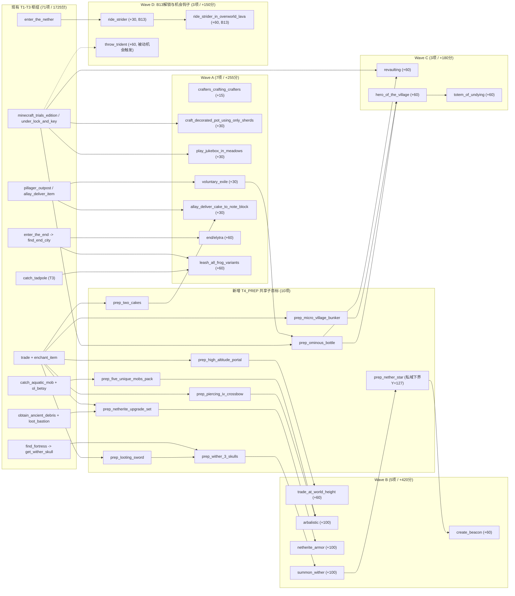

# 14 · T4 精选扩展、联网机制交叉审计与子目标架构规划（Stage 3）

> **编制日期**：2026-11-19 · **规划基线**：`6a4b0f5` → **Stage 3 落地基线**：`feat/arch-converge-v2-agy`（`d746035`）
> **目标版本**：Minecraft Java Edition **1.21.11** · **接口规范**：[API v1.3.11](99-原始记录/api-spec-v1.3.11.md) · **赛事规则**：虚空岛单人独立主世界/下界 + 全服共用已屠龙末地 + 单局 8 小时 + 比赛期 2 路推理并发。
> **Stage 3 落地总览（2026-11-19）**：Wave A–D 共 **18 项 T4 技能**、**6 个 `<400` 行技能模块**、**10 项 `T4_PREP` 节点**与 **4 个新子目标谓词**已全部离线落地并合入本分支，台账升至 **79 技能（4 `live` + 75 `offline`）/ 104 目标（89 / 99 计分项 / 2,730 分上限 [80.6%]）**，全仓 **1,421/1,421** Python 单测 + **11/11** Node 单测全绿；Step 0 `T4-P1..P4` 已在 `local-target` Vanilla 1.21.11 实测通过（`T4-P2` 确认自搭服 `hard` 刷怪正常，B13 已按条件双路径落地、待官方 1 步复核），且 `crafter_chain`/`ride_strider_boost`/`jukebox_meadow` 完成 `local-target` 3/3 真进度解锁冒烟（脱敏归档 `results/probe/`）。
> **关联文档**：[04-待确认.md](04-待确认.md)、[11-任务性价比分层.md](11-任务性价比分层.md)、[13-得分目标脚本与子目标规划.md](13-得分目标脚本与子目标规划.md)、[06-工作日志.md](06-工作日志.md)。

---

## 一、完成度演进：Stage 2 基线 vs Stage 3 落地状态

| 维度 | Stage 2 基线（规划前） | **Stage 3 落地状态（当前）** |
|---|---|---|
| **代码实现与离线验收** | `GOALS` 76 项（71/99 计分项 = 1,725 分）；`61` 技能；`1,275` Python 单测 | **Wave A–D 全部离线落地**：`GOALS` **104 项**（**89 / 99 计分项 = 2,730 / 3,385 分 [80.6%]**，含 10 项 `T4_PREP` 与 5 项 `T0_PREP`）；`skills.REGISTRY` **79 个**技能（含 6 个 `<400` 行 T4 模块 + 4 个新活谓词）；全仓 **`1,421 / 1,421`** Python 单测 + **`11 / 11`** Node 桥单测全绿 |
| **真机晋级态** | `4 live + 57 offline`；`6 graduated + 1 candidate + 69 draft` | **`4 live + 75 offline`**（`gather_wood`、`mine_stone`、`craft_gear`、`emergency_escape` 保持 `live`，其余 **75** 项如实标 `verified="offline"`）；台账 **`6 graduated（10 分）+ 1 candidate（smelt_iron，5 分）+ 97 draft`**；B13 `ride_strider_boost` 落地为条件双路径（`/use_item` 优先，返 `cannot_use` 回退 `/move_to`），待官方 1 步复核 |
| **未实现计分项（10 项 / 655 分）** | 25 项原 T4 + 3 项排除项（28 项 / 1,660 分） | 仅保留 **10 项明确放弃（655 分）**：`all_effects`(100)、`all_potions`(100)、`create_full_beacon`(100)、`uneasy_alliance`(100)、`two_birds_one_arrow`(60)、`froglights`(60)、`feed_snifflet`(60)、`obtain_sniffer_egg`(30)、`plant_any_sniffer_seed`(30)、`salvage_sherd`(15) |

### 服务端难度现状核查

- **正式比赛服**：按赛事规则草案与 [04-待确认.md](04-待确认.md) A16，**难度与 gamerule 赛前公布**，当前尚未官宣。
- **官方校园网模拟服（`survivaltest`）实测旁证**：2026-11-19 官方脱敏探针 [pathfinding-official-20261119.json](../results/probe/pathfinding-official-20261119.json) 记录无护甲 Bot 遭僵尸近战命中单次掉血 `damage=3`（`health: 20 -> 17`），在 Java 版中严格对应 **`Normal`（普通）难度**（Easy=2.5、Normal=3.0、Hard=4.5）。该难度下袭击第 5 波正常刷新唤魔者，支持 `totem_of_undying`。
- **队内自搭靶场（`local-target`）**：已由 **`T4-P2`（2026-11-19）实测关闭**（脱敏证据 [t4-p2-local-check-20261119.json](../results/probe/t4-p2-local-check-20261119.json)）——确认自搭服为 Vanilla `1.21.11` **`hard`** 难度（`difficultyLocked=false`、`keepInventory=false`），同屏观测 50 实体刷怪正常（苦力怕/骷髅/僵尸/蜘蛛/末影人/鱼/蝙蝠），并同步修复了 `SurveyIsland` 空循环与 `ScoutIsland` Y=67 矿坑脱困阻塞，全通 `gather_wood -> mine_stone -> craft_gear -> smelt_iron -> survey_island`。

---

## 二、1.21.11 机制 × API v1.3.11 交叉审计核心结论

### 1. 六大破局逃课特性（将高难/原阻塞项转化为确定性拿分）

1. **零 GUI 漏斗按序装料破 B11（`crafters_crafting_crafters`，15 分）**：Crafter 配方恰好占满全部 9 格（无需锁空槽），上方漏斗严格按槽 `0 -> 8` 优先填充空槽；API v1.3.11 原生支持 `hopper` 容器与 `/drop`，按序装入 `4×iron_ingot → 1×crafting_table → 1×iron_ingot → 1×redstone → 1×dropper → 1×redstone`，拆漏斗后站 `≤8.5` 格内通红石即触发，**彻底绕过 Crafter GUI 缺失**。
2. **试炼密室饰纹罐直挖陶片破 B12（`craft_decorated_pot_using_only_sherds`，30 分）**：Java 进度判定独立，不强制前置 `salvage_sherd`，且允许 **4 块相同陶片**。用镐敲碎试炼密室饰纹罐即掉 `Flow/Guster/Scrape` 陶片，再用 v1.3.11 原生 `crafting_table` 3×3 `grid` 合成，**彻底绕过刷子长按 B12**。
3. **桶装鱼 + 1 格轴向槽破 `arbalistic`（100 分）**：复用 `catch_aquatic_mob`，将 4 种鱼桶（`cod/salmon/tropical_fish/pufferfish`，均 3 HP）+ 1 只 `tadpole`（6 HP，空手拍 1 下剩 5 HP）或 `chicken`（4 HP）放入 `1×1×5` 直线浅槽，穿透 IV 弩（伤害 6–11，单箭穿 5 实体）严格轴向一发秒杀 5 种不同生物，**零赶怪、高确定性瞬拿 100 分**。
4. **顺序单拴 + 末地/深暗冷群系破 `leash_all_frog_variants`（60 分）**：1.21.x **不要求同时拴 3 只青蛙**，分次用同一根拴绳依次右键 3 种变体即可累计；1.21.6+ 拴绳仅需 5 根线（无需粘液球）；**末地全维度（`#minecraft:is_end`）与深暗之域均属冷群系**可出寒带绿蛙，并读 `/advancements` 子进度校验变体（绕过 `/get_entities` 无变种字段限制）。
5. **漏斗无仇恨抽堡垒模板 + 盔甲匠买钻甲破 `netherite_armor`（100 分）**：无需穿戴（背包齐 4 件即触发）；在宝藏房宝箱下方放漏斗抽取模板**不激怒猪灵**；满级盔甲匠买齐 4 件钻甲省去 24 颗钻石（仅需 21 钻复制 3 张模板 + Y=15 采 16 残骸）。
6. **下界门 3D 锚定直传破 `trade_at_world_height`（60 分）**：流浪商人同样有效；村旁临时门送职业村民进下界 → 拆门 → 玩家独自搭柱至 `Y=314` 建高空门与 `Y=319` 平台 → 下界推回瞬间空降 `Y=315` → 推上 `Y=319` 交易，**零 250 格垂直电梯、零战斗、全难度通用**。

### 2. 四条硬性红线

1. **API B12 硬阻塞**：v1.3.11 无 4.8s 持续右键方块接口，继续阻断 `salvage_sherd` 与嗅探兽 3 项（共 135 分，后两项还叠加 55–68 分钟硬区块加载锁）。
2. **1.21.11 `all_effects` 暴增至 34 种**：新增骑乘驯服鹦鹉螺 `breath_of_the_nautilus`，外加活运潜影贝回主世界、监守者、远古守卫者、潮涌、30s `raid_omen` + 3 瓶不祥，明确放弃。
3. **快乐恶魂不计入 `uneasy_alliance`**：`minecraft:happy_ghast` 不匹配 `minecraft:ghast`；敌对 4×4 恶魂过 6×6 大门 + 防窒息亲杀脆弱度过高，明确放弃。
4. **AIAMC 赛事红线**：末地全服共用且**严禁妨碍他人**，**禁止**在末地返回传送门基岩下卡凋灵——`create_beacon` 必须在**本岛私域下界 `Y=127` 基岩顶层**实施水平卡头窒息陷阱；同时虚空岛**探险家地图不可用**，试炼密室必须沿用 `survey_island` / `discover_structure` 方块指纹扫描。

---

## 三、依赖网状结构图

---

## 四、28 项未实现目标最终分级清单与 Stage 3 落地回填

- **核心已实现（Wave A–C，15 项 / +855 分）**：`1,725 -> 2,580 / 3,385 分（76.2%）`（全部 15 项已完成离线代码与单测落地，标 `verified="offline"`、`stage="draft"`）
- **B13 条件解锁 + 被动机会钩子（Wave D，3 项 / +150 分）**：`T4-P4` 在 `local-target` 实测 `/use_item` 触发耐久 `-1`，`ride_strider_boost` 已按条件双路径（`/use_item` 优先，返 `cannot_use` 回退 `/move_to` 掌舵）离线落地，待官方端点 1 步复核；连同被动三叉戟钩子（`+60` 分），总台账已覆盖 **89 / 99 项、理论上限 2,730 / 3,385 分（80.6%）**
- **明确放弃（10 项 / 655 分）**：`all_effects`(100)、`all_potions`(100)、`create_full_beacon`(100)、`uneasy_alliance`(100)、`two_birds_one_arrow`(60)、`froglights`(60)、`feed_snifflet`(60)、`obtain_sniffer_egg`(30)、`plant_any_sniffer_seed`(30)、`salvage_sherd`(15)。

| 波次 | 目标 ID | 分值 | 注册 L3 技能名 | 所在模块（单文件 <400 行） | Stage 3 落地状态 |
|---|---|---:|---|---|---|
| Wave A | `crafters_crafting_crafters` | 15 | `crafter_chain` | `skills/t4_quick_exploits.py` | **已落地（`offline`）+ `local-target` 真进度解锁（26 步）** |
| Wave A | `craft_decorated_pot_using_only_sherds` | 30 | `decorated_pot_sherds` | `skills/t4_quick_exploits.py` | 已落地（`offline`）+ 空包 `blocked` 通过 |
| Wave A | `play_jukebox_in_meadows` | 30 | `jukebox_meadow` | `skills/t4_quick_exploits.py` | **已落地（`offline`）+ `local-target` 真进度解锁（2 步）** |
| Wave A | `voluntary_exile` | 30 | `sweep_outpost_captain` | `skills/t4_quick_exploits.py` | 已落地（`offline`）+ 空包 `blocked` 通过 |
| Wave A | `allay_deliver_cake_to_note_block` | 30 | `allay_cake_birthday` | `skills/t4_quick_exploits.py` | 已落地（`offline`）+ 空包 `blocked` 通过 |
| Wave A | `elytra` | 60 | `loot_end_ship_elytra` | `skills/t4_end_and_frogs.py` | 已落地（`offline`）+ `T4-P1` 机制 PASS（待官方复核） |
| Wave A | `leash_all_frog_variants` | 60 | `leash_frog_variants` | `skills/t4_end_and_frogs.py` | 已落地（`offline`）+ 空包 `blocked` 通过 |
| Wave B | `trade_at_world_height` | 60 | `trade_world_height` | `skills/t4_arbalistic_and_height.py` | 已落地（`offline`）+ 空包 `blocked` 通过 |
| Wave B | `arbalistic` | 100 | `arbalistic_trench_shot` | `skills/t4_arbalistic_and_height.py` | 已落地（`offline`）+ 空包 `blocked` 通过 |
| Wave B | `netherite_armor` | 100 | `craft_netherite_armor_set` | `skills/t4_nether_endgame.py` | 已落地（`offline`）+ 空包 `blocked` 通过 |
| Wave B | `summon_wither` | 100 | `summon_and_trap_wither` | `skills/t4_nether_endgame.py` | 已落地（`offline`）+ `T4-P3` 模板 PASS（待官方复核） |
| Wave B | `create_beacon` | 60 | `activate_beacon` | `skills/t4_nether_endgame.py` | 已落地（`offline`）+ 空包 `blocked` 通过 |
| Wave C | `revaulting` | 60 | `unlock_ominous_vault` | `skills/t4_ominous_combat.py` | 已落地（`offline`）+ 空包 `blocked` 通过 |
| Wave C | `hero_of_the_village` | 60 | `win_micro_village_raid` | `skills/t4_ominous_combat.py` | 已落地（`offline`）+ 空包 `blocked` 通过 |
| Wave C | `totem_of_undying` | 60 | `trigger_totem_safely` | `skills/t4_ominous_combat.py` | 已落地（`offline`）+ 4 条件受控单次钩子 |
| Wave D | `ride_strider` | 30 | `ride_strider_boost` | `skills/t4_strider_and_trident.py` | **已落地（`offline` 条件双路径）+ `local-target` 真进度解锁（5 步，待官方 1 步复核）** |
| Wave D | `ride_strider_in_overworld_lava` | 60 | `ride_strider_overworld` | `skills/t4_strider_and_trident.py` | 已落地（`offline` 条件双路径，待官方 1 步复核） |
| Wave D | `throw_trident` | 60 | `throw_opportunistic_trident` | `skills/t4_strider_and_trident.py` | 已落地（`offline` 被动机会根门控） |

---

## 五、共享中间子目标（`T4_PREP`）与新谓词规格（均已离线落地）

### 1. 10 项 `T4_PREP` 节点（`goals.py` 扩展 `GOAL_TIERS` 加入 `"T4_PREP", "T4"`，全标 `stage="draft"`）

1. `prep_ominous_bottle`：前哨站清扫或试炼普通宝库（18.6%）获取 `ominous_bottle>=1`（供 `revaulting` + `hero_of_the_village` + `totem_of_undying` 三路共享摊销）。
2. `prep_two_cakes`：Lv.4 农民 6 绿宝石买 2 蛋糕（备选传统合成）+ 1 音符盒。
3. `prep_piercing_iv_crossbow`：图书管理员洗穿透书 + 铁砧合成或 30 级附魔台，获 `piercing>=4` 弩（禁用多重射击）。
4. `prep_five_unique_mobs_pack`：4 桶不同鱼（`cod/salmon/tropical_fish/pufferfish`）+ 1 桶 `tadpole` 或 `chicken`（总唯一生物 ≥ 5）。
5. `prep_looting_sword`：图书管理员/附魔台获 `looting>=3` 剑（将凋灵头掉率从 2.5% 升至 5.5%）。
6. `prep_wither_3_skulls`：要塞十字路口 2 格高门框无伤刷齐 `wither_skeleton_skull>=3` + 4 灵魂沙/土。
7. `prep_nether_star`：本岛私域下界 `Y=127` 基岩顶层水平 T 形卡头窒息杀凋灵取 `nether_star>=1`。
8. `prep_netherite_upgrade_set`：漏斗无仇恨抽堡垒模板 + 21 钻复制 3 张 + 盔甲匠买 4 钻甲 + Y=15 采 16 残骸（接入 `ReservationBook` 防抢钻）。
9. `prep_micro_village_bunker`：平坦无洞区建 1 村民密封石室 + 1 认领床 + 4 格高射击塔 + 钟。
10. `prep_high_altitude_portal`：村旁临时门送职业村民进下界 → 拆临时门 → `Y=314` 建高空门与 `Y=319` 平台 → 下界推回。

### 2. 4 个新子目标谓词（`code/mcagent/loop/subgoals.py`）与观测扩展

- `enchantment_ready(state, item_tag, enchant_id, min_level)`：检查背包武器/弩是否具备目标附魔等级（`piercing>=4` / `looting>=3`）。
- `mob_collection_ready(state, min_unique=5)`：统计背包水生生物桶唯一物种数 + 近场低血量易入槽陆生动物种类数。
- `ominous_ready(state, mode="trial"|"raid")`：校验不祥之瓶数量/等级与护甲/食物/奶桶底仓。
- `advancement_criteria_remaining(state, adv_id)`：读取 `/advancements` 子条件剩余项，精确解决 `/get_entities` 无青蛙变种字段痛点。
- `station_ready._KNOWN_STATIONS` 增补 `anvil`、`smithing_table`、`jukebox`、`note_block`、`crafter`、`beacon`；`WorldResourceMemo` 增补 `meadow`、`swamp`、`mangrove_swamp`、`cold_biome`、`trial_vault_ominous`。

---

## 六、Step 0 靶场探针与实时冒烟验收回填（`local-target`，严格与官方分列）

1. **`T4-P1`（画框掉鞘翅，[t4-p1-item-frame-20261119.json](../results/probe/t4-p1-item-frame-20261119.json)）**：**PASS（本地靶场）**——`/attack(max_hits=1)`（`64.1ms`）与 `/look + /control(hit=true)`（`61.6+56.1ms`）均一次弹出并拾取满耐久 `elytra`，空框留墙，证实技能层必须传 `max_hits=1`；待官方端点复核关闭 B19。
2. **`T4-P2`（自搭服难度与刷怪体检，[t4-p2-local-check-20261119.json](../results/probe/t4-p2-local-check-20261119.json)）**：**PASS**——确认自搭 Vanilla `1.21.11` 为 `hard` 难度且 50 实体刷怪正常；同步修复 `SurveyIsland` 空循环与 `ScoutIsland` Y=67 矿坑脱困卡点后全通 `gather_wood -> mine_stone -> craft_gear -> smelt_iron -> survey_island`。
3. **`T4-P3`（私域下界 `Y=127` 基岩顶窒息模板，[t4-p3-wither-y127-20261119.json](../results/probe/t4-p3-wither-y127-20261119.json)）**：**PASS（本地靶场）**——`3×3` 基岩下水平 T 形召唤即时解锁 `summon_wither`（`place_skull_2` 消耗块返 `place_failed` 属正常），`300 HP` 初爆零漂移（`max_drift_xz=0.0`）并按 `-1.0 HP/s` 稳态窒息；待官方端点复核关闭 `C20`。
4. **`T4-P4`（B13 炽足兽加速探针，[t4-p4-strider-boost-20261119.json](../results/probe/t4-p4-strider-boost-20261119.json)）**：**条件 PASS**——`/use_item(warped_fungus_on_a_stick)` 触发耐久 `100->99` 并解锁 `ride_strider`；代码已按条件双路径（`/use_item` 优先、返 `cannot_use` 回退 `/move_to` 掌舵）离线落地，待官方端点 1 步复核。
5. **Stage 3 实时冒烟（[stage3-local-smoke-20261119.json](../results/probe/stage3-local-smoke-20261119.json)）**：**PASS（`local-target`）**——18 项 T4 技能空包 `blocked` **18/18 拦截**；Vanilla `1.21.11` 实跑 `crafter_chain`（26 步，漏斗排空）、`ride_strider_boost`（5 步，耐久 `-1`）、`jukebox_meadow`（2 步）**3/3 解锁真实游戏进度**。
