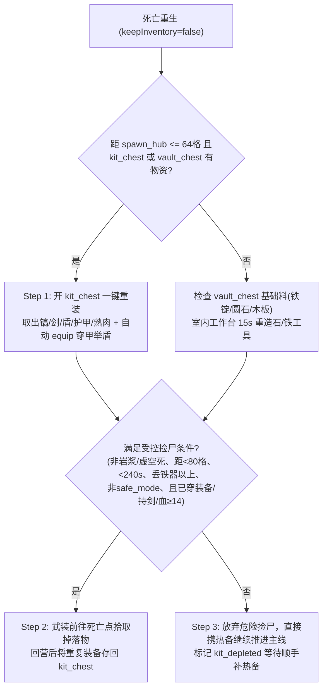

# 15 · 出生点避难所、分级仓库与防清零架构方案（`keepInventory=false`）

> **编制日期**：2026-11-21 · **适用前提**：正式比赛已确认关闭死亡不掉落（`keepInventory = false`，见 [00-赛事事实.md](00-赛事事实.md)、[04-待确认.md](04-待确认.md) A13、[01-关键判断.md](01-关键判断.md) J21）
> **设计基线**：`feat/arch-converge-v2-agy`（Sprint 1 `d47dc26` 之后，面向 Sprint 1.5 / Sprint 2 落地）
> **约束对齐**：NMO API v1.3.11（[api-spec-v1.3.11.md](99-原始记录/api-spec-v1.3.11.md)）、虚空岛单人主世界/下界、[AGENTS.md](../AGENTS.md) §2B / §9 三层抽象与单文件 `<400` 行约束。

---

## 一、为什么必须在「出生点外缘」建避难所与分级仓库？

1. **死亡代价已坐实为「全背包清零」**：A13 已确认正式比赛 `keepInventory=false`，且 2026-11-20 5 小时自搭困难服长跑实证——无基地存箱与避难所时 41 次死亡导致反复退回木器时代（单段重造木镐 10 次、石镐 7 次），5 小时停留在 30 分。
2. **重生引力锚点（B7 实测 49ms 自动回出生点）**：
   - 正常阶段靠睡床绑定重生点；但在开局无床、床被苦力怕炸毁或床位被阻挡时，服务端会在 `49ms` 内把角色自动重生到**世界出生点**。
   - 若把箱子建在离出生点 150 格外的临时矿口，一旦床位失效，角色在出生点空手重生后无法及时重装，夜间守尸极易引发 60s 3 死（5 分钟停赛惩罚，J3）。
   - 因此主仓库与避难所必须建在**紧贴出生点保护区外缘（距首次出生点 `12–28` 格）的干燥实心陆地**：无论床是否生效，重生后 **3–8 秒内（≤25 格）** 即可触达应急重装箱。
3. **防苦力怕炸箱与防床边刷怪（A16 未知 `mobGriefing` 按最坏情况防御）**：
   - 露天箱子与露天床在夜晚极易遭苦力怕近身引爆（炸毁箱子+存货+床）或因 8 格内有怪导致 `sleep_in_bed` 失败（5h 长跑中出现 4 次）。
   - 最小化 **圆石封闭避难所（5×5 外框、3×3×3 净空、火把照明 ≥8 级）** 仅耗 ~45 圆石，即可同时提供：① 圆石防爆抗性（6.0）护箱护床；② 室内绝对不刷怪；③ 夜晚可安全合成、冶炼、补粮、下主矿井与度过 `safe_mode` 65s 冷却。

---

## 二、选址算法（自动绕开 `protected_region` 与虚空边缘）

严格遵守 §2B.1 禁硬编码坐标，所有选址在开局首分钟内由代码当场观测生成并原子落盘至 `WorldResourceMemo`：

1. **锚定 `spawn_pos`**：主循环首次 `ready=true` 采样主世界脚底坐标写入 `WorldResourceMemo.set_spawn(pos, dimension="overworld")`（单局不变，重启复读）。
2. **保护区外缘环带探测**：
   - 以 `spawn_pos` 为圆心，按半径环带 `r ∈ (10, 14, 18, 22, 26, 32)`、8 方位扫描候选中心 `(cx, cy, cz)`；
   - 剔除落在 `PROTECTED_ZONES`（动态记录任何触发 `protected_region` 的坐标，半径 +6 格）或距已探虚空边缘 `< 12` 格的候选点；
   - 校验 `5×5` 地基下方为实心承重块（非水、非岩浆、非树叶、非空洞），且地表高度起伏 `<= 1` 格（最多顺手清 3–6 格表土/杂草，不耗时削山）。
3. **试放确认（Live Placement Probe）**：
   - 首个放置 `crafting_table` 或 `chest` 若返回 `protected_region`，立即记录保护区并外移下一环带（`+6` 格）重试，直至 `get_block` 确认方块落位，锁定为本局唯一 `spawn_hub` 坐标。

---

## 三、基地三级演进蓝图（不拖慢开局，随阶段自动升级）

| 阶段 | 触发时机 | 建设内容 | 预计耗时 / 耗材 | 核心收益 |
|---|---|---|---|---|
| **Tier 0：出生点急救营地** | 拿到 `stone_pickaxe` + `furnace` 且拥有 ≥8 木板（或 ≥2 原木）时（开局 **2–4 min**） | 选定 `spawn_hub`，紧邻摆放 `crafting_table` + `furnace` + **1 号应急箱 `kit_chest`**；顺手把多余圆石/原木/首批铁锭存底 | ~15–25s<br/>8 木板（1 箱） | **立即可存可取**；彻底解决 Sprint 1 `setup` 未自动触发的问题 |
| **Tier 1：圆石防爆避难所 + 室内矿井口** | 持有 ≥48 圆石（或首轮采石/采铁回营前，开局 **5–12 min**） | 围建 **5×5×4 圆石掩体**（3×3×3 净空室内）+ 顶封 + 1×2 入口门（`oak_door` 或临时 2 格圆石封口）+ 室内 2 火把 + 室内放床绑定重生点 + 角落留 1×2 地板直通持久化主斜井（Sprint 2 `mine_shaft.py`） | ~45–60s<br/>~48 圆石、6 木板（门）、2 火把 | 防苦力怕炸箱炸床；彻底解决“床边有怪睡不了”；夜晚不出门即可在室内安全冶炼/合成/下矿；`safe_mode` 65s 冷却有绝对安全屋可躲 |
| **Tier 2：三区分级仓库 + 下界门碉堡箱** | 首次铁器全装成型（累计 ≥18 铁）或开箱满槽 `>= 20/27` 格时（**25–40 min+**） | 室内扩为 **3 只专职箱**（`kit_chest` / `vault_chest` / `bulk_chest`，均留顶部 1 格空气保证可开窗）+ 补 1 台高炉/烟熏炉；进入下界后在传送门旁同步建 3×3 圆石防恶魂碉堡 + `nether_portal_depot` 应急箱 | ~30s<br/>16 木板（2 箱）+ 下界 ~36 圆石 | 消除 27 格单箱爆仓；重生只开 1 箱 5 秒重装；高价值钻/黑曜石/烈焰棒/图腾物理隔离不丢失；下界阵亡防门灭裸过 |

### 避难所最小几何布局（俯视图 5×5，高度 `y..y+3`）

```text
y+0 地板层（实心圆石/原地表，M 为室内直通主斜井入口）
y+1 设施层 / y+2 净空层（箱子上方必须为 AIR，保证原版可开箱）/ y+3 圆石封顶

  C  C  C  C  C      C = 圆石防爆墙（y+1, y+2, y+3 全封）
  C [K][V][B] C      K = kit_chest（应急重装箱，上方 AIR）
  C [F] . [T] C      V = vault_chest（战略金库，上方 AIR）
  C [W][R][M] C      B = bulk_chest（大宗建材杂物箱，上方 AIR）
  C  C [D] C  C      F = furnace（熔炉/高炉）  W = crafting_table
                     T = bed（两格床，放于墙角或贴墙）  R = 室内火把（插墙面 y+2）
                     M = 主斜井入口（可加活板门或 1 格门槛防坠）
                     D = 1×2 入口门（oak_door；无门或紧急避险时 2 格圆石封口）
```

**API v1.3.11 物理兼容关键点**：
- **箱子顶部净空**：每个箱子 `y+2` 必须为 `AIR`（顶板在 `y+3`），避免原版实体块压顶打不开窗口。
- **单箱间隔优先**：`kit_chest`、`vault_chest`、`bulk_chest` 放独立坐标（或中间隔熔炉/工作台，防止自动合成大箱改变窗口槽位语义），三者各自是标准 27 格 `generic_9x3`，完全复用现有 `windows.py` 契约。
- **入口兼容寻路**：常规进出经 `oak_door`（`/interact` 开关）；若 `safe_mode` 或贴脸追击逃入避难所，直接在门口内侧放置 2 格圆石封门（复用 Sprint 1 矿道封堵原语）。
- **箱子上方绝不放床/熔炉**；所有设施均在 3×3 室内，角色站中心 `.` 时眼距 ≤ 2.5 格，**零走位即可同时触达全部箱子、工作台、熔炉与床**！

---

## 四、三区仓库分类规则与随身配额策略

### 1. 仓库分区清单（写入 `WorldResourceMemo.camps[dim]`）

| 箱子角色 | 存放内容 | 存取原则 |
|---|---|---|
| **`kit_chest`（应急重装箱）** | **热备战斗/生存套（目标恒定保留 1–2 套）**：铁镐/石镐、铁剑/石剑、盾牌、铁甲（胸甲/靴/头盔/护腿）、熟肉（≥16 份）、圆石 ×64、原木 ×16、火把 ×16、水桶 ×1 | **最高优先级**：首次铁器成型后主动制作 1 套热备存入；每次重生空包优先开此箱一次性取齐并**立即穿甲持盾** |
| **`vault_chest`（战略金库）** | **高价值不可丢资产**：富余 `iron_ingot` / `raw_iron`、`diamond`、`gold_ingot`、`obsidian`、`lapis_lazuli`、`redstone`、`emerald`、`blaze_rod`、`ender_pearl`、`wither_skeleton_skull`、`totem_of_undying`、`netherite_upgrade_smithing_template`、`ancient_debris`、附魔书 | **宁早存勿晚存**：身上达标立即回存；需要合成/附魔/建门/下界前按需定量取出 |
| **`bulk_chest`（建材杂物箱）** | 多余圆石、深板岩、泥土、沙砾、煤炭、木板、线、骨头、箭、皮革、羊毛、种子、多余工具与战利品 | 背包空格 `<= 4` 时一键卸货，防 `inventory_full` 漏捡钻石/烈焰棒/图腾 |

### 2. 随身携带配额（Carry Quota）与强制回存触发条件

- **常态随身保留（不存进箱子，确保野外续航）**：
  - 工具武器：最优镐 ×1、最优剑 ×1、最优斧 ×1（如有）、盾牌 ×1、已穿戴护甲 ×1 套、水桶 ×1；
  - 消耗品：熟食 `12` 份（上限 `16` 份，超出存 `kit_chest`）、垫路圆石 `64` 个、原木 `8` 个、煤炭 `8` 个、火把 `16` 个、随身应急 `iron_ingot <= 4`（超出存 `vault_chest`）；
  - 特殊任务所需物资：若已被 `ReservationBook` 为当前活跃目标预留（如正在带 10 黑曜石建下界门），**`deposit` 必须尊重预留清单，绝不把正在用的黑曜石/钻石存回箱子导致死循环！**
- **主动回营存仓触发条件（任一满足且距营地 `<= 96` 格、非紧急脱险时触发）**：
  1. 携带未预留高价值物：`diamond >= 2` 或 `obsidian >= 4` 或 `iron_ingot >= 10` 或 `raw_iron >= 12` 或 `blaze_rod >= 2` 或 `ender_pearl >= 4` 或 `totem_of_undying >= 2`；
  2. 背包空闲槽位 `<= 4`（防满包丢掉落物）；
  3. 距营地 `<= 32` 格且持有热备缺口物资（例如 `kit_chest` 尚缺备用镐/剑/盾/熟肉且背包有多余）。

### 3. 重生恢复三步状态机（彻底杜绝「裸装捡尸 60s 3 死」）



**关键安全红线**：
- 绝不在空手无食物状态直接去捡尸！必须先过 Step 1（从 `kit_chest` 拿剑+食物+护甲/盾，或至少备齐石剑+食物），否则在怪群中裸奔捡尸必然触发第 2/3 死。
- 若死亡发生在 `safe_mode` 冷却期，先躲入 Tier 1 避难所室内（门关/封口）原地重装与合成，待 65s 冷却结束后再出营。

---

## 五、与 Sprint 1 现有代码的衔接与 Sprint 1.5 落地清单

经 2026-11-21 独立代码验收，Sprint 1 离线门禁全绿（`1,561 / 1,561`），但发现以下 4 项必须在真机验收前修补的缺口，可与本方案一并在 **Sprint 1.5** 收口：

1. **打通出生点建营自动触发（修复 Sprint 1 缺口 #1）**：
   - 在 `WorldResourceMemo` 增加 `spawn_pos`、`shelter_tier`（`0/1/2`）与多角色箱坐标（`chests: {"kit": ..., "vault": ..., "bulk": ...}`，向后兼容旧 `chest` 单字段）；
   - 在 [policy.py](../code/mcagent/loop/policy.py) `choose_proactive_survival()` 补入 **Tier 0 自动建营触发**（持有石镐+熔炉+木料且尚未建营时自动调 `manage_camp_chest(mode="setup")`）与 **Tier 1 避难所自动升级触发**（持有 ≥48 圆石且距营地近时调用新技能 `build_spawn_shelter`），使整套存/取箱链路在新局冷启动真正激活。
2. **修复烤肉无等待轮询（修复 Sprint 1 缺口 #2）**：
   - 修复 [survival_food.py](../code/mcagent/skills/survival_food.py) `_cook_raw_meat()`：装炉后登记 `FurnaceLease`（`lease_book_for(state)`）或按 `2.0s` 间隔有界轮询至熟肉产出；且即使背包 `raw_meat_count == 0`，若营地熔炉存在就绪熟肉租约也会主动取回，杜绝熟肉遗弃炉内。
3. **补齐取箱重装、取基础料、自动穿甲与防保护区（修复 Sprint 1 缺口 #3）**：
   - [camp_base.py](../code/mcagent/skills/camp_base.py)：`deposit` 接入 `ReservationBook` 排除活跃目标预留物资；`withdraw` 缺成品时允许取 `iron_ingot`/`cobblestone`/`planks`/`coal` 重造基础装，并在取出护甲/盾牌后立即调用 `ex.equip` 穿戴到位；所有 `ex.move_to` 统一带 `timeout=30.0, retries=0`；放箱捕获 `protected_region` 自动记录 `PROTECTED_ZONES` 并外迁选点。
4. **修补盾牌快路径与下界/末地止损收紧（修复 Sprint 1 缺口 #4 + 兑现 `docs/11` §八）**：
   - `policy.py` 盾牌快路径计入 `total_planks(state) + total_logs(state) * 4 >= 6` 并先拆板再合盾；烤肉快路径增加燃料检查；
   - 按 A13 `keepInventory=false` 与 `docs/11` §八，对 `goals.py` 中下界/末地高风险目标检查并收紧止损预算，并在入下界前强校验营地留有热备套。

---

## 六、Sprint 1.5 验收标准（`verified: offline` → `local-target` 30–60 分钟实跑）

1. **离线单测**：新增覆盖「冷启动自动建 `spawn_hub` 绕开保护区 → Tier 1 圆石避难所建造与火把照明 → 烤肉 `FurnaceLease` 取回 → 预留物资不被误存 → 死后开 `kit_chest` 取装并自动穿甲持盾 → 再武装捡尸」全链 `drive()` 单测，全量 `unittest` 零回归。
2. **自搭困难服 30–60 分钟实跑验收**：
   - 开局 5 分钟内自动建成 `spawn_hub` + `kit_chest`，12 分钟内建成圆石避难所；
   - 烤肉稳定入包（熟食底仓 ≥ 12，不再遗弃炉内）；
   - 人为/自然触发死亡后，在 60 秒内完成开箱重装（穿甲持盾）并继续推进，不再退回木镐循环；
   - 60 分钟死亡次数 `<= 2`，总分突破 **70–100+ 分**（打通 `smelt_iron`、`iron_tools`、`obtain_armor`、`sleep_in_bed`、`deflect_arrow`、`lava_bucket` 等）。
